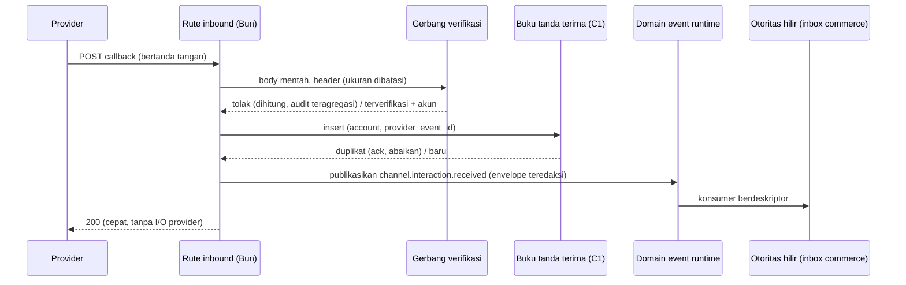

🇮🇩 Bahasa Indonesia · 🇬🇧 [English (source)](0150-inbound-omnichannel-events-enter-as-verified-redacted-envelopes-with-no-generic-interactions-store.md)

<!-- i18n-source-hash: sha256:8f5632ae42e9b915981691537f49162be4467cf174e863e6fc7240076ebfec1a -->

# ADR-0150 — Event masuk omnichannel masuk sebagai envelope terverifikasi dan teredaksi; tidak ada store interaksi generik yang diadmisi

- **Status:** Diusulkan
- **Tinjauan:** menjadi Diterima setelah maintainer meninjaunya. Issue #1164 (implementasi inbound pertama) dan semua issue lain yang bergantung pada inbound tetap terblokir sampai saat itu. Hanya dokumen: tidak ada di sini yang menjadi bukti bahwa konektor inbound mana pun berfungsi.
- **Tanggal:** 2026-10-27
- **Pengambil keputusan:** ahliweb (menunggu tinjauan maintainer)
- **Menyelesaikan:** Issue #1144 (batas admisi percakapan inbound dan webhook). Ini adalah "batas interaksi inbound" (C4) yang oleh [ADR-0148](0148-omnichannel-foundation-is-five-gated-capabilities-with-fail-closed-per-account-capability.id.md) §1 dan §9 diserahkan kepada issue ini.
- **Memperluas, tidak menggantikan:** [ADR-0148](0148-omnichannel-foundation-is-five-gated-capabilities-with-fail-closed-per-account-capability.id.md) (invarian §2 I1 sampai I13, default §6, matriks §3). Ia **mematuhi ketiga belas invarian** dan tidak menyimpang dari default §6 mana pun. [ADR-0133](0133-generic-delivery-capability-whatsapp-promotion.id.md) dan [ADR-0139](0139-cross-channel-notification-orchestration-not-admitted.id.md) (tanpa fasad, tanpa fallback), [ADR-0134](0134-descriptor-declared-domain-event-consumers.id.md) (konsumer event), [ADR-0140](0140-telegram-delivery-adapter-ops-staff-alerts-only.id.md) (satu-satunya webhook terverifikasi yang ada; Telegram staf tidak berubah), [ADR-0094](0094-a-data-subject-is-answered-per-tenant.id.md) (jawaban subjek data per tenant).
- **Terkait:** Issue #1139, #1140 (registri akun), #1153 (event situs), #1155 dan #1156 (bot Telegram pelanggan), #1152 (platform tambahan), #1164 (implementasi inbound pertama), #1168 (gateway realtime); hilir `ahliweb/awcms-one` #458, #460 dan inbox commerce-nya; paket kesiapan [`docs/awcms/omnichannel-foundation.id.md`](../awcms/omnichannel-foundation.id.md) §2.4, §3, §5 dan §11.

**Hanya dokumen dan tata kelola.** ADR ini tidak menambah modul, tabel, migrasi, rute, path OpenAPI, kanal AsyncAPI, dependensi, atau panggilan provider. Penerimaan berarti **batas diadmisi**; setiap issue implementasi tetap melewati Definition of Ready-nya sendiri dan tinjauan keamanan modul sensitif (webhook, kredensial).

## Konteks

Terverifikasi di `main` pada 27 Oktober 2026:

- Webhook inbound **satu-satunya** di repositori ini adalah milik Telegram: `src/pages/api/v1/telegram/webhook.ts`, dijaga `verifyWebhookSecret` (perbandingan waktu-konstan dua digest SHA-256 terhadap `TELEGRAM_WEBHOOK_SECRET`, dijalankan sebelum body dibaca), pembatas laju per chat yang baru dibangun setelah secret terverifikasi, dan satu baris audit `warning` teragregasi per menit untuk penolakan (ADR-0140 §7 dan §9). Ia melayani binding **staf**, bukan percakapan pelanggan, dan berlaku se-deployment (satu bot).
- `whatsapp_delivery` hanya outbound. Tidak ada rute inbound, verifikasi tanda tangan, atau ingesti status pengiriman; "accepted" dari provider bukan "delivered" (ADR-0148 §4).
- `SocialPublishingPort` adalah port outbound; modul `social_publishing` belum ada. `email` outbound dengan suppression; provider-nya tidak punya callback terverifikasi (lihat #1158 dan ADR-0151).
- `domain_event_runtime` menyediakan konsumer berdeskriptor (ADR-0134). `sync-storage/domain/sync-hmac.ts` dan guard Telegram adalah dua idiom verifikasi yang ada; **tidak ada helper verifikasi inbound bersama**.
- `commerce` di `awcms-one` hilir sudah memiliki pelanggan, persetujuan, segmen, dan **inbox**. Semantik percakapannya (pesanan, thread dukungan) berbeda dari thread DM sosial.
- ADR-0148 §6 mencatat default: **tidak ada store percakapan generik di hulu**; envelope domain-event teredaksi yang unik pada `(account, provider_event_id)`; inbox commerce adalah otoritas percakapan di hilir; tidak ada balasan di kanal selain tempat pesan masuk; tautan kontak hanya lewat `contact_link_evidence` dengan daftar metode deterministik tertutup; provider tanpa autentikasi webhook yang dapat diverifikasi digerbangi atau ditunda.

Yang belum jelas: apakah modul `interactions` generik (thread, pesan, reaksi, komentar) memang diperlukan, berapa state persisten minimum untuk perlindungan replay, dan dukungan inbound per platform. API outbound suatu provider tidak menyatakan apakah ia menawarkan pesan masuk: API TikTok, LinkedIn, dan YouTube **tidak** menyiratkan akses DM, dan data anggota LinkedIn Community Management dilarang untuk pembuatan dan pengayaan lead CRM (ADR-0148 I7 dan §8).

## Keputusan

### 1. Tidak ada modul `interactions` generik yang diadmisi

AWCMS hulu **tidak** mendapat store percakapan, thread, pesan, reaksi, atau komentar. Event masuk dinormalisasi oleh **adapter terverifikasi per kanal** menjadi envelope teredaksi §3 dan dipublikasikan sebagai domain event; otoritas percakapan hilir (inbox `commerce` di `awcms-one`, atau modul milik deployment) mengonsumsinya lewat event atau port yang disahkan. "Inbox terpadu" adalah **proyeksi khusus presentasi** yang dihitung dari event itu dan data otoritas sendiri; ia bukan sumber kebenaran dan tidak pernah menulis.

Ini mengikuti default ADR-0148 §6 tanpa penyimpangan. Alasannya ada di Opsi di bawah; singkatnya, store di sini akan menduplikasi otoritas hilir, menyimpan isi pesan pihak ketiga yang tunduk pada batas caching dan penghapusan per platform, dan mengembalikan fasad lintas-kanal yang ditolak ADR-0139.

**Pemicu buka-ulang** (salah satu membenarkan ADR baru, tidak ada yang terpenuhi hari ini): dua konsumer atau lebih di repositori ini membutuhkan state percakapan persisten yang sama dan tidak dapat memperolehnya dengan mengonsumsi envelope; sebuah platform mensyaratkan thread yang dipegang server agar dapat membalas dengan benar; atau inbox commerce berhenti menjadi otoritas.

### 2. Yang dipersistenkan di hulu: buku tanda terima, bukan percakapan

Perlindungan replay butuh kunci unik, sehingga satu baris **tanda terima inbound** minimal diadmisi di dalam bidang kendali akun (C1, #1140), bukan di modul baru: `tenant_id`, `channel_account_id`, `provider_event_id`, status tanda terima (`received` / `published` / `rejected`), `occurred_at`, `received_at`, `payload_hash`, `correlation_id`. **Tanpa isi pesan, tanpa alamat pengirim, tanpa media**. Unik pada `(channel_account_id, provider_event_id)` dengan RLS `FORCE`; retensinya dibatasi (usulan default di Pertanyaan terbuka Q3) dan dideklarasikan dalam deskriptor `data_lifecycle` pada migrasi yang membuatnya (I12). Ini adalah buku dedupe dan jangkar audit. Apa pun yang lebih kaya adalah data otoritas hilir.

### 3. Envelope kanonik

Dipublikasikan sebagai domain event `channel.interaction.received` (sudah dinamai di garis besar §9 paket), teredaksi sejak desain:

| Field                      | Aturan                                                                                                                                                                                    |
| -------------------------- | ----------------------------------------------------------------------------------------------------------------------------------------------------------------------------------------- |
| `tenant_id`                | Diselesaikan dari akun tersimpan milik langganan terverifikasi, **tidak pernah** dari payload atau parameter request.                                                                     |
| `channel_account_id`       | Baris akun hulu; bagian dari kunci idempotensi.                                                                                                                                           |
| `provider`, `event_kind`   | Enum tertutup: `message`, `comment`, `reaction`, `status`, `membership`, `form_submission`. Event `status` (delivered/read/bounce) bukan konten dan tidak dapat mengubah state pelanggan. |
| `provider_event_id`        | Id event atau update provider; untuk Telegram `update_id` **dicakup per `bot_identity`**, tidak pernah global.                                                                            |
| `provider_conversation_id` | Id thread atau chat provider (Telegram `chat_id` beserta tipe chat), dicakup per platform.                                                                                                |
| `sender`, `recipient`      | Id berlingkup platform, bukan nomor telepon atau alamat email kecuali platform itu sendiri memakainya sebagai id; bila demikian dikirim termasker dengan hash berkunci untuk pencocokan.  |
| `privacy_class`            | `contact` / `content` / `status`; konsumer menentukan retensi darinya.                                                                                                                    |
| `occurred_at`              | Waktu provider bila ada, selain itu `received_at`; tidak pernah dipakai sebagai kunci replay.                                                                                             |
| `provenance`               | Cara verifikasi: `hmac_signature`, `secret_header`, `challenge`, `first_party_token`. `unauthenticated` **bukan nilai yang sah** untuk event konten (I9).                                 |
| `correlation_id`           | Dibuat saat diterima; mengalir lewat audit, event, dan hilir.                                                                                                                             |
| `content_ref` (opsional)   | Referensi berumur pendek dan berlingkup tenant untuk isi pesan, bukan isinya. Pertanyaan terbuka Q4 menentukan apakah isi pesan ikut dikirim sama sekali.                                 |

Envelope membawa id dan kode. Ia tidak pernah membawa token, tanda tangan, header mentah, atau body mentah (I3, I11).

### 4. Gerbang verifikasi, dibagi sebagai pustaka, bukan modul

Setiap rute inbound adalah empat langkah yang sama, **dalam urutan ini**, sebelum pekerjaan database apa pun: (1) batasi ukuran body dan baca mentah; (2) verifikasi provenance dengan mekanisme resmi provider memakai perbandingan timing-safe, terhadap secret yang diselesaikan lewat referensi (I3); (3) selesaikan tenant dan akun dari token callback per-akun yang buram (disimpan ter-hash) dan tolak bila kredensial terverifikasi bukan milik akun itu; (4) terapkan kunci replay §2 dan pembatas laju per akun. Kegagalan di langkah 1 sampai 3 tidak melakukan pekerjaan database dan dihitung, lalu diaudit sebagai **satu baris platform teragregasi per menit** (idiom Telegram ADR-0140 §9), bukan satu baris per request.

Bentuk implementasi: pustaka bersama kecil (nama kerja `src/lib/webhooks/`) yang mengekspor mode verifikasi (`hmac_signature` dengan header dan digest yang dapat dikonfigurasi, `secret_header`, `challenge`), guard tanda terima/replay, dan penghitung penolakan teragregasi. Ia **pustaka**, seperti `field-encryption.ts`, karena tidak memegang data tenant dan tidak butuh izin, rute, atau navigasi. Guard Telegram dipindahkan ke pustaka itu hanya lewat perubahan terpisah di kemudian hari; ADR ini tidak menyentuhnya. Parsing khusus provider tetap di adapter provider.

Provider **tanpa autentikasi yang dapat diverifikasi** berstatus `unverified` atau `restricted` di matriks dan ditangani oleh §6.

### 5. Audit kapabilitas inbound per platform

Matriks v1 (paket §3) adalah otoritasnya; tabel ini adalah pembacaan inbound-nya, diverifikasi ulang terhadap dokumentasi resmi oleh issue implementasi (setiap sel yang belum terverifikasi ditolak). "Mekanisme" adalah yang dijelaskan dokumentasi resmi provider; kode AWCMS untuk semuanya belum ada kecuali webhook staf Telegram.

| Platform / jenis akun                     | Konten inbound                                                                                                 | Mekanisme verifikasi resmi                                                      | Status di ADR ini                                                                                                                             |
| ----------------------------------------- | -------------------------------------------------------------------------------------------------------------- | ------------------------------------------------------------------------------- | --------------------------------------------------------------------------------------------------------------------------------------------- |
| WhatsApp Cloud API (Meta)                 | Pesan dan status                                                                                               | HMAC `X-Hub-Signature-256` dengan app secret; challenge GET dengan verify token | `candidate`; konsumer pertama (#1164)                                                                                                         |
| Facebook Page                             | Pesan Messenger, komentar                                                                                      | Tanda tangan dan challenge Meta yang sama                                       | `candidate`; butuh app review per scope                                                                                                       |
| Instagram Professional                    | DM, komentar (lewat platform Meta)                                                                             | Tanda tangan dan challenge Meta yang sama                                       | `candidate`; hanya akun profesional; jendela layanan berlaku untuk balasan                                                                    |
| Bot Telegram (lingkup pelanggan)          | Chat privat, grup, kanal, update anggota dan chat-member; koneksi **Business** sebagai kelas update tersendiri | Header `secret_token` per bot yang diatur saat registrasi webhook               | `candidate` (#1155/#1156); **satu langganan terverifikasi per `bot_identity`**, terpisah dari bot staf; tanpa DM dingin; bukti opt-in dicatat |
| Form dan event first-party situs          | Pengiriman form, event first-party                                                                             | Token berlingkup tenant plus challenge anti-abuse (#1153)                       | `candidate`; satu-satunya provenance `first_party_token`                                                                                      |
| StarSender (gateway WhatsApp tidak resmi) | Hanya callback status bila ditawarkan                                                                          | Belum terbukti                                                                  | `unverified`: **digerbangi**, tidak menerima apa pun yang mengubah state sampai terverifikasi atau ditunda                                    |
| Email (Mailketing)                        | Bounce, unsubscribe, open, click, new subscriber                                                               | Tidak ada pada dokumentasi publik yang ditinjau                                 | `restricted`: diputuskan oleh ADR-0151, bukan di sini                                                                                         |
| TikTok, YouTube, Page LinkedIn            | Tanpa DM; paling banyak sinyal komentar/engagement                                                             | Belum terbukti                                                                  | `unverified`; **publikasi dan analitik tidak menyiratkan pesan**. Data anggota LinkedIn dilarang untuk CRM (I7)                               |
| Threads                                   | Balasan                                                                                                        | Belum terbukti                                                                  | `unverified`                                                                                                                                  |
| Platform yang tidak tercantum             | n/a                                                                                                            | n/a                                                                             | Tidak ada sampai #1152                                                                                                                        |

**Batas Telegram (multi-bot).** Setiap bot pelanggan adalah `channel_account` sendiri dan langganan terverifikasi sendiri dengan secret sendiri; `update_id` didedup per `bot_identity`; `chat_id` dan tipe chat (privat, grup, supergrup, kanal) menjadi bagian id percakapan berlingkup platform; koneksi Telegram Business serta update chat-member dan keanggotaan adalah `event_kind` tersendiri, bukan pesan. Proyeksi percakapan pelanggan dipisahkan dari `telegram_delivery` khusus staf, yang tidak berubah. Bot tidak dapat mengirim pesan ke pengguna yang belum memulainya, sehingga tidak ada jalur DM dingin, dan bukti opt-in (`/start` atau form first-party) dicatat sebagai bukti persetujuan.

### 6. Provider tanpa autentikasi yang dapat diverifikasi

Mereka **digerbangi atau ditunda**. Penundaan berarti tidak ada event konten yang diterima. Bila provider hanya menawarkan callback **kelas status** tanpa autentikasi, konektor boleh menerimanya hanya jika semua ini terpenuhi: callback tidak dapat mengubah state pelanggan atau persetujuan; efeknya terbatas pada tampilan status atau penghitung; akun diatribusikan dari token per-akun yang buram, bukan dari payload; event ditandai `provenance: unauthenticated_status` di buku internal saja dan **tidak pernah** dipublikasikan sebagai `channel.interaction.received`; kontrol ukuran body, laju, dan replay §4 berlaku; dan tidak ada suppression, opt-out, atau persetujuan yang dibuat atau dihapus olehnya. Apakah bahkan ini dapat diterima adalah Pertanyaan terbuka Q1. Kerahasiaan URL saja tidak pernah cukup untuk konten yang mengubah state pelanggan (I9).

### 7. Tautan kontak, balasan, dan tanpa penggabungan

- Menautkan kontak platform ke person CRM butuh catatan `contact_link_evidence` (metode, provenance, siapa, kapan, pencabutan) dari daftar **tertutup** di ADR-0148 §6 (pelanggan mengetik pengenal di form first-party; pelanggan membalas pesan yang dialamatkan ke nomor yang mereka berikan). Catatannya hidup di hilir bersama CRM. Tidak ada pencocokan probabilistik atau lintas platform. Akun yang dikelola bukan identitas pelanggan (I7).
- Balasan dikirim **hanya** di kanal dan akun tempat pesan masuk, lewat antrean dan pemeriksaan persetujuan kanal itu sendiri (I4, I5, I8, ADR-0133). Tidak ada balasan tertukar kanal dan tidak ada fallback ke kanal lain. Balasan yang tidak diizinkan oleh jendela provider atau status persetujuan ditolak, bukan dialihkan.
- Publikasi bersifat outbound dan digerbangi persetujuan; pesan bersifat percakapan dan digerbangi consent. Keduanya berbagi akun, tidak pernah antrean atau event.

### 8. Pemakaian ulang inbox commerce, tanpa sistem pelanggan kedua

Hulu mengekspos **akun, pemeriksaan persetujuan, dan envelope teredaksi**. Inbox commerce mengonsumsi `channel.interaction.received` lewat konsumer berdeskriptor atau port yang disahkan (ADR-0011, ADR-0134) dan tetap menjadi otoritas percakapan. Hulu tidak memegang master pelanggan maupun tabel thread. Adopsi hilir mengikuti issue hulu dan sinkronisasi subtree sebagai merge commit (ADR-0148 §10).

### 9. Rekonsiliasi celah, retensi, penghapusan, ekspor, media

- **Celah:** bila provider menawarkan poll terbatas atau API replay event, job rekonsiliasi membaca id event yang terlewat dan memasukkannya lewat gerbang dan buku tanda terima yang sama; bila tidak, celah dicatat sebagai alasan kesehatan pada akun dan tidak pernah dikarang.
- **Retensi:** tanda terima mengikuti §2. Isi pesan tidak disimpan di hulu (§1). Provider yang membatasi lama data boleh di-cache menetapkan batas retensi bagi konsumer hilir; kelas privasi memberi tahu konsumer aturan mana yang berlaku (I12).
- **Penghapusan dan ekspor:** callback penghapusan atau subjek data dari provider, bila ada, adalah inbound terverifikasi berjenis `membership`/`status` yang memicu alur penghapusan hilir; jawaban subjek data per tenant mengikuti ADR-0094. Buku tanda terima tidak membawa data subjek selain id, sehingga menjawab ekspor hanya dengan hitungan dan id.
- **Media:** tidak pernah diambil sinkron saat diterima. Referensi media diambil kemudian lewat `ssrfSafeFetch` dengan host provider yang di-allowlist, batas redirect, batas ukuran dan content-type, serta sniffing magic-byte, disimpan (bila disimpan) lewat media library, tidak pernah inline di event.
- **Runtime:** semua prosesor inbound terverifikasi dan job rekonsiliasi berjalan di bawah runtime Bun yang dipin, sebagai job launch-manifest, bukan layanan khusus Node. Streaming realtime progres teredaksi, bila kelak diadmisi, adalah keputusan #1168 dan bukan jalur ingest.

### 10. Invarian untuk issue hilir (#1164 dan setiap konektor inbound)

N1. Rute inbound **tidak melakukan pekerjaan database** sebelum provenance terverifikasi; penolakan dihitung dan diagregasi, tidak pernah satu baris audit per request.
N2. Tenant dan akun berasal dari langganan terverifikasi, bukan payload; kredensial terverifikasi akun A tidak dapat mengirim event untuk akun B.
N3. Kunci replay adalah `(channel_account_id, provider_event_id)`; milik Telegram dicakup per `bot_identity`; duplikat di-ack dan diabaikan.
N4. Envelope yang dipublikasikan memiliki field §3 dan tidak ada token, tanda tangan, header mentah, body mentah, atau alamat kontak tak-termasker; tes canary membuktikannya untuk setiap adapter.
N5. `provenance` tidak pernah `unauthenticated` pada event konten; sel `unverified` atau `restricted` tidak menerima apa pun sampai ADR mengadmisi mekanisme.
N6. Tidak ada tabel percakapan, thread, pesan, atau komentar hulu yang dibuat oleh issue inbound; buku tanda terima adalah satu-satunya state inbound persisten dan tidak memuat isi pesan.
N7. Tidak ada balasan di kanal selain kanal kedatangan; tidak ada penggabungan person lintas platform otomatis; tautan hanya lewat `contact_link_evidence` dengan daftar metode tertutup.
N8. Inbound tidak pernah membuat, memperpanjang, atau menghapus persetujuan atau suppression dengan sendirinya; perubahan persetujuan lewat jalur opt-out kanal itu sendiri dengan buktinya sendiri.
N9. Setiap adapter menyertakan fixture-nya: event bertanda tangan valid, body dimanipulasi, secret salah, replay, kredensial lintas-akun, banjir, dan kasus RLS dua tenant; baris matriks tes §11 paket untuk T2, T3, T8 berlaku.
N10. Setiap tabel baru menyertakan deskriptor `subjectData` dan `data_lifecycle`; OpenAPI (rute inbound adalah callback provider yang terdokumentasi) dan AsyncAPI (`channel.interaction.received`) berubah dalam pull request yang sama, dengan cermin Inggris dan Indonesia.

## Opsi yang dipertimbangkan

| Kriteria                 | **B. Envelope teredaksi terverifikasi, hanya buku tanda terima (dipilih)**                      | A. Modul `interactions` generik (thread, pesan, reaksi)                                           | C. Tiap modul kanal menyimpan store inbound-nya sendiri                | D. Agregasi langsung baca-saja, tanpa tanda terima persisten                             |
| ------------------------ | ----------------------------------------------------------------------------------------------- | ------------------------------------------------------------------------------------------------- | ---------------------------------------------------------------------- | ---------------------------------------------------------------------------------------- |
| Keamanan                 | Tidak menyimpan isi pihak ketiga; satu gerbang verifikasi bersama; radius dampak terkecil       | Menyimpan isi pesan dan id kontak semua platform; satu cacat menjangkau semua kanal               | Verifikasi diimplementasi ulang per modul; salinan terlemah menentukan | Tanpa perlindungan replay atau jangkar audit; event yang diputar ulang diproses lagi     |
| Performa                 | Satu insert kunci-unik per event; tanpa I/O isi pesan                                           | Volume tulis besar dan indeks fan-in untuk fitur yang tidak dibutuhkan konsumer hulu              | Sama per kanal, dengan tuning terduplikasi                             | Tanpa biaya tulis, tetapi setiap baca mengenai provider langsung; laju dan latensi bocor |
| Maintainability          | Pustaka plus parsing per adapter; otoritas tetap di tempatnya                                   | Modul besar yang semantiknya harus memuaskan commerce, sosial, dan Telegram sekaligus             | Tiga sampai lima model berbeda untuk konsep yang sama                  | Sederhana sampai kebutuhan riwayat pertama                                               |
| Skalabilitas             | Menambah adapter dan baris matriks, bukan tabel                                                 | Skala sebagai satu store; partisi dan retensi per platform menjadi sulit                          | Skala per modul dengan operasi terduplikasi                            | Dibatasi API baca provider; banyak yang tidak menyediakannya                             |
| Kompatibilitas           | Sesuai ADR-0148 §6 dan inbox commerce yang ada; aditif                                          | Bersaing dengan inbox hilir dan membuat ulang fasad yang ditolak ADR-0139                         | Kontrak per kanal bocor ke konsumer                                    | Kompatibel, tetapi celah tidak dapat direkonsiliasi                                      |
| Kompleksitas operasi     | Satu tabel buku dan satu pustaka; flag per provider                                             | Urusan deployable baru, kebijakan retensi per platform, propagasi penghapusan                     | Banyak buku untuk dipurge dan dipantau                                 | Terendah, sampai insiden butuh bukti                                                     |
| Kepatuhan (UU PDP)       | Minimisasi data: hanya id dan hash; penghapusan adalah alur hilir                               | Store besar konten pribadi; kewajiban caching dan penghapusan per platform jatuh ke repo ini      | Sama, tersebar                                                         | Retensi minimal, tetapi tanpa catatan pemrosesan                                         |
| Implikasi jangka panjang | Store kelak dapat diadmisi lewat ADR bila pemicu buka-ulang (§1) terpenuhi, tanpa utang migrasi | Sulit dihapus setelah konsumer bergantung; menjadi system of record secara tak sengaja (ADR-0055) | Drift; inbound tiap modul menyimpang                                   | Jalan buntu bagi konsumer mana pun yang butuh riwayat                                    |

### Pembacaan kepatuhan

- **UU PDP No. 27/2022.** Envelope dan buku diminimisasi (id, hash, pengenal termasker); persetujuan dan tujuan tetap per kanal (I8); inbound tidak pernah membuat persetujuan (N8); penghapusan dan ekspor dijawab per tenant dan didelegasikan ke hilir tempat isi pesan berada; pemrosesan lintas negara oleh platform adalah pengungkapan pengendali.
- **ISO/IEC 27001:2022 dan 27002:2022.** Autentikasi dan secret (5.17, 8.5), logging dan pemantauan (8.15, 8.16: audit penolakan teragregasi), secure coding (8.28: verifikasi sebelum bekerja), hubungan pemasok (5.19 sampai 5.23: ketentuan webhook provider adalah masukan), penghapusan informasi (8.10), perlindungan PII (5.34).
- **ISO/IEC 27005.** Risiko baru terbesar: event palsu atau diputar ulang (T2, T3, N1 sampai N3), provider tak-terautentikasi diperlakukan tepercaya (I9, §6, Q1), dan isi pesan di-cache melebihi ketentuan provider (dimitigasi dengan tidak menyimpannya di hulu, §1).

## Konsekuensi

- **Positif:** batas diputuskan sebelum kode ada; tidak ada otoritas pelanggan atau percakapan ganda; satu gerbang verifikasi bersama alih-alih salinan per adapter; #1164 punya envelope, kunci, dan daftar fixture yang konkret.
- **Negatif / trade-off:** konsumer yang butuh riwayat harus menyimpannya sendiri; pustaka bersama dan tabel buku harus dibangun sebelum konektor pertama (kecil, dan dapat dipakai ulang); provider tanpa verifikasi tetap ditunda, yang sengaja menunda sebagian kanal.
- **Netral:** tidak ada yang berubah bagi deployment mana pun sampai akun dan langganan terverifikasi ada; webhook staf `telegram_delivery` tidak disentuh.
- **Persetujuan manusia yang masih dibutuhkan (tidak dilakukan di sini):** pengendali atau DPO untuk retensi dan DPIA; pemilik untuk app review Meta dan persetujuan tiap provider; tinjauan keamanan #1164 (webhook dan kredensial) sebelum merge.

## Pertanyaan terbuka untuk maintainer

- **Q1.** Bolehkah callback **kelas status** tak-terautentikasi (misalnya status pengiriman sebuah gateway) pernah diterima di bawah §6, atau setiap provider tanpa autentikasi yang dapat diverifikasi cukup ditunda? Rekomendasi: tunda, dan izinkan bentuk §6 hanya per provider lewat amendemen ADR bernama.
- **Q2.** Apakah pustaka bersama `src/lib/webhooks/` dapat diterima (direkomendasikan), atau tiap adapter menyimpan guard-nya sendiri sampai ada dua?
- **Q3.** Retensi buku tanda terima: rekomendasi 30 hari (cukup untuk jendela retry provider dan rekonsiliasi), dipurge oleh worker data-lifecycle. Apakah kebijakan menuntut batas lain?
- **Q4.** Apakah isi pesan ikut dalam event sama sekali, atau hanya `content_ref` yang ditebus konsumer? Rekomendasi: `content_ref` untuk event kelas `content`, agar retensi tetap keputusan hilir; biayanya satu fetch terotorisasi tambahan.
- **Q5.** Haruskah buku tanda terima berada di `channel_accounts` (direkomendasikan, berbagi model akun dan langganan) atau di modul kecil terpisah?
- **Q6.** Apakah pemilik setuju bot Telegram pelanggan berupa satu langganan terverifikasi per bot (direkomendasikan), yang berarti secret per bot di `channel_secret` alih-alih `TELEGRAM_WEBHOOK_SECRET` deployment?

## Alternatif yang ditolak

- **Store `interactions` generik sekarang.** Menduplikasi otoritas hilir dan menyimpan konten pihak ketiga tanpa konsumer yang membutuhkannya.
- **Memercayai URL rahasia untuk event konten.** Melanggar I9; URL bocor dapat memalsukan pesan pelanggan.
- **Menyimpan isi pesan untuk "inbox terpadu".** Inbox adalah proyeksi; ia tidak butuh jalur tulis.
- **Balasan tertukar kanal dan fallback.** Ditolak ADR-0133, ADR-0139, dan I5.
- **Pencocokan atau pengayaan kontak lintas platform.** Ditolak I7; data anggota LinkedIn dilarang untuk CRM.
- **Layanan inbound khusus Node atau Socket.IO.** Melanggar aturan Bun-only (I10).

## Rencana implementasi (issue terpisah, setelah diterima)

1. #1140 menyediakan akun, langganan, secret, dan tabel buku tanda terima (tinjauan keamanan wajib).
2. Pustaka verifikasi bersama dan skema envelope (callback OpenAPI, AsyncAPI `channel.interaction.received`) dengan fixture.
3. #1164: konektor pertama (WhatsApp Cloud API dan keluarga Meta berbagi tanda tangan dan challenge), lalu #1155/#1156 (bot Telegram pelanggan), #1153 (event situs).
4. Konsumsi hilir (`awcms-one` #458, #460) setelah sinkronisasi subtree merge-commit.
