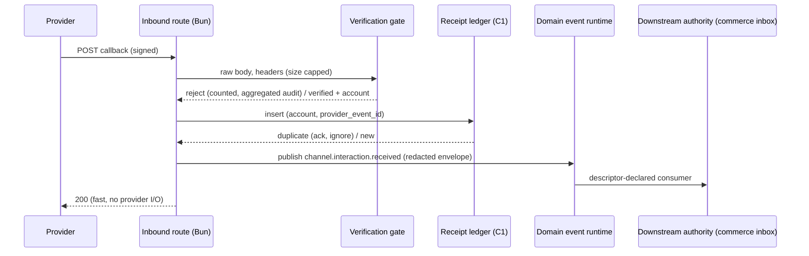

🇬🇧 English (source) · 🇮🇩 [Bahasa Indonesia](0150-inbound-omnichannel-events-enter-as-verified-redacted-envelopes-with-no-generic-interactions-store.id.md)

# ADR-0150 — Inbound omnichannel events enter as verified, redacted envelopes; no generic interactions store is admitted

- **Status:** Proposed
- **Review:** becomes Accepted once a maintainer reviews it. Issue #1164 (the first inbound implementation) and every other inbound-dependent issue stay blocked until then. Docs only: nothing here is evidence that any inbound connector works.
- **Date:** 2026-10-27
- **Decision maker:** ahliweb (maintainer review pending)
- **Resolves:** Issue #1144 (the inbound conversation and webhook admission boundary). It is the "inbound interaction boundary" (C4) that [ADR-0148](0148-omnichannel-foundation-is-five-gated-capabilities-with-fail-closed-per-account-capability.md) §1 and §9 left to this issue.
- **Extends, does not supersede:** [ADR-0148](0148-omnichannel-foundation-is-five-gated-capabilities-with-fail-closed-per-account-capability.md) (§2 invariants I1 to I13, §6 default, §3 matrix). It **conforms to all thirteen invariants** and departs from none of the §6 defaults. [ADR-0133](0133-generic-delivery-capability-whatsapp-promotion.md) and [ADR-0139](0139-cross-channel-notification-orchestration-not-admitted.md) (no facade, no fallback), [ADR-0134](0134-descriptor-declared-domain-event-consumers.md) (event consumers), [ADR-0140](0140-telegram-delivery-adapter-ops-staff-alerts-only.md) (the one existing verified webhook; staff Telegram stays unchanged), [ADR-0094](0094-a-data-subject-is-answered-per-tenant.md) (per-tenant data-subject answers).
- **Related:** Issues #1139, #1140 (account registry), #1153 (website events), #1155 and #1156 (Telegram customer bots), #1152 (additional platforms), #1164 (first inbound implementation), #1168 (realtime gateway); downstream `ahliweb/awcms-one` #458, #460 and its commerce inbox; the readiness pack [`docs/awcms/omnichannel-foundation.md`](../awcms/omnichannel-foundation.md) §2.4, §3, §5 and §11.

**Docs and governance only.** This ADR adds no module, table, migration, route, OpenAPI path, AsyncAPI channel, dependency or provider call. Acceptance means the **boundary is admitted**; each implementation issue still passes its own Definition of Ready and the sensitive-module security review (webhooks, credentials).

## Context

Verified on `main` at 27 October 2026:

- The **only** inbound webhook in this repository is Telegram's: `src/pages/api/v1/telegram/webhook.ts`, guarded by `verifyWebhookSecret` (a constant-time comparison of two SHA-256 digests against `TELEGRAM_WEBHOOK_SECRET`, run before the body is read), a per-chat rate limit built only after the secret verified, and one aggregated `warning` audit row per minute for rejections (ADR-0140 §7 and §9). It serves **staff** bindings, not customer conversations, and it is deployment-wide (one bot).
- `whatsapp_delivery` is outbound only. It has no inbound route, no signature verification and no delivery-status ingestion; a provider's "accepted" is not "delivered" (ADR-0148 §4).
- `SocialPublishingPort` is an outbound port; the `social_publishing` module does not exist. `email` is outbound with suppression; its provider has no verified callback (see #1158 and ADR-0151).
- `domain_event_runtime` provides descriptor-declared consumers (ADR-0134). `sync-storage/domain/sync-hmac.ts` and the Telegram guard are the two existing verification idioms; there is **no shared inbound-verification helper**.
- Downstream `awcms-one` `commerce` already owns the customer, consent, segments and an **inbox**. Its conversation semantics (orders, support threads) differ from a social DM thread.
- ADR-0148 §6 records the default: **no generic upstream conversation store**; a redacted domain-event envelope unique on `(account, provider_event_id)`; the commerce inbox is the conversation authority downstream; no reply on a channel other than the one the message arrived on; contact linkage only through `contact_link_evidence` with a closed deterministic method list; providers without verifiable webhook authentication are gated or deferred.

What is not established: whether a generic `interactions` module (threads, messages, reactions, comments) is warranted at all, what the minimum persisted state for replay protection is, and per-platform inbound support. A provider's outbound API says nothing about whether it offers inbound messages: TikTok, LinkedIn and YouTube APIs do **not** imply DM access, and LinkedIn Community Management member data is barred from CRM lead creation and enrichment (ADR-0148 I7 and §8).

## Decision

### 1. No generic `interactions` module is admitted

AWCMS upstream does **not** gain a conversation, thread, message, reaction or comment store. An inbound event is normalised by a **per-channel verified adapter** into the redacted envelope of §3 and published as a domain event; the downstream conversation authority (the `awcms-one` `commerce` inbox, or a deployment's own module) consumes it through the sanctioned event or port. A "unified inbox" is a **presentation-only projection** computed from those events and the authority's own data; it is never a source of truth and it never writes.

This follows the ADR-0148 §6 default with no departure. The reasons are in Options below; in short, a store here would duplicate the downstream authority, would hold third-party message bodies subject to per-platform caching and deletion limits, and would reintroduce the cross-channel facade that ADR-0139 refused.

**Re-open triggers** (any one justifies a new ADR, none is met today): two or more consumers in this repository need the same persisted conversation state and cannot get it by consuming the envelope; a platform requires a server-held thread to reply correctly; or the commerce inbox stops being the authority.

### 2. What persists upstream: a receipt ledger, not a conversation

Replay protection needs a unique key, so a minimal **inbound receipt** row is admitted inside the account control plane (C1, #1140), not in a new module: `tenant_id`, `channel_account_id`, `provider_event_id`, a receipt state (`received` / `published` / `rejected`), `occurred_at`, `received_at`, `payload_hash`, `correlation_id`. **No message body, no sender address, no media**. Unique on `(channel_account_id, provider_event_id)` with RLS `FORCE`; retention is bounded (default proposed in Open question Q3) and declared in its `data_lifecycle` descriptor in the migration that creates it (I12). It is a dedupe ledger and an audit anchor. Anything richer is the downstream authority's data.

### 3. The canonical envelope

Published as the domain event `channel.interaction.received` (already named in the pack's §9 outline), redacted by construction:

| Field                      | Rule                                                                                                                                                                                |
| -------------------------- | ----------------------------------------------------------------------------------------------------------------------------------------------------------------------------------- |
| `tenant_id`                | Resolved from the verified subscription's stored account, **never** from the payload or a request parameter.                                                                        |
| `channel_account_id`       | The upstream account row; part of the idempotency key.                                                                                                                              |
| `provider`, `event_kind`   | Closed enums: `message`, `comment`, `reaction`, `status`, `membership`, `form_submission`. `status` events (delivered/read/bounce) are not content and cannot alter customer state. |
| `provider_event_id`        | The provider's event or update id; for Telegram `update_id` **scoped by `bot_identity`**, never global.                                                                             |
| `provider_conversation_id` | The provider's thread or chat id (Telegram `chat_id` with chat type), platform-scoped.                                                                                              |
| `sender`, `recipient`      | Platform-scoped ids, never a phone number or e-mail address unless the platform itself uses it as the id, in which case it travels masked with a keyed hash for matching.           |
| `privacy_class`            | `contact` / `content` / `status`; the consumer decides retention from it.                                                                                                           |
| `occurred_at`              | The provider's time where it supplies one, else `received_at`; never used as the replay key.                                                                                        |
| `provenance`               | How it was verified: `hmac_signature`, `secret_header`, `challenge`, `first_party_token`. `unauthenticated` is **not a valid value** for a content event (I9).                      |
| `correlation_id`           | Generated at receipt; threads through audit, event and downstream.                                                                                                                  |
| `content_ref` (optional)   | A short-lived, tenant-scoped reference for the body, never the body. Open question Q4 decides whether bodies travel at all.                                                         |

The envelope carries ids and codes. It never carries a token, a signature, a raw header or a raw body (I3, I11).

### 4. Verification gate, shared as a library, not a module

Every inbound route is the same four steps, **in this order**, before any database work: (1) cap body size and read it raw; (2) verify provenance with the provider's official mechanism using a timing-safe comparison, against a secret resolved by reference (I3); (3) resolve tenant and account from the opaque per-account callback token (stored hashed) and reject if the verified credential does not belong to that account; (4) apply the replay key of §2 and a per-account rate limit. A failure at 1 to 3 does no database work and is counted, then audited as **one aggregated platform row per minute** (the Telegram idiom of ADR-0140 §9), never one row per request.

Implementation shape: a small shared library (working name `src/lib/webhooks/`) exporting the verification modes (`hmac_signature` with a configurable header and digest, `secret_header`, `challenge`), the receipt/replay guard and the aggregated rejection counter. It is a **library**, like `field-encryption.ts`, because it holds no tenant data and needs no permissions, routes or navigation. The Telegram guard is migrated onto it only by a later, separate change; this ADR does not touch it. Provider-specific parsing stays in the provider adapter.

A provider with **no verifiable authentication** is `unverified` or `restricted` in the matrix and is handled by §6.

### 5. Per-platform inbound capability audit

Matrix v1 (pack §3) is the authority; this table is the inbound reading of it, re-verified against official documentation by the implementing issue (every unverified cell is denied). "Mechanism" is what the provider's official documentation describes; AWCMS code for none of these exists today except Telegram's staff webhook.

| Platform / account kind                  | Inbound content                                                                                                      | Official verification mechanism                                                   | Status in this ADR                                                                                                                             |
| ---------------------------------------- | -------------------------------------------------------------------------------------------------------------------- | --------------------------------------------------------------------------------- | ---------------------------------------------------------------------------------------------------------------------------------------------- |
| WhatsApp Cloud API (Meta)                | Messages and status                                                                                                  | `X-Hub-Signature-256` HMAC with the app secret; GET challenge with a verify token | `candidate`; first consumer (#1164)                                                                                                            |
| Facebook Page                            | Messenger messages, comments                                                                                         | Same Meta signature and challenge                                                 | `candidate`; needs app review per scope                                                                                                        |
| Instagram Professional                   | DMs, comments (via the Meta platform)                                                                                | Same Meta signature and challenge                                                 | `candidate`; professional accounts only; service window applies to replies                                                                     |
| Telegram bot (customer scope)            | Private chats, groups, channels, member and chat-member updates; **Business** connections as a distinct update class | Per-bot `secret_token` header set at webhook registration                         | `candidate` (#1155/#1156); **one verified subscription per `bot_identity`**, distinct from the staff bot; no cold DM; opt-in evidence recorded |
| Website first-party forms and events     | Form submissions, first-party events                                                                                 | Tenant-scoped token plus anti-abuse challenge (#1153)                             | `candidate`; the only `first_party_token` provenance                                                                                           |
| StarSender (unofficial WhatsApp gateway) | Status callbacks only if offered                                                                                     | Not established                                                                   | `unverified`: **gated**, accepts nothing that mutates state until verified or deferred                                                         |
| Email (Mailketing)                       | Bounce, unsubscribe, open, click, new subscriber                                                                     | None shown in reviewed public documentation                                       | `restricted`: decided by ADR-0151, not here                                                                                                    |
| TikTok, YouTube, LinkedIn Page           | No DM; comment/engagement signals at most                                                                            | Not established                                                                   | `unverified`; **publishing and analytics do not imply messaging**. LinkedIn member data barred from CRM (I7)                                   |
| Threads                                  | Replies                                                                                                              | Not established                                                                   | `unverified`                                                                                                                                   |
| Platforms not listed                     | n/a                                                                                                                  | n/a                                                                               | Do not exist until #1152                                                                                                                       |

**Telegram boundary (multi-bot).** Each customer bot is its own `channel_account` and its own verified subscription with its own secret; `update_id` is deduplicated per `bot_identity`; `chat_id` and chat type (private, group, supergroup, channel) are part of the platform-scoped conversation id; Telegram Business connections, chat-member and membership updates are distinct `event_kind`s, not messages. Customer conversation projections are kept apart from the staff-only `telegram_delivery`, which stays unchanged. A bot cannot message a user who has not started it, so there is no cold-DM path, and the opt-in evidence (the `/start` or the first-party form) is recorded as consent evidence.

### 6. Providers without verifiable authentication

They are **gated or deferred**. A deferral means no content event is accepted. Where a provider offers only unauthenticated **status-class** callbacks, a connector may accept them only if all of these hold: the callback cannot change customer state or consent; the effect is limited to a status or counter display; the account is attributed from an opaque per-account token, not the payload; the event is flagged `provenance: unauthenticated_status` in an internal-only ledger and **never** published as `channel.interaction.received`; the body size, rate and replay controls of §4 apply; and no suppression, opt-out or consent is created or cleared by it. Whether even this is acceptable is Open question Q1. URL secrecy alone is never sufficient for content that mutates customer state (I9).

### 7. Contact linkage, replies and no merge

- Linking a platform contact to a CRM person needs a `contact_link_evidence` record (method, provenance, who, when, revocation) from the **closed** list in ADR-0148 §6 (customer typed the identifier on a first-party form; customer replied to a message addressed to a number they gave). The record lives downstream with the CRM. No probabilistic or cross-platform matching exists. A managed account is not a customer identity (I7).
- A reply is sent **only** on the channel and account the message arrived on, through that channel's own queue and consent checks (I4, I5, I8, ADR-0133). There is no channel-swapped reply and no fallback to another channel. A reply that is not permitted by the provider's window or consent state is refused, not rerouted.
- Publishing is outbound and approval-gated; messaging is conversational and consent-gated. They share the account, never a queue or an event.

### 8. Reuse of the commerce inbox, no second customer system

Upstream exposes **accounts, consent checks and the redacted envelope**. The commerce inbox consumes `channel.interaction.received` through a descriptor-declared consumer or the sanctioned port (ADR-0011, ADR-0134) and remains the conversation authority. Upstream holds no customer master and no thread table. Downstream adoption follows the upstream issue and a subtree sync as a merge commit (ADR-0148 §10).

### 9. Gap reconciliation, retention, deletion, export, media

- **Gaps:** where the provider offers a bounded poll or event-replay API, a reconciliation job reads missed event ids and feeds them through the same gate and receipt ledger; where it does not, the gap is recorded as a health reason on the account and is never invented.
- **Retention:** receipts follow §2. Bodies are not stored upstream (§1). A provider that limits how long its data may be cached sets the retention ceiling for the downstream consumer; the privacy class tells the consumer which rule applies (I12).
- **Deletion and export:** a provider deletion or data-subject callback, where one exists, is a verified inbound of kind `membership`/`status` that triggers the downstream deletion workflow; per-tenant data-subject answers follow ADR-0094. The receipt ledger carries no subject data beyond ids, so it answers export with counts and ids only.
- **Media:** never fetched on receipt synchronously. A media reference is fetched later through `ssrfSafeFetch` with allowlisted provider hosts, redirect cap, size and content-type caps and magic-byte sniffing, stored (if at all) through the media library, never inline in the event.
- **Runtime:** all verified inbound processors and reconciliation jobs run under the pinned Bun runtime, as launch-manifest jobs, never a Node-only service. Realtime streaming of redacted progress, if ever admitted, is #1168's decision and is not the ingest path.

### 10. Invariants for downstream issues (#1164 and every inbound connector)

N1. An inbound route performs **no database work** before provenance is verified; rejection is counted and aggregated, never one audit row per request.
N2. The tenant and account come from the verified subscription, never from the payload; a verified credential from account A cannot deliver an event for account B.
N3. The replay key is `(channel_account_id, provider_event_id)`; Telegram's is scoped by `bot_identity`; a duplicate is acknowledged and ignored.
N4. The published envelope has the fields of §3 and no token, signature, raw header, raw body or unmasked contact address; a canary test proves it for every adapter.
N5. `provenance` is never `unauthenticated` on a content event; a cell that is `unverified` or `restricted` accepts nothing until an ADR admits a mechanism.
N6. No upstream conversation, thread, message or comment table is created by an inbound issue; the receipt ledger is the only persisted inbound state and holds no body.
N7. No reply on a channel other than the arrival channel; no automatic cross-platform person merge; linkage only through `contact_link_evidence` with a closed method list.
N8. Inbound never creates, extends or clears consent or suppression by itself; consent changes go through the channel's own opt-out path with its own evidence.
N9. Each adapter ships its fixtures: a valid signed event, a tampered body, a wrong secret, a replay, a cross-account credential, a flood, and a two-tenant RLS case; the pack's §11 test matrix rows for T2, T3, T8 apply.
N10. Every new table ships `subjectData` and `data_lifecycle` descriptors; OpenAPI (the inbound route is a documented provider callback) and AsyncAPI (`channel.interaction.received`) change in the same pull request, with English and Indonesian mirrors.

## Options considered

| Criterion              | **B. Verified redacted envelope, receipt ledger only (chosen)**                               | A. Generic `interactions` module (threads, messages, reactions)                                 | C. Each channel module keeps its own inbound store                  | D. Read-only live aggregation, no persisted receipt                                |
| ---------------------- | --------------------------------------------------------------------------------------------- | ----------------------------------------------------------------------------------------------- | ------------------------------------------------------------------- | ---------------------------------------------------------------------------------- |
| Security               | No third-party bodies held; one shared verification gate; smallest blast radius               | Holds every platform's message bodies and contact ids; one flaw reaches all channels            | Verification re-implemented per module; weakest copy sets the level | No replay protection or audit anchor; a replayed event is processed again          |
| Performance            | One unique-key insert per event; no body I/O                                                  | Large write volume and fan-in indexes for a feature no upstream consumer needs                  | Same per channel, duplicated tuning                                 | No write cost, but every read hits the provider live; rate limits and latency leak |
| Maintainability        | A library plus per-adapter parsing; the authority stays where it is                           | A large module whose semantics must satisfy commerce, social and Telegram at once               | Three to five divergent models of the same concept                  | Simple until the first need for history                                            |
| Scalability            | Adds adapters and matrix rows, not tables                                                     | Scales as one store; partitioning and retention per platform become hard                        | Scales per module with duplicated operations                        | Bounded by provider read APIs; many provide none                                   |
| Compatibility          | Matches ADR-0148 §6 and the existing commerce inbox; additive                                 | Competes with the downstream inbox and recreates the facade ADR-0139 rejected                   | Per-channel contracts leak into consumers                           | Compatible, but gaps cannot be reconciled                                          |
| Operational complexity | One ledger table and one library; flags per provider                                          | A new deployable concern, retention policy per platform, deletion propagation                   | Many ledgers to purge and monitor                                   | Lowest, until an incident needs evidence                                           |
| Compliance (UU PDP)    | Data minimisation: ids and hashes only; deletion is a downstream workflow                     | Large store of personal content; per-platform caching and deletion duties fall on this repo     | Same, scattered                                                     | Minimal retention, but no processing record                                        |
| Long-term implications | A later store can be admitted by ADR if a re-open trigger (§1) is met, without migration debt | Hard to remove once consumers depend on it; becomes the system of record by accident (ADR-0055) | Drift; each module's inbound diverges                               | Dead end for any consumer that needs history                                       |

### Compliance reading

- **UU PDP No. 27/2022.** The envelope and ledger are data-minimised (ids, hashes, masked identifiers); consent and purpose stay per channel (I8); inbound never creates consent (N8); deletion and export are answered per tenant and delegated downstream where the bodies live; cross-border processing by the platforms is the controller's disclosure.
- **ISO/IEC 27001:2022 and 27002:2022.** Authentication and secrets (5.17, 8.5), logging and monitoring (8.15, 8.16: aggregated rejection audit), secure coding (8.28: verify before work), supplier relationships (5.19 to 5.23: provider webhook terms are inputs), information deletion (8.10), PII protection (5.34).
- **ISO/IEC 27005.** Largest new risks: spoofed or replayed events (T2, T3, N1 to N3), an unauthenticated provider treated as trusted (I9, §6, Q1), and bodies cached beyond provider terms (mitigated by not storing them upstream, §1).

## Consequences

- **Positive:** the boundary is decided before code exists; no duplicate customer or conversation authority; one shared verification gate instead of per-adapter copies; #1164 has a concrete envelope, key and fixture list.
- **Negative / trade-off:** a consumer that wants history must keep it itself; a shared library and a ledger table must be built before the first connector (small, and reusable); providers without verification stay deferred, which delays some channels by design.
- **Neutral:** nothing changes for any deployment until an account and a verified subscription exist; `telegram_delivery` staff webhook is untouched.
- **Human sign-off still needed (not performed here):** the controller or DPO for retention and the DPIA; the owner for Meta app review and each provider's approval; the security review of #1164 (webhooks and credentials) before it merges.

## Open questions for the maintainer

- **Q1.** May unauthenticated **status-class** callbacks (for example a gateway's delivery status) ever be accepted under §6, or is every provider without verifiable authentication simply deferred? Recommendation: defer, and allow the §6 shape only per provider by a named ADR amendment.
- **Q2.** Is a shared library `src/lib/webhooks/` acceptable (recommended), or should each adapter keep its own guard until two exist?
- **Q3.** Receipt-ledger retention: recommendation 30 days (enough for provider retry windows and reconciliation), purged by the data-lifecycle worker. Is a different ceiling required by policy?
- **Q4.** Do message bodies travel in the event at all, or only a `content_ref` the consumer redeems? Recommendation: `content_ref` for `content`-class events, so retention stays a downstream decision; the cost is one extra authorised fetch.
- **Q5.** Should the receipt ledger live in `channel_accounts` (recommended, shares the account and subscription model) or in a separate tiny module?
- **Q6.** Is the owner content with Telegram customer bots being one verified subscription per bot (recommended), which means a per-bot secret in `channel_secret` rather than the deployment `TELEGRAM_WEBHOOK_SECRET`?

## Alternatives rejected

- **A generic `interactions` store now.** Duplicates the downstream authority and holds third-party content with no consumer that needs it.
- **Trusting a secret URL for content events.** Violates I9; a leaked URL would forge customer messages.
- **Persisting bodies for a "unified inbox".** The inbox is a projection; it needs no write path.
- **Channel-swapped replies and fallback.** Rejected by ADR-0133, ADR-0139 and I5.
- **Cross-platform contact matching or enrichment.** Rejected by I7; LinkedIn member data is barred from CRM.
- **A Node-only or Socket.IO inbound service.** Violates the Bun-only rule (I10).

## Implementation plan (separate issues, after acceptance)

1. #1140 supplies accounts, subscriptions, secrets and the receipt ledger table (security review mandatory).
2. The shared verification library and the envelope schema (OpenAPI callback, AsyncAPI `channel.interaction.received`) with fixtures.
3. #1164: the first connector (WhatsApp Cloud API and the Meta family share signature and challenge), then #1155/#1156 (Telegram customer bots), #1153 (website events).
4. Downstream consumption (`awcms-one` #458, #460) after a subtree merge-commit sync.
