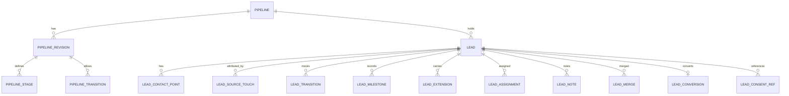

🇮🇩 Bahasa Indonesia · 🇬🇧 [English (source)](0153-reusable-lead-prospect-pipeline-is-a-pre-customer-context-that-never-owns-the-customer.md)

<!-- i18n-source-hash: sha256:b89c7c4ef6c763d61fb950e97d6dd9c66530f859b6f15becff46b03fc117d323 -->

# ADR-0153 — Pipeline lead/prospek yang dapat dipakai ulang diadmisi sebagai konteks pra-pelanggan `crm_leads` dengan katalog tahap yang ditentukan tenant dan berversi; ia tidak pernah memiliki pelanggan, identitas, atau consent

- **Status:** Diusulkan
- **Tinjauan:** menjadi Diterima setelah ditinjau maintainer. Sampai saat itu ia adalah rekomendasi. Tidak ada isinya yang mengotorisasi kode, dan issue implementasi #1166 serta issue lanjutan #1165 tetap terblokir olehnya.
- **Tanggal:** 2026-10-27
- **Pengambil keputusan:** @ahliweb (menunggu tinjauan maintainer)
- **Menyelesaikan:** Issue #1163 (admisi pipeline lead/prospek generik)
- **Memperluas:** [ADR-0148](0148-omnichannel-foundation-is-five-gated-capabilities-with-fail-closed-per-account-capability.id.md) (invarian I1 sampai I13 mengikat; C4 dan C5 menentukan di mana percakapan dan pelanggan berada), [ADR-0094](0094-a-data-subject-is-answered-per-tenant.id.md) (subjek data dijawab per tenant), [ADR-0137](0137-payout-account-encryption-at-rest-and-keyed-hashing.id.md) (ciphertext ditambah hash berkunci untuk nilai pribadi), [ADR-0134](0134-descriptor-declared-domain-event-consumers.id.md), [ADR-0011](0011-capability-ports-for-cross-module-collaboration.id.md), [ADR-0055](0055-development-confined-to-awcms-and-awcms-astro.id.md) (upstream lebih dulu), [ADR-0063](0063-ownership-grants-run-through-the-authorization-chokepoint.id.md), [ADR-0139](0139-cross-channel-notification-orchestration-not-admitted.id.md) (tanpa facade, tanpa fallback)
- **Terkait:** Issue #1139, #1140 (akun kanal), #1144 (batas inbound), #1153 (sumber lead situs web), #1164 (proyeksi percakapan dan SLA), #1165 (kadens tindak lanjut), #1166 (implementasi), ADR-0152 (Proposed, Issue #1155) (kontak Telegram); downstream `ahliweb/awcms-one` #462 (standar kebutuhan CRM), #463 (pemetaan pelanggan), #464 (proyeksi laporan) dan AW Business PRD-nya; modul `profile_identity` dan `external_customer_ref` opak milik modul `booking` ([ADR-0131](0131-generic-booking-module-admission.id.md))

**Hanya dokumen dan tata kelola.** ADR ini tidak menambah modul, tabel, migrasi, rute, path OpenAPI, kanal AsyncAPI, atau dependensi. Nama tabel, rute, event, dan izin di bawah adalah **nama kerja ilustratif** agar invarian dapat dinyatakan; #1166 menetapkan nama sebenarnya. Ia tidak memuat kutipan pemangku kepentingan: sumber kebutuhan (SRS pemangku kepentingan LPP ENTER lima halaman, dijangkau lewat `awcms-one` #462) **tidak dapat dibaca dari sesi repositori ini** saat ADR ditulis, dan issue sendiri mencatat bahwa bagian 4 dan 5-nya tidak ada, jadi pipeline di bawah adalah **admisi platform hasil turunan analis**, bukan butir sumber verbatim. Merekonsiliasinya dengan #462 dan PRD adalah butir penerimaan bagi maintainer (O12).

## Konteks

Terverifikasi di `main` pada 27 Oktober 2026:

- Repositori ini **tidak punya master pelanggan**. [ADR-0148](0148-omnichannel-foundation-is-five-gated-capabilities-with-fail-closed-per-account-capability.id.md) mencatat bahwa pelanggan CRM, consent, segmen, kampanye, dan inbox dimiliki downstream oleh `awcms-one` `commerce`, dan upstream harus mengekspos akun, pengirim, pemeriksaan consent, dan event teredaksi, bukan otoritas pelanggan kedua. Modul `booking` mengikuti aturan yang sama: pelanggannya adalah `external_customer_ref` opak, dan "otoritas pelanggan adalah commerce".
- `profile_identity` adalah **identitas orang/organisasi kanonik** upstream: `awcms_profiles`, pengenal bertipe yang disimpan sebagai nilai ternormalisasi, hash SHA-256 untuk resolve dan dedup, dan bentuk termasker, serta tabel tautan entitas generik yang diisi modul lain lewat kode. Ia direktori identitas dengan penunjuk merge; ia tidak punya tahap, sumber, pemilik, atau riwayat minat.
- Ada kerangka impor CSV/JSON bertahap yang dikontribusikan modul pemilik lewat descriptor, penulis CSV penetral formula (`src/lib/security/csv-formula.ts`), mesin `workflow_approval`, `form_drafts` (status draf formulir, bukan catatan intake), daftar langganan `newsletter`, dan view `reporting`. Tidak ada yang memodelkan prospek sebelum menjadi pelanggan.
- Kebutuhannya, seperti dinyatakan issue, adalah **intake** lead, **tahap**, dan **atribusi sumber** sampai **konversi terverifikasi** akhir, untuk produk (LPP ENTER) yang menginginkan funnel gaya program, ditambah kebutuhan generik yang dipakai bersama produk AWCMS-One lain. Risikonya klasik: kosakata produk pertama (program, angkatan, daftar ulang) mengeras menjadi skema, "pelanggan" kedua muncul di upstream, atau daftar lead menjadi pintu belakang untuk mengirim pesan ke orang yang tidak pernah menyetujui.

### Istilah, ditetapkan sekali

| Istilah          | Arti di sini                                                                                                                                                                                                                  | Tempatnya                                               |
| ---------------- | ----------------------------------------------------------------------------------------------------------------------------------------------------------------------------------------------------------------------------- | ------------------------------------------------------- |
| **Lead**         | Orang atau organisasi yang menunjukkan minat atau diidentifikasi berpotensi berminat, **belum pelanggan**, dengan pemilik, sumber, dan tahap. "Prospek" adalah **kategori tahap** lead (terkualifikasi), bukan entitas kedua. | `crm_leads` (ADR ini)                                   |
| **Titik kontak** | Email, telepon, atau id berlingkup platform yang terlampir pada lead, disimpan sebagai ciphertext ditambah hash berkunci ditambah bentuk termasker                                                                            | `crm_leads`                                             |
| **Opportunity**  | Potensi transaksi dengan nilai dan rencana penutupan                                                                                                                                                                          | **Tidak diadmisi di v1** (O2)                           |
| **Pelanggan**    | Pihak dengan hubungan komersial, dimiliki dan dinomori oleh otoritas produk (`commerce`)                                                                                                                                      | **Downstream**; upstream hanya menyimpan referensi opak |
| **Profil**       | Catatan identitas kanonik                                                                                                                                                                                                     | `profile_identity`, tidak disentuh                      |
| **Konversi**     | Saat otoritas mengonfirmasi lead menjadi pelanggan, dengan bukti dan waktu                                                                                                                                                    | Fakta yang dicatat lead; ia tidak membuat pelanggan     |

## Keputusan

### 1. Modul baru, `crm_leads`, nonaktif secara default, yang memiliki lead dan tidak lebih

Admisi **modul sistem `crm_leads`** (nama kerja; O1) dengan namespace izinnya sendiri, diaktifkan per tenant dan nonaktif secara default pada level deployment, modul, dan tenant. Ia memiliki: lead, titik kontaknya, catatan sumber dan atribusi, katalog tahap dan revisi pipeline tenant, riwayat transisi, penugasan, catatan aktivitas, catatan merge, dan catatan konversi. Ia **tidak** memiliki pelanggan, consent, pesan, segmen, kampanye, tugas, atau opportunity.

### 2. Apa yang tidak boleh menjadi modul ini (aturan non-duplikasi)

- **N1. Tanpa otoritas pelanggan kedua.** Tidak ada tabel `customer`, nomor pelanggan, atau status pelanggan. Tautan ke pelanggan adalah `external_customer_ref` opak yang ditulis **hanya** oleh konfirmasi konversi (§6) dan dibaca hanya untuk menampilkan atau melaporkan. Upstream tidak pernah membuat pelanggan.
- **N2. Tanpa otoritas identitas kedua.** Intake **tidak** membuat profil `profile_identity`; kiriman formulir yang belum terverifikasi bukan identitas kanonik. Lead nantinya boleh membawa tautan `profile_id` opsional, ditetapkan hanya lewat port `profile_identity` sendiri setelah manusia memverifikasinya (§5, O6). `crm_leads` tidak pernah menulis tabel `profile_identity` (gerbang penulis tabel berlaku).
- **N3. Tanpa penyimpanan consent.** Consent tetap di tempatnya, per kanal dan purpose, dan mendapat lingkup (ADR-0148 §2.5). Lead menyimpan **referensi** ke bukti consent (kanal, purpose, id bukti, versi) dan flag turunan `contactable` untuk tampilan; ia tidak pernah memberi, menyimpulkan, atau mengedit consent. Lead hasil impor, pengikut sosial, dan entri daftar vendor **tidak punya consent** sampai modul kanal mencatatnya.
- **N4. Tanpa penyimpanan percakapan dan tanpa inbox.** Pesan inbound milik batas #1144 dan proyeksi #1164. Lead menaut ke percakapan lewat referensi. Membuat lead dari pesan inbound adalah aturan tenant eksplisit, **nonaktif secara default** (O8), tidak pernah otomatis.
- **N5. Tanpa mesin workflow dan tanpa pengiriman pesan.** Guard tahap bersifat deklaratif (§3). Tugas tindak lanjut dan kadens adalah #1165, dibangun di atas `workflow_approval`, job yang ada, dan port notifikasi; `crm_leads` memublikasikan event dan mengekspos status, ia tidak mengirim apa pun.
- **N6. Tanpa kopling ke internal commerce.** Kedua sisi berbicara lewat port publik dan domain event (§6). Modul tidak mengimpor apa pun dari `awcms-one` atau skema downstream, dan produk downstream tidak punya dependensi runtime pada keberadaan modul (ia bekerja saat modul nonaktif).

### 3. Katalog tahap adalah data tenant, berversi, dengan himpunan kategori tertutup

- **Pipeline** milik tenant dan **business scope** (merek atau unit; I1 ADR-0148). Scope boleh memegang lebih dari satu pipeline (O3). Pipeline punya **revisi**; revisi **imutabel setelah dipublikasikan**, dan lead selalu menampilkan revisi tempat setiap transisi terjadi. Mengubah pipeline memublikasikan revisi baru; lead di tahap yang dihapus harus dipindahkan oleh migrasi tahap yang eksplisit, beraudit, dan idempoten, tidak pernah diam-diam.
- **Tahap** punya nama pilihan tenant (dapat dilokalkan), id stabil, urutan, dan **kategori** dari daftar tertutup yang ditetapkan platform: `new`, `working`, `qualified`, `converted`, `lost`, `disqualified`. Laporan memakai kategori, jadi tenant dapat mengganti nama setiap tahap tanpa mengubah arti "converted". Id tahap stabil antar revisi.
- **Transisi** adalah daftar sisi yang diizinkan per revisi. **Guard** adalah himpunan tertutup predikat deklaratif (pemilik ditetapkan, field bernama terisi, referensi consent ada, aktor memegang izin, milestone tercatat). **Tidak ada bahasa ekspresi, skrip, atau callback**, aturan yang sama dengan yang diterapkan `hr_commission` pada aturannya, sehingga guard dapat disimulasikan dan diaudit.
- **Milestone bisnis** adalah kode yang ditentukan tenant (misalnya "daftar ulang" khusus program) yang dicatat pada lead dengan waktu dan bukti. Mereka adalah **data**, dibuat tenant lewat izin administratif. **Kosakata contoh LPP (program, angkatan, daftar ulang) tidak pernah menjadi kolom skema, seed, atau default**; sebuah tes (§9, T-L1) gagal bila skema, seed, atau fixture modul memuat field yang di-hardcode seperti itu, dan set contoh netral generik adalah satu-satunya seed yang diizinkan.
- **Ekstensi bertipe.** Tenant boleh mendeklarasikan field ekstensi pada lead (kunci, tipe dari `text`, `number`, `date`, `boolean`, `enum`, batas panjang, dan **flag `pii`**). Nilai divalidasi saat tulis terhadap deklarasi, disimpan terbatas, dan field `pii` disimpan sebagai ciphertext dengan tampilan termasker dan dikecualikan dari event dan konteks AI. Apakah field ekstensi `pii` diizinkan sama sekali di v1 adalah O9.

### 4. Intake, atribusi sumber, dan aturan duplikat

- **Jalur intake** adalah daftar tertutup: `website_form` (#1153), `inbound_message` (hanya aturan tenant eksplisit, #1144), `import`, `manual`, `api`. Masing-masing membawa `source_kind`, `channel_account_id` opsional (#1140), referensi kampanye opak, dan field atribusi terbatas.
- **Sentuhan pertama imutabel**; sentuhan berikutnya ditambahkan. Lead menyimpan sumber pembuatannya selamanya, dan kontak ulang dari kanal lain menambah sentuhan, bukan lead baru, **hanya bila aturan identitas §5 menyatakan itu lead yang sama**.
- **Aturan duplikat intake terpisah dari aturan identitas.** Intake idempoten pada `(tenant, source_kind, account, external_event_id)`: webhook yang diputar ulang, formulir yang dikirim ganda, atau baris CSV yang diunggah ulang menghasilkan pembuatan lead yang **sama**, tidak pernah dua. Apakah dua event _berbeda_ menggambarkan orang yang sama adalah §5, dan tidak pernah diputuskan diam-diam.
- **Waktu.** Semua instan adalah `timestamptz` (UTC). Fakta punya `occurred_at` (efektif, dari sumber) dan `recorded_at` (saat kita mengetahuinya); koreksi adalah event baru yang merujuk event yang dikoreksi. Bucket "hari", "minggu", dan kohort memakai **zona waktu IANA business scope**, disimpan pada scope, sehingga laporan dapat direproduksi apa pun zona penampilnya.
- **Metrik dapat dibuktikan.** Hitungan funnel dihitung dari event transisi dan sumber imutabel dengan **versi definisi** dan **revisi pipeline** terlampir; angka yang dipublikasikan `reporting` membawa waktu as-of dan dapat direproduksi dengan kueri. Atribusi (first-touch, last-touch) dinyatakan, tidak diimplikasikan. Proyeksi downstream (#464) mengonsumsinya; ia tidak menghitung ulang dengan cara berbeda.

### 5. Identitas, deduplikasi, dan merge

- Titik kontak lead disimpan sebagai **ciphertext + hash berkunci + bentuk termasker** (bentuk ADR-0137, dengan key ring dan job rekey sendiri). Hash bersifat **per tenant** dan per jenis titik kontak; ia tidak pernah meninggalkan tenant.
- **Deteksi kandidat** membandingkan hash titik kontak ternormalisasi **dalam satu tenant** (dan dalam business scope bila tenant memilih demikian). Ia menghasilkan **kandidat**, tidak pernah merge. **Tidak ada pencocokan lintas tenant, lintas platform, atau antara id berlingkup platform dan email** tanpa bukti deterministik tercatat (ADR-0148 I7); dua tenant yang memegang email sama memegang dua lead tak berhubungan, dan tes menyatakannya (T-I1).
- **Merge diverifikasi manusia, beraudit, dan dapat dibatalkan.** Ia butuh izin, `Idempotency-Key`, catatan peninjau, dan token konkurensi optimistik pada kedua lead. Ia menulis **catatan merge** (yang bertahan, yang diserap, snapshot lead yang diserap, anak yang dipindahkan lewat referensi) dan tidak soft-delete apa pun diam-diam. **Rollback** dalam jendela pembatalan memulihkan lead yang diserap dan memindahkan kembali riwayat yang berasal darinya lewat referensi; setelah jendela, koreksi adalah merge baru. Merge ditolak lintas tenant dan lintas business scope yang tidak dapat dilihat aktor.
- **Menaut ke profil kanonik** (O6) adalah langkah terpisah yang diverifikasi manusia lewat port `profile_identity`, memakai catatan tautan dengan metode, provenance, siapa dan kapan. Tidak ada pembuatan atau pengayaan profil otomatis.

### 6. Tautan pelanggan: port publik dan event tersanitasi

- `crm_leads` mengekspos **port kapabilitas** (`CrmLeadPort`, di `_shared/ports/`, per ADR-0011): membaca kategori tahap dan referensi sumber lead, meminta konversi, dan menerima konfirmasi konversi. Ia tidak mengembalikan PII kepada pemanggil yang belum berhak atasnya; port membawa id opak.
- Ia memublikasikan **domain event** lewat infrastruktur standar: `lead.created`, `lead.stage_changed`, `lead.assigned`, `lead.merged`, `lead.merge_reverted`, `lead.converted`, `lead.conversion_reversed`, `lead.lost`, `lead.consent_changed` (pembaruan referensi). Payload membawa **id tersanitasi dan referensi atribusi, tidak pernah nama, email, telepon, atau catatan teks bebas**; `privacy_class` ada di setiap event. Event adalah satu-satunya yang disubscribe konsumen downstream (termasuk #1165 dan adapter `commerce`).
- **Konversi** dicatat saat otoritas produk mengonfirmasinya: adapter downstream, setelah membuat atau mencocokkan pelanggannya, memanggil port dengan `external_customer_ref`, milestone konversi, dan referensi bukti; lead berpindah ke tahap `converted` di bawah guard. **Konversi manual** oleh staf berwenang diizinkan untuk produk tanpa otoritas otomatis (kasus LPP mungkin membutuhkannya) tetapi disimpan sebagai `authority_unconfirmed`, butuh catatan dan referensi bukti, dan dilaporkan terpisah (O13). **Pembalikan** adalah event `conversion_reversed` dari otoritas (refund, pendaftaran dibatalkan), tidak pernah suntingan riwayat. Konfirmasi yang diputar ulang adalah no-op (idempoten pada referensi bukti).

### 7. Pelindungan data, retensi, dan akses

- **Minimisasi.** Lead punya himpunan tertutup field standar (nama tampilan, titik kontak, pemilik, tahap, sumber, field catatan terbatas, ekstensi). **Tidak ada NIK, NPWP, tanggal lahir, atau field keuangan** dalam bentuk standar; tenant yang membutuhkannya mendeklarasikan ekstensi `pii` tunduk pada O9 dan satu baris DPIA.
- **Masking.** Daftar dan log menampilkan bentuk termasker; pencarian titik kontak adalah **kecocokan persis pada hash berkunci** dan hanya untuk aktor berwenang; baris audit tidak pernah membawa nilainya.
- **Permintaan subjek data** dijawab **per tenant** (ADR-0094): descriptor `subjectData` modul mendaftar lead, titik kontak, catatan, dan ekstensi; penghapusan **menganonimkan** lead (ciphertext dan catatan dihapus, nisan dan **hitungan serta fakta sumber/tahap non-pribadi dipertahankan**) sehingga riwayat funnel yang dilaporkan tidak berubah. Legal hold melewati penghapusan. Ekspor data lead menetralkan sel formula (`csvCellForWrite`).
- **Retensi** dinyatakan dalam migrasi pembuat (ADR-0148 I12) dengan descriptor `data_lifecycle`: lead tak terkonversi dan tak aktif kedaluwarsa setelah periode yang ditetapkan tenant dalam batas platform (O4); lead `lost` dan `disqualified` punya jendela lebih pendek; lead terkonversi hanya menyimpan yang dibutuhkan catatan konversi.
- **Consent dan dasar hukum.** Modul tidak memutuskan dasar hukum. Pengendali (tenant) menyatakannya per sumber dalam konfigurasi intake, dan lead mencatatnya untuk tampilan dan audit. Tidak ada lead yang menjadi dapat dihubungi karena berada di pipeline (N3).
- **Otorisasi.** RBAC ditambah ABAC default-deny, RLS `FORCE` pada setiap tabel, pemeriksaan business scope dan ownership grant lewat chokepoint otorisasi (ADR-0063). Izin terpisah: `leads.read`, `leads.create`, `leads.update`, `leads.assign`, `leads.move`, `leads.merge`, `leads.export`, `leads.delete` (soft), `pipeline.configure` (berisiko tinggi, beraudit), `milestones.configure`, `conversion.confirm`, dan `conversion.manual`. Masing-masing di-seed migrasi **dan** ditegakkan endpoint-nya (kegagalan izin-tak-pernah-di-seed yang pernah dialami repositori).
- **Konkurensi dan idempotensi.** Setiap lead punya `version`; `PATCH` dan perpindahan tahap memakai `If-Match` (atau field versi) dan menjawab `409` saat konflik; create, move, merge, dan impor membawa `Idempotency-Key`. Perpindahan ke tahap memeriksa ulang guard di dalam transaksi.
- **Impor.** Impor CSV melewati kerangka impor bertahap, dengan batas baris, batas ukuran, hasil per baris, kunci sumber per baris untuk idempotensi, dan **netralisasi sel dua arah**: sel yang diawali `=`, `+`, `-`, `@`, tab, atau carriage return dinetralkan saat impor sebelum disimpan dan lagi saat ekspor. Impor tidak pernah menetapkan consent.
- **Permukaan.** Layar admin adalah halaman Astro SSR di bawah shell yang ada (`/admin/...`, pola halaman data ADR-0149), dengan entri navigasinya ditambahkan **dalam perubahan yang sama dengan halamannya** (aturan registri navigasi), aksesibel dan terlokalisasi en/id. Endpoint publik terbatas pada endpoint intake #1153 dan dibatasi laju serta dilindungi tantangan.

### 8. Invarian mengikat untuk issue turunan

Mereka mewarisi ADR-0148 I1 sampai I13 dan **mengikat #1164, #1165, #1166 dan awcms-one #463 dan #464**:

- **L1.** `crm_leads` hanya memiliki lead; N1 sampai N6 berlaku. Tanpa tabel pelanggan, pemberian consent, pengiriman pesan, mesin workflow, atau penyimpanan inbox.
- **L2.** Tahap, milestone, dan ekstensi adalah data tenant; kategori adalah daftar tertutup platform; revisi terpublikasi imutabel; tidak ada field program, angkatan, atau daftar ulang di skema, seed, atau default mana pun.
- **L3.** Guard adalah himpunan tertutup predikat deklaratif; tidak ada bahasa ekspresi atau skrip.
- **L4.** Intake idempoten pada kunci sumbernya; lead menyimpan sentuhan pertama imutabel; sentuhan kedua tidak pernah membuat duplikat tanpa aturan identitas.
- **L5.** Pencocokan identitas dalam satu tenant (dan opsional satu scope), lewat hash berkunci, menghasilkan kandidat; tanpa pencocokan lintas tenant, lintas platform, atau berbasis pengayaan; merge diverifikasi manusia, beraudit, dapat dibatalkan, diperiksa konkurensinya, dan idempoten.
- **L6.** Event dan port membawa id opak dan referensi atribusi saja; tanpa PII di event, baris audit, log, atau konteks AI; setiap event membawa `privacy_class`.
- **L7.** Konversi dicatat dari konfirmasi otoritas (atau jalur manual eksplisit yang diberi flag); pembalikan adalah event; riwayat dikoreksi dengan event baru, tidak pernah disunting.
- **L8.** Setiap tabel punya RLS `FORCE`, ABAC default-deny, descriptor `subjectData` dan `data_lifecycle`, migrasi forward-only, dan izin yang di-seed **dan** ditegakkan.
- **L9.** Impor dan ekspor menetralkan sel formula; impor atau webhook tidak pernah membuat consent.
- **L10.** Waktu adalah `timestamptz`; laporan membucket menurut zona business scope dan membawa versi definisi dan revisi pipeline; hitungan dapat direproduksi dari event imutabel.
- **L11.** Lead tidak pernah menjadi dapat dihubungi karena keanggotaan pipeline; kelayakan pesan dibaca dari consent kanal sendiri (#1165 memeriksa ulang saat penjadwalan dan saat dispatch).
- **L12.** Modul bekerja saat nonaktif, dan produk downstream tidak punya dependensi runtime padanya. Sinkronisasi dari upstream ke `awcms-one` adalah merge commit, dan tidak ada yang diubah di `awcms-one/apps/cms` sebelumnya.

#### Apa yang diterima tiap issue turunan

| Issue          | Yang boleh diandalkan                                                                                                                           | Yang tidak boleh dilakukan                                                                                      |
| -------------- | ----------------------------------------------------------------------------------------------------------------------------------------------- | --------------------------------------------------------------------------------------------------------------- |
| #1164 inbox    | Menaut percakapan ke lead lewat referensi; membaca kategori tahap dan pemilik lead lewat port                                                   | Memiliki tabel pelanggan atau lead; membuat lead otomatis kecuali aturan tenant (O8) aktif                      |
| #1165 kadens   | Subscribe ke `lead.stage_changed`, `lead.converted`, `lead.lost`, `lead.consent_changed` sebagai sinyal berhenti; mengunci tugas dengan id lead | Menyimpan salinan lead; mengirim tanpa memeriksa ulang consent saat dispatch; membangun mesin persetujuan kedua |
| #1166 build    | Semua di §1 sampai §7 sebagai kontrak; Definition of Ready di bawah                                                                             | Menambah field LPP; mengimpor commerce; membuat profil saat intake                                              |
| awcms-one #463 | Subscribe ke `lead.converted` dan memanggil port konfirmasi dengan `external_customer_ref`-nya                                                  | Membaca tabel `crm_leads`; menulis lead langsung                                                                |
| awcms-one #464 | Mengonsumsi proyeksi reporting dengan versi definisinya                                                                                         | Menghitung ulang hitungan funnel berbeda dari definisi upstream                                                 |

#### Definition of Ready untuk #1166

ADR-0153 Diterima; #1140 (registri akun) dan #1144 (kontrak event inbound) diputuskan atau secara eksplisit tidak diperlukan untuk irisan pertama; kamus data dan ERD §10 diubah menjadi desain fisik; draf OpenAPI dan AsyncAPI; pertanyaan terbuka di bawah terjawab; satu baris DPIA dari pengendali; dan tinjauan keamanan direncanakan (modul menangani data pribadi dan ownership grant).

### 9. Matriks tes yang harus dibawa issue implementasi

| ID   | Kasus                                                                                                                                                                                                       | Pemilik |
| ---- | ----------------------------------------------------------------------------------------------------------------------------------------------------------------------------------------------------------- | ------- |
| T-L1 | Tidak ada kolom, seed, atau fixture program, angkatan, atau daftar ulang; hanya seed netral                                                                                                                 | #1166   |
| T-I1 | Dua tenant, email sama dan username eksternal sama: dua lead tak berhubungan; tanpa kandidat lintas tenant; permintaan merge lintas tenant ditolak                                                          | #1166   |
| T-I2 | Banyak kanal dan sumber untuk satu orang dalam satu tenant: satu himpunan kandidat, tanpa merge otomatis, sentuhan pertama imutabel, atribusi dihitung sekali                                               | #1166   |
| T-D1 | Webhook, kiriman formulir, dan baris CSV ganda: satu lead; replay mengembalikan hasil sama                                                                                                                  | #1166   |
| T-S1 | Balapan transisi tahap: dua perpindahan bersamaan, satu menang, yang lain mendapat `409`; guard diperiksa ulang dalam transaksi; perpindahan tanpa izin ditolak                                             | #1166   |
| T-M1 | Merge lalu rollback: lead yang diserap dan riwayat dipulihkan; rollback kedua ditolak; merge oleh aktor tanpa akses ke salah satu lead ditolak                                                              | #1166   |
| T-C1 | Replay konfirmasi konversi, pembalikan, dan konversi manual berflag `authority_unconfirmed`; koreksi hanya lewat event                                                                                      | #1166   |
| T-X1 | Sel formula jahat pada impor dan ekspor; berkas terlalu besar dan cacat; error per baris                                                                                                                    | #1166   |
| T-P1 | PII: tanpa nilai di event, baris audit, log, atau error mana pun; daftar termasker; pencarian hash persis hanya untuk yang berwenang; ekspor DSR dan penghapusan anonimisasi mempertahankan hitungan funnel | #1166   |
| T-K1 | Consent: lead hasil impor, pengikut, dan daftar vendor tidak dapat dihubungi; event penarikan menghentikan kadens (#1165); kelayakan diperiksa ulang saat dispatch                                          | #1165   |
| T-R1 | Laporan: angka sama direproduksi dari event; bucket zona dan hari libur; versi definisi dan revisi ditampilkan                                                                                              | #1166   |
| T-Q1 | Indeks dan rencana kueri untuk daftar, pencarian kandidat, dan funnel pada volume; paging keyset                                                                                                            | #1166   |
| T-U1 | Migrasi dan upgrade: forward-only, modul nonaktif persis tak berubah, izin di-seed dan ditegakkan                                                                                                           | #1166   |

### 10. Kamus data logis dan ERD (nama kerja)

Setiap tabel berlingkup tenant dengan RLS `FORCE` dan mengirim descriptor `subjectData` dan `data_lifecycle` dalam migrasi yang membuatnya. Desain fisik milik #1166.

| Entitas               | Tujuan                                           | Field kunci (logis)                                                                                                                                                                     | Catatan                                                                 |
| --------------------- | ------------------------------------------------ | --------------------------------------------------------------------------------------------------------------------------------------------------------------------------------------- | ----------------------------------------------------------------------- |
| `lead`                | Catatan pra-pelanggan                            | tenant, business scope, pipeline, nama tampilan, pemilik, tim, tahap saat ini, `version`, `external_customer_ref` (opak, nullable), tautan profil (nullable), waktu dibuat, soft delete | Tanpa field pelanggan; referensi ditulis hanya oleh konfirmasi konversi |
| `lead_contact_point`  | Email, telepon, atau id berlingkup platform lead | lead, jenis, hash berkunci, ciphertext, nilai termasker, sumber, waktu verifikasi, waktu dicabut                                                                                        | Hash per tenant dan jenis                                               |
| `lead_source_touch`   | Sentuhan pertama dan berikutnya yang imutabel    | lead, jenis sumber, akun kanal (nullable), referensi kampanye, field atribusi terbatas, external event id (unik bersama sumber), waktu kejadian, waktu dicatat                          | Sentuhan pertama tidak pernah disunting                                 |
| `pipeline`            | Funnel tenant untuk business scope               | tenant, scope, nama, revisi saat ini, zona waktu dari scope                                                                                                                             |                                                                         |
| `pipeline_revision`   | Versi terpublikasi yang imutabel                 | pipeline, nomor, waktu dan pelaku publikasi, hash definisi                                                                                                                              |                                                                         |
| `pipeline_stage`      | Tahap dari revisi                                | revisi, id tahap stabil, nama, urutan, kategori (daftar tertutup)                                                                                                                       | Id stabil antar revisi                                                  |
| `pipeline_transition` | Sisi yang diizinkan dengan guard deklaratif      | revisi, tahap asal, tahap tujuan, predikat guard (himpunan tertutup)                                                                                                                    | Tanpa bahasa ekspresi                                                   |
| `lead_transition`     | Riwayat perpindahan append-only                  | lead, dari, ke, revisi, aktor, alasan, waktu efektif, waktu dicatat, kunci idempotensi, mengoreksi (nullable)                                                                           | Koreksi adalah baris baru                                               |
| `milestone_type`      | Milestone bisnis yang ditentukan tenant          | tenant, scope, kode, label, butuh bukti                                                                                                                                                 | Data, bukan kolom                                                       |
| `lead_milestone`      | Milestone yang tercatat                          | lead, tipe, waktu kejadian, referensi bukti, pencatat                                                                                                                                   |                                                                         |
| `extension_field`     | Ekstensi bertipe yang dideklarasikan             | tenant, scope, kunci, tipe, batas panjang, flag `pii`, nilai enum                                                                                                                       | Field `pii` tunduk pada O9                                              |
| `lead_extension`      | Nilai ekstensi                                   | lead, field, nilai atau ciphertext                                                                                                                                                      | Divalidasi saat tulis                                                   |
| `lead_assignment`     | Riwayat pemilik dan tim                          | lead, penerima tugas, jenis, dari, ke, oleh                                                                                                                                             |                                                                         |
| `lead_note`           | Catatan aktivitas internal                       | lead, isi (terbatas), penulis, waktu dibuat                                                                                                                                             | Hanya internal; tidak pernah dikirim                                    |
| `lead_merge`          | Catatan merge untuk pembatalan                   | yang bertahan, yang diserap, snapshot, referensi anak yang dipindah, peninjau, catatan, waktu merge, waktu dibatalkan                                                                   |                                                                         |
| `lead_conversion`     | Catatan konversi                                 | lead, milestone, `external_customer_ref`, referensi bukti, mode (`authority_confirmed` / `authority_unconfirmed`), waktu kejadian, waktu dibalik                                        | Pembalikan adalah event                                                 |
| `lead_consent_ref`    | Referensi ke bukti consent kanal                 | lead, kanal, purpose, id bukti, versi, status saat dibaca                                                                                                                               | Hanya referensi, tidak pernah pemberian                                 |

| Ancaman                                          | Kontrol (invarian)                                                                              |
| ------------------------------------------------ | ----------------------------------------------------------------------------------------------- |
| Baca atau merge lintas tenant, merge keliru      | RLS `FORCE`, hash berkunci per tenant, merge diverifikasi manusia dan dapat dibatalkan (L5, L8) |
| Daftar lead dipakai mengirim pesan tanpa consent | Tanpa consent di modul, periksa ulang saat dispatch (N3, L11)                                   |
| Injeksi formula lewat impor atau ekspor          | Netralisasi dua arah (L9)                                                                       |
| PII di event, log, atau konteks AI               | Id opak, `privacy_class`, tampilan termasker (L6)                                               |
| Otoritas pelanggan atau identitas kedua muncul   | N1, N2, dan gerbang penulis tabel                                                               |
| Lost update pada perpindahan tahap               | `version` dan `If-Match`, guard diperiksa ulang dalam transaksi (L3, §7)                        |
| Sengketa penghitungan                            | Laporan dapat direproduksi dari event imutabel dengan versi definisi (L10)                      |
| Kosakata produk di-hardcode ke platform          | Tes T-L1 (L2)                                                                                   |

## Opsi yang dipertimbangkan

| Kriteria                 | **B. Modul pra-pelanggan baru `crm_leads` (dipilih)**                                                                    | A. Susun dari modul yang ada (`profile_identity`, `form_drafts`, `newsletter`, `workflow_approval`)                               | C. Taruh lead hanya di `commerce` downstream                                | D. Tambah status dan tahap lead ke `profile_identity`                             | E. Pembangun objek kustom generik, lead sebagai satu konfigurasi |
| ------------------------ | ------------------------------------------------------------------------------------------------------------------------ | --------------------------------------------------------------------------------------------------------------------------------- | --------------------------------------------------------------------------- | --------------------------------------------------------------------------------- | ---------------------------------------------------------------- |
| Keamanan                 | Satu konteks terbatas dengan izin, RLS, dan tinjauan sendiri; PII terisolasi dari identitas kanonik sampai terverifikasi | Setiap kiriman tak terverifikasi menjadi profil kanonik atau pelanggan langganan; modul terlemah menentukan level                 | Gerbang upstream tidak dapat melihat kode pembawa PII                       | Data tak terverifikasi masuk direktori identitas yang dipercaya semua modul       | Mesin generik adalah permukaan injeksi dan otorisasi generik     |
| Privasi dan UU PDP       | Field standar minimal, hash berkunci per tenant, penghapusan anonimisasi yang mempertahankan hitungan, retensi per tabel | Catatan identitas dibuat untuk orang yang mungkin tak pernah menjadi pelanggan; sulit dihapus; tanpa sumber atau retensi per lead | Kode sama, di luar gerbang lifecycle dan subjek data upstream               | Menggabungkan lead ke profil, sehingga semantik penghapusan dan merge bertabrakan | Field sembarang membuat minimisasi tidak dapat ditegakkan        |
| Kinerja                  | Indeks khusus untuk daftar, kandidat, dan funnel; paging keyset                                                          | Join lintas modul untuk funnel; tanpa riwayat tahap                                                                               | Sama dengan B                                                               | Tabel identitas panas menerima beban tulis pipeline                               | Penyimpanan key/value generik lambat difilter dan dilaporkan     |
| Maintainability          | Port sempit dan event; modul dapat dilepas sendiri                                                                       | Tak ada rumah untuk tahap, versi, atribusi; logika tersebar                                                                       | Setiap produk menurunkannya ulang (ADR-0055 menyatakan upstream lebih dulu) | Modul dengan dua tugas                                                            | Permukaan besar, bahasa kueri baru untuk dirawat                 |
| Skalabilitas             | Menambah baris dan revisi, bukan antrean                                                                                 | Tidak skala terhadap kebutuhan                                                                                                    | Sama dengan B                                                               | Terkopel pada pertumbuhan identitas                                               | Skala buruk                                                      |
| Kompatibilitas           | Aditif; modul nonaktif tidak mengubah apa pun; commerce tetap otoritas pelanggan                                         | Aditif tetapi tidak lengkap                                                                                                       | Salinan downstream menyimpang dari upstream                                 | Mengubah kontrak modul bersama                                                    | Berat                                                            |
| Kompleksitas operasional | Satu modul, tiga level nonaktif-default, satu set migrasi                                                                | Rendah, tetapi kebutuhan tak terpenuhi                                                                                            | Terendah upstream, tertinggi downstream                                     | Kode sedikit, risiko tinggi                                                       | Tinggi                                                           |

### Pembacaan kepatuhan

- **UU PDP No. 27/2022.** Data lead adalah data pribadi yang dikumpulkan sebelum kontrak apa pun: pengendali (tenant) harus punya dasar hukum dan pemberitahuan per sumber, dan dasarnya dapat berupa consent atau dasar lain yang disebut undang-undang; ADR ini tidak memilihnya (O5) dan tidak memperlakukan keanggotaan pipeline sebagai consent (N3, L11). Minimisasi, pembatasan tujuan, dan pembatasan penyimpanan adalah field standar tertutup, jenis sumber, dan jendela retensi. Hak subjek data dilayani per tenant (ADR-0094) dengan penghapusan anonimisasi. Penilaian dampak untuk pemrosesan berskala besar atau sistematis (Pasal 34) adalah milik pengendali, per deployment, sebelum pemakaian kelas CRM. Transfer lintas batas (Pasal 56) muncul hanya lewat penyedia kanal dan merupakan pengungkapan pengendali. Pemberitahuan kegagalan pelindungan data (Pasal 46) memakai jejak audit.
- **PP 71/2019 dan ISO/IEC 27001:2022, 27002:2022, 27005, 27701, 27034.** Seperti ADR-0148: kontrol akses (5.15, 5.18, 8.2), kriptografi (8.24), logging (8.15), penghapusan informasi (8.10), pelindungan PII (5.34), ketentuan pemasok di mana penyedia menyuplai lead. Risiko baru untuk didaftarkan di register risiko paket omnichannel: daftar lead adalah daftar kontak, sehingga risiko eksfiltrasi dan penyalahgunaan terkonsentrasi di sini; dimitigasi dengan tampilan termasker secara default, izin ekspor, netralisasi formula, audit, dan jam retensi.

## Konsekuensi

- **Positif:** siklus hidup pra-pelanggan mendapat satu rumah dengan tahap berversi yang ditentukan tenant dan angka funnel yang dapat dibuktikan; commerce tetap satu-satunya otoritas pelanggan dan `profile_identity` tetap satu-satunya otoritas identitas; #1164 sampai #1166 menerima invarian mengikat dan matriks tes; kosakata produk pertama tetap di luar skema.
- **Negatif / trade-off:** modul baru dan kontrak baru yang harus disinkronkan dengan `awcms-one`; daftar kategori tertutup kadang terasa terlalu kecil; intake tanpa profil berarti langkah penautan eksplisit nanti; objek opportunity ditunda, jadi produk yang menginginkan nilai transaksi menunggu ADR-nya sendiri.
- **Netral:** tidak ada yang berubah bagi deployment mana pun sampai modul diaktifkan untuk sebuah tenant.
- **Persetujuan manusia yang masih diperlukan (tidak dilakukan di sini):** maintainer atas pertanyaan terbuka di bawah; pengendali atau DPO untuk dasar hukum, pemberitahuan, jendela retensi, dan DPIA; rekonsiliasi dengan `awcms-one` #462 dan PRD (O12); dan tinjauan keamanan #1166 sebelum merge.

## Alternatif yang ditolak

- **Hanya komposisi (A).** Tidak menyisakan rumah untuk versi tahap, atribusi, atau riwayat, dan mengubah kiriman tak terverifikasi menjadi identitas kanonik atau pelanggan langganan.
- **Hanya downstream (C).** Menghilangkan gerbang upstream dari kode pembawa PII dan membuat setiap produk menurunkan model ulang.
- **Tahap di `profile_identity` (D).** Dua siklus hidup dalam satu direktori identitas; semantik penghapusan dan merge bertabrakan.
- **Pembangun objek kustom (E).** Mesin ekspresi-dan-skema adalah biaya keamanan dan perawatan tanpa kebutuhan di baliknya.
- **Membuat pelanggan, profil, atau consent dari lead.** Masing-masing akan menjadi otoritas kedua.
- **Pencocokan otomatis lintas tenant, lintas platform, atau probabilistik, dan lead-otomatis-dari-setiap-pesan.** Pelanggaran privasi dan kontrak sebelum menjadi pilihan rekayasa.
- **Meng-hardcode kosakata LPP sebagai default.** Ia mengubah contoh produk menjadi skema platform.

## Pertanyaan terbuka untuk maintainer

- **O1.** Kunci modul: `crm_leads` (nama yang dipakai #1166, direkomendasikan) atau `lead_pipeline` (nama yang dipakai #1163).
- **O2.** Apakah objek **opportunity** diadmisi sekarang? Rekomendasi: tidak di v1; produk yang membutuhkan nilai transaksi mendapat ADR sendiri, agar lead tidak tumbuh field uang.
- **O3.** Satu pipeline per business scope, atau beberapa (misalnya satu per penawaran)? Rekomendasi: beberapa, masing-masing dengan revisinya, lead milik tepat satu.
- **O4.** Jendela retensi untuk lead tak terkonversi, `lost`, dan `disqualified`, dan jendela pembatalan merge. Titik awal yang direkomendasikan: periode yang ditetapkan tenant dalam batas platform, jendela lebih pendek untuk `lost`, jendela pembatalan merge singkat berhari-hari.
- **O5.** Peran pengendali atau prosesor deployment dan opsi **dasar hukum** yang ditawarkan konfigurasi intake (consent, langkah kontrak, kepentingan yang sah bila hukum mengizinkan). Membutuhkan pengendali atau penasihat hukum.
- **O6.** Apakah tautan `profile_id` opsional diadmisi di v1? Rekomendasi: ya, sebagai langkah terverifikasi manusia pembawa bukti lewat port `profile_identity`, tidak pernah otomatis.
- **O7.** Apakah SLA tingkat lead (respons pertama, terlambat) dimiliki #1164 (direkomendasikan) atau modul ini?
- **O8.** Bolehkah tenant mengaktifkan "buat lead dari pesan inbound" sama sekali, dan untuk provider mana? Rekomendasi: nonaktif secara default, diaktifkan per sumber dengan dasar hukum yang dinyatakan.
- **O9.** Apakah ekstensi bertipe `pii` diizinkan di v1, atau dilarang sampai ada DPIA? Rekomendasi: dilarang di v1.
- **O10.** Batas impor (baris, byte) dan apakah impor diizinkan sama sekali sebelum adapter lead kerangka impor bertahap ditinjau.
- **O11.** Apakah daftar kategori tertutup (`new`, `working`, `qualified`, `converted`, `lost`, `disqualified`) cukup?
- **O12.** Rekonsiliasi ADR ini dengan `awcms-one` #462, #463, #464 dan AW Business PRD, yang tidak dapat dibaca sesi ini; maintainer atau agen berikutnya yang punya akses memastikan tidak ada yang bertentangan.
- **O13.** Apakah **konversi manual** (tanpa otoritas otomatis) diadmisi? Rekomendasi: ya, diberi flag `authority_unconfirmed`, dengan catatan, referensi bukti, dan izin sendiri, dilaporkan terpisah.

## Tautan tindak lanjut

- #1166 mengimplementasikan modul dan membawa T-L1 sampai T-U1 setelah ADR ini Diterima; #1165 mengonsumsi event sebagai sinyal berhenti dan menunggu ADR ini; #1164 menaut percakapan lewat referensi setelah #1144; #1153 adalah sumber intake situs web; #1140 dan #1144 menyediakan kontrak akun dan inbound; awcms-one #463 dan #464 mengonsumsi port dan proyeksi reporting dan menunggu issue upstream **dan** sinkronisasi subtree sebagai merge commit. Masing-masing dibangun, ditinjau, dan digerbangi sebagai perubahan biasa.
