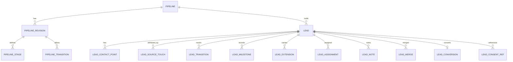

🇬🇧 English (source) · 🇮🇩 [Bahasa Indonesia](0153-reusable-lead-prospect-pipeline-is-a-pre-customer-context-that-never-owns-the-customer.id.md)

# ADR-0153 — A reusable lead/prospect pipeline is admitted as a pre-customer `crm_leads` context with a tenant-defined, versioned stage catalog; it never owns the customer, the identity or the consent

- **Status:** Proposed
- **Review:** becomes Accepted after maintainer review. Until then it is a recommendation. Nothing in it authorises code, and the implementation issue #1166 and the follow-up issue #1165 stay blocked on it.
- **Date:** 2026-10-27
- **Decision maker:** @ahliweb (maintainer review pending)
- **Resolves:** Issue #1163 (the admission of a generic lead/prospect pipeline)
- **Extends:** [ADR-0148](0148-omnichannel-foundation-is-five-gated-capabilities-with-fail-closed-per-account-capability.md) (invariants I1 to I13 are binding; C4 and C5 define where the conversation and the customer live), [ADR-0094](0094-a-data-subject-is-answered-per-tenant.md) (a data subject is answered per tenant), [ADR-0137](0137-payout-account-encryption-at-rest-and-keyed-hashing.md) (ciphertext plus keyed hash for personal values), [ADR-0134](0134-descriptor-declared-domain-event-consumers.md), [ADR-0011](0011-capability-ports-for-cross-module-collaboration.md), [ADR-0055](0055-development-confined-to-awcms-and-awcms-astro.md) (upstream first), [ADR-0063](0063-ownership-grants-run-through-the-authorization-chokepoint.md), [ADR-0139](0139-cross-channel-notification-orchestration-not-admitted.md) (no facade, no fallback)
- **Related:** Issues #1139, #1140 (channel accounts), #1144 (inbound boundary), #1153 (website lead source), [ADR-0155](0155-website-engagement-is-an-intake-only-system-module-with-token-and-origin-provenance.md) (the `website_engagement` intake module, Proposed), #1164 (conversation projection and SLA), #1165 (follow-up cadence), #1166 (implementation), ADR-0152 (Proposed, Issue #1155) (Telegram contacts); downstream `ahliweb/awcms-one` #462 (CRM requirements standard), #463 (customer mapping), #464 (report projection) and its AW Business PRD; the `profile_identity` module and the `booking` module's opaque `external_customer_ref` ([ADR-0131](0131-generic-booking-module-admission.md))

**Docs and governance only.** This ADR adds no module, table, migration, route, OpenAPI path, AsyncAPI channel or dependency. Table, route, event and permission names below are **illustrative working names** so that the invariants can be stated; #1166 fixes the real ones. It contains no stakeholder quotation: the requirement source (the five-page LPP ENTER stakeholder SRS, reached through `awcms-one` #462) was **not readable from this repository's session** when this ADR was written, and the issue itself records that its sections 4 and 5 are absent, so the pipeline below is an **analyst-derived platform admission**, not a verbatim source item. Reconciling it to #462 and the PRD is an acceptance item for the maintainer (O12).

## Context

Verified on `main` at 27 October 2026:

- The repository has **no customer master**. [ADR-0148](0148-omnichannel-foundation-is-five-gated-capabilities-with-fail-closed-per-account-capability.md) records that the CRM customer, consent, segments, campaigns and an inbox are owned downstream by `awcms-one` `commerce`, and that upstream must expose accounts, senders, consent checks and redacted events, not a second customer authority. The `booking` module follows the same rule: its customer is the opaque `external_customer_ref`, and "the customer authority is commerce".
- `profile_identity` is the upstream **canonical person/organisation identity**: `awcms_profiles`, typed identifiers stored as a normalised value, a SHA-256 hash for resolve and dedup and a masked form, and a generic entity-link table that other modules fill through code. It is an identity directory with a merge pointer; it has no stages, no source, no owner and no history of interest.
- There is a staged CSV/JSON import framework contributed by owning modules through descriptors, a CSV formula-neutralising writer (`src/lib/security/csv-formula.ts`), a `workflow_approval` engine, `form_drafts` (draft state for a form, not an intake record), a `newsletter` subscription list and `reporting` views. None models a prospect before it is a customer.
- The requirement, as the issue states it, is lead **intake**, **stages** and **source attribution** through a final **verified conversion**, for a product (LPP ENTER) that wants a program-style funnel, plus a generic need that other AWCMS-One products share. The risk is the familiar one: the first product's vocabulary (program, cohort, re-registration) hardens into the schema, a second "customer" appears upstream, or a lead list becomes a back door for messaging people who never consented.

### Words, fixed once

| Term              | Meaning here                                                                                                                                                                                                                                 | Where it lives                                           |
| ----------------- | -------------------------------------------------------------------------------------------------------------------------------------------------------------------------------------------------------------------------------------------- | -------------------------------------------------------- |
| **Lead**          | A person or organisation that showed interest or was identified as potentially interested, **not yet a customer**, with an owner, a source and a stage. "Prospect" is a **stage category** of a lead (it is qualified), not a second entity. | `crm_leads` (this ADR)                                   |
| **Contact point** | An email, phone or platform-scoped id attached to a lead, kept as ciphertext plus a keyed hash plus a masked form                                                                                                                            | `crm_leads`                                              |
| **Opportunity**   | A potential deal with value and a close plan                                                                                                                                                                                                 | **Not admitted in v1** (O2)                              |
| **Customer**      | A party with a commercial relationship, owned and numbered by the product's authority (`commerce`)                                                                                                                                           | **Downstream**; upstream holds an opaque reference only  |
| **Profile**       | The canonical identity record                                                                                                                                                                                                                | `profile_identity`, untouched                            |
| **Conversion**    | The moment the authority confirms the lead became a customer, with evidence and a time                                                                                                                                                       | A fact the lead records; it does not create the customer |

## Decision

### 1. A new module, `crm_leads`, off by default, that owns the lead and nothing else

Admit a **system module `crm_leads`** (working name; O1) with its own permission namespace, enabled per tenant and off by default at deployment, module and tenant level. It owns: the lead, its contact points, the source and attribution record, the tenant's stage catalog and pipeline revisions, the transition history, assignment, activity notes, merge records and conversion records. It owns **no** customer, no consent, no message, no segment, no campaign, no task and no opportunity.

### 2. What the module must not become (the non-duplication rules)

- **N1. No second customer authority.** There is no `customer` table, no customer number, no customer status. The link to a customer is an opaque `external_customer_ref` written **only** by a conversion confirmation (§6) and read only to display or report. Upstream never creates a customer.
- **N2. No second identity authority.** Intake does **not** create a `profile_identity` profile; an unverified form submission is not a canonical identity. A lead may later carry an optional `profile_id` link, set only through `profile_identity`'s own port after a human verified it (§5, O6). `crm_leads` never writes `profile_identity` tables (the table-writer gate holds).
- **N3. No consent store.** Consent stays where it is, per channel and purpose, and gains scope (ADR-0148 §2.5). A lead stores a **reference** to consent evidence (channel, purpose, evidence id, version) and a derived `contactable` flag for display; it never grants, infers or edits consent. An imported lead, a social follower and a vendor list entry have **no consent** until a channel module records it.
- **N4. No conversation store and no inbox.** An inbound message belongs to the boundary of #1144 and the projection of #1164. A lead links to a conversation by reference. Creating a lead from an inbound message is an explicit tenant rule, **off by default** (O8), never automatic.
- **N5. No workflow engine and no messaging.** Stage guards are declarative (§3). Follow-up tasks and cadences are #1165, built on `workflow_approval`, the existing jobs and the notification ports; `crm_leads` publishes events and exposes state, it sends nothing.
- **N6. No coupling to commerce internals.** Both sides talk through a public port and domain events (§6). The module imports nothing from `awcms-one` or from a downstream schema, and a downstream product has no runtime dependency on the module being present (it works with the module off).

### 3. The stage catalog is tenant data, versioned, with a closed set of categories

- A **pipeline** belongs to a tenant and a **business scope** (a brand or unit; I1 of ADR-0148). A scope may hold more than one pipeline (O3). A pipeline has **revisions**; a revision is **immutable once published**, and a lead always shows the revision under which each transition happened. Changing a pipeline publishes a new revision; leads in a removed stage must be moved by an explicit, audited, idempotent migration of stages, never silently.
- A **stage** has a tenant-chosen name (localisable), a stable id, an order, and a **category** from a closed list the platform defines: `new`, `working`, `qualified`, `converted`, `lost`, `disqualified`. Reports use the category, so a tenant can rename every stage without changing what "converted" means. Stage ids are stable across revisions.
- **Transitions** are an allowed-edge list per revision. A **guard** is a closed set of declarative predicates (an owner is set, a named field is present, a consent reference exists, the actor holds a permission, a milestone is recorded). There is **no expression language, no script and no callback**, the same rule `hr_commission` applies to its rules, so a guard can be simulated and audited.
- **Business milestones** are tenant-defined codes (for example a program-specific "re-registration") recorded on a lead with a time and evidence. They are **data**, created by the tenant through an administrative permission. **The LPP example vocabulary (program, cohort, re-registration) is never a schema column, a seed or a default**; a test (§9, T-L1) fails if the module's schema, seeds or fixtures contain such a hard-coded field, and a generic neutral example set is the only seed allowed.
- **Typed extensions.** A tenant may declare extension fields on a lead (key, type from `text`, `number`, `date`, `boolean`, `enum`, a length cap, and a **`pii` flag**). Values are validated on write against the declaration, stored bounded, and a `pii` field is kept as ciphertext with a masked display and is excluded from events and AI context. Whether `pii` extension fields are allowed in v1 at all is O9.

### 4. Intake, source attribution and the duplicate rule

- **Intake paths** are a closed list: `website_form` (#1153), `inbound_message` (explicit tenant rule only, #1144), `import`, `manual`, `api`. Each carries `source_kind`, an optional `channel_account_id` (#1140), an opaque campaign reference and bounded attribution fields.
- **Website seam (ADR-0155).** The website path is an **event subscription**, not a shared table: `crm_leads` consumes `website_engagement.submission.received` (opaque submission reference, `source_id`, `event_id`, provenance, consent block and attribution) and reads details through ADR-0155's sanctioned port with its own permission. The intake key for this path is `(tenant, website_engagement source_id, event_id)`, the same replay key ADR-0155 defines, so a replayed submission yields the same lead. A source maps to a pipeline only by an explicit tenant rule (a source with no rule creates no lead; `kind` `contact` and `interaction` do not create leads unless the rule says so). The submission's consent block is **referenced** as consent evidence (N3), never copied into a grant. If ADR-0155 is amended or rejected, only this paragraph and the `website_form` source kind change; the rest of this ADR does not depend on it.
- **First touch is immutable**; later touches are appended. A lead keeps the source of its creation forever, and a re-contact from another channel adds a touch, not a new lead, **only when the identity rule of §5 says it is the same lead**.
- **The intake duplicate rule is separate from the identity rule.** Intake is idempotent on `(tenant, source_kind, account, external_event_id)`: a replayed webhook, a double-submitted form or a re-uploaded CSV row yields the **same** lead creation, never two. Whether two _different_ events describe the same person is §5, and is never decided silently.
- **Time.** All instants are `timestamptz` (UTC). A fact has `occurred_at` (effective, from the source) and `recorded_at` (when we learned it); a correction is a new event that references the one it corrects. "Day", "week" and cohort buckets use the **business scope's IANA time zone**, stored on the scope, so a report is reproducible whatever the viewer's zone.
- **Metrics are provable.** A funnel count is computed from the immutable transition and source events with the **definition version** and the **pipeline revision** attached; a figure published by `reporting` carries its as-of time and can be reproduced by a query. Attribution (first-touch, last-touch) is stated, not implied. The downstream projection (#464) consumes these; it does not recompute them differently.

### 5. Identity, deduplication and merge

- A lead's contact points are stored as **ciphertext + keyed hash + masked form** (the ADR-0137 shape, with its own key ring and rekey job). The hash is **per tenant** and per contact-point kind; it never leaves the tenant.
- **Candidate detection** compares normalised contact-point hashes **within one tenant** (and within the business scope when the tenant chooses so). It produces a **candidate**, never a merge. There is **no matching across tenants, across platforms, or across a platform-scoped id and an email** without recorded deterministic evidence (ADR-0148 I7); two tenants holding the same email hold two unrelated leads, and the test says so (T-I1).
- **Merge is human-verified, audited and undoable.** It needs a permission, an `Idempotency-Key`, the reviewer's note and an optimistic-concurrency token on both leads. It writes a **merge record** (survivor, absorbed, a snapshot of the absorbed lead, the moved children by reference) and soft-deletes nothing silently. **Rollback** within the undo window restores the absorbed lead and moves the history that came from it back by reference; after the window, a correction is a new merge. A merge is refused across tenants and across business scopes the actor cannot see.
- **Linking to the canonical profile** (O6) is a separate, human-verified step through `profile_identity`'s port, and uses a link record with method, provenance, who and when. No automatic profile creation or enrichment exists.

### 6. The customer link: a public port and sanitized events

- `crm_leads` exposes a **capability port** (`CrmLeadPort`, in `_shared/ports/`, per ADR-0011): read a lead's stage category and source reference, request a conversion, and receive a conversion confirmation. It does not return PII to a caller that did not already have a right to it; the port carries opaque ids.
- It publishes **domain events** through the standard infrastructure: `lead.created`, `lead.stage_changed`, `lead.assigned`, `lead.merged`, `lead.merge_reverted`, `lead.converted`, `lead.conversion_reversed`, `lead.lost`, `lead.consent_changed` (a reference update). Payloads carry **sanitized ids and attribution references, never a name, an email, a phone or a free-text note**; `privacy_class` is on every event. Events are the only thing a downstream consumer (including #1165 and the `commerce` adapter) subscribes to.
- **Conversion** is recorded when the product's authority confirms it: the downstream adapter, having created or matched its customer, calls the port with `external_customer_ref`, the conversion milestone and the evidence reference; the lead moves to a `converted` stage under the guard. A **manual conversion** by authorised staff is allowed for products with no automated authority (the LPP case may need it) but is stored as `authority_unconfirmed`, requires a note and evidence reference, and is reported separately (O13). **Reversal** is a `conversion_reversed` event from the authority (a refund, a cancelled enrolment), never an edit of history. A replayed confirmation is a no-op (idempotent on the evidence reference).

### 7. Data protection, retention and access

- **Minimisation.** The lead has a closed set of standard fields (display name, contact points, owner, stage, source, a bounded note field, extensions). There is **no national id, tax id, date of birth or financial field** in the standard shape; a tenant needing one declares a `pii` extension subject to O9 and a DPIA line.
- **Masking.** Lists and logs show the masked form; search by contact point is **exact match on the keyed hash** and available only to an authorised actor; an audit row never carries the value.
- **Data-subject requests** are answered **per tenant** (ADR-0094): the module's `subjectData` descriptor lists lead, contact points, notes and extensions; erasure **anonymises** the lead (ciphertext and notes erased, a tombstone and the **non-personal counts and source/stage facts kept**) so that reported funnel history does not change. A legal hold skips deletes. Export of a lead's data neutralises formula cells (`csvCellForWrite`).
- **Retention** is declared in the creating migration (ADR-0148 I12) with a `data_lifecycle` descriptor: an unconverted, inactive lead expires after a tenant-set period within platform bounds (O4); `lost` and `disqualified` leads have a shorter window; converted leads keep only what the conversion record needs.
- **Consent and legal basis.** The module does not decide a lawful basis. The controller (the tenant) states it per source in the intake configuration, and the lead records it for display and audit. No lead becomes contactable by being in the pipeline (N3).
- **Authorization.** RBAC plus ABAC default-deny, RLS `FORCE` on every table, business-scope and ownership-grant checks through the authorization chokepoint (ADR-0063). Separate permissions: `leads.read`, `leads.create`, `leads.update`, `leads.assign`, `leads.move`, `leads.merge`, `leads.export`, `leads.delete` (soft), `pipeline.configure` (high-risk, audited), `milestones.configure`, `conversion.confirm` and `conversion.manual`. Each is seeded by migration **and** enforced by its endpoint (the permission-never-seeded failure the repository has hit before).
- **Concurrency and idempotency.** Every lead has a `version`; `PATCH` and stage moves use `If-Match` (or a version field) and answer `409` on conflict; create, move, merge and import carry an `Idempotency-Key`. A move into a stage re-checks the guard inside the transaction.
- **Import.** CSV import goes through the staged import framework, with a row cap, a size cap, per-row results, a source key per row for idempotency, and **cell neutralisation both ways**: a cell that begins with `=`, `+`, `-`, `@`, a tab or a carriage return is neutralised on import before storage and again on export. An import never sets consent.
- **Surface.** The admin screen is an Astro SSR page under the existing shell (`/admin/...`, the ADR-0149 data-page pattern), with its navigation entry added **in the same change as the page** (the navigation-registry rule), accessible and localised en/id. Public endpoints are limited to the intake endpoint of #1153 and are rate limited and challenge-protected.

### 8. Binding invariants for the downstream issues

They inherit ADR-0148 I1 to I13 and **bind #1164, #1165, #1166 and awcms-one #463 and #464**:

- **L1.** `crm_leads` owns the lead only; N1 to N6 hold. No customer table, no consent grant, no message send, no workflow engine, no inbox store.
- **L2.** Stages, milestones and extensions are tenant data; categories are the closed platform list; a published revision is immutable; no program, cohort or re-registration field exists in any schema, seed or default.
- **L3.** A guard is a closed set of declarative predicates; there is no expression language or script.
- **L4.** Intake is idempotent on its source key; a lead keeps an immutable first touch; a second touch never creates a duplicate without the identity rule.
- **L5.** Identity matching is within one tenant (and optionally one scope), by keyed hash, and yields candidates; no cross-tenant, cross-platform or enrichment-based matching; a merge is human-verified, audited, undoable, concurrency-checked and idempotent.
- **L6.** Events and the port carry opaque ids and attribution references only; no PII in an event, an audit row, a log or an AI context; every event carries `privacy_class`.
- **L7.** A conversion is recorded from an authority confirmation (or an explicit, flagged manual path); a reversal is an event; history is corrected by new events, never edited.
- **L8.** Every table has `FORCE` RLS, default-deny ABAC, a `subjectData` and `data_lifecycle` descriptor, a forward-only migration, and seeded **and** enforced permissions.
- **L9.** Imports and exports neutralise formula cells; an import or a webhook never creates consent.
- **L10.** Time is `timestamptz`; reports bucket by the business scope's zone and carry the definition version and pipeline revision; counts are reproducible from immutable events.
- **L11.** A lead is never made contactable by pipeline membership; messaging eligibility is read from the channel's own consent (#1165 re-checks at schedule and at dispatch).
- **L12.** The module works off, and a downstream product has no runtime dependency on it. The sync from upstream into `awcms-one` is a merge commit, and nothing is changed in `awcms-one/apps/cms` before it.

#### What each downstream issue receives

| Issue          | What it may rely on                                                                                                            | What it must not do                                                                             |
| -------------- | ------------------------------------------------------------------------------------------------------------------------------ | ----------------------------------------------------------------------------------------------- |
| #1164 inbox    | Link a conversation to a lead by reference; read the lead's stage category and owner through the port                          | Own a customer or lead table; create leads automatically unless the tenant rule (O8) is on      |
| #1165 cadence  | Subscribe to `lead.stage_changed`, `lead.converted`, `lead.lost`, `lead.consent_changed` as stop signals; key tasks by lead id | Store a lead copy; send without re-checking consent at dispatch; build a second approval engine |
| #1166 build    | Everything in §1 to §7 as the contract; the Definition of Ready below                                                          | Add LPP fields; import commerce; create profiles on intake                                      |
| awcms-one #463 | Subscribe to `lead.converted` and call the confirmation port with its `external_customer_ref`                                  | Read `crm_leads` tables; write a lead directly                                                  |
| awcms-one #464 | Consume the reporting projection with its definition version                                                                   | Recompute funnel counts differently from the upstream definition                                |

#### Definition of Ready for #1166

An Accepted ADR-0153; #1140 (account registry) and #1144 (inbound event contracts) decided or explicitly not required for the first slice; the data dictionary and ERD of §10 turned into a physical design; the OpenAPI and AsyncAPI drafts; the open questions below answered; a DPIA line from the controller; and the security review planned (the module handles personal data and ownership grants).

### 9. Test matrix the implementation issues must carry

| ID   | Case                                                                                                                                                                | Owner |
| ---- | ------------------------------------------------------------------------------------------------------------------------------------------------------------------- | ----- |
| T-L1 | No program, cohort or re-registration column, seed or fixture; the neutral seed only                                                                                | #1166 |
| T-I1 | Two tenants, the same email and the same external username: two unrelated leads; no cross-tenant candidate; a cross-tenant merge request is refused                 | #1166 |
| T-I2 | Many channels and sources for one person in one tenant: one candidate set, no automatic merge, first touch immutable, attribution counted once                      | #1166 |
| T-D1 | Duplicate webhook, form submission and CSV row: one lead; a replay returns the same result                                                                          | #1166 |
| T-S1 | Stage transition race: two concurrent moves, one wins, the other gets `409`; guard re-checked in the transaction; unauthorised move refused                         | #1166 |
| T-M1 | Merge, then rollback: absorbed lead and history restored; a second rollback is refused; merge by an actor without access to one lead is refused                     | #1166 |
| T-C1 | Conversion confirmation replay, reversal, and a manual conversion flagged `authority_unconfirmed`; correction by event only                                         | #1166 |
| T-X1 | Malicious formula cells in import and export; oversized and malformed files; per-row errors                                                                         | #1166 |
| T-P1 | PII: no value in any event, audit row, log or error; masked lists; exact-hash search only for the authorised; DSR export and anonymising erasure keep funnel counts | #1166 |
| T-K1 | Consent: imported, followed and vendor-list leads are not contactable; a withdrawal event stops the cadence (#1165); eligibility re-checked at dispatch             | #1165 |
| T-R1 | Reports: the same figure reproduced from events; zone and holiday bucket; definition version and revision shown                                                     | #1166 |
| T-Q1 | Index and query plans for the list, the candidate lookup and the funnel under volume; keyset paging                                                                 | #1166 |
| T-U1 | Migration and upgrade: forward-only, module off byte-for-byte unchanged, permissions seeded and enforced                                                            | #1166 |

### 10. Logical data dictionary and ERD (working names)

Every table is tenant-scoped with RLS `FORCE` and ships its `subjectData` and `data_lifecycle` descriptors in the migration that creates it. The physical design belongs to #1166.

| Entity                | Purpose                                      | Key fields (logical)                                                                                                                                                                | Notes                                                                          |
| --------------------- | -------------------------------------------- | ----------------------------------------------------------------------------------------------------------------------------------------------------------------------------------- | ------------------------------------------------------------------------------ |
| `lead`                | The pre-customer record                      | tenant, business scope, pipeline, display name, owner, team, current stage, `version`, `external_customer_ref` (opaque, nullable), profile link (nullable), created at, soft delete | No customer fields; the reference is written only by a conversion confirmation |
| `lead_contact_point`  | Email, phone or platform-scoped id of a lead | lead, kind, keyed hash, ciphertext, masked value, source, verified at, revoked at                                                                                                   | Hash is per tenant and kind                                                    |
| `lead_source_touch`   | Immutable first and later touches            | lead, source kind, channel account (nullable), campaign ref, bounded attribution fields, external event id (unique with source), occurred at, recorded at                           | First touch never edited                                                       |
| `pipeline`            | A tenant's funnel for a business scope       | tenant, scope, name, current revision, time zone from the scope                                                                                                                     |                                                                                |
| `pipeline_revision`   | An immutable published version               | pipeline, number, published at and by, definition hash                                                                                                                              |                                                                                |
| `pipeline_stage`      | A stage of a revision                        | revision, stable stage id, name, order, category (closed list)                                                                                                                      | Stable id across revisions                                                     |
| `pipeline_transition` | An allowed edge with a declarative guard     | revision, from stage, to stage, guard predicates (closed set)                                                                                                                       | No expression language                                                         |
| `lead_transition`     | Append-only history of moves                 | lead, from, to, revision, actor, reason, effective at, recorded at, idempotency key, corrects (nullable)                                                                            | Corrections are new rows                                                       |
| `milestone_type`      | Tenant-defined business milestone            | tenant, scope, code, label, requires evidence                                                                                                                                       | Data, never a column                                                           |
| `lead_milestone`      | A recorded milestone                         | lead, type, occurred at, evidence ref, recorded by                                                                                                                                  |                                                                                |
| `extension_field`     | Declared typed extension                     | tenant, scope, key, type, length cap, `pii` flag, enum values                                                                                                                       | `pii` fields subject to O9                                                     |
| `lead_extension`      | Extension values                             | lead, field, value or ciphertext                                                                                                                                                    | Validated on write                                                             |
| `lead_assignment`     | Owner and team history                       | lead, assignee, kind, from, to, by                                                                                                                                                  |                                                                                |
| `lead_note`           | Internal activity note                       | lead, body (bounded), author, created at                                                                                                                                            | Internal only; never delivered                                                 |
| `lead_merge`          | Merge record for undo                        | survivor, absorbed, snapshot, moved children refs, reviewer, note, merged at, reverted at                                                                                           |                                                                                |
| `lead_conversion`     | Conversion record                            | lead, milestone, `external_customer_ref`, evidence ref, mode (`authority_confirmed` / `authority_unconfirmed`), occurred at, reversed at                                            | Reversal is an event                                                           |
| `lead_consent_ref`    | Reference to channel consent evidence        | lead, channel, purpose, evidence id, version, state at read time                                                                                                                    | A reference only, never a grant                                                |

| Threat                                             | Control (invariant)                                                          |
| -------------------------------------------------- | ---------------------------------------------------------------------------- |
| Cross-tenant read or merge, bad merge              | RLS `FORCE`, per-tenant keyed hashes, human-verified undoable merge (L5, L8) |
| A lead list used to message people without consent | No consent in the module, re-check at dispatch (N3, L11)                     |
| Formula injection through import or export         | Neutralisation both ways (L9)                                                |
| PII in events, logs or AI context                  | Opaque ids, `privacy_class`, masked display (L6)                             |
| A second customer or identity authority emerging   | N1, N2 and the table-writer gate                                             |
| Lost update on a stage move                        | `version` and `If-Match`, guard re-checked in the transaction (L3, §7)       |
| Counting disputes                                  | Reports reproducible from immutable events with definition version (L10)     |
| Product vocabulary hard-coded into the platform    | Test T-L1 (L2)                                                               |

## Options considered

| Criterion              | **B. New `crm_leads` pre-customer module (chosen)**                                                                   | A. Compose from existing modules (`profile_identity`, `form_drafts`, `newsletter`, `workflow_approval`)            | C. Put leads in downstream `commerce` only                   | D. Add lead status and stages to `profile_identity`                | E. A generic custom-object builder, leads as one configuration    |
| ---------------------- | --------------------------------------------------------------------------------------------------------------------- | ------------------------------------------------------------------------------------------------------------------ | ------------------------------------------------------------ | ------------------------------------------------------------------ | ----------------------------------------------------------------- |
| Security               | One bounded context with its own permissions, RLS and review; PII isolated from the canonical identity until verified | Every unverified submission becomes a canonical profile or a subscriber; the weakest module sets the level         | The upstream gates cannot see the PII-bearing code           | Unverified data enters the identity directory every module trusts  | A generic engine is a generic injection and authorisation surface |
| Privacy and UU PDP     | Minimised standard fields, per-tenant keyed hashes, anonymising erasure that keeps counts, retention per table        | Identity records created for people who may never become customers; hard to erase; no per-lead source or retention | Same code, outside upstream lifecycle and data-subject gates | Merges leads into profiles, so erasure and merge semantics collide | Arbitrary fields make minimisation unenforceable                  |
| Performance            | Purpose-built indexes for list, candidate and funnel; keyset paging                                                   | Joins across modules for a funnel; no stage history                                                                | Same as B                                                    | Hot identity table gets pipeline write load                        | Generic key/value storage is slow to filter and report            |
| Maintainability        | Narrow port and events; the module can be removed alone                                                               | No home for stages, versions, attribution; logic scattered                                                         | Each product re-derives it (ADR-0055 says upstream first)    | A module with two jobs                                             | Large surface, a new query language to maintain                   |
| Scalability            | Adds rows and revisions, not queues                                                                                   | Does not scale to the requirement                                                                                  | Same as B                                                    | Couples to identity growth                                         | Scales poorly                                                     |
| Compatibility          | Additive; module off changes nothing; commerce stays the customer authority                                           | Additive but incomplete                                                                                            | The downstream copy diverges from upstream                   | Changes a shared module's contract                                 | Heavy                                                             |
| Operational complexity | One module, three off-by-default levels, one migration set                                                            | Low, but the requirement is unmet                                                                                  | Lowest upstream, highest downstream                          | Low code, high risk                                                | High                                                              |

### Compliance reading

- **UU PDP No. 27/2022.** Lead data is personal data collected before any contract: the controller (the tenant) must have a lawful basis and a notice per source, and the basis may be consent or another basis the law lists; this ADR does not choose it (O5) and does not treat pipeline membership as consent (N3, L11). Minimisation, purpose limitation and storage limitation are the closed standard fields, the source kind and the retention windows. Data-subject rights are served per tenant (ADR-0094) with anonymising erasure. The impact assessment for large-scale or systematic processing (Art. 34) is the controller's, per deployment, before CRM-grade use. Cross-border transfer (Art. 56) arises only through a channel provider and is the controller's disclosure. Breach notification (Art. 46) uses the audit trail.
- **PP 71/2019 and ISO/IEC 27001:2022, 27002:2022, 27005, 27701, 27034.** As in ADR-0148: access control (5.15, 5.18, 8.2), cryptography (8.24), logging (8.15), information deletion (8.10), PII protection (5.34), supplier terms where a provider supplies the lead. The new risk to register in the pack: a lead list is a contact list, so exfiltration and misuse risk concentrate here; mitigated by masked-by-default display, an export permission, formula neutralisation, audit and a retention clock.

## Consequences

- **Positive:** the pre-customer lifecycle gets one home with versioned, tenant-defined stages and provable funnel numbers; commerce stays the only customer authority and `profile_identity` stays the only identity authority; #1164 to #1166 receive binding invariants and a test matrix; the first product's vocabulary stays out of the schema.
- **Negative / trade-off:** a new module and a new contract to keep in sync with `awcms-one`; the closed category list will occasionally feel too small; intake without a profile means a later explicit link step; the opportunity object is deferred, so a product that wants deal value waits for its own ADR.
- **Neutral:** nothing changes for any deployment until the module is enabled for a tenant.
- **Human sign-off still needed (not performed here):** the maintainer on the open questions below; the controller or DPO for the lawful basis, notices, retention windows and DPIA; reconciliation with `awcms-one` #462 and the PRD (O12); and the security review of #1166 before merge.

## Alternatives rejected

- **Composition only (A).** It leaves no home for stage versions, attribution or history, and turns unverified submissions into canonical identities or subscribers.
- **Downstream only (C).** Removes the upstream gates from PII-bearing code and makes every product re-derive the model.
- **Stages on `profile_identity` (D).** Two lifecycles in one identity directory; erasure and merge semantics collide.
- **A custom-object builder (E).** An expression-and-schema engine is a security and maintenance cost with no requirement behind it.
- **Creating a customer, a profile or consent from a lead.** Each would be a second authority.
- **Automatic cross-tenant, cross-platform or probabilistic matching, and auto-lead-from-every-message.** Privacy and contract violations before they are engineering choices.
- **Hard-coding the LPP vocabulary as defaults.** It turns a product example into the platform's schema.

## Open questions for the maintainer

- **O1.** Module key: `crm_leads` (the name #1166 uses, recommended) or `lead_pipeline` (the name #1163 uses).
- **O2.** Is an **opportunity** object admitted now? Recommended: not in v1; a product that needs deal value gets its own ADR, so the lead does not grow a money field.
- **O3.** One pipeline per business scope, or several (for example one per offering)? Recommended: several, each with its own revisions, a lead belongs to exactly one.
- **O4.** Retention windows for unconverted, `lost` and `disqualified` leads, and the undo window for a merge. Recommended starting point: a tenant-set period within platform bounds, a shorter window for `lost`, a short merge-undo window of days.
- **O5.** The deployment's controller or processor role and the **lawful basis** options the intake configuration offers (consent, contract steps, legitimate interest where the law allows). Needs the controller or counsel.
- **O6.** Is the optional `profile_id` link admitted in v1? Recommended: yes, as a human-verified, evidence-carrying step through `profile_identity`'s port, never automatic.
- **O7.** Is lead-level SLA (first response, overdue) owned by #1164 (recommended) or by this module?
- **O8.** May a tenant enable "create a lead from an inbound message" at all, and for which providers? Recommended: off by default, enabled per source with a stated lawful basis.
- **O9.** Are `pii` typed extensions allowed in v1, or forbidden until a DPIA exists? Recommended: forbidden in v1.
- **O10.** Import caps (rows, bytes) and whether import is allowed at all before the staged import framework's lead adapter is reviewed.
- **O11.** Is the closed category list (`new`, `working`, `qualified`, `converted`, `lost`, `disqualified`) sufficient?
- **O12.** Reconcile this ADR with `awcms-one` #462, #463, #464 and the AW Business PRD, which this session could not read; the maintainer or the next agent with access confirms nothing contradicts them.
- **O13.** Is a **manual conversion** (no automated authority) admitted? Recommended: yes, flagged `authority_unconfirmed`, with a note, evidence reference and its own permission, reported separately.

## Follow-up links

- #1166 implements the module and carries T-L1 to T-U1 after this ADR is Accepted; #1165 consumes the events as stop signals and waits for this ADR; #1164 links conversations by reference after #1144; #1153 is the website intake source; #1140 and #1144 supply the account and inbound contracts; awcms-one #463 and #464 consume the port and the reporting projection and wait for the upstream issues **and** a subtree sync as a merge commit. Each is built, reviewed and gated as an ordinary change.
