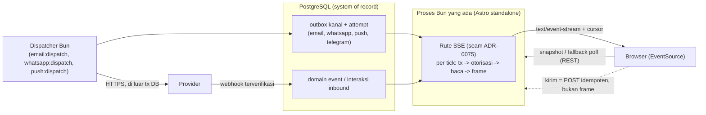

🇮🇩 Bahasa Indonesia · 🇬🇧 [English (source)](0154-realtime-progress-is-sse-first-on-the-existing-bun-process-reading-durable-state-websocket-not-admitted.md)

<!-- i18n-source-hash: sha256:8d9b731e420d8e2b3ccee71c996d785b557f23820911f843c87cda9c1f363da5 -->

# ADR-0154 — Progres realtime memakai SSE lebih dulu di proses Bun yang sudah ada dan membaca state durable; WebSocket belum diadmisi sampai kebutuhan dua arah terbukti

- **Status:** Diusulkan
- **Tanggal:** 2026-10-27
- **Pengambil keputusan:** menunggu — penerimaan adalah keputusan maintainer (ADR-0148 dan Issue #1168 mensyaratkan ADR yang disetujui sebelum kode gateway apa pun)
- **Menyelesaikan:** Issue #1168 (evaluasi gateway realtime Bun yang aman per tenant). Ia gerbang bagi Issue #1171 (implementasinya).
- **Memperluas:** [ADR-0075](0075-sse-reauthorizes-every-tick.md) (koneksi SSE mengotorisasi ulang di setiap tick; ADR ini tidak melonggarkannya), [ADR-0148](0148-omnichannel-foundation-is-five-gated-capabilities-with-fail-closed-per-account-capability.md) invarian I1, I2, I3, I8, I10 dan I13, [ADR-0074](0074-push-delivery-is-a-second-outbox.md) (konsumen SSE pertama), [ADR-0002](0002-bun-only-runtime.md) (hanya Bun)
- **Terkait:** [ADR-0006](0006-offline-first-sync-outbox.md), [ADR-0027](0027-mfa-totp-session-assurance-step-up.md) (assurance sesi), [ADR-0133](0133-generic-delivery-capability-whatsapp-promotion.md) (satu antrean per kanal), Issue #1139, #1144, #1167, #1170, #1171; hilir `ahliweb/awcms-one` #458, #459, #461 dan #430 sampai #432; paket kesiapan [`docs/awcms/bun-delivery-realtime-runtime.md`](../awcms/bun-delivery-realtime-runtime.md) (batas yang diusulkan dari PR #1169)

**Hanya dokumen dan tata kelola.** ADR ini tidak menambah rute, tabel, migrasi, dependensi, path OpenAPI, kanal AsyncAPI, atau job, dan tidak ada di dalamnya yang menjadi bukti bahwa sebuah gateway ada. Penerimaan berarti **desain diadmisi**; Issue #1171 tetap melewati Definition of Ready-nya sendiri dan dibangun, ditinjau, serta digerbangi sebagai perubahan biasa.

## Konteks

Terverifikasi di `main` pada 27 Oktober 2026:

- **Satu endpoint SSE ada:** `GET /api/v1/push/stream` (Issue #467), dibangun di atas `defineSseTenantRoute` di `src/modules/_shared/tenant-route.ts` dan tick loop di `src/modules/_shared/sse-stream.ts`. Ia membuka transaksi baru di setiap tick, menjalankan ulang chokepoint otorisasi, membaca snapshot, dan mengakhiri stream dengan event terminal bernama pada deny pertama, pada error yang dilempar, atau pada `maxConnectionMs` (ADR-0075). Fan-out-nya adalah **polling per koneksi**, dan dituliskan demikian.
- **Tidak ada server WebSocket.** Entry produksi adalah `src/lib/server/standalone-entry.ts`, pembungkus tipis yang menjalankan handler request standalone `@astrojs/node` di bawah Bun (`bun ./dist/standalone-entry.mjs`). Ia tidak memiliki listener `Bun.serve`, sehingga hari ini tidak ada seam `server.upgrade`. Apakah handler adapter dapat dibuat menerima event `upgrade` `node:http` di bawah Bun tanpa listener kedua **belum terverifikasi** di sini.
- Antrean kanal adalah system of record pengiriman: `email`, `whatsapp_delivery`, `push_delivery` dan `telegram_delivery` masing-masing punya outbox PostgreSQL dan dispatcher Bun (ADR-0133, ADR-0074, ADR-0140). ADR-0148 I10: stream **bukan** jalur kirim dan **bukan** antrean kedua.
- Produksi secara default satu instance aplikasi (`capacity-config.ts`); pembungkus klien Redis ada di `src/lib/redis/` untuk cache dan rate limiting, dan bersifat opsional.
- Fakta Bun yang berpengaruh pada pilihan, dari dokumentasi resmi yang diperiksa pada 27 Oktober 2026 dan harus diverifikasi ulang terhadap Bun yang dipin saat implementasi: `Bun.serve` menutup koneksi yang idle 10 detik secara default, sehingga stream SSE yang sepi butuh heartbeat atau `server.timeout(req, 0)`; body `Response` streaming dibatalkan ketika klien terputus; `send` WebSocket mengembalikan `-1` saat backpressure dan `0` saat dijatuhkan, dengan `backpressureLimit` dan `maxPayloadLength` default 16 MB; `idleTimeout` WebSocket default 120 detik dengan ping otomatis; topik `server.publish` berada di dalam proses, dan dokumentasi tidak menjelaskan pengiriman lintas proses; halaman WebSocket tidak menyebut HTTP/2.
- `WebSocket` browser tidak dapat mengatur header `Authorization`, dan `EventSource` browser juga tidak; keduanya mengirim cookie untuk request same-origin, yang dipakai sesi admin.

Kebutuhan produk (Issue #1168): progres untuk kampanye CRM, broadcast, email, WhatsApp, Web Push dan inbox terpadu, tanpa layanan Node Socket.IO, tanpa ingress istimewa kedua, dan tanpa menampilkan pub/sub dalam memori sebagai pengiriman.

### Apa yang sebenarnya di-stream

| Kasus penggunaan                                                 | Arah              | Kebutuhan kesegaran | Toleransi kehilangan                            |
| ---------------------------------------------------------------- | ----------------- | ------------------- | ----------------------------------------------- |
| Penghitung progres kampanye (antre, terkirim, gagal, ditekan)    | server ke halaman | detik               | tinggi (frame berikutnya menggantikan)          |
| Perubahan status provider pada pesan (diterima, terkirim, gagal) | server ke halaman | detik               | tidak ada untuk status akhir; dibaca dari baris |
| Lencana "pesan baru" inbox dan petunjuk muat ulang daftar        | server ke halaman | detik               | tinggi (petunjuk untuk mengambil ulang)         |
| Kesehatan akun (token kedaluwarsa, rating kualitas)              | server ke halaman | puluhan detik       | tinggi                                          |
| Presence agen, mengetik, tanda dibaca                            | **dua arah**      | di bawah satu detik | sedang                                          |
| Mengirim pesan atau kampanye                                     | halaman ke server | bukan urusan stream | tidak ada: ia POST idempoten                    |

Hanya baris kelima yang dua arah, dan tidak ada integrasi provider yang diadmisi ADR-0148 yang membuka mengetik atau presence untuk diteruskan AWCMS. Pengiriman adalah `POST` HTTPS dengan `Idempotency-Key`, bukan frame socket.

## Keputusan

### 1. Pilihan per kasus penggunaan

1. **SSE adalah transport realtime** untuk setiap kasus server-ke-halaman di atas, dilayani dari **proses Bun yang sudah ada** lewat seam ADR-0075 (`defineSseTenantRoute` atau saudaranya di `_shared/`), di bawah path `/api/v1/*`, sesi cookie dan middleware yang ada. Tidak ada listener kedua, port kedua, atau layanan terpisah.
2. **WebSocket tidak diadmisi.** Tidak ada kasus dengan kebutuhan dua arah yang terbukti hari ini. Kebutuhan WebSocket baru diadmisi oleh ADR berikutnya yang menyebut kasusnya, menunjukkan bahwa SSE ditambah `POST` idempoten tidak mencukupi, dan memenuhi §4 di bawah. Sampai saat itu Issue #1171 tidak mengimplementasikan jalur upgrade `Bun.serve`.
3. **Polling terautentikasi terbatas tetap menjadi fallback yang didukung** dan dasar untuk aksesibilitas serta klien yang tidak bisa menahan stream (§6). Snapshot REST yang dipakai polling adalah pembacaan yang sama yang dipakai stream untuk melanjutkan.
4. **Layanan realtime Bun terpisah tidak diadmisi.** Jika pengukuran kelak menunjukkan proses aplikasi tidak sanggup memikul jumlah koneksi, jawabannya adalah ADR yang mengadmisi layanan Bun privat di jaringan internal di belakang proxy dan chokepoint otorisasi yang sama, bukan otoritas kedua dan bukan ingress publik.

### 2. Stream adalah proyeksi state durable

- Sumber event adalah **PostgreSQL**: baris outbox pengiriman beserta kolom attempt dan statusnya, domain event, dan baris interaksi inbound yang diterima. Frame diturunkan dari baris; baris tidak pernah diturunkan dari frame. Email tidak pernah `delivered` hanya karena sebuah frame ditulis.
- Setiap frame membawa **cursor** yang terurut monoton berupa nilai database (misalnya keyset `(updated_at, id)` atau sekuens event per tenant), bukan penghitung per proses. `Last-Event-ID` membawanya saat reconnect. Cursor yang tidak dapat dipenuhi server (sudah dipangkas, cacat, dari tenant lain) menghasilkan event `snapshot-required` dan klien mengambil ulang snapshot REST; server tidak pernah menebak.
- Pembacaan terjadi di dalam transaksi tenant milik tick, setelah keputusan otorisasi (konsekuensi 2 dan 3 ADR-0075). `tx` tidak pernah hidup lebih lama dari satu tick.
- Redis atau `LISTEN/NOTIFY` kelak boleh dipakai **hanya sebagai petunjuk bangun** yang memperpendek tunggu sebelum tick berikutnya. Petunjuk yang hilang hanya merugikan latensi, bukan kebenaran, karena tick berikutnya membaca state durable. Petunjuk tidak membawa apa pun selain id tenant dan topik. Ini tidak diperlukan untuk rilis pertama #1171.

### 3. Otorisasi, scope dan pencabutan

- **Subscribe** diotorisasi per topik lewat chokepoint, dengan permission bernama per keluarga topik (misalnya `crm_campaigns.progress.read`, `inbox.status.read`). Setiap permission di-seed oleh migrasi dan ditegakkan endpoint; permission yang tidak di-seed menolak bahkan owner.
- **Per event:** tick memutuskan ulang dan pembacaan menerapkan filter business-scope yang sama dengan daftar REST yang setara. Frame tidak pernah memuat baris yang tidak boleh didaftar aktor. Pencabutan mengakhiri stream dalam satu tick dengan event terminal `authorization-revoked` yang ada; karena itu interval tick adalah latensi pencabutan dan ditulis di setiap call site (ADR-0075).
- **Scope tenant, akun, brand dan kampanye diturunkan server** dari sesi dan id resource topik, dicek terhadap tenant. Klien menyebut sebuah resource (misalnya id kampanye) dan tidak pernah string kanal. Id yang tidak dikenal, lintas tenant, atau cacat tidak dapat dibedakan dari "tidak ditemukan" dan tidak membuka stream.
- **Assurance sesi:** sesi yang kedaluwarsa atau perlu step-up mengakhiri stream seperti pencabutan (ADR-0027).
- **Origin:** request stream yang `Origin`-nya ada dan tidak ada di allowlist site-origin ditolak sebelum pekerjaan apa pun. `EventSource` adalah `GET`, sehingga tidak ada perubahan state lewatnya; permukaan CSRF-nya hanya-baca dan pengecekan Origin adalah penjaga setara CSWSH.
- **Tidak perlu tiket untuk SSE**, karena cookie same-origin mengautentikasi request. Bila WebSocket kelak diadmisi (§4), aturan tiket di bawah berlaku.

### 4. Syarat bagi setiap admisi WebSocket kelak

ADR berikutnya yang mengadmisi WebSocket `Bun.serve` minimal harus: membuktikan seam upgrade pada standalone entry (atau mengadmisi layanan privat menurut §1.4) tanpa ingress istimewa kedua; mengautentikasi dengan **tiket berumur pendek, sekali pakai, terikat tenant dan audiens** yang diterbitkan `POST` terotorisasi dan dikonsumsi saat upgrade, tidak pernah bearer berumur panjang di URL atau log; memverifikasi `Origin` saat upgrade; mengotorisasi setiap subscribe dan setiap frame masuk per topik; membatasi ukuran frame jauh di bawah default 16 MB; memakai batas per koneksi dan per tenant, idle timeout, heartbeat dan pengusiran klien lambat pada hasil send `-1`/`0`; berjalan hanya di balik upgrade HTTP/1.1 dan gagal-tertutup di tempat proxy akan menegosiasikan WebSocket HTTP/2; dan tidak pernah membawa pengiriman, panggilan provider, atau antrean kedua.

### 5. Backpressure, kuota dan load shedding (mengikat #1171)

- **Batas:** batas koneksi per aktor, per tenant dan per instance, masing-masing dikonfigurasi lewat registri env, dengan default konservatif yang didokumentasikan. Di atas batas, request ditolak dengan `429` dan `Retry-After`, tidak diantre.
- **Frame terbatas:** ukuran frame serial maksimum dan jumlah item per frame maksimum; kumpulan perubahan yang lebih besar dikirim sebagai event `snapshot-required`, bukan frame yang lebih besar.
- **Konsumen lambat:** penulis harus mengamati desired size stream; koneksi yang buffer-nya tetap di atas ambang selama waktu terbatas ditutup dengan event terminal `slow-consumer`. Klien lambat tidak boleh membuat memori server tumbuh tanpa batas atau menunda tick tenant lain.
- **Koalesensi:** penghitung progres digabung ke nilai terbaru per tick; hanya status terminal pesan individual yang dijamin dapat direpresentasikan, dan itu dibaca dari baris.
- **Load shedding:** ketika pool database atau circuit breaker menolak (`withTenantOrThrow` melempar), stream berakhir dengan event terminal bernama yang ada dan klien mundur dengan jitter; tidak ada loop retry per koneksi terhadap database yang sedang menolak (ADR-0075).
- **Umur:** `maxConnectionMs` tetap wajib; `EventSource` menyambung ulang dengan cursor.
- **Heartbeat:** frame komentar pada interval di bawah batas idle proxy dan Bun menjaga stream tetap terbuka; byte pertama ditulis segera (konsekuensi 1 ADR-0075).

### 6. Aksesibilitas dan UX

- UI progres **harus bekerja tanpa stream**: state terkini dirender server, kontrol muat ulang manual berlabel, dan fallback polling terbatas. Stream memperbaiki kesegaran; ia tidak pernah satu-satunya cara mengetahui state.
- Pembaruan diumumkan lewat region `aria-live` polite dengan laju terbatas (misalnya paling banyak satu pengumuman per beberapa detik, dan selalu untuk status terminal), bukan di setiap tick penghitung. Gerak menghormati `prefers-reduced-motion`. Status koneksi ("live", "menyambung ulang", "basi sejak") berupa teks, bukan hanya warna, dan state basi atau tidak diketahui ditampilkan apa adanya, tidak pernah sebagai nilai optimistis terakhir.
- Stream **bukan** push durable: tab yang ditutup, browser iOS di latar belakang, atau perangkat yang tidur berhenti menerima. Pengguna yang perlu diberi tahu saat tab ditutup memilih Web Push (ADR-0074); UI tidak mengisyaratkan sebaliknya.

### 7. Perilaku multi-instance

- **Hari ini (satu instance):** polling per koneksi, seperti konsekuensi 4 ADR-0075. Ia benar pada berapa pun instance karena setiap tick membaca PostgreSQL; ia tidak menjadi lebih murah.
- **Saat replika diadmisi:** reconnect dapat mendarat di instance mana pun dan melanjutkan dengan cursor; tidak ada state dalam memori yang otoritatif; sticky session tidak diperlukan. Biayanya beban baca database proporsional dengan koneksi dibagi interval tick, yang dibatasi oleh batas di §5 dan diekspos oleh metrik di §8. Petunjuk bangun (§2) mengurangi latensi, bukan beban, kecuali tick diperpanjang saat kanal petunjuk sehat; optimasi itu butuh pengukuran dulu.
- **Ditolak untuk multi-instance:** `server.publish` lokal-proses sebagai satu-satunya fan-out, dan broker yang menyimpan satu-satunya salinan sebuah event.

### 8. Observabilitas dan privasi envelope

- Metrik **hanya agregat tenant** dan berkardinalitas rendah: koneksi terbuka, buka dan tutup menurut alasan (`revoked`, `expired`, `slow-consumer`, `capped`, `error`, `client`), frame tertulis, jumlah `snapshot-required`, durasi tick, lag tick-ke-frame, auth deny. Tidak ada id tenant, id aktor, atau id resource sebagai label.
- Envelope berversi (`v`), terbatas, dan membawa pengenal, hitungan, status enum, dan timestamp. Ia **tidak pernah** membawa alamat atau nomor telepon penerima, token atau body respons provider, body atau subjek pesan, OTP, atau data tenant lain. Pratinjau percakapan tidak di-stream; petunjuk inbox berkata "ada yang berubah" dan halaman mengambil ulang lewat pembacaan REST terotorisasi.
- Baris audit ditulis untuk **penolakan stream karena pencabutan** (peristiwa relevan-keamanan), bukan untuk setiap pembukaan; decision log mengikuti aturan volume ADR-0072.

### 9. Yang tidak berubah

Pull worker bertanda tangan outbound-only OMES (ADR-0027 OMES), pesan native Hermes, dan dispatch HTTPS provider tetap di luar gateway browser. Gateway tidak menambah listener inbound untuk OMES, runtime agen, atau antrean.

## Tabel keputusan

| Kriteria                               | **SSE di proses yang ada (dipilih)**                                                                                                      | WebSocket native Bun                                                                                                       | Polling terautentikasi terbatas (dipertahankan sebagai fallback)      |
| -------------------------------------- | ----------------------------------------------------------------------------------------------------------------------------------------- | -------------------------------------------------------------------------------------------------------------------------- | --------------------------------------------------------------------- |
| Isolasi tenant                         | Chokepoint dan transaksi tenant RLS yang sama dengan setiap API; cookie same-origin                                                       | Butuh identitas waktu-upgrade terpisah (tiket) dan otorisasi per frame; topik lokal-proses mengundang kanal bernama string | Sama dengan pembacaan API mana pun                                    |
| Otorisasi saat subscribe dan per event | Diputuskan ulang tiap tick (ADR-0075); pencabutan dalam satu tick                                                                         | Harus dibangun: cek subscribe, cek per frame, putus paksa saat pencabutan                                                  | Diputuskan ulang di setiap request                                    |
| Backpressure dan klien lambat          | Penulis mengamati desired size; tutup pada ambang; satu arah sehingga tak ada banjir masuk                                                | Frame masuk menambah permukaan serangan (ukuran, laju, cacat); hasil send `-1`/`0` harus ditangani                         | Tidak perlu; klien mengatur lajunya sendiri                           |
| Dukungan browser dan proxy             | Respons HTTP biasa; `EventSource` menyambung ulang dengan `Last-Event-ID`; proxy perlu buffering mati (sudah dilakukan untuk push stream) | Butuh dukungan upgrade HTTP/1.1 di setiap proxy dan posisi HTTP/2 terdokumentasi; tanpa reconnect bawaan                   | Bekerja di mana-mana                                                  |
| Performa                               | Satu respons terbuka per klien; baca DB per tick                                                                                          | Latensi terendah; broadcast efisien hanya dalam satu proses                                                                | Overhead request tertinggi pada interval pendek; paling mudah di-shed |
| Skalabilitas multi-instance            | Benar di instance mana pun lewat cursor; beban naik dengan koneksi / tick                                                                 | Pub/sub lokal-proses; tetap butuh broker atau cursor durable agar benar                                                    | Benar di instance mana pun                                            |
| Kompleksitas operasional               | Sudah berjalan untuk `push/stream`; tanpa listener baru                                                                                   | Listener atau seam adapter baru, endpoint tiket, konfigurasi proxy upgrade, tes baru                                       | Terendah                                                              |
| Aksesibilitas                          | Model live-region yang sama; fallback adalah halamannya sendiri                                                                           | Sama; lebih banyak bagian bergerak yang dapat membuat UI basi tanpa pemberitahuan                                          | Paling mudah dinalar; tanpa koneksi hidup untuk diumumkan             |
| Kecocokan kasus ini                    | Semua kasus server-ke-halaman                                                                                                             | Hanya presence dan mengetik, yang tidak diadmisi                                                                           | Semua, dengan latensi interval poll                                   |
| Jangka panjang                         | Dapat diamandemen dengan petunjuk bangun                                                                                                  | Dapat diadmisi kelak lewat §4                                                                                              | Lantai permanen                                                       |

## Arsitektur

## Tugas implementasi atomik untuk #1171 (setelah diterima)

1. **Seam dan envelope.** Perluas seam SSE `_shared/` dengan dukungan cursor (`Last-Event-ID`, `snapshot-required`), tipe envelope berversi, batas dan penutupan konsumen lambat, serta pengecekan Origin. Tes unit dengan efek yang disuntik, tanpa database.
2. **Topik progres kampanye.** Satu topik, permission yang di-seed, snapshot REST-nya, path OpenAPI dan catatan proyeksi AsyncAPI; tes integrasi untuk dua tenant dan dua brand, peran dicabut di tengah stream, id resource berbahaya, Origin salah, sesi kedaluwarsa, gangguan provider, reconnect dengan cursor, pembaca lambat.
3. **Topik petunjuk inbox** dan **topik status pesan**, masing-masing sebagai perubahan sendiri dengan permission dan tes sendiri.
4. **Metrik, entri registri env, dokumen dan runbook;** komponen progres yang aksesibel beserta fallback polling-nya; catatan konfigurasi proxy (buffering mati, idle timeout di atas heartbeat).
5. **Opsional, kelak, issue terpisah:** petunjuk bangun lewat `LISTEN/NOTIFY` atau Redis, hanya setelah pengukuran beban.

## Invarian untuk #1171

R1. **Durable dulu.** Frame adalah proyeksi baris yang sudah di-commit; tidak ada state yang hanya ada di stream atau memori proses; cursor adalah nilai database.
R2. **Tidak pernah jalur kirim.** Tidak ada frame, dan tidak ada pesan stream klien-ke-server, yang menyebabkan panggilan provider, enqueue, atau perubahan status (ADR-0148 I10).
R3. **Diotorisasi ulang tiap tick**, deny final, dan event terminal bernama membedakan pencabutan, error, konsumen lambat dan batas (ADR-0075).
R4. **Scope diturunkan server.** Klien menyebut id resource, tidak pernah string tenant, kanal atau topik; id lintas tenant adalah "tidak ditemukan".
R5. **Permission per topik, di-seed dan ditegakkan.** Permission yang tidak ada di migrasi seeding menolak owner juga.
R6. **Filter sama dengan REST.** Frame hanya memuat apa yang bisa didaftar aktor yang sama lewat pembacaan REST.
R7. **Envelope tersunting, terbatas, berversi.** Tanpa alamat penerima, rahasia atau respons provider, body pesan, OTP, atau data tenant lain (ADR-0148 I3, I8).
R8. **Dibatasi dan di-shed.** Batas per aktor, per tenant dan per instance; `429` di atas batas; konsumen lambat ditutup; tanpa buffer tak terbatas.
R9. **Umur dan heartbeat wajib;** byte pertama di-flush segera; buffering proxy dimatikan.
R10. **Tidak ada otoritas kedua yang berdiri.** Tanpa listener baru, port kedua, proses Node, Socket.IO, listener inbound OMES, atau antrean kedua.
R11. **Fallback polling dan UI tanpa stream** dirilis dalam perubahan yang sama dengan stream.
R12. **Metrik hanya agregat tenant;** tanpa pengenal sebagai label.
R13. **Tidak ada klaim melampaui bukti.** UI dan dokumen tidak pernah menyebut stream sebagai push durable atau konfirmasi pengiriman; basi dan tidak diketahui ditampilkan apa adanya.
R14. **Aditif dan forward-only** (ADR-0148 I13): tidak ada migrasi terapan yang ditulis ulang; deployment yang tidak membuka stream berperilaku seperti hari ini.

## Tes yang diwajibkan (dibawa #1171)

Dua tenant; dua brand; kampanye campuran-kanal; status basi ditampilkan sebagai basi; peran dicabut saat stream; id resource berbahaya dan lintas tenant; Origin salah dan hilang; sesi kedaluwarsa; pool database atau breaker menolak; gangguan provider terlihat sebagai `failed` dari baris; koneksi terputus dan pemulihan cursor; cursor terpangkas atau asing; pengusiran pembaca lambat; penegakan batas; restart; dua instance membaca cursor yang sama; reverse proxy tanpa buffering dan dengan idle timeout; iOS Safari di latar belakang dan pemulihan tab; fallback polling dengan stream diblokir; pemeriksaan statis bahwa tidak ada `ws`, `socket.io` atau perintah peluncuran Node yang masuk repositori (bersama #1170).

## Konsekuensi

- **Positif:** kasus penggunaan dilayani dengan mesin yang sudah berjalan dan punya ADR keamanan; tanpa listener atau ingress baru; kebenaran tidak bergantung pada memori proses; latensi pencabutan adalah angka yang dipilih di setiap call site.
- **Negatif / trade-off:** pembacaan database per koneksi skala dengan koneksi, yang dibatasi tetapi tidak dihapus oleh batas; tidak ada push di bawah satu detik dan tidak ada presence; kebutuhan dua arah kelak memerlukan ADR baru.
- **Netral:** tidak ada perubahan perilaku sampai #1171 mendarat; polling tetap tersedia sepanjang waktu.
- **Terbuka dan ditandai:** apakah handler `@astrojs/node` di bawah Bun dapat menerima upgrade belum terverifikasi dan kini tidak relevan bagi jalur yang dipilih; ia hanya penting bagi ADR §4 kelak. Nilai default batas dan interval tick ditetapkan saat implementasi dari pengukuran, bukan di sini. Perilaku Bun yang dikutip di Konteks harus diverifikasi ulang terhadap versi Bun yang dipin.
- **Persetujuan manusia yang masih diperlukan (tidak dilakukan di sini):** penerimaan maintainer; tinjauan keamanan atas implementasi #1171 (ia menyentuh chokepoint otorisasi).

## Alternatif yang ditolak

- **Gateway WebSocket sekarang.** Ia membeli latensi di bawah satu detik dan presence yang tidak dibutuhkan kasus mana pun yang diadmisi, dengan harga listener baru, protokol tiket, dan jalur otorisasi kedua.
- **Layanan Node atau Socket.IO terpisah.** Dilarang ADR-0002 dan ADR-0148 I10.
- **`server.publish` lokal-proses sebagai fan-out.** Ia tidak dibagi antar instance dan menjadikan memori sebagai catatan.
- **Hanya polling.** Dipertahankan sebagai lantai, tetapi memakai lebih banyak request untuk kesegaran yang sama dan tidak memberi push untuk layar kampanye.
- **Broker sebagai satu-satunya salinan event.** Ia membuat state pengiriman bergantung pada system of record kedua.
