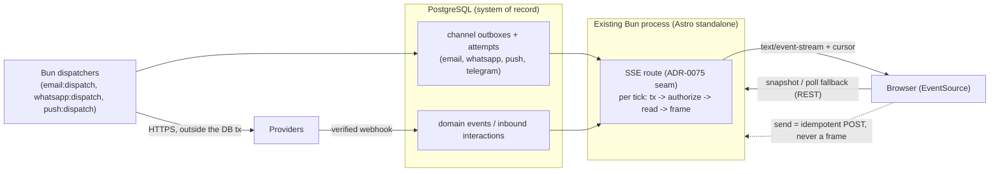

🇬🇧 English (source) · 🇮🇩 [Bahasa Indonesia](0154-realtime-progress-is-sse-first-on-the-existing-bun-process-reading-durable-state-websocket-not-admitted.id.md)

# ADR-0154 — Realtime progress is SSE-first on the existing Bun process and reads durable state; WebSocket is not admitted until a bidirectional need is proven

- **Status:** Proposed
- **Date:** 2026-10-27
- **Decision maker:** pending — acceptance is the maintainer's decision (ADR-0148 and Issue #1168 require an approved ADR before any gateway code)
- **Resolves:** Issue #1168 (evaluate a tenant-safe Bun realtime gateway). It is the gate for Issue #1171 (the implementation).
- **Extends:** [ADR-0075](0075-sse-reauthorizes-every-tick.md) (an SSE connection re-authorizes on every tick; this ADR does not relax it), [ADR-0148](0148-omnichannel-foundation-is-five-gated-capabilities-with-fail-closed-per-account-capability.md) invariants I1, I2, I3, I8, I10 and I13, [ADR-0074](0074-push-delivery-is-a-second-outbox.md) (the first SSE consumer), [ADR-0002](0002-bun-only-runtime.md) (Bun only)
- **Related:** [ADR-0006](0006-offline-first-sync-outbox.md), [ADR-0027](0027-mfa-totp-session-assurance-step-up.md) (session assurance), [ADR-0133](0133-generic-delivery-capability-whatsapp-promotion.md) (one queue per channel), Issues #1139, #1144, #1167, #1170, #1171; downstream `ahliweb/awcms-one` #458, #459, #461 and #430 to #432; the readiness pack [`docs/awcms/bun-delivery-realtime-runtime.md`](../awcms/bun-delivery-realtime-runtime.md) (the proposed boundary from PR #1169)

**Docs and governance only.** This ADR adds no route, table, migration, dependency, OpenAPI path, AsyncAPI channel or job, and nothing in it is evidence that a gateway exists. Acceptance means the **design is admitted**; Issue #1171 still passes its own Definition of Ready and is built, reviewed and gated as a normal change.

## Context

Verified on `main` at 27 October 2026:

- **One SSE endpoint exists:** `GET /api/v1/push/stream` (Issue #467), built on `defineSseTenantRoute` in `src/modules/_shared/tenant-route.ts` and the tick loop in `src/modules/_shared/sse-stream.ts`. It opens a new transaction every tick, re-runs the authorization chokepoint, reads a snapshot, and ends the stream with a named terminal event on the first deny, on a thrown error, or at `maxConnectionMs` (ADR-0075). Its fan-out is **per-connection polling**, written down as such.
- **No WebSocket server exists.** The production entry is `src/lib/server/standalone-entry.ts`, a thin wrapper that runs the `@astrojs/node` standalone request handler under Bun (`bun ./dist/standalone-entry.mjs`). It does not own a `Bun.serve` listener, so there is no `server.upgrade` seam today. Whether the adapter's handler can be made to take a `node:http` `upgrade` event under Bun without a second listener is **unverified** here.
- The channel queues are the system of record for delivery: `email`, `whatsapp_delivery`, `push_delivery` and `telegram_delivery` each have a PostgreSQL outbox and a Bun dispatcher (ADR-0133, ADR-0074, ADR-0140). ADR-0148 I10: a stream is **not** the send path and **not** a second queue.
- Production defaults to one application instance (`capacity-config.ts`); a Redis client wrapper exists in `src/lib/redis/` for cache and rate limiting, and is optional.
- Bun facts that bear on the choice, from the official documentation checked on 27 October 2026 and to be re-verified against the pinned Bun at implementation time: `Bun.serve` closes connections idle for 10 seconds by default, so a quiet SSE stream needs a heartbeat or `server.timeout(req, 0)`; a streaming `Response` body is cancelled when the client disconnects; WebSocket `send` returns `-1` under backpressure and `0` when dropped, with a 16 MB default `backpressureLimit` and `maxPayloadLength`; WebSocket `idleTimeout` defaults to 120 seconds with automatic pings; `server.publish` topics are in-process, and the documentation does not describe cross-process delivery; the WebSocket page does not mention HTTP/2.
- A browser `WebSocket` cannot set an `Authorization` header, and a browser `EventSource` cannot either; both send cookies for same-origin requests, which is what the admin session uses.

The product need (Issue #1168): progress for CRM campaigns, broadcast, email, WhatsApp, Web Push and the unified inbox, without a Node Socket.IO service, without a second privileged ingress, and without presenting an in-memory pub/sub as delivery.

### What is actually being streamed

| Use case                                                           | Direction      | Freshness need       | Loss tolerance                                    |
| ------------------------------------------------------------------ | -------------- | -------------------- | ------------------------------------------------- |
| Campaign progress counters (queued, sent, failed, suppressed)      | server to page | seconds              | high (the next frame supersedes)                  |
| Provider status changes on a message (accepted, delivered, failed) | server to page | seconds              | none for the final state; it is read from the row |
| Inbox "new message" badge and list refresh hint                    | server to page | seconds              | high (a hint to re-fetch)                         |
| Account health (token expired, quality rating)                     | server to page | tens of seconds      | high                                              |
| Agent presence, typing, read receipts                              | **both**       | sub-second           | medium                                            |
| Sending a message or a campaign                                    | page to server | not a stream concern | none: it is an idempotent POST                    |

Only the fifth row is bidirectional, and no provider integration admitted by ADR-0148 exposes typing or presence that AWCMS would relay. Sending is an HTTPS `POST` with an `Idempotency-Key`, not a socket frame.

## Decision

### 1. Per-use-case choice

1. **SSE is the realtime transport** for every server-to-page use case above, served from the **existing Bun process** through the ADR-0075 seam (`defineSseTenantRoute` or a sibling in `_shared/`), under the existing `/api/v1/*` path, cookie session and middleware. No second listener, no second port, no separate service.
2. **WebSocket is not admitted.** No use case with a proven bidirectional requirement exists today. A WebSocket requirement is admitted only by a later ADR that names the use case, shows that SSE plus an idempotent `POST` cannot meet it, and satisfies §4 below. Until then Issue #1171 implements no `Bun.serve` upgrade path.
3. **Authenticated bounded polling remains the supported fallback** and the baseline for accessibility and for clients that cannot hold a stream (§6). The REST snapshot that polling uses is the same read the stream uses to resume.
4. **A separate Bun realtime service is not admitted.** If measurement later shows the application process cannot carry the connection count, the answer is an ADR that admits a private, internal-network Bun service behind the same proxy and the same authorization chokepoint, not a second authority and not a public ingress.

### 2. The stream is a projection of durable state

- The event source is **PostgreSQL**: delivery outbox rows and their attempt and status columns, domain events, and accepted inbound interaction rows. A frame is derived from a row; a row is never derived from a frame. An email is never `delivered` because a frame was written.
- Every frame carries a monotonically ordered **cursor** that is a database value (for example a `(updated_at, id)` keyset or an event sequence per tenant), not a per-process counter. `Last-Event-ID` carries it on reconnect. A cursor the server cannot honour (pruned, malformed, from another tenant) yields a `snapshot-required` event and the client re-fetches the REST snapshot; the server never guesses.
- Reads happen inside the tick's tenant transaction, after the authorization decision (ADR-0075 consequences 2 and 3). `tx` never outlives a tick.
- Redis or `LISTEN/NOTIFY` may later be used **only as a wake-up hint** that shortens the wait before the next tick. A lost hint costs latency, never correctness, because the next tick reads durable state. A hint carries no payload beyond a tenant id and a topic. This is not required for #1171's first release.

### 3. Authorization, scope and revocation

- **Subscribe** is authorized per topic through the chokepoint, with a named permission per topic family (for example `crm_campaigns.progress.read`, `inbox.status.read`). Each permission is seeded by migration and enforced by the endpoint; a permission that is not seeded denies even the owner.
- **Per event:** the tick re-decides and the read applies the same business-scope filter the equivalent REST list applies. A frame never contains a row the actor could not list. Revocation ends the stream within one tick with the existing `authorization-revoked` terminal event; the tick interval is therefore the revocation latency and is written at every call site (ADR-0075).
- **Tenant, account, brand and campaign scope are server-derived** from the session and the topic's resource id, checked against the tenant. The client names a resource (for example a campaign id) and never a channel string. An unknown, cross-tenant or malformed id is indistinguishable from "not found" and opens no stream.
- **Session assurance:** an expired or step-up-required session ends the stream like a revocation (ADR-0027).
- **Origin:** a stream request whose `Origin` is present and not on the site-origin allowlist is refused before any work. `EventSource` is a `GET`, so no state change is possible through it; the CSRF surface is read-only and the Origin check is the CSWSH-equivalent guard.
- **No ticket is needed for SSE**, because the same-origin cookie authenticates the request. If WebSocket is ever admitted (§4), the ticket rule below applies.

### 4. Conditions any later WebSocket admission must meet

A future ADR admitting a `Bun.serve` WebSocket must, at minimum: prove the upgrade seam on the standalone entry (or admit a private service per §1.4) without a second privileged ingress; authenticate with a **short-lived, single-use, tenant- and audience-bound ticket** issued by an authorized `POST` and consumed on upgrade, never a long-lived bearer in a URL or log; verify `Origin` on upgrade; authorize each subscribe and each inbound frame by topic; cap frame size well below the 16 MB default; use per-connection and per-tenant caps, idle timeout, heartbeats and slow-client eviction on `-1`/`0` send results; run behind HTTP/1.1 upgrade only and fail closed where a proxy would negotiate HTTP/2 WebSocket; and never carry a send, a provider call or a second queue.

### 5. Backpressure, quotas and load shedding (binding on #1171)

- **Caps:** a per-actor connection cap, a per-tenant connection cap and a per-instance cap, each configured through the env registry, with defaults chosen conservatively and documented. Over a cap the request is refused with `429` and `Retry-After`, not queued.
- **Bounded frames:** a maximum serialized frame size and a maximum number of items per frame; a larger change set is sent as a `snapshot-required` event, not as a bigger frame.
- **Slow consumers:** the writer must observe the stream's desired size; a connection whose buffer stays above a threshold for a bounded time is closed with a `slow-consumer` terminal event. A slow client must never grow server memory without bound or delay other tenants' ticks.
- **Coalescing:** progress counters are coalesced to the latest value per tick; only terminal states of individual messages are guaranteed to be representable, and they are read from the row.
- **Load shedding:** when the database pool or circuit breaker refuses (`withTenantOrThrow` throws), the stream ends with the existing named terminal event and the client backs off with jitter; there is no per-connection retry loop against a refusing database (ADR-0075).
- **Lifetime:** `maxConnectionMs` stays mandatory; `EventSource` reconnects with the cursor.
- **Heartbeat:** a comment frame at an interval below the proxy and Bun idle limits keeps the stream open; the first byte is written immediately (ADR-0075 consequence 1).

### 6. Accessibility and UX

- Progress UI **must work with no stream**: server-rendered current state, a labelled manual refresh control, and the bounded polling fallback. A stream improves freshness; it is never the only way to learn the state.
- Updates are announced through a polite `aria-live` region at a bounded rate (for example, at most one announcement per several seconds, and always for terminal states), not on every counter tick. Motion respects `prefers-reduced-motion`. The connection state ("live", "reconnecting", "stale since") is text, not only colour, and a stale or unknown state is shown as such, never as the last optimistic value.
- A stream is **not** durable push: a closed tab, a backgrounded iOS browser or a sleeping device stops receiving. Users who need to be told when the tab is closed opt into Web Push (ADR-0074); the UI does not imply otherwise.

### 7. Multi-instance behaviour

- **Today (one instance):** per-connection polling, as ADR-0075 consequence 4. It is correct on any number of instances because every tick reads PostgreSQL; it does not get cheaper.
- **When replicas are admitted:** a reconnect may land on any instance and resumes by cursor; no in-memory state is authoritative; sticky sessions are not required. The cost is database read load proportional to connections divided by tick interval, which the caps in §5 bound and the metrics in §8 expose. A wake-up hint (§2) reduces latency, not load, unless ticks are lengthened when a hint channel is healthy; that optimisation needs measurement first.
- **Rejected for multi-instance:** process-local `server.publish` as the only fan-out, and a broker that holds the only copy of an event.

### 8. Observability and privacy of the envelope

- Metrics, **tenant-aggregate only** and low-cardinality: open connections, opens and closes by reason (`revoked`, `expired`, `slow-consumer`, `capped`, `error`, `client`), frames written, `snapshot-required` count, tick duration, tick-to-frame lag, auth denies. No tenant id, actor id or resource id as a label.
- The envelope is versioned (`v`), bounded, and carries identifiers, counts, enum states and timestamps. It **never** carries a recipient address or phone number, a provider token or response body, a message body or subject, an OTP, or another tenant's data. A conversation preview is not streamed; the inbox hint says "something changed" and the page re-fetches through the authorized REST read.
- The audit row is written for stream **denials by revocation** (a security-relevant event), not for every open; the decision log follows ADR-0072 volume rules.

### 9. What does not change

The OMES outbound-only signed pull worker (ADR-0027 of OMES), Hermes native messaging, and provider HTTPS dispatch stay outside the browser gateway. The gateway adds no inbound listener for OMES, no agent runtime and no queue.

## Decision table

| Criterion                        | **SSE on the existing process (chosen)**                                                                                                    | Bun native WebSocket                                                                                                           | Authenticated bounded polling (kept as fallback)                             |
| -------------------------------- | ------------------------------------------------------------------------------------------------------------------------------------------- | ------------------------------------------------------------------------------------------------------------------------------ | ---------------------------------------------------------------------------- |
| Tenant isolation                 | Same chokepoint and RLS tenant transaction as every API; cookie same-origin                                                                 | Needs a separate upgrade-time identity (ticket) and per-frame authorization; process-local topics invite string-named channels | Same as any API read                                                         |
| Authz on subscribe and per event | Re-decided every tick (ADR-0075); revocation within one tick                                                                                | Must be built: subscribe checks, per-frame checks, forced disconnect on revocation                                             | Re-decided on every request                                                  |
| Backpressure and slow clients    | Writer observes desired size; close on threshold; one-way so no inbound flood                                                               | Inbound frames add an attack surface (size, rate, malformed); send returns `-1`/`0` to be handled                              | None needed; client paces itself                                             |
| Browser support and proxies      | Plain HTTP/1.1 or HTTP/2 response; `EventSource` reconnects with `Last-Event-ID`; proxies need buffering off (already done for push stream) | Needs HTTP/1.1 upgrade support in every proxy and a documented HTTP/2 position; no built-in reconnect                          | Works everywhere                                                             |
| Performance                      | One open response per client; per-tick DB read                                                                                              | Lowest latency; efficient broadcast within one process only                                                                    | Highest request overhead at short intervals; simplest to cache-bust and shed |
| Multi-instance scalability       | Correct on any instance via cursor; load scales with connections / tick                                                                     | Process-local pub/sub; needs a broker or durable cursor anyway to be correct                                                   | Correct on any instance                                                      |
| Operational complexity           | Already shipping for `push/stream`; no new listener                                                                                         | New listener or adapter seam, ticket endpoint, upgrade proxy config, new tests                                                 | Lowest                                                                       |
| Accessibility                    | Same live-region model; fallback is the page itself                                                                                         | Same; more moving parts that can leave the UI stale without notice                                                             | Simplest to reason about; no live connection to announce                     |
| Fit for these use cases          | All server-to-page cases                                                                                                                    | Only presence and typing, which are not admitted                                                                               | All, with latency of the poll interval                                       |
| Long-term                        | Can be amended with a wake-up hint                                                                                                          | Admissible later through §4                                                                                                    | Permanent floor                                                              |

## Architecture

## Atomic implementation tasks for #1171 (after acceptance)

1. **Seam and envelope.** Extend the `_shared/` SSE seam with cursor support (`Last-Event-ID`, `snapshot-required`), a versioned envelope type, the caps and slow-consumer close, and the Origin check. Unit tests with injected effects, no database.
2. **Campaign progress topic.** One topic, its seeded permission, its REST snapshot, OpenAPI paths and the AsyncAPI projection note; integration tests for two tenants and two brands, role revoked mid-stream, malicious resource id, wrong Origin, expired session, provider outage, reconnect with cursor, slow reader.
3. **Inbox hint topic** and **message status topic**, each as its own change with its own permission and tests.
4. **Metrics, env registry entries, docs and runbook;** the accessible progress component and its polling fallback; proxy configuration notes (buffering off, idle timeouts above the heartbeat).
5. **Optional, later, separate issue:** wake-up hint through `LISTEN/NOTIFY` or Redis, only after a load measurement.

## Invariants for #1171

R1. **Durable first.** A frame is a projection of a committed row; no state exists only in a stream or in process memory; a cursor is a database value.
R2. **Never a send path.** No frame, and no client-to-server stream message, causes a provider call, an enqueue or a status change (ADR-0148 I10).
R3. **Re-authorized every tick**, deny is final, and the named terminal event distinguishes revocation, error, slow consumer and cap (ADR-0075).
R4. **Server-derived scope.** The client names a resource id, never a tenant, channel or topic string; a cross-tenant id is "not found".
R5. **Per-topic permission, seeded and enforced.** A permission absent from the seeding migration denies the owner too.
R6. **Same filter as REST.** A frame contains only what the same actor could list through the REST read.
R7. **Redacted, bounded, versioned envelope.** No recipient address, provider secret or response, message body, OTP or other-tenant data (ADR-0148 I3, I8).
R8. **Capped and shed.** Per-actor, per-tenant and per-instance caps; `429` over cap; slow consumers closed; no unbounded buffer.
R9. **Mandatory lifetime and heartbeat;** first byte flushed immediately; proxy buffering disabled.
R10. **No standing second authority.** No new listener, no second port, no Node process, no Socket.IO, no OMES inbound listener, no second queue.
R11. **Polling fallback and no-stream UI** ship in the same change as the stream.
R12. **Tenant-aggregate metrics only;** no identifiers as labels.
R13. **No claim beyond the evidence.** The UI and docs never describe a stream as durable push or as delivery confirmation; stale and unknown are shown as such.
R14. **Additive and forward-only** (ADR-0148 I13): no applied migration is rewritten; a deployment that opens no stream behaves as today.

## Required tests (carried by #1171)

Two tenants; two brands; mixed-channel campaign; stale status shown as stale; role revoked during a stream; malicious and cross-tenant resource id; wrong and missing Origin; expired session; database pool or breaker refusal; provider outage visible as `failed` from the row; dropped connection and cursor recovery; pruned or foreign cursor; slow reader eviction; cap enforcement; restart; two instances reading the same cursor; reverse proxy without buffering and with an idle timeout; iOS Safari backgrounding and tab restore; the polling fallback with the stream blocked; a static check that no `ws`, `socket.io` or Node launch command enters the repository (with #1170).

## Consequences

- **Positive:** the use cases are served with machinery that already ships and has a security ADR; no new listener or ingress; correctness does not depend on process memory; the revocation latency is a number chosen at each call site.
- **Negative / trade-off:** per-connection database reads scale with connections, which the caps bound but do not remove; there is no sub-second push and no presence; a future bidirectional need costs a new ADR.
- **Neutral:** no behaviour changes until #1171 lands; polling remains available throughout.
- **Open and flagged:** whether the `@astrojs/node` handler under Bun can accept an upgrade is unverified and now irrelevant to the chosen path; it matters only to a future §4 ADR. Default cap values and tick intervals are set at implementation from measurement, not here. Bun behaviours quoted in Context must be re-verified against the pinned Bun version.
- **Human sign-off still needed (not performed here):** the maintainer's acceptance; a security review of the #1171 implementation (it touches the authorization chokepoint).

## Alternatives rejected

- **A WebSocket gateway now.** It buys sub-second latency and presence that no admitted use case needs, at the price of a new listener, a ticket protocol and a second authorization path.
- **A separate Node or Socket.IO service.** Forbidden by ADR-0002 and ADR-0148 I10.
- **Process-local `server.publish` as the fan-out.** It is not shared across instances and would make memory the record.
- **Polling only.** Kept as the floor, but it spends more requests for the same freshness and gives no push for the campaign screen.
- **A broker as the only copy of events.** It would make delivery state depend on a second system of record.
