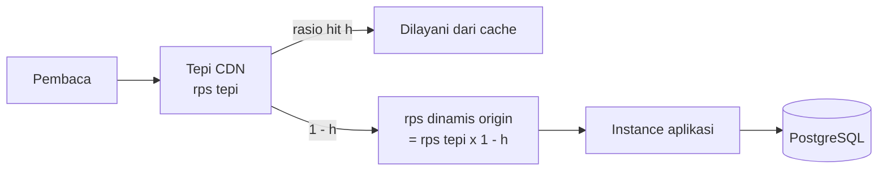

🇮🇩 Bahasa Indonesia · 🇬🇧 [English (source)](0161-capacity-targets-are-measured-nfrs-and-the-scale-path-is-staged.md)

<!-- i18n-source-hash: sha256:511be026e844ebb9e6d4656f453c69a67a79b15f4a9f9815e0b3f23d45b0d2c5 -->

# ADR-0161 — Target kapasitas adalah NFR yang terukur, dan jalur skala bertahap

- **Status:** Diusulkan
- **Tinjauan:** menjadi Diterima hanya setelah ditinjau maintainer. Sampai saat itu ia adalah rekomendasi. ADR ini tidak menambah kode; pekerjaan yang disebutnya dipecah menjadi issue yang menunggu gerbang Definition-of-Ready.
- **Tanggal:** 2026-11-12
- **Pengambil keputusan:** @ahliweb (menunggu tinjauan maintainer)
- **Terkait:** [ADR-0042](0042-varnish-edge-cache-auto-activation.id.md) (cache tepi, allow-list surface fail-closed), [ADR-0061](0061-host-resolved-public-surfaces-are-edge-cacheable.id.md), [ADR-0066](0066-shared-rate-limiting-and-full-auth-surface-coverage.id.md) (rate limiting bersama), [ADR-0083](0083-this-template-deploys-to-one-environment.id.md) (satu environment), [ADR-0098](0098-the-cache-key-carries-the-locale-in-the-path.id.md), [ADR-0107](0107-a-readers-browser-may-search-and-the-origin-names-the-tenant.id.md); [`docs/awcms/edge-cache-architecture.id.md`](../awcms/edge-cache-architecture.id.md), [`docs/awcms/database-pooling.id.md`](../awcms/database-pooling.id.md), [`docs/awcms/database-capacity-runbook.id.md`](../awcms/database-capacity-runbook.id.md), [`docs/awcms/observability-metrics.id.md`](../awcms/observability-metrics.id.md), [`docs/awcms/standar-performa-dan-keamanan.md`](../awcms/standar-performa-dan-keamanan.md) (C14); `ahliweb/awcms-astro` (header cache HTML, dilacak di repo itu)

**Hanya dokumen dan tata kelola.** Tidak ada perubahan modul, migrasi, path API, dependensi, maupun runtime. ADR ini menetapkan _bentuk_ target kapasitas dan urutan langkah skala. Angka bertanda "awal" adalah usulan yang direvisi setelah baseline terukur pertama.

## Konteks

Pertanyaan pemicu ADR ini adalah "apakah keluarga ini sanggup melayani puluhan juta sampai miliaran request per detik?". Pertanyaan itu tidak bisa dijawab sebagaimana diajukan, dan repo belum punya pengukuran untuk menjawab versi yang lebih kecil.

- **Belum ada uji beban yang mendorong `awcms` sampai batasnya.** Satu-satunya uji beban HTTP yang diketahui maintainer (Juli 2026, terhadap deployment keluarga terdahulu, tercatat dalam tinjauan kapasitas internal di bawah standar lintas-portofolio internal) mencapai sekitar 620 rps lewat CDN dan 452 rps ke origin, dengan CPU aplikasi sekitar 1,4%. Batas sekitar 800 rps berasal dari **klien uji**, bukan aplikasi. Repo sendiri tidak punya harness uji beban HTTP, dan benchmark-nya (booking, commerce) mengukur operasi domain, bukan tumpukan HTTP.
- **Cache tepi baru aktif di bawah beban.** Produksi memakai `EDGE_CACHE_MODE=auto`: kenaikan TTL dimulai pada 5 request per detik yang bertahan di jendela 60 detik, atau rata-rata latensi origin 250 ms (`src/lib/edge-cache/config.ts`: `autoRequestRateThreshold: 5`, `autoLatencyThresholdMs: 250`; [`environments.id.md`](../awcms/environments.id.md) §Edge cache). Halaman publik yang sama untuk semua pembaca karena itu tidak di-cache oleh desain di bawah laju tersebut, dan lonjakan pertama menanggung biaya origin penuh sampai latch aktif.
- **Purge tidak sampai ke CDN.** Antrean purge hanya mem-ban di Varnish; lapisan yang menjawab pembaca adalah Cloudflare ([`edge-cache-architecture.id.md`](../awcms/edge-cache-architecture.id.md) §Batas jangkauan purge). Ini tercatat sebagai **C14** dan _ditutup dengan pernyataan_ pada 5 Agustus 2026: kebasian yang dibatasi `s-maxage` ≤ 300 detik diterima, dengan API purge zona Cloudflare disebut sebagai jalur peningkatan "bila jeda itu tidak lagi bisa diterima" ([`standar-performa-dan-keamanan.md`](../awcms/standar-performa-dan-keamanan.md) §9). TTL CDN yang lebih panjang, yang dibutuhkan rasio hit lebih tinggi, menggeser penerimaan itu.
- **Rate limiter turun ke per proses.** Tanpa Redis terkonfigurasi, `src/lib/security/rate-limit.ts` memakai `Map` dalam proses (ADR-0066). Itu bisa diterima untuk satu instance dan salah untuk dua.
- **Koneksi dianggarkan per proses, bukan lintas instance.** Pool bawaan 20 per jenis klien (`src/lib/database/client.ts`). Dukungan PgBouncer ada (`DATABASE_PGBOUNCER`, `deploy/pgbouncer/pgbouncer.ini.example`) tetapi koneksi langsung secara bawaan, dan `bun run database:capacity:check`, pemeriksaan lintas instance, belum ada (catatan status runbook sendiri). Scale-out tanpanya bisa melampaui batas koneksi PostgreSQL.
- **Metrik latensi belum terpasang.** `http_request_duration_ms` dideklarasikan di `src/lib/observability/metrics-port.ts`, tetapi tidak ada yang merekamnya: pemanggilan di middleware masih "planned" di [`observability-metrics.id.md`](../awcms/observability-metrics.id.md). Target p95 belum bisa diukur hari ini.
- **Satu deployment hidup.** ADR-0083 memilih satu environment dan menghapus `staging`. Baseline kapasitas membutuhkan beban, dan satu-satunya deployment berisi data nyata; di mana uji semacam itu boleh dijalankan adalah pertanyaan terbuka bagi pemilik (dilacak sebagai issue).

### Rumus yang menentukan segalanya

**rps origin = rps tepi × (1 − rasio hit).** Pada 1 juta rps di tepi, rasio hit 99% menyisakan 10.000 rps di origin dan 90% menyisakan 100.000. Halaman publik CMS sama untuk semua pembaca dan bisa mencapai 99%+; admin, API, dan data per pengguna tidak bisa memakai pengali itu, sehingga targetnya ditetapkan terpisah dan jauh lebih kecil. Di sisi publik, tuasnya adalah rasio hit cache, bukan kecepatan aplikasi; di sisi terautentikasi, tuasnya adalah basis data.

Sebagai skala rujukan: Cloudflare melaporkan rata-rata lebih dari 81 juta dan puncak lebih dari 129 juta request HTTP per detik di seluruh jaringannya pada 2025 ([Cloudflare Radar 2025 Year in Review](https://blog.cloudflare.com/radar-2025-year-in-review/)), dan AWS melaporkan puncak DynamoDB 192 juta request per detik saat Prime Day 2026 ([AWS News Blog](https://aws.amazon.com/blogs/aws/all-the-numbers-amazon-prime-day-2026-powered-by-aws/)). Satu miliar request per detik kira-kira 7,75 kali puncak Cloudflare itu. Ia sifat CDN global, bukan sifat satu aplikasi.

## Keputusan

Kami mengusulkan hal berikut.

1. **Target kapasitas adalah NFR yang terukur.** Target hanya sah bila menyatakan cara membuktikannya. Angka absolut tanpa rasio hit dan batas latensi bukan NFR dan tidak ditulis di dokumen mana pun.
2. **Bentuk NFR.** Nilai awal di bawah adalah titik berangkat, direvisi setelah baseline terukur pertama (issue harness uji beban terdistribusi).

   | Permukaan                          | Target awal                                                                                            | Cara membuktikan                        |
   | ---------------------------------- | ------------------------------------------------------------------------------------------------------ | --------------------------------------- |
   | Halaman publik yang dapat di-cache | Laju request di tepi dan **rasio hit ≥ 99%**, sehingga beban dinamis origin tetap ≤ 1% dari beban tepi | Uji beban lewat CDN plus analitik cache |
   | Origin dinamis, per node           | rps per node yang terukur pada **p95 < 500 ms**; target awal 2.000 rps per node 2 vCPU                 | Beban terdistribusi langsung ke origin  |
   | Admin dan API terautentikasi       | **p95 baca ≤ 500 ms, tulis ≤ 900 ms** pada jumlah pengguna serentak per tenant yang dinyatakan         | Uji beban skenario admin                |
   | Ketersediaan                       | **99,9%** sampai ada replika dan high availability; 99,95% hanya sesudahnya                            | Pemantauan uptime                       |
   | Lonjakan                           | **10× trafik normal dalam 60 detik** dengan **5xx ≤ 1%**                                               | Uji lonjakan                            |

3. **"Miliaran request per detik" adalah non-tujuan yang eksplisit.** Ia bukan NFR produk dan tidak ada tahap di bawah yang menjanjikannya.
4. **Jalur skala bertahap.** Setiap tahap punya kriteria masuk yang diukur, bukan diklaim; tahap berikutnya dimulai hanya bila tahap sekarang terukur dan kriteria masuknya terpenuhi.

   | Tahap  | Arti                                                                                                         | Kriteria masuk                                                                                                                                                         |
   | ------ | ------------------------------------------------------------------------------------------------------------ | ---------------------------------------------------------------------------------------------------------------------------------------------------------------------- |
   | **S0** | Hari ini: satu host, satu PostgreSQL, batas belum diukur                                                     | n/a                                                                                                                                                                    |
   | **S1** | Cache tepi yang benar untuk halaman publik, rate limiter bersama, connection pooler, metrik p95 terpasang    | Baseline terukur dari uji beban terdistribusi; surface publik dapat di-cache di CDN tanpa bergantung beban; keputusan purge untuk CDN diambil; metrik p95 HTTP terekam |
   | **S2** | Tier aplikasi horizontal dengan anggaran koneksi lintas instance, replika baca, job dan SSE dipisah dari web | NFR S1 terpenuhi dalam uji; rate limiter berbasis Redis; PgBouncer plus pemeriksaan anggaran lintas instance; keputusan topologi replika                               |
   | **S3** | Tenant sebagai kunci shard, CQRS tier 2 opsional, multi-region                                               | Belum dirancang. Butuh ADR sendiri setelah S2 terukur dan pemicunya dinyatakan dengan angka                                                                            |

   Target pemilik adalah **S1 → S2**. S3 di luar cakupan ADR ini.

5. **Pekerjaan lanjutan** (masing-masing issue sendiri, S atau M, menunggu gerbang Definition-of-Ready): harness uji beban terdistribusi dan baseline (#1283); surface publik selalu dapat di-cache di CDN lewat allow-list fail-closed yang ada (ADR-0042) (#1284); purge yang sampai ke CDN dalam batas paket, meninjau ulang C14 (#1282); Redis bersama untuk rate limiter (#1285); PgBouncer plus pemeriksaan anggaran lintas instance (#1286); metrik p95 HTTP (#1287); dan keputusan pemilik tentang di mana baseline kapasitas boleh dijalankan (#1281).
6. **Tidak ada invarian yang dilonggarkan.** Kemampuan di-cache tetap allow-list fail-closed per surface, respons terautentikasi dan ber-scope tenant tetap tidak boleh di-cache, dan RLS tetap batas otorisasi (ADR-0003).

## Konsekuensi

- **Positif:** klaim kapasitas menjadi dapat diuji; ketidakpastian terbesar (batas sebenarnya) mendapat rencana; sisi publik ditangani lewat tuas yang bekerja (rasio hit), bukan kecepatan aplikasi; jalur bertahap menghindari komitmen ke sharding sebelum dibutuhkan.
- **Negatif / trade-off:** menaikkan rasio hit CDN memperpanjang jendela kebasian kecuali purge sampai ke CDN, sehingga pekerjaan purge CDN dan penerimaan C14 harus ditinjau bersama; harness uji beban membutuhkan environment yang boleh dibebani, yang merupakan keputusan pemilik; Redis dan PgBouncer menambah komponen operasional.
- **Netral:** angka awal akan berubah setelah baseline; nama tahap adalah kosakata perencanaan, bukan jadwal rilis; `awcms-astro` membawa pertanyaan ADR terkait sendiri untuk header cache HTML dan dilacak di repo itu.

## Alternatif yang dipertimbangkan

- **Langsung ke sharding per tenant.** Ditolak untuk sekarang: tenant memang kunci shard yang alami, tetapi belum ada pengukuran yang menunjukkan tier satu basis data adalah batasnya, dan sharding mahal untuk dibatalkan. Tinjau ulang di S2 dengan data.
- **Mempertahankan target rps absolut (misalnya "jutaan rps").** Ditolak: tidak bisa diuji tanpa rasio hit dan batas latensi, dan mendorong arsitektur yang dirancang untuk angka yang tidak bisa dibuktikan siapa pun.
- **Tidak berbuat apa-apa sampai trafik menuntut.** Ditolak: cache tepi baru aktif setelah beban datang, purge tidak bisa meng-invalidasi CDN, dan batasnya belum terukur, sehingga lonjakan nyata pertama akan menjadi uji pertama.
- **Komputasi di tepi sebagai pengganti cache.** Ditolak untuk halaman publik: komputasi tepi per request ditagih per request dan bukan pengganti cache hit.
