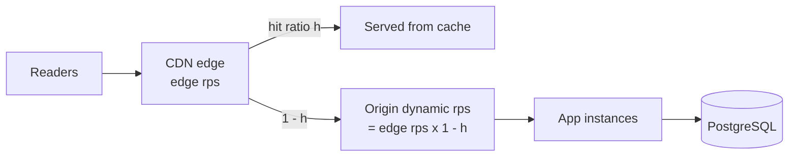

🇬🇧 English (source) · 🇮🇩 [Bahasa Indonesia](0161-capacity-targets-are-measured-nfrs-and-the-scale-path-is-staged.id.md)

# ADR-0161 — Capacity targets are measured NFRs, and the scale path is staged

- **Status:** Accepted
- **Review:** accepted by the owner on 2026-11-12 through the standard choice dialog. This ADR adds no code; the work it names is split into issues that wait for the Definition-of-Ready gate.
- **Date:** 2026-11-12
- **Decision maker:** @ahliweb (accepted by the owner on 2026-11-12)
- **Related:** [ADR-0042](0042-varnish-edge-cache-auto-activation.md) (edge cache, fail-closed surface allow-list), [ADR-0061](0061-host-resolved-public-surfaces-are-edge-cacheable.md), [ADR-0066](0066-shared-rate-limiting-and-full-auth-surface-coverage.md) (shared rate limiting), [ADR-0083](0083-this-template-deploys-to-one-environment.md) (one environment), [ADR-0098](0098-the-cache-key-carries-the-locale-in-the-path.md), [ADR-0107](0107-a-readers-browser-may-search-and-the-origin-names-the-tenant.md); [`docs/awcms/edge-cache-architecture.md`](../awcms/edge-cache-architecture.md), [`docs/awcms/database-pooling.md`](../awcms/database-pooling.md), [`docs/awcms/database-capacity-runbook.md`](../awcms/database-capacity-runbook.md), [`docs/awcms/observability-metrics.md`](../awcms/observability-metrics.md), [`docs/awcms/standar-performa-dan-keamanan.md`](../awcms/standar-performa-dan-keamanan.md) (C14); `ahliweb/awcms-astro` (HTML cache headers, tracked there)

**Docs and governance only.** No module, migration, API path, dependency or runtime change. The ADR fixes the _shape_ of the capacity targets and the order of the scale steps. The numbers marked "initial" are proposals to be revised after the first measured baseline.

## Context

The question that triggered this ADR was "can the family serve tens of millions to billions of requests per second?". It cannot be answered as asked, and the repo has no measurement to answer a smaller version of it.

- **No load test has driven `awcms` to its limit.** The only HTTP load test known to the maintainers (July 2026, against an earlier family deployment, recorded in an internal capacity review under the internal cross-portfolio standard) reached about 620 rps through the CDN and 452 rps against the origin, with application CPU near 1.4%. The ceiling of roughly 800 rps came from the **test client**, not from the application. The repo itself has no HTTP load harness, and its benchmarks (booking, commerce) measure domain operations, not the HTTP stack.
- **Edge caching only engages under load.** Production uses `EDGE_CACHE_MODE=auto`: the TTL ramp starts at 5 requests per second sustained over a 60-second window, or a mean origin latency of 250 ms (`src/lib/edge-cache/config.ts`: `autoRequestRateThreshold: 5`, `autoLatencyThresholdMs: 250`; [`environments.md`](../awcms/environments.md) §Edge cache). A public page that is identical for every reader is therefore not cacheable by design below that rate, and the first spike pays full origin cost until the latch engages.
- **Purge does not reach the CDN.** The purge queue bans in Varnish only; the tier that answers readers is Cloudflare ([`edge-cache-architecture.md`](../awcms/edge-cache-architecture.md) §The reach limit of purging). This was recorded as **C14** and _closed by statement_ on 5 August 2026: staleness bounded by `s-maxage` ≤ 300 seconds was accepted, with the Cloudflare zone purge API named as the upgrade path "if that lag ever stops being acceptable" ([`standar-performa-dan-keamanan.md`](../awcms/standar-performa-dan-keamanan.md) §9). Longer CDN TTLs, which a higher hit ratio needs, move that acceptance.
- **The rate limiter degrades per process.** Without Redis configured, `src/lib/security/rate-limit.ts` uses an in-process `Map` (ADR-0066). That is acceptable for one instance and wrong for two.
- **Connections are budgeted per process, not across instances.** The pool defaults to 20 per client kind (`src/lib/database/client.ts`). PgBouncer support exists (`DATABASE_PGBOUNCER`, `deploy/pgbouncer/pgbouncer.ini.example`) but connections are direct by default, and `bun run database:capacity:check`, the cross-instance check, does not exist yet (the runbook's own status note). Scaling out without it can exceed PostgreSQL's connection limit.
- **The latency metric is not wired.** `http_request_duration_ms` is declared in `src/lib/observability/metrics-port.ts`, but nothing records it: the middleware call is still "planned" in [`observability-metrics.md`](../awcms/observability-metrics.md). A p95 target cannot be measured today.
- **One live deployment.** ADR-0083 chose a single environment and removed `staging`. A capacity baseline needs load, and the only deployment holds real data; where such a test may run is an open owner question (tracked as an issue).

### The formula that decides everything

**origin rps = edge rps × (1 − hit ratio).** At 1 million edge rps, a 99% hit ratio leaves 10,000 origin rps and 90% leaves 100,000. Public CMS pages are identical for all readers and can reach 99%+; admin, API and per-user data cannot use that multiplier, so their target is set separately and is far smaller. Cache hit ratio, not application speed, is the lever on the public side; the database is the lever on the authenticated side.

For scale of reference: Cloudflare reported an average of over 81 million and a peak of over 129 million HTTP requests per second across its whole network in 2025 ([Cloudflare Radar 2025 Year in Review](https://blog.cloudflare.com/radar-2025-year-in-review/)), and AWS reported a DynamoDB peak of 192 million requests per second during Prime Day 2026 ([AWS News Blog](https://aws.amazon.com/blogs/aws/all-the-numbers-amazon-prime-day-2026-powered-by-aws/)). One billion requests per second is about 7.75 times that Cloudflare peak. It is a property of a global CDN, not of one application.

## Decision

We propose the following.

1. **Capacity targets are measured NFRs.** A target is only valid if it states how it is proven. An absolute figure without a hit ratio and a latency bound is not an NFR and is not written into any document.
2. **NFR shape.** The initial values below are starting points, revised after the first measured baseline (issue on the distributed load harness).

   | Surface                     | Initial target                                                                                           | How it is proven                          |
   | --------------------------- | -------------------------------------------------------------------------------------------------------- | ----------------------------------------- |
   | Public cacheable pages      | An edge request rate and a **hit ratio ≥ 99%**, so origin dynamic load stays at or below 1% of edge load | Load through the CDN plus cache analytics |
   | Origin dynamic, per node    | A measured rps per node at **p95 < 500 ms**; initial target 2,000 rps per 2-vCPU node                    | Distributed load directly at the origin   |
   | Admin and authenticated API | **p95 read ≤ 500 ms, write ≤ 900 ms** at a stated number of concurrent users per tenant                  | Admin-scenario load                       |
   | Availability                | **99.9%** until a replica and high availability exist; 99.95% only after                                 | Uptime monitoring                         |
   | Spike                       | **10× normal traffic within 60 seconds** with **5xx ≤ 1%**                                               | Spike test                                |

3. **"Billions of requests per second" is an explicit non-goal.** It is not a product NFR and no stage below promises it.
4. **The scale path is staged.** Each stage has entry criteria that are measured, not asserted; the next stage starts only when the current one is measured and its entry criteria are met.

   | Stage  | Meaning                                                                                                    | Entry criteria                                                                                                                                                       |
   | ------ | ---------------------------------------------------------------------------------------------------------- | -------------------------------------------------------------------------------------------------------------------------------------------------------------------- |
   | **S0** | Today: a single host, single PostgreSQL, limit unmeasured                                                  | n/a                                                                                                                                                                  |
   | **S1** | Correct edge caching for public pages, a shared rate limiter, a connection pooler, a wired p95 metric      | A measured baseline from a distributed load test; public surfaces cacheable at the CDN regardless of load; purge decision made for the CDN; HTTP p95 metric recorded |
   | **S2** | Horizontal app tier with a cross-instance connection budget, read replica, jobs and SSE separated from web | S1 NFRs met in a test; Redis-backed rate limiter; PgBouncer plus the cross-instance budget check; a decision on replica topology                                     |
   | **S3** | Tenant as shard key, optional CQRS tier 2, multi-region                                                    | Not designed. Needs its own ADR when S2 is measured and a trigger is stated with numbers                                                                             |

   The owner target is **S1 → S2**. S3 is out of scope of this ADR.

5. **Work that follows** (each its own issue, S or M, waiting for the Definition-of-Ready gate): a distributed load-test harness and baseline (#1283); public surfaces always cacheable at the CDN through the existing fail-closed allow-list (ADR-0042) (#1284); purge reaching the CDN within plan limits, revisiting C14 (#1282); a shared Redis for the rate limiter (#1285); PgBouncer plus the cross-instance budget check (#1286); the HTTP p95 metric (#1287); and an owner decision on where a capacity baseline may run (#1281).
6. **Nothing here relaxes an existing invariant.** Cacheability remains a fail-closed allow-list per surface, authenticated and tenant-scoped responses stay uncacheable, and RLS remains the authorization boundary (ADR-0003).

## Consequences

- **Positive:** capacity claims become testable; the largest unknown (the real limit) gets a plan; the public side is attacked through the lever that works (hit ratio) instead of through application speed; the staged path avoids committing to sharding before it is needed.
- **Negative / trade-off:** raising the CDN hit ratio lengthens the staleness window unless purge reaches the CDN, so the CDN purge work and the C14 acceptance have to be revisited together; the load harness needs an environment that may be loaded, which is an owner decision; Redis and PgBouncer add operational components.
- **Neutral:** the initial numbers will change after the baseline; the tiered stage names are a vocabulary for planning, not a release schedule; `awcms-astro` carries its own, related ADR question for HTML cache headers and is tracked in that repo.

## Alternatives considered

- **Jump straight to tenant sharding.** Rejected for now: the tenant is a natural shard key, but no measurement shows the single-database tier is the limit, and sharding is expensive to undo. Revisit at S2 with data.
- **Keep an absolute rps target (for example "millions of rps").** Rejected: it cannot be tested without a hit ratio and a latency bound, and it invites an architecture sized for a number nobody can prove.
- **Do nothing until traffic demands it.** Rejected: edge caching engages only after load arrives, purge cannot invalidate the CDN, and the limit is unmeasured, so the first real spike would be the first test.
- **Compute at the edge instead of caching.** Rejected for public pages: per-request edge compute is billed per request and is not a substitute for a cache hit.
