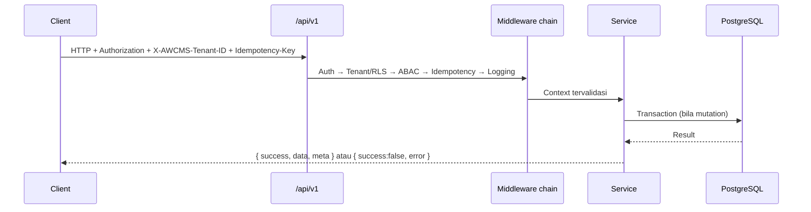
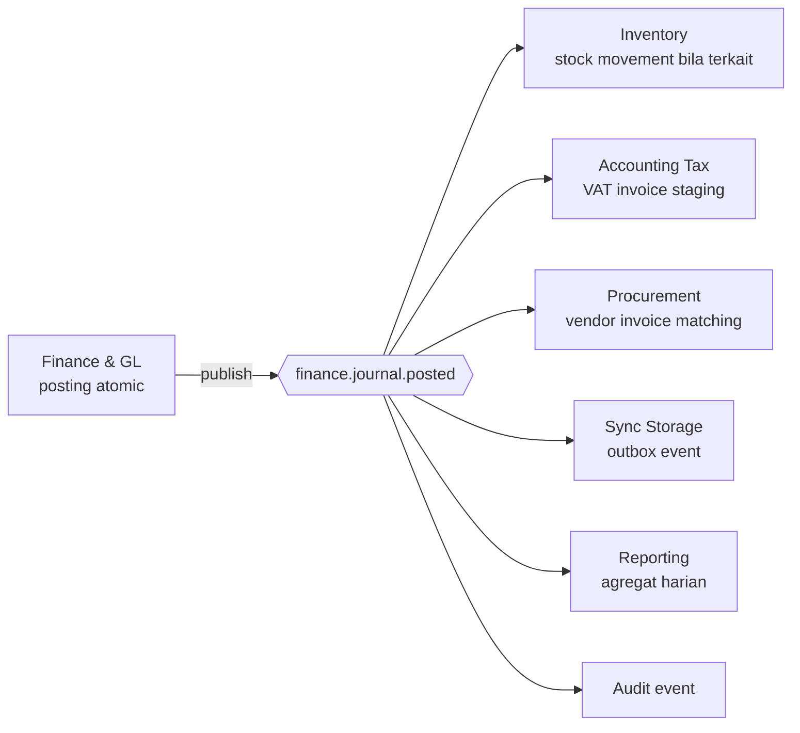

🇮🇩 Bahasa Indonesia · 🇬🇧 [English (source)](05_openapi_asyncapi_detail.md)

<!-- i18n-source-hash: sha256:a0ec45cda64f7818d2cd235d1b31905de173665e03bf916091eb4beb7bdef456 -->

# Bagian 5 — OpenAPI dan AsyncAPI Detail

> **Status dokumen:** target/rencana kontrak API dan event, bukan status implementasi. Belum ada endpoint atau event modul ERP yang diimplementasikan di repo ini — dokumen ini menjabarkan baseline kontrak yang **direncanakan** dibangun bertahap.

> **Contoh domain (ilustratif).** Dokumen ini memakai domain ERP (keuangan/akuntansi, inventori/gudang, procurement, manufaktur, HR/payroll) sebagai contoh berjalan. **Pola & standar**-nya reusable untuk base AWCMS; **entitas, endpoint, dan istilah domain** adalah ilustrasi awal yang akan disempurnakan seiring modul dibangun. Lihat [README paket dokumen](README.md) §Reusable vs domain ERP.

## Tujuan

Dokumen ini menjadi baseline kontrak API dan domain event AWCMS. Semua API baru wajib diperbarui di OpenAPI. Semua event baru wajib diperbarui di AsyncAPI.

## Versi kontrak

`info.version` OpenAPI/AsyncAPI adalah SemVer independen dari versi rilis `package.json` — kebijakan lengkap + aturan bump akan dicatat sebagai ADR tersendiri di repo ini (mengikuti pola ADR versioning kontrak pada base sebelumnya). Divalidasi otomatis oleh `bun run api:spec:check` (harus berbentuk `X.Y.Z`).

## Standard API

Base path:

```text
/api/v1
```

Response sukses:

```json
{
  "success": true,
  "data": {},
  "meta": {
    "correlationId": "corr_...",
    "requestId": "req_..."
  }
}
```

Response error:

```json
{
  "success": false,
  "error": {
    "code": "VALIDATION_ERROR",
    "message": "Data tidak valid.",
    "details": [],
    "correlationId": "corr_..."
  }
}
```

## Header standard

| Header                      |                       Wajib | Fungsi                                                                              |
| --------------------------- | --------------------------: | ----------------------------------------------------------------------------------- |
| `Authorization`             |           Ya kecuali public | Bearer token                                                                        |
| `X-AWCMS-Tenant-ID`         |  Ya untuk tenant-scoped API | Tenant aktif                                                                        |
| `Idempotency-Key`           | Ya untuk mutation high-risk | Anti duplicate mutation; 1-255 ASCII terlihat (komponen `IdempotencyKey`, ADR-0129) |
| `X-Correlation-ID`          |                    Opsional | Trace request                                                                       |
| `X-Request-ID`              |                    Opsional | Trace client request                                                                |
| `Accept-Language`           |                    Opsional | Locale                                                                              |
| `X-AWCMS-Node-ID`           |               Ya untuk sync | Sync node                                                                           |
| `X-AWCMS-Timestamp`         |        Ya untuk signed sync | Anti replay                                                                         |
| `X-AWCMS-Signature`         |               Ya untuk sync | HMAC signature                                                                      |
| `X-AWCMS-Signature-Version` |  Disarankan untuk sync (v2) | Versi skema signature; `"2"` mengikat tenant+node (GHSA-c972)                       |

## Soft delete API standard

DELETE pada resource tenant-scoped yang deletable berarti **soft delete**, bukan physical delete. Endpoint harus terdokumentasi di OpenAPI dengan perilaku berikut:

| Pola                                   | Fungsi                  | Catatan                                                                            |
| -------------------------------------- | ----------------------- | ---------------------------------------------------------------------------------- |
| `DELETE /<resources>/{id}`             | Soft delete resource    | Isi `deleted_at`, `deleted_by`, `delete_reason`; high-risk perlu `Idempotency-Key` |
| `POST /<resources>/{id}/restore`       | Restore resource        | Validasi konflik unique key, status lifecycle, ABAC, dan audit                     |
| `POST /<resources>/{id}/purge-request` | Request purge/anonymize | Hanya retention/legal; approval bila policy aktif                                  |
| `GET /<resources>?includeDeleted=true` | List termasuk arsip     | Hanya role berizin; default `false`                                                |

Default response list/detail tidak menampilkan soft-deleted record. Detail soft-deleted tanpa permission mengembalikan `RESOURCE_NOT_FOUND`; dengan permission arsip boleh mengembalikan data masked dengan status `deleted`.

## Endpoint wajib idempotency (rencana)

- `POST /finance/journal-batches/{id}/post`
- `POST /finance/documents/{id}/cancel-request`
- `POST /profiles/resolve`
- `POST /profiles/{id}/links`
- `POST /profiles/merge-requests`
- `DELETE /profiles/{id}`
- `POST /profiles/{id}/restore`
- `DELETE /inventory/items/{id}`
- `POST /inventory/items/{id}/restore`
- `POST /warehouse-transfers`
- `POST /warehouse-transfers/{id}/approve`
- `POST /warehouse-transfers/{id}/ship`
- `POST /warehouse-transfers/{id}/receive`
- `POST /cycle-counts`
- `POST /stock-adjustment-requests`
- `POST /tax/vat-invoices/generate`
- `POST /tax/coretax/batches`
- `POST /procurement/purchase-orders`
- `POST /procurement/purchase-orders/{id}/approve`
- `POST /procurement/purchase-orders/{id}/receive`
- `POST /sync/push`
- `POST /workflow/tasks/{id}/decision`

## Error code standard

| Code                         | HTTP | Keterangan                                                       |
| ---------------------------- | ---: | ---------------------------------------------------------------- |
| `VALIDATION_ERROR`           |  400 | Data tidak valid                                                 |
| `AUTH_REQUIRED`              |  401 | Belum login                                                      |
| `TOKEN_EXPIRED`              |  401 | Token kadaluarsa                                                 |
| `ACCESS_DENIED`              |  403 | Tidak punya akses                                                |
| `TENANT_REQUIRED`            |  400 | Tenant wajib                                                     |
| `RESOURCE_NOT_FOUND`         |  404 | Resource tidak ditemukan                                         |
| `RESOURCE_DELETED`           |  410 | Resource sudah di-soft-delete dan butuh restore/arsip permission |
| `IDEMPOTENCY_REQUIRED`       |  400 | Header idempotency wajib                                         |
| `IDEMPOTENCY_CONFLICT`       |  409 | Key dipakai request berbeda                                      |
| `WORKFLOW_APPROVAL_REQUIRED` |  409 | Perlu approval                                                   |
| `STOCK_NOT_AVAILABLE`        |  409 | Stok tidak cukup                                                 |
| `SYNC_CONFLICT`              |  409 | Konflik sync                                                     |
| `PAYLOAD_TOO_LARGE`          |  413 | Body request melebihi batas ukuran                               |
| `DATABASE_BUSY`              |  503 | Pool/DB sibuk                                                    |
| `PROVIDER_ERROR`             |  502 | Provider eksternal gagal                                         |
| `INTERNAL_ERROR`             |  500 | Error internal                                                   |

## API endpoint summary per modul (rencana)

### Foundation

| Method | Endpoint  | Fungsi       |
| ------ | --------- | ------------ |
| GET    | `/health` | Health check |

### Tenant Admin

| Method   | Endpoint                      | Fungsi                       |
| -------- | ----------------------------- | ---------------------------- |
| GET      | `/setup/status`               | Status setup                 |
| POST     | `/setup/initialize`           | Setup tenant pertama         |
| GET      | `/tenants/current`            | Tenant aktif                 |
| GET/POST | `/offices`                    | List/create office           |
| PATCH    | `/offices/{officeId}`         | Update office                |
| DELETE   | `/offices/{officeId}`         | Soft delete office jika aman |
| POST     | `/offices/{officeId}/restore` | Restore office               |

### Identity & Access

| Method | Endpoint                | Fungsi                 |
| ------ | ----------------------- | ---------------------- |
| POST   | `/auth/login`           | Login                  |
| POST   | `/auth/logout`          | Logout                 |
| GET    | `/auth/me`              | User aktif             |
| GET    | `/access/modules`       | Daftar module/activity |
| POST   | `/access/evaluate`      | Evaluasi ABAC          |
| POST   | `/access/assignments`   | Assign access          |
| GET    | `/access/decision-logs` | Decision log           |

### Profile Identity

| Method   | Endpoint                        | Fungsi                             |
| -------- | ------------------------------- | ---------------------------------- |
| GET/POST | `/profiles`                     | List/create profile                |
| GET      | `/profiles/{profileId}`         | Detail profile                     |
| POST     | `/profiles/resolve`             | Resolve/create profile             |
| POST     | `/profiles/{profileId}/links`   | Link entity                        |
| GET      | `/profiles/dedup-candidates`    | Kandidat duplikat                  |
| POST     | `/profiles/merge-requests`      | Request merge                      |
| DELETE   | `/profiles/{profileId}`         | Soft delete profile/contact master |
| POST     | `/profiles/{profileId}/restore` | Restore profile                    |

### Master Data & Inventory

| Method    | Endpoint                               | Fungsi             |
| --------- | -------------------------------------- | ------------------ |
| GET/POST  | `/inventory/items`                     | List/create item   |
| GET/PATCH | `/inventory/items/{itemId}`            | Detail/update item |
| DELETE    | `/inventory/items/{itemId}`            | Soft delete item   |
| POST      | `/inventory/items/{itemId}/restore`    | Restore item       |
| GET       | `/inventory/stock-balances`            | Stok               |
| GET       | `/inventory/stock-movements`           | Mutasi stok        |
| POST      | `/inventory/stock-adjustment-requests` | Request adjustment |
| GET       | `/inventory/lots`                      | Lot/batch          |

### Finance & General Ledger

| Method | Endpoint                                       | Fungsi                    |
| ------ | ---------------------------------------------- | ------------------------- |
| POST   | `/finance/journal-batches`                     | Buat jurnal draft         |
| GET    | `/finance/journal-batches/{id}`                | Detail jurnal             |
| POST   | `/finance/journal-batches/{id}/lines`          | Tambah baris jurnal       |
| PATCH  | `/finance/journal-batches/{id}/lines/{lineId}` | Update baris jurnal       |
| DELETE | `/finance/journal-batches/{id}/lines/{lineId}` | Hapus baris jurnal        |
| POST   | `/finance/journal-batches/{id}/post`           | Posting jurnal            |
| GET    | `/finance/documents/{id}`                      | Detail financial document |
| POST   | `/finance/documents/{id}/cancel-request`       | Request cancel            |

### Warehouse Management

| Method   | Endpoint                                         | Fungsi                            |
| -------- | ------------------------------------------------ | --------------------------------- |
| GET/POST | `/warehouses`                                    | List/create warehouse             |
| GET      | `/warehouses/{warehouseId}/stock`                | Stok gudang                       |
| GET/POST | `/warehouses/{warehouseId}/bins`                 | Bin list/create                   |
| DELETE   | `/warehouses/{warehouseId}/bins/{binId}`         | Soft delete bin jika saldo kosong |
| POST     | `/warehouses/{warehouseId}/bins/{binId}/restore` | Restore bin                       |
| POST     | `/warehouse-transfers`                           | Buat transfer                     |
| POST     | `/warehouse-transfers/{id}/approve`              | Approve                           |
| POST     | `/warehouse-transfers/{id}/ship`                 | Ship                              |
| POST     | `/warehouse-transfers/{id}/receive`              | Receive                           |
| POST     | `/cycle-counts`                                  | Buat cycle count                  |

### Accounting Tax/Coretax

| Method   | Endpoint                          | Fungsi               |
| -------- | --------------------------------- | -------------------- |
| GET/POST | `/tax/profiles`                   | Tax profile          |
| GET/POST | `/tax/business-units`             | NITKU/ID TKU         |
| GET/POST | `/tax/party-profiles`             | Party tax profile    |
| POST     | `/tax/vat-invoices/generate`      | Generate VAT invoice |
| GET      | `/tax/vat-invoices`               | List invoice         |
| POST     | `/tax/vat-invoices/{id}/validate` | Validasi             |
| POST     | `/tax/coretax/batches`            | Coretax batch export |

### Procurement & Vendor Management

| Method   | Endpoint                                      | Fungsi                        |
| -------- | --------------------------------------------- | ----------------------------- |
| GET/POST | `/procurement/vendors`                        | Vendor master                 |
| GET/POST | `/procurement/purchase-requests`              | Purchase request              |
| POST     | `/procurement/purchase-requests/{id}/approve` | Approve PR                    |
| GET/POST | `/procurement/purchase-orders`                | Purchase order                |
| POST     | `/procurement/purchase-orders/{id}/approve`   | Approve PO                    |
| POST     | `/procurement/purchase-orders/{id}/receive`   | Terima barang (goods receipt) |
| GET      | `/procurement/vendors/{id}/invoices`          | Invoice vendor                |
| DELETE   | `/procurement/vendors/{id}`                   | Soft delete vendor            |
| POST     | `/procurement/vendors/{id}/restore`           | Restore vendor                |
| POST     | `/webhooks/procurement/vendor-portal`         | Webhook vendor portal         |

### Sync Storage

| Method | Endpoint                       | Fungsi                |
| ------ | ------------------------------ | --------------------- |
| POST   | `/sync/push`                   | Push event            |
| POST   | `/sync/pull`                   | Pull event            |
| GET    | `/sync/status`                 | Sync status           |
| GET    | `/sync/conflicts`              | List conflict         |
| POST   | `/sync/conflicts/{id}/resolve` | Resolve conflict      |
| POST   | `/sync/objects/presign`        | Object upload/presign |

### Module Management

Database-backed, tenant-aware module registry — generic infrastructure for managing every other registered module, not a domain-specific feature.

| Method | Endpoint                               | Fungsi                                                     |
| ------ | -------------------------------------- | ---------------------------------------------------------- |
| GET    | `/modules`                             | Katalog modul (code + DB registry)                         |
| GET    | `/modules/{moduleKey}`                 | Detail satu modul                                          |
| POST   | `/modules/sync`                        | Sync descriptor code → DB registry                         |
| GET    | `/modules/{moduleKey}/permissions`     | Status sinkron permission (synced/missing/orphaned)        |
| GET    | `/modules/{moduleKey}/jobs`            | Registry command operasional (dokumentasi, tidak eksekusi) |
| GET    | `/modules/{moduleKey}/health`          | Health/readiness cepat, read-only                          |
| POST   | `/modules/{moduleKey}/health/check`    | Trigger health check eksplisit (+ provider check bila ada) |
| GET    | `/tenant/modules`                      | Status enable/disable modul untuk tenant pemanggil         |
| POST   | `/tenant/modules/{moduleKey}/enable`   | Aktifkan modul untuk tenant                                |
| POST   | `/tenant/modules/{moduleKey}/disable`  | Nonaktifkan modul untuk tenant (butuh `reason`)            |
| GET    | `/tenant/modules/{moduleKey}/settings` | Effective settings (default + override tenant)             |
| PATCH  | `/tenant/modules/{moduleKey}/settings` | Update override settings tenant                            |

Tidak ada event AsyncAPI baru untuk modul ini — perubahan lifecycle/config modul tercatat lewat `awcms_audit_events` generik, bukan domain event terpisah.

### AI, Reports, Logs, Workflow, Security

| Modul    | Endpoint utama                                                   |
| -------- | ---------------------------------------------------------------- |
| AI       | `POST /ai/business-analyst/chat`                                 |
| Reports  | `GET /reports/finance/daily`, `GET /reports/warehouse/dashboard` |
| Logs     | `GET /logs/recent`, `GET /logs/audit`, `GET /logs/security`      |
| DB Pool  | `GET /database/pool/health`                                      |
| Workflow | `GET /workflow/tasks`, `POST /workflow/tasks/{id}/decision`      |
| Security | `POST /security/go-live-gates/evaluate`                          |

Modul lanjutan (Manufacturing, HR & Payroll, integrasi payment gateway/marketplace/logistik) belum memiliki daftar endpoint final — akan ditambahkan saat modul tersebut dirancang detail, mengikuti pola base path `/api/v1/<module>` yang sama.

## Siklus request API



## AsyncAPI event envelope

```json
{
  "eventId": "uuid",
  "eventType": "finance.journal.posted",
  "eventVersion": "1.0",
  "tenantId": "uuid",
  "nodeId": "uuid-node",
  "aggregateType": "journal_batch",
  "aggregateId": "uuid",
  "occurredAt": "2026-07-14T09:00:00+07:00",
  "actor": {
    "tenantUserId": "uuid",
    "profileId": "uuid"
  },
  "correlationId": "corr_001",
  "causationId": "event-before-id",
  "payload": {},
  "metadata": {
    "sourceModule": "finance_gl",
    "schemaVersion": "1.0"
  }
}
```

Soft delete event memakai envelope yang sama. Pola nama event: `<module>.<resource>.soft_deleted`, `<module>.<resource>.restored`, dan `<module>.<resource>.purge_requested` bila event perlu disinkronkan atau dikonsumsi modul lain. Payload tidak boleh membawa PII mentah; gunakan identifier, status, dan metadata audit yang sudah diredaksi.

## Event fan-out — `finance.journal.posted`



## Event utama (rencana)

| Event                                 | Producer        | Consumer                                     |
| ------------------------------------- | --------------- | -------------------------------------------- |
| `tenant.created`                      | Tenant Admin    | Audit, reporting                             |
| `identity.login.succeeded`            | Identity        | Audit/security                               |
| `profile.created`                     | Profile         | Procurement, reporting                       |
| `inventory.item.created`              | Master Data     | Reporting, sync                              |
| `inventory.item.soft_deleted`         | Master Data     | Reporting, sync                              |
| `inventory.item.restored`             | Master Data     | Reporting, sync                              |
| `finance.journal.posted`              | Finance & GL    | Inventory, Tax, Procurement, Sync, Reporting |
| `finance.document.generated`          | Finance & GL    | Reporting, sync                              |
| `warehouse.transfer.shipped`          | Warehouse       | Inventory, Sync, Reporting                   |
| `warehouse.transfer.received`         | Warehouse       | Inventory, Sync, Reporting                   |
| `tax.vat_invoice.generated`           | Tax             | Reporting, audit                             |
| `tax.coretax.batch_exported`          | Tax             | Sync, audit                                  |
| `procurement.purchase_order.approved` | Procurement     | Reporting, audit                             |
| `procurement.goods_receipt.posted`    | Procurement     | Inventory, Reporting                         |
| `sync.conflict.detected`              | Sync            | Workflow, audit                              |
| `workflow.task.approved`              | Workflow        | Requesting module                            |
| `database.pool.saturated`             | DB Connectivity | Observability, security                      |
| `database.pool.rejected`              | DB Connectivity | Observability, security                      |
| `security.golive.blocked`             | Security        | Owner/admin                                  |

## Contract testing requirement

- Semua endpoint punya success/error response schema.
- Tenant-scoped API wajib tenant header.
- Mutation high-risk wajib idempotency.
- Sensitive fields tidak tampil penuh.
- Event envelope lengkap.
- Event payload sesuai schema.
- Event tidak membawa raw sensitive data.

## Gerbang lint kontrak (`api:contract:lint`)

`bun run api:contract:lint` (Issue #1390, [ADR-0167](../adr/0167-contract-derived-fixtures-and-two-sided-conformance-checks-with-an-in-repo-generator-and-ajv.id.md)) ada di rantai `check` tepat setelah `api:spec:check`. `api:spec:check` membandingkan template path dan bentuk operasi; ia tidak melihat isi skema. Gerbang ini mengompilasi, dengan `ajv` (draft 2020-12, `strict: true`, dijalankan Bun), setiap skema di bundle: seluruh `components.schemas`, setiap `requestBody`, dan setiap respons (sukses **dan** galat, inline atau lewat `components.responses`). Kegagalan mencetak operasi (`METHOD /path -> status`) dan JSON pointer skemanya, misalnya `/paths/~1x/post/responses/201/content/application~1json/schema`.

- **Ketat, bukan longgar.** Keyword tak dikenal, `format` tak dikenal, `properties: null`, `$ref` putus, `required` bukan array, dan `exclusiveMinimum: true` gaya 3.0 semuanya gagal. Keyword OpenAPI yang bukan JSON Schema didaftarkan satu per satu: `discriminator` (bentuknya diperiksa), `xml`, `externalDocs`, `example`, ekstensi `x-*` yang muncul, dan kunci tingkat-atas dokumen OpenAPI sendiri. `nullable` ditangani `ajv` sendiri, yang menolaknya tanpa `type`; pada 3.1 ia tidak berefek dan diperbaiki bertahap (ADR-0167 §6).
- **Format dikenali, tidak ditegakkan.** Hanya format JSON Schema dan OpenAPI yang diterima, sebagai nama; instance tidak divalidasi di sini sehingga `ajv-formats` tidak diperlukan.
- **Di luar scope.** Paket fixture dan validasi respons handler nyata adalah isu terpisah (#1392 sampai #1395). Contoh divalidasi di sini, lihat bagian berikut.
- **Biaya.** Sekitar 2,5 sampai 3 detik untuk sekitar 2.300 lokasi skema di satu mesin pengembang (Bun 1.4.4); satu kali jalan, bukan benchmark.
- **Dependensi.** `ajv` 8.20.0 adalah dependensi dev, dipin persis (MIT; empat dependensi langsung miliknya); lolos `deps:audit:check` dan `deps:license:check`.

Tes: `tests/api-contract-lint.test.ts` (bundle asli harus terkompilasi; kontrak yang sengaja dirusak harus gagal).

### Contoh ikut divalidasi (Issue #1391)

Perintah yang sama juga memvalidasi setiap contoh di bundle dengan `ajv` yang sama: `example` dan `examples.<nama>.value` pada media type (request dan respons, inline atau lewat `components`), contoh parameter, dan `example`/`examples` tingkat skema. Kegagalan mencetak pointer contoh dan pelanggaran pertama, sehingga contoh yang menyimpang dari skemanya (field baru di `required`, nilai enum yang diganti nama) memerahkan `check`. `uuid`, `date`, `date-time`, `email`, dan `uri` ditegakkan untuk contoh (pemeriksaan kecil buatan sendiri, tanpa `ajv-formats`); `nullable` dihormati.

- **Hanya sintetis.** Alamat e-mail di contoh wajib memakai domain tercadang (`example.test`, `example.com|org|net`, atau host `.test`, `.example`, `.invalid`, `.localhost`); domain nyata menggagalkan gerbang.
- **Menulisnya di mana.** `examples` (bernama) pada media type, di fragmen operasinya sendiri. `components.responses` akar (`BadRequest`, `Unauthorized`, `Forbidden`, `NotFound`) dibekukan `tests/openapi-bundle.test.ts`, jadi operasi yang butuh contoh galat khusus mendeklarasikan respons itu inline, bukan `$ref`.
- **Bentuk bersyarat.** Daftar blog adalah `oneOf [BlogPostSummary, BlogPostFeedItem]`; `BlogPostSummary` ber-`additionalProperties: false` agar `oneOf` tetap eksklusif dan contoh `view=full` tak lolos sebagai ringkasan. `BlogPostFeedItem` mendaftar field feed yang selalu dikembalikan handler (`BlogPost` tak bisa, karena respons siklus hidup memakainya bersama).
- **Yang tercakup.** `GET /api/v1/blog/posts` (`summary`, `stable_order`, `full`, plus 400/401/403), `POST /api/v1/newsletter/subscribe` (satu 200 netral yang tak membedakan alamat baru dari yang dikenal; 400; 429) dan `PUT /api/v1/booking/policy` (200, 400 x2, 401, 403, 409, 422). Operasi lain belum wajib bercontoh (ADR-0167: syarat berlaku untuk operasi baru).

Tes: `tests/api-contract-examples.test.ts` (bundle asli lolos; merusak satu field contoh nyata, uuid cacat, atau domain e-mail nyata memerahkannya).

### Paket fixture dan gerbang kesegaran (`api:fixtures:*`, Issue #1392)

`bun run api:fixtures:generate` menulis `fixtures/api-contract/contract-fixtures.json` dari bundle ([ADR-0167](../adr/0167-contract-derived-fixtures-and-two-sided-conformance-checks-with-an-in-repo-generator-and-ajv.id.md)); `bun run api:fixtures:check` (di rantai `check`, tepat setelah `api:contract:lint`) meregenerasi di memori dan gagal bila paket ter-commit berbeda. Paket adalah data, bukan layanan: konsumen mematoknya dan tidak pernah mengimpor kode repo ini. Generator: `scripts/api-contract-fixtures.ts`, di atas `yaml` dan `ajv` yang sudah ada (tanpa dependensi baru).

- **Isi.** Per operasi: contoh body request dan satu contoh per respons JSON yang dideklarasikan. Contoh TERDEKLARASI (#1391) dipakai apa adanya (`source: "declared"`); selain itu nilai disintesis dari skema (`source: "generated"`): `$ref`, `allOf` (gabung objek), `oneOf`/`anyOf` (cabang pertama yang memvalidasi seluruh node), `example`, `const`, `enum`, `format`, batas, `minItems`, `minProperties`. Siklus dipotong di `$ref` pertama yang berulang (properti opsional dibuang, array menjadi kosong); siklus lewat properti WAJIB dilaporkan. `components.responses` yang dipakai banyak operasi (`BadRequest`, `Unauthorized`, ...) dikeluarkan sekali di `sharedResponses` dan dirujuk dengan `{"$ref": "#/sharedResponses/Nama"}`.
- **Setiap fixture diperiksa.** Tiap nilai divalidasi dengan `ajv` yang sama seperti lint (format ditegakkan) dan diperiksa domain e-mail yang dicadangkan. Nilai yang gagal TIDAK ditulis; operasinya didaftarkan di `skipped` beserta alasannya (kini 4: tiga respons `text/event-stream` dan satu `text/plain`). `summary.skipped` selalu sama dengan panjang daftar itu.
- **Deterministik.** Kunci berurutan tetap dan tidak ada nilai yang bergantung pada jam, keacakan, atau mesin, sehingga dua kali jalan identik byte demi byte. Paket membawa `contractSha256` (SHA-256 bundle), sehingga PERUBAHAN APA PUN pada bundle membuat paket ter-commit basi: regenerasi dengan `bun run api:fixtures:generate` dan commit bersama perubahan kontrak. Berkas ini dikecualikan dari prettier (`.prettierignore`) karena gerbang membandingkan byte.
- **Hanya sintetis.** String hasil generate adalah placeholder tetap (`example`, `user@example.test`, `00000000-0000-4000-8000-000000000000`, `2026-01-01T00:00:00Z`); tanpa rahasia dan tanpa data pribadi.
- **Batas yang diketahui (TV-2).** Sebuah instans hanya membuktikan body cocok dengan skema: properti yang diganti nama pada skema tanpa `required` tetap lolos. Tes menerapkan vektor laporan #1379 bagian 7 (TV-0 baseline, TV-1 aditif lolos, TV-2 ganti nama TIDAK tertangkap, TV-3 ubah tipe, TV-4 required baru, TV-5 `additionalProperties: false` tertangkap) dan menegaskan TV-2 sebagai batasnya; kebijakan kontrak (`required` pada operasi baru, ADR-0167 bagian 5) yang mempersempitnya.
- **Di luar cakupan di sini.** Penerbitan paket sebagai artefak terpatok untuk konsumen (#1394) dan kesesuaian respons handler sungguhan (#1393).

Tes: `tests/api-contract-fixtures.test.ts` (regenerasi identik byte, determinisme, contoh terdeklarasi dipakai, TV-0..TV-5, aturan generator `oneOf`/`allOf`/siklus/pola, kontrak yang dimutasi mengubah paket).

### Gerbang kebijakan untuk operasi baru (`api:contract:policy:check`, Issue #1395)

[ADR-0167](../adr/0167-contract-derived-fixtures-and-two-sided-conformance-checks-with-an-in-repo-generator-and-ajv.id.md) bagian 5 menetapkan kebijakan kontrak untuk operasi BARU; `bun run api:contract:policy:check` (dalam rantai `check`, tepat setelah `api:fixtures:check`) menegakkannya. Operasi yang sudah ada tidak diperiksa (ADR-0167 bagian 6, tanpa retrofit massal). Gerbang: `scripts/api-contract-policy.ts`; data: `scripts/api-contract-policy-baseline.ts`.

| Aturan             | Operasi yang baru wajib...                                                                                                                                                                                        |
| ------------------ | ----------------------------------------------------------------------------------------------------------------------------------------------------------------------------------------------------------------- |
| `response-example` | membawa contoh TERDEKLARASI (`example` atau `examples` pada media type; yang dipakai paket fixture sebagai `source: "declared"`) pada setiap respons 2xx yang punya body. `example` tingkat skema tidak dihitung. |
| `required-list`    | punya array `required` pada setiap skema objek ber-`properties` yang terjangkau dari respons 2xx (`required: []` eksplisit boleh; ketiadaan tidak). Peta (hanya `additionalProperties`) tidak membutuhkannya.     |
| `no-nullable`      | tidak memakai `nullable` pada permintaan (body, parameter) atau respons 2xx; tulis `type: [X, "null"]` (OpenAPI 3.1).                                                                                             |
| `rate-limit-429`   | mendeklarasikan `429` bila handler-nya ber-rate-limit.                                                                                                                                                            |

- **Apa itu "baru".** Operasi yang `operationId`-nya tidak ada di `CONTRACT_POLICY_BASELINE`, daftar beku 742 operasi yang dimiliki kontrak saat gerbang mendarat. Baseline **hanya mengecil**: entri yang menamai operasi yang sudah tidak ada menggagalkan gerbang (hapus barisnya), `tests/api-contract-policy.test.ts` mematok batas atas panjangnya serta bahwa ia tetap terurut dan unik, dan berkasnya menyatakan jangan menambah baris demi menghijaukan gerbang. `operationId` hilang atau ganda menggagalkan gerbang (tak bisa dibedakan dari baseline). Komponen bersama (`ApiMeta`, `Unauthorized`, ...) yang juga dijangkau operasi baseline adalah warisan dan tidak dibebankan pada operasi baru yang merujuknya; komponen yang hanya dijangkau operasi baru diperiksa penuh.
- **Kenapa baseline, bukan diff terhadap cabang dasar.** `bun run check` berjalan di CI pada checkout dangkal tanpa `origin/main`:

  | Kriteria (dari 11)            | A. Baseline beku ter-commit (dipilih)                                                         | B. Diff `git merge-base` saat cek                                               | C. CI mengambil cabang dasar                              |
  | ----------------------------- | --------------------------------------------------------------------------------------------- | ------------------------------------------------------------------------------- | --------------------------------------------------------- |
  | 1 Kelebihan dan kekurangan    | + jawaban sama di mana pun; - daftar dipelihara tangan, satu suntingan kasatmata untuk curang | + tanpa daftar; - butuh riwayat yang CI tidak punya                             | + tepat; - langkah jaringan di gerbang yang local-first   |
  | 2 Keamanan                    | gagal tertutup: id tak dikenal = baru = diperiksa                                             | merosot ke "semua baru" atau "tak ada baru" saat riwayat hilang (lubang senyap) | pengambilan gagal atau basi merosot senyap serupa         |
  | 3 Performa                    | satu parse YAML, tanpa git                                                                    | panggilan git tiap run                                                          | satu round trip jaringan tiap run                         |
  | 4 Perawatan                   | mengecil seiring operasi diretrofit; tes batas atas memaksa suntingan                         | tanpa daftar, tetapi rapuh pada rebase dan squash merge                         | plumbing workflow yang harus sinkron dengan run lokal     |
  | 5 Skalabilitas                | O(jumlah operasi)                                                                             | tumbuh bersama kedalaman riwayat                                                | tumbuh bersama ukuran repositori                          |
  | 6-8 Aksesibilitas, SEO, UI/UX | tidak berlaku (hanya perkakas)                                                                | tidak berlaku                                                                   | tidak berlaku                                             |
  | 9 Kompatibilitas              | identik lokal, di CI, pada klon dangkal dan di worktree                                       | berbeda antara klon, klon dangkal, dan worktree                                 | hanya CI; `bun run check` lokal tak dapat mereproduksinya |
  | 10 Kompleksitas operasional   | tidak ada                                                                                     | butuh `fetch-depth: 0` atau langkah fetch                                       | token, jaringan, dan penanganan ref dasar                 |
  | 11 Implikasi jangka panjang   | mengikuti pola ledger satu-arah repositori (`NOT_YET_SCREENED`)                               | terikat perilaku hosting git                                                    | terikat vendor CI                                         |

- **"Ber-rate-limit" diturunkan, bukan dicari.** Rate limit dipasang di dalam handler oleh `checkRateLimit`, `checkSharedRateLimit`, atau `checkAuthRateLimit` (`src/middleware.ts` tidak memasang apa pun). Gerbang bertanya apakah graf panggilan handler menjangkau salah satunya, memakai penelusur yang mendasari `tests/openapi-rate-limit-and-idempotency-declared.test.ts` (#1385), kini dibagi di `scripts/lib/route-handler-graph.ts`. **Batas deteksi** (dicatat di berkas itu): limiter di luar graf panggilan handler (middleware, edge), yang dijangkau lewat alias path, specifier telanjang, `export *`, `import()` dinamis, method kelas atau objek-literal, atau di bawah nama helper yang tidak ada di pola, tidak terlihat. Sebuah tes mematok bahwa pola menamai persis helper `check*RateLimit` yang diekspor, sehingga helper baru tak bisa lolos. Bila berkas route operasi baru tidak ditemukan di `src/pages/api/v1`, aturan GAGAL (tertutup): "tak terdeteksi" tidak pernah dibaca sebagai "tidak dibatasi".
- **Pengecualian.** `CONTRACT_POLICY_EXCEPTIONS` membebaskan satu aturan dari satu operasi baru dan wajib membawa alasan minimal 30 karakter. Pengecualian untuk operasi baseline atau tak dikenal, aturan tak dikenal, duplikat, atau yang membebaskan aturan yang tidak dilanggar, menggagalkan gerbang: pembebasan dibersihkan, bukan ditumpuk. Hari ini tidak ada.

Tes: `tests/api-contract-policy.test.ts` (tiap aturan punya kasus negatif; operasi lama dengan cacat sama diabaikan; baseline basi, `operationId` hilang dan ganda, pembukuan pengecualian; deteksi graf panggilan terhadap berkas route sintetis; bundel nyata hijau; baseline tak pernah tumbuh). Tiap kontrol dirusak bergantian dan tesnya memerah.
