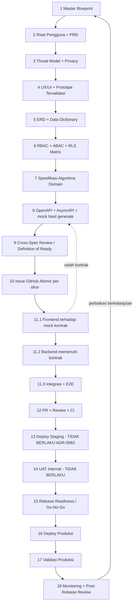

🇮🇩 Bahasa Indonesia · 🇬🇧 [English (source)](alur-pengembangan.md)

<!-- i18n-source-hash: sha256:0eb17fa4f08080b76036f8a944c1d5293f6f27e1a51dd3b3b50cb1b522d16a95 -->

# Alur pengembangan AWCMS

> **Dokumen kanonik proses.** Ia menjawab satu pertanyaan: _dari niat sampai
> produksi, apa yang harus ada, dalam urutan apa, dan apa yang menegakkannya._
>
> Ia **tidak** mengulang isi dokumen lain. Setiap langkah menunjuk artefak
> nyata di repo ini, dan bila artefaknya **belum ada**, langkah itu mengatakannya
> — celah yang ditulis lebih berguna daripada celah yang disamarkan.

- **Versi alur: v2.0.0**, diadopsi oleh
  [ADR-0156](../adr/0156-adopt-development-flow-v2-validated-ux-before-data-model-frontend-backend-integration-per-slice.id.md)
  (30 Oktober 2026; sumber generik: `ahliweb/personal-coding` DL-033). v2
  memindahkan UX/UI dari langkah 8 ke langkah 4 dan memecah langkah 11 menjadi
  11.1 → 11.2 → 11.3. Langkah 1–3, 9, 10, 12, dan 13–18 mempertahankan nomornya.
  **Rujukan ke "langkah 4" sampai "langkah 8" yang ditulis sebelum 30 Oktober
  2026 memakai penomoran v1** — terjemahkan dengan tabel di §Peta penomoran di
  bawah.
- **Menggantikan** [`alur-pengembangan-mini-first.md`](alur-pengembangan-mini-first.md),
  yang dicabut [ADR-0055](../adr/0055-development-confined-to-awcms-and-awcms-astro.md)
  dan kini hanya catatan sejarah.
- **Melengkapi, bukan menggantikan:** [`../../AGENTS.md`](../../AGENTS.md)
  (kontrak kerja teknis) dan [`../../CONTRIBUTING.md`](../../CONTRIBUTING.md)
  (mekanik langkah 10–12).

## Alurnya

## Dua hal yang harus dibaca sebelum memakai diagram ini

**Pertama: tidak setiap perubahan menempuh 18 langkah.** Yang menentukan bukan
selera, melainkan KELAS perubahannya:

| Kelas perubahan                                         | Langkah wajib                                                                                               |
| ------------------------------------------------------- | ----------------------------------------------------------------------------------------------------------- |
| Dokumen saja, chore, dependency bump                    | 10 → 12, lalu 16–18 saat rilis                                                                              |
| Perbaikan bug tanpa perubahan kontrak/skema             | 10 → 12                                                                                                     |
| Perubahan perilaku pada modul yang sudah ada            | 3, 6 (bila menyentuh akses), 8 (bila menyentuh API), 10 → 12                                                |
| Skema baru / kolom baru                                 | 5, 6, 10 → 12                                                                                               |
| **Modul baru**                                          | 1 → 12 penuh, plus admission ADR ([`21_module_admission_governance.md`](21_module_admission_governance.md)) |
| Perubahan lapisan fondasi (auth, access, sync, tenancy) | 1 → 12 penuh, **ADR wajib**                                                                                 |

Dalam tabel, "10 → 12" mencakup 11.1, 11.2, dan 11.3 **untuk bagian yang memang
dimiliki perubahan itu**: perubahan tanpa layar tidak punya 11.1, perubahan tanpa
backend tidak punya 11.2. Urutan di antara yang ada tetap frontend → backend →
integrasi.

**Kedua: langkah 1–9 menghasilkan DOKUMEN, dan dokumen di repo ini menua.**
Aturan yang sudah berlaku tetap berlaku: sebuah dokumen yang salah lebih
berbahaya daripada dokumen yang tidak ada, karena ia dipercaya. Kalau sebuah
langkah menghasilkan klaim yang bisa basi (angka, daftar berkas, status), taruh
klaim itu di tempat yang **di-generate atau digerbangi**, bukan di prosa.

## Peta penomoran (v1 → v2)

| v1 (13 Agu 2026)                | v2 (ADR-0156)                                              |
| ------------------------------- | ---------------------------------------------------------- |
| 1, 3                            | 1, 3 (tidak berubah)                                       |
| 2 PRD                           | 2 Riset Pengguna + PRD                                     |
| 8 UX/UI                         | **4** UX/UI + prototipe tervalidasi                        |
| 4 ERD + Data Dictionary         | **5**                                                      |
| 5 RBAC + ABAC + RLS Matrix      | **6**                                                      |
| 6 Algoritma Domain / Verifikasi | **7**                                                      |
| 7 OpenAPI + AsyncAPI            | **8** (plus mock yang dihasilkan dari kontrak)             |
| 9, 10, 12                       | 9, 10, 12 (tidak berubah; gerbang 9 bertambah pemeriksaan) |
| 11 Implementasi + Test Otomatis | 11 = **11.1 Frontend → 11.2 Backend → 11.3 Integrasi**     |
| 13–18                           | 13–18 (tidak berubah; 13–14 tetap TIDAK BERLAKU, ADR-0083) |

Gerbang 9 dan 15 mempertahankan nomornya dengan sengaja: keduanya nomor yang paling
sering dirujuk di repo ini, dan menomori ulang akan membasikan dokumen yang tidak
bisa dideteksi gerbang mana pun.

---

## 1. Master Blueprint

**Menjawab:** produk ini apa, batasnya di mana, dan apa yang secara sengaja
BUKAN bagiannya.

| Artefak                                                            | Peran                                 |
| ------------------------------------------------------------------ | ------------------------------------- |
| [`01_canvas_induk.md`](01_canvas_induk.md)                         | ringkasan produk & prinsip            |
| [`11_implementation_blueprint.md`](11_implementation_blueprint.md) | blueprint implementasi per sprint     |
| [`../ARCHITECTURE.md`](../ARCHITECTURE.md)                         | arsitektur current-state (digerbangi) |
| [`../adr/`](../adr/README.md)                                      | keputusan yang mengunci ruang lingkup |

Perubahan ruang lingkup di tingkat ini **selalu** sebuah ADR. Blueprint tidak
mengubah arah; ADR yang mengubah, dan blueprint mengikutinya.

## 2. Riset Pengguna + PRD

**Menjawab:** siapa penggunanya, pekerjaan apa yang diselesaikan, apa bukti dari
pengguna nyata, dan apa kriteria diterimanya. v2 menjadikan riset pengguna
masukan wajib: asumsi yang belum diuji ditulis sebagai asumsi, bukan sebagai
kebutuhan.

[`02_prd_detail_per_modul.md`](02_prd_detail_per_modul.md). **Celah:** tidak ada
artefak terpisah yang memuat bukti riset pengguna (wawancara, observasi, tiket
dukungan), sehingga hari ini PRD yang memuatnya, atau memuat asumsi sebagai
gantinya.

## 3. Threat Model + Privacy Analysis

**Menjawab:** siapa penyerangnya, apa yang ia incar, dan data pribadi apa yang
tersentuh.

| Bagian                      | Artefak                                                                                | Status          |
| --------------------------- | -------------------------------------------------------------------------------------- | --------------- |
| Threat model                | [`20_threat_model_security_architecture.md`](20_threat_model_security_architecture.md) | ada             |
| Peta kontrol                | [`standar-performa-dan-keamanan.md`](standar-performa-dan-keamanan.md)                 | ada, **hidup**  |
| Retensi data                | [`data-lifecycle.md`](data-lifecycle.md) + gerbang `data-lifecycle:*`                  | ada, digerbangi |
| **Privacy analysis / DPIA** | [`privacy-analysis.md`](privacy-analysis.md)                                           | ada             |
| Per fitur                   | [`templates/privacy-analysis-template.md`](templates/privacy-analysis-template.md)     | ada             |

Keduanya wajib dan menjawab hal berbeda: threat model menjawab "siapa
penyerangnya", analisis privasi menjawab "data siapa yang ada di sini".

Analisis privasi sengaja **tidak** menyalin angka retensi per tabel — salinan
itu basi pada hari pertama seseorang mengubah deskriptornya, dan angka basi di
dokumen privasi lebih berbahaya daripada tidak ada angka. Ia menunjuk ke tempat
yang digerbangi. Ia juga menyatakan apa yang **hanya bisa dijawab operator**
(dasar hukum, DPO, transfer lintas-yurisdiksi) alih-alih berpura-pura
menjawabnya.

## 4. Visualisasi UX/UI + prototipe tervalidasi

**Menjawab:** produk ini tampak seperti apa dan apakah pengguna benar-benar bisa
memakainya, _sebelum_ model data dan kontrak digambar. Dipindahkan ke sini dari
langkah 8 pada v2: model data dan API dibentuk oleh apa yang ternyata dibutuhkan
layar yang sudah dicoba, bukan oleh dugaan penulisnya.

**Yang v2 wajibkan di langkah ini:** fidelitas yang naik bertahap (sketsa →
prototipe klik → hi-fi); **uji usabilitas dengan pengguna representatif**, dengan
temuan dicatat ber-ID dan tingkat keparahan (`UXT-*`); **seluruh state layar**
didesain (kosong, memuat, error, sebagian, tanpa izin, offline/lambat, konfirmasi
aksi destruktif); **WCAG 2.2 AA** sejak desain; privasi dalam desain (data
terklasifikasi ter-masking, persetujuan terlihat); dan **inventaris data per
layar** (apa yang ditampilkan, diinput, difilter, diurutkan), yang menjadi
masukan langsung bagi langkah 5 dan 8.

| Bagian                               | Artefak                                                                                                                | Status                                                                                                                   |
| ------------------------------------ | ---------------------------------------------------------------------------------------------------------------------- | ------------------------------------------------------------------------------------------------------------------------ |
| Aturan desain, token, state          | [`14_ui_ux_design_system.md`](14_ui_ux_design_system.md), [`../../src/styles/tokens.css`](../../src/styles/tokens.css) | ada; menargetkan **WCAG 2.1 AA** (v2: 2.2 AA) — **celah**                                                                |
| Arsitektur frontend                  | [`15_frontend_architecture_integration.md`](15_frontend_architecture_integration.md)                                   | ada                                                                                                                      |
| Kontrak layar (contoh nyata)         | [`omnichannel-ui-ux-screen-contracts.md`](omnichannel-ui-ux-screen-contracts.md)                                       | ada, satu area produk, Proposed                                                                                          |
| Prototipe                            | [`../../design/`](../../design/README.md) (`redesain-ui-ux-2026-10`)                                                   | ada, **hanya rujukan, belum diuji usabilitas**                                                                           |
| Review layar yang sudah dibangun     | skill `awcms-ui-screen`, `awcms-ux-review`                                                                             | ada (bekerja di langkah 11, bukan memvalidasi prototipe)                                                                 |
| Laporan uji usabilitas (`UXT-*`)     | —                                                                                                                      | **belum ada**: tanpa template, tanpa skema ID, tanpa putaran uji tercatat                                                |
| Bukti riset pengguna untuk langkah 2 | —                                                                                                                      | **belum ada** sebagai artefak; PRD (02) memuat asumsi, bukan bukti                                                       |
| Inventaris data per layar            | —                                                                                                                      | **belum ada** sebagai template; `admin:screen-coverage:check` memetakan permission ke layar, itu pertanyaan yang berbeda |

Penegakan yang sudah ada dan bekerja belakangan: `design:token-contrast:check`
(kontras token), `i18n:screens:check`, `admin:screen-coverage:check`, dan E2E
aksesibilitas axe (`tests/e2e/a11y-axe.e2e.ts`). Tidak satu pun memvalidasi
prototipe dengan pengguna.

Dua batasan yang sering baru ditemukan belakangan: **CSP single-owner** (script
harus di-import lalu di-bundle, bukan inline) dan setiap layar admin wajib lewat
`loadAdminScreen` (`access:chokepoint:check` menghitungnya).

**Permukaan produk baru adalah keputusan langkah 4/9, bukan detail
implementasi** ([ADR-0146](../adr/0146-persona-apps-prefer-lynx-in-consumer-repos-astro-keeps-admin-and-public-web.id.md)): sebelum membangun layar atau
aplikasi, klasifikasikan dengan tabel permukaan. Apa pun yang mengelola sistem
atau bagian milik seseorang di sebuah situs adalah admin Astro (`/admin/*` di
sini, atau `awcms-astro` untuk admin USER); halaman publik yang dapat dirayapi
adalah Astro; hanya **alur kerja persona** (pelanggan, kurir, pengemudi, mitra,
petugas gudang atau lapangan) yang menjadi kandidat repo konsumen **LynxJS**
yang terpisah, dan hanya setelah gerbang proof-of-concept Lynx. "Aplikasi"
berarti fungsi persona, bukan URL `/app`, tampilan seukuran ponsel, atau
manifest Add-to-Home-Screen. Pertanyaannya ada di
[`templates/definition-of-ready.id.md`](templates/definition-of-ready.id.md)
§Permukaan produk baru.

## 5. ERD + Data Dictionary

**Menjawab:** entitas apa, relasinya bagaimana, dan kolomnya berarti apa. Sejak v2
masukannya ada tiga: inventaris data per layar dari langkah 4, aturan domain
langkah 7, dan kewajiban data dari langkah 3.

[`04_erd_data_dictionary.md`](04_erd_data_dictionary.md), dengan skema nyata di
[`../../sql/`](../../sql/) dan konvensinya di
[`database-migrations.md`](database-migrations.md).

**Yang menegakkan, bukan sekadar menyarankan:**

- migrasi terapan **immutable** — mengeditnya memblokir `db:migrate` di
  deployment yang sudah jalan;
- setiap tabel `awcms_%` wajib `ENABLE` **dan** `FORCE ROW LEVEL SECURITY`
  kecuali terdaftar sebagai global ber-alasan (`security:readiness`);
- setiap kolom foreign key wajib terjangkau index (`db:fk-index:check`);
- setiap tabel wajib menjawab pertanyaan retensi
  (`data-lifecycle:table-coverage:check`).

## 6. RBAC + ABAC + RLS Matrix

**Menjawab:** siapa boleh melakukan apa, terhadap objek mana.

| Artefak                                                        | Peran                                |
| -------------------------------------------------------------- | ------------------------------------ |
| [`17_default_seed_rbac_abac.md`](17_default_seed_rbac_abac.md) | seed role & policy default           |
| Deskriptor `permissions` di `src/modules/*/module.ts`          | katalog permission yang sesungguhnya |
| Policy RLS di `sql/`                                           | batas tenant yang sesungguhnya       |

**Yang menegakkan:** `access:chokepoint:check` (setiap handler lewat gerbang),
`access:permissions:enforcement:check`, `access:decision-log:coverage:check`,
`access:grant-readers:check`, `identity-access:sod-registry:check`, dan
`security:readiness` untuk RLS terhadap basis data nyata.

Aturan yang tidak bisa ditawar: **default-deny**, gerbang struktural di ATAS
pengambilan permission, dan setiap gerbang baru **deny-only** — tidak satu pun
boleh menghasilkan `allowed: true`.

## 7. Spesifikasi Algoritma Domain / Verifikasi

**Menjawab:** aturan bisnisnya persisnya apa, termasuk kasus tepinya.

[`03_srs_detail_per_modul.md`](03_srs_detail_per_modul.md).

Aturan yang berlaku sejak awal repo ini: **logika murni dipisahkan dari I/O**.
Yang bisa ditulis sebagai fungsi murni ditulis begitu, karena itu yang membuat
kasus tepi bisa diuji tanpa basis data — dan karena itu yang membuat mutasi
bisa membuktikan sebuah gerbang benar-benar menjaga sesuatu.

## 8. OpenAPI + AsyncAPI + mock hasil generate

**Menjawab:** kontrak yang dijanjikan ke pemanggil, dan (v2) mock yang menjadi
landasan frontend langkah 11.1.

Fragmen per modul di [`../../openapi/modules/`](../../openapi/modules/), pola
dan alasannya di [`05_openapi_asyncapi_detail.md`](05_openapi_asyncapi_detail.md)
dan [`api-contribution-guide.md`](api-contribution-guide.md).

**Yang menegakkan:** `api:spec:check`, `api:docs:check`,
`api:consumer-contract:check`, dan gerbang kesegaran bundle — spesifikasi yang
tidak cocok dengan rutenya memerahkan CI, bukan menunggu ditemukan konsumen.

**Yang BELUM ada (celah, bukan keputusan):** tidak ada apa pun di repo ini yang
**menghasilkan mock server atau klien bertipe dari kontrak OpenAPI**, dan tidak
ada dependensi yang terpasang untuknya. v2 mewajibkan mock dihasilkan dari
kontrak, tidak pernah ditulis tangan, sehingga sebelum perkakasnya dipilih,
langkah 11.1 terhadap mock kontrak tidak bisa dikerjakan seperti yang v2
gambarkan. Memilih perkakas adalah keputusan tersendiri (menyentuh toolchain),
bukan sesuatu yang diselesaikan dokumen ini. Yang paling dekat adalah
`api:consumer-contract:generate|check`, yang membekukan irisan API publik yang
dipanggil `awcms-astro`; itu snapshot konsumen **satu sisi**, bukan mock dan
bukan verifikasi provider.

## 9. Cross-Spec Review / Definition of Ready

**Menjawab:** apakah langkah 1–8 saling setuju, sebelum ada yang menulis kode.

v2 menambahkan pemeriksaan ini ke gerbang: setiap layar punya sumber data yang
terpetakan ke operasi kontrak (**layar tanpa sumber data di kontrak adalah cacat
blocking**, sejajar dengan endpoint tanpa permission, tabel tanpa klasifikasi,
dan kolom PII tanpa kebijakan retensi); temuan `UXT-*` berprioritas tinggi sudah
tuntas atau diterima sadar oleh orang yang disebut namanya; desain diperiksa
terhadap WCAG 2.2 AA; mock dihasilkan dari kontrak dan menjalankan contohnya; dan
pass **kedua** atas keamanan dan privasi langkah 3 dilakukan setelah UI, data, dan
API punya bentuk. Cacat mengembalikan pekerjaan ke langkah yang memuatnya lalu
melewati gerbang ini lagi, bukan lanjut dengan catatan.

**Celah:** [`templates/definition-of-ready.md`](templates/definition-of-ready.md)
belum diperluas dengan pemeriksaan v2 ini, sehingga yang dilihat orang yang
mengisinya adalah template itu, bukan paragraf ini. Memperbaruinya (beserta
cerminnya) adalah perubahan lanjutan.

| Artefak                                                                                                | Peran                              |
| ------------------------------------------------------------------------------------------------------ | ---------------------------------- |
| [`templates/definition-of-ready.md`](templates/definition-of-ready.md)                                 | **Definition of Ready umum**       |
| [`13_final_master_index_traceability.md`](13_final_master_index_traceability.md)                       | matriks traceability antar-dokumen |
| [`templates/module-admission-decision-checklist.md`](templates/module-admission-decision-checklist.md) | checklist — modul baru             |

Definition of **Done** di `CONTRIBUTING.md` diperiksa di ujung; daftar di atas
diperiksa di pangkal, dan itu seluruh perbedaannya.

Pengalaman repo ini menunjukkan biayanya, dan pertanyaan PERTAMA di Definition
of Ready ada karena itu: **dua gelombang berturut-turut** (ADR-0087 dan
ADR-0088) menulis rencana yang mengasumsikan pembacaan lintas-tenant yang FORCE
RLS larang, dan keduanya baru ketahuan saat implementasi.

## 10. Issue GitHub Atomic

**Menjawab:** unit kerja terkecil yang bisa di-review sendirian.

Pola di [`06_github_issues_detail.md`](06_github_issues_detail.md), konvensi
penamaan/roadmap di [`09_roadmap_repository_commit.md`](09_roadmap_repository_commit.md).

v2: potong pekerjaan **per vertical slice** (satu kemampuan pengguna yang utuh),
lalu pecah tiap slice menjadi issue yang berjalan **11.1 → 11.2 → 11.3**, dengan
dependency yang ditulis dan ID `UI`/`TBL`/`PERM`/`API` asalnya ditautkan.

Satu issue = satu branch = satu PR. Bila sebuah issue tidak bisa mendarat tanpa
meninggalkan pohon dalam keadaan lebih lemah, ia dipecah sampai bisa.

## 11. Implementasi + Test Otomatis

**Menjawab:** kodenya, dan bukti bahwa kodenya benar.

Standar di [`10_template_kode_coding_standard.md`](10_template_kode_coding_standard.md)
dan [`../../AGENTS.md`](../../AGENTS.md).

v2 memecah langkah ini menjadi tiga sub-langkah yang berjalan **berurutan, per
slice**, bukan per produk. Menyelesaikan seluruh frontend sebelum backend mana
pun dimulai adalah integrasi big-bang dan dilarang. Backend boleh mulai paralel
setelah kontrak slice dibekukan dan frontend menyelesaikan satu layar terhadap
mock tanpa menemukan celah kontrak; yang dilarang adalah backend yang
_mendahului_ kontrak. Celah kontrak yang ditemukan di 11.1 pulang ke langkah 8
dan melewati gerbang 9 lagi. **Otorisasi tidak pernah dipindah ke frontend:**
chokepoint, RBAC/ABAC, dan FORCE RLS ditegakkan di backend dan database, dan
frontend hanya mencerminkannya.

### 11.1 Frontend terhadap mock kontrak

Layar dibangun dari komponen design system dan memanggil API hanya lewat klien
(atau tipe) yang dihasilkan dari kontrak, diarahkan ke mock langkah 8. Keluar
bila: seluruh layar slice berjalan terhadap mock, termasuk state error dan tanpa
izin.

**Yang ada di sini, secara jujur:**

- Tes komponen dan interaksi: E2E Playwright di `tests/e2e/`, dan pemeriksaan
  aksesibilitas axe (`tests/e2e/a11y-axe.e2e.ts`).
- `loadAdminScreen` sebagai chokepoint tunggal layar admin SISTEM, sehingga
  frontend mencerminkan permission yang ditegakkan backend.
- **Tidak ada perkakas visual regression** yang terpasang.
- **Tidak ada mock dari kontrak dan tidak ada klien hasil generate** (celah di
  bawah langkah 8). Tanpa keduanya, "terhadap mock" tidak bisa dikerjakan seperti
  yang v2 gambarkan.
- **Ketidakcocokan struktural yang perlu diketahui:** layar admin SISTEM di sini
  adalah halaman Astro yang dirender server. Pembacaannya memanggil fungsi aplikasi
  yang sama dengan endpoint JSON, di sisi server (misalnya `admin/offices.astro`
  memanggil `listOffices`), dan hanya penulisannya yang menuju `/api/v1` dari
  browser. Model "frontend terhadap mock kontrak" karena itu lebih cocok untuk
  penulisan, island sisi klien, dan konsumen `awcms-astro` (yang repo-nya
  memiliki 11.1-nya sendiri) daripada untuk pembacaan SSR. Bagaimana model ini
  berlaku pada layar admin SSR adalah pertanyaan terbuka yang tidak dijawab ADR
  ini; sebelum dijawab, perlakukan 11.1 di sini sebagai "layar bekerja terhadap
  data uji di bawah gerbang yang sebenarnya", dan nyatakan itu di issue-nya.

### 11.2 Backend memenuhi kontrak

Operasi diimplementasikan persis seperti yang dinyatakan kontrak; perbedaan
mengembalikan pekerjaan ke langkah 8, bukan penyesuaian diam-diam. Keluar bila:
setiap operasi kontrak lolos pemeriksaan sisi provider dan tes RLS lintas-tenant.

**Yang ada:** tes unit, suite integrasi DB-gated terhadap Postgres nyata,
`security:readiness` untuk RLS, immutabilitas migrasi dan gerbang index FK, serta
`api:spec:check` / `api:docs:check` yang menggagalkan spesifikasi yang tidak
cocok dengan rutenya. Ini yang paling kuat tercakup dari ketiga sub-langkah.
Verifikasi provider berbasis konsumen (perkakas yang memutar ulang ekspektasi
konsumen terhadap provider) tidak ada; `api:consumer-contract:check` adalah yang
terdekat, sebagai snapshot beku.

### 11.3 Integrasi

Frontend dialihkan dari mock ke backend nyata di lingkungan dev atau preview, uji
kontrak berjalan di **kedua** sisi, dan tes end-to-end mencakup jalur kritis
setiap kebutuhan Must. Keluar bila: jalur kritis lolos tanpa mock, dan tidak ada
operasi kontrak yang tidak terpakai atau tidak terverifikasi.

**Yang ada:** E2E Playwright dan suite DB-gated di CI (langkah 12), serta
`ci:local`. **Yang tidak ada:** uji kontrak dua sisi (hanya snapshot sisi
konsumen dari panggilan `awcms-astro`), dan baseline kinerja terhadap SLO
langkah 1.

### Aturan yang berlaku untuk ketiganya

Tiga aturan yang khas repo ini dan tidak ada di panduan umum mana pun:

1. **Jalankan, jangan dibaca.** Migrasi diverifikasi dengan di-apply dari nol
   pada Postgres nyata, dan constraint dibuktikan **MENOLAK** — bukan sekadar
   ada.
2. **Gerbang wajib dibuktikan GAGAL.** Sebuah cek yang hijau tidak membuktikan
   apa pun sampai sebuah mutasi memerahkannya. Kembalikan cacat aslinya, lihat
   test yang benar memerah, lalu pulihkan.
3. **Klaim berbentuk "X berjalan sebelum Y" diuji di level SOURCE**, karena test
   perilaku bisa dipuaskan oleh susunan yang benar _dan_ oleh susunan yang
   termutasi — dan asersi source wajib rename-proof, atau ia lolos secara hampa.

Juga dari v2: perubahan yang berdampak pada pengguna dirilis di balik flag yang
mati secara default, data uji sintetis atau teranonimisasi (data produksi tidak
pernah masuk lingkungan uji, termasuk mock), dan kasus smoke untuk langkah 17
ditulis di sini, bukan diimprovisasi setelah rilis.

## 12. PR + Review + CI

**Menjawab:** apakah ini boleh masuk `main`. Setiap PR dari 11.1, 11.2, dan 11.3
melewatinya; tidak ada satu PR besar di akhir.

Mekaniknya di [`../../CONTRIBUTING.md`](../../CONTRIBUTING.md), template di
[`../../.github/PULL_REQUEST_TEMPLATE.md`](../../.github/PULL_REQUEST_TEMPLATE.md),
proteksi branch di [`branch-protection.md`](branch-protection.md).

Gerbangnya: rantai `bun run check` penuh, suite DB-gated, E2E Playwright,
CodeQL, GitGuardian, dan changeset wajib untuk perubahan perilaku.

**Sebelum push: `bun run ci:local`** ([`ci-local.md`](ci-local.md), Issue
#1001). `bun run check` hanyalah job `quality`; `ci:local` juga menjalankan repo
hygiene, kebijakan changeset, suite integrasi DB-gated terhadap database
sementara, lantai Bun 1.3.0, dan smoke Playwright, dengan perintah workflow
sendiri dalam urutannya, lalu mencetak satu tabel. Job yang tidak bisa dijalankan
di sini dilaporkan `SKIPPED (alasan)` dan exit code-nya bukan nol — tidak pernah
lulus diam-diam. `tests/ci-local-parity.test.ts` menjaga daftar job-nya tetap
sejalan dengan `ci.yml` dan `changesets.yml`, sehingga job workflow baru tidak
bisa hilang tanpa diketahui. **Ini tidak menggantikan gerbang di atas:** required
checks GitHub (ruleset `11653326`, [`branch-protection.md`](branch-protection.md))
tetap yang menentukan apakah PR boleh merge; run lokal adalah verifikasi sebelum
push, bukan penggantinya.

**Jebakan yang sudah pernah menggigit:** PR bertumpuk (base bukan `main`)
menjalankan **NOL** gerbang, sementara `gh pr checks` tetap tampak hijau karena
GitGuardian lulus sendirian.

## 13. Deploy Staging — **TIDAK BERLAKU untuk repo ini**

> **Keputusan, bukan celah** (13 Agustus 2026).
> [ADR-0083](../adr/0083-this-template-deploys-to-one-environment.md) tetap
> berlaku: template ini men-deploy ke **SATU** environment, produksi.

Langkah ini ada di alur generik dan **sengaja dilewati di sini**. Pemilik repo
diminta memilih antara menghidupkan staging (men-supersede ADR-0083) dan
mempertahankan satu environment, dan memilih yang kedua.

**Yang menggantikannya, dinyatakan supaya tidak perlu diterka:**

| Peran staging                        | Yang mengisinya di sini                                                           |
| ------------------------------------ | --------------------------------------------------------------------------------- |
| skema diterapkan dari nol            | basis data ephemeral CI (langkah 12)                                              |
| jalur request diuji ujung ke ujung   | E2E Playwright + suite DB-gated (langkah 12)                                      |
| verifikasi terhadap basis data nyata | `bun run security:readiness` (langkah 15)                                         |
| kesiapan sebelum rilis               | [`production-preflight-runbook.md`](production-preflight-runbook.md) (langkah 15) |

**Dan yang TIDAK tergantikan olehnya, dicatat apa adanya:** pengujian manusia
terhadap data yang mirip produksi, dan verifikasi perilaku pihak ketiga
(Cloudflare, Varnish, Traefik) di luar jalur produksi. Keduanya adalah harga
dari keputusan ini, bukan sesuatu yang hilang tanpa disadari — dan keduanya
alasan sah untuk meninjau ulang ADR-0083 kelak.

Menghidupkannya kembali tetap keputusan tingkat ADR, bukan sesuatu yang bisa
dibalik dokumen proses.

## 14. UAT Internal / Pengujian Manusia — **TIDAK BERLAKU untuk repo ini**

**Menjawab:** apakah yang dibangun benar-benar menyelesaikan pekerjaan
penggunanya.

Ia bergantung pada langkah 13, dan langkah 13 adalah keputusan untuk tidak ada.
Jadi ini bukan celah yang menunggu diisi; ia konsekuensi yang sudah diputuskan.

Yang paling mendekati perannya adalah verifikasi produksi (langkah 17), dengan
perbedaan yang harus dibaca jujur: **ia berjalan SESUDAH rilis, bukan
sebelumnya.** Untuk perubahan yang mempengaruhi jalur yang dilihat pelanggan,
itu berarti biaya kesalahan dibayar di produksi — dan bila ongkos itu terasa
terlalu mahal untuk sebuah perubahan tertentu, jawabannya adalah meninjau
ADR-0083 untuk perubahan itu, bukan melewatkan langkah 17.

## 15. Release Readiness / Go–No-Go

**Menjawab:** apakah ini aman dirilis, dan siapa yang mengatakan ya.

| Artefak                                                              | Peran                                |
| -------------------------------------------------------------------- | ------------------------------------ |
| [`production-readiness.md`](production-readiness.md)                 | gate kesiapan produksi               |
| [`production-preflight-runbook.md`](production-preflight-runbook.md) | checklist preflight                  |
| `bun run security:readiness`                                         | verifikasi terhadap basis data NYATA |
| [`resilience-dr-verification.md`](resilience-dr-verification.md)     | verifikasi disaster recovery         |

`security:readiness` adalah satu-satunya pemeriksaan di daftar ini yang
menjalankan query terhadap basis data sungguhan — dan ia yang menangkap kelas
kegagalan yang tak terlihat gerbang murni, mis. **role Postgres yang ternyata
superuser sehingga FORCE RLS menjadi inert**.

## 16. Deploy Produksi

**Menjawab:** bagaimana bit-nya sampai ke server.

[`release-process.md`](release-process.md) (SemVer + Changesets),
[`deploy-coolify.md`](deploy-coolify.md), dan `.github/workflows/release.yml`.

## 17. Validasi Produksi

**Menjawab:** apakah yang berjalan di sana benar-benar versi yang dimaksud, dan
benar-benar sehat.

[`production-preflight-runbook.md`](production-preflight-runbook.md) memuat
langkah pasca-deploy-nya.

**Aturan yang lahir dari pengalaman:** _200 di domain ≠ produksi hidup._
Verifikasi versi, migrasi terapan, dan jalur data — bukan hanya kode status
halaman depan.

## 18. Monitoring + Post-Release Review

**Menjawab:** apa yang terjadi setelahnya, dan apa yang dipelajari.

| Bagian                  | Artefak                                                           | Status |
| ----------------------- | ----------------------------------------------------------------- | ------ |
| Konvensi observability  | [`observability-metrics.md`](observability-metrics.md)            | ada    |
| Kapasitas basis data    | [`database-capacity-runbook.md`](database-capacity-runbook.md)    | ada    |
| **Post-release review** | [`post-release-reviews.md`](post-release-reviews.md) + templatnya | ada    |
| Putaran rekomendasi     | [`../PROJECT_STATE.md`](../PROJECT_STATE.md) §4                   | ada    |

Dua register, dan pembedaannya disengaja: §4 terikat **putaran kerja** dan
mencatat keputusan; register rilis terikat **rilis** dan mencatat apa yang
terjadi ketika rilis itu bertemu produksi. Sebelum yang kedua ada, ia diam-diam
ditulis sebagai yang pertama atau tidak ditulis sama sekali.

**Rilis yang mulus tetap mendapat entri** — register yang hanya memuat insiden
menghapus garis dasar yang membuat rilis buruk terlihat buruk. Dan satu baris di
templatnya menanggung beban khusus di repo ini: _"yang pertama kali terlihat di
produksi dan tidak terlihat di CI"_ adalah tempat harga keputusan ADR-0083
(langkah 13) dibayar, dan mengumpulkannya rilis demi rilis adalah satu-satunya
cara mengetahui apakah harganya masih pantas.

**Aturan yang sudah berlaku:** rekomendasi wajib ditulis ke §4, termasuk yang
DITOLAK beserta alasannya. Menurunkan ulang sebuah daftar rekomendasi memakan
satu audit penuh; menuliskannya memakan satu paragraf.

---

## Status tiap langkah yang pernah kosong

Daftar ini ada di sini supaya tidak perlu diturunkan ulang. Perhatikan kolom
terakhir: **celah dan keputusan bukan hal yang sama**, dan mencampurnya adalah
bagaimana pekerjaan yang belum dikerjakan memperoleh rupa penilaian.

| Langkah | Hal                           | Sifat                                      |
| ------- | ----------------------------- | ------------------------------------------ |
| 3       | Privacy analysis / DPIA       | **ditutup** 13 Agu 2026                    |
| 9       | Definition of Ready umum      | **ditutup** 13 Agu 2026                    |
| 13      | Deploy staging                | **keputusan** — ADR-0083, satu environment |
| 14      | UAT internal                  | **keputusan** — konsekuensi langkah 13     |
| 18      | Post-release review per rilis | **ditutup** 13 Agu 2026                    |

Ditambahkan oleh v2 (ADR-0156, 30 Okt 2026). Setiap baris adalah **celah**, bukan
keputusan: masing-masing membutuhkan issue sendiri, dan tidak satu pun ditutup
oleh ADR yang menyebutnya.

| Langkah | Hal                                                             | Sifat                                                    |
| ------- | --------------------------------------------------------------- | -------------------------------------------------------- |
| 2       | Bukti riset pengguna sebagai artefak                            | **celah**                                                |
| 4       | Laporan uji usabilitas (`UXT-*`) dan prototipe yang sudah diuji | **celah**; `design/` hanya rujukan                       |
| 4       | Template inventaris data per layar                              | **celah**                                                |
| 4       | WCAG 2.2 AA (doc 14 menyebut 2.1 AA)                            | **celah** — `14_ui_ux_design_system.md` basi terhadap v2 |
| 8       | Mock server / klien bertipe yang dihasilkan dari kontrak        | **celah** — tidak ada perkakas terpasang                 |
| 9       | Pemeriksaan v2 baru di template Definition of Ready             | **celah**                                                |
| 11.1    | Perkakas visual regression; model untuk layar admin SSR         | **celah** / pertanyaan terbuka                           |
| 11.3    | Uji kontrak dua sisi; baseline kinerja terhadap SLO             | **celah** (hanya snapshot sisi konsumen)                 |

Celah yang tersisa setelah itu **ada di dalam** dokumen yang menutupnya, bukan
di tabel ini — terutama ketiadaan alur ekspor/penghapusan per subjek data
([`privacy-analysis.md`](privacy-analysis.md) §4). Ia dicatat di sana karena di
sanalah orang yang membutuhkannya akan mencari.
