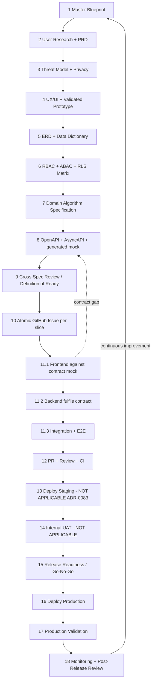

🇬🇧 English (source) · 🇮🇩 [Bahasa Indonesia](alur-pengembangan.id.md)

# AWCMS development flow

> **Canonical process document.** It answers one question: _from intent to
> production, what must exist, in what order, and what enforces it._
>
> It does **not** repeat the content of other documents. Every step points at a
> real artifact in this repo, and when the artifact **does not exist yet**, the
> step says so — a gap that is written down is more useful than a gap that is
> disguised.

- **Flow version: v2.0.0**, adopted by
  [ADR-0156](../adr/0156-adopt-development-flow-v2-validated-ux-before-data-model-frontend-backend-integration-per-slice.md)
  (30 October 2026; generic source: `ahliweb/personal-coding` DL-033). v2 moves
  UX/UI from step 8 to step 4 and splits step 11 into 11.1 → 11.2 → 11.3. Steps
  1–3, 9, 10, 12 and 13–18 keep their numbers. **A reference to "step 4" through
  "step 8" written before 30 October 2026 uses the v1 numbering** — translate it
  with the table in §Numbering map below.
- **Replaces** [`alur-pengembangan-mini-first.md`](alur-pengembangan-mini-first.md),
  which was revoked by [ADR-0055](../adr/0055-development-confined-to-awcms-and-awcms-astro.md)
  and is now only a historical record.
- **Complements, does not replace:** [`../../AGENTS.md`](../../AGENTS.md)
  (technical working contract) and [`../../CONTRIBUTING.md`](../../CONTRIBUTING.md)
  (mechanics of steps 10–12).

## The flow

## Two things that must be read before using this diagram

**First: not every change walks all 18 steps.** What decides is not taste, but
the CLASS of the change:

| Class of change                                       | Mandatory steps                                                                                               |
| ----------------------------------------------------- | ------------------------------------------------------------------------------------------------------------- |
| Docs only, chore, dependency bump                     | 10 → 12, then 16–18 at release time                                                                           |
| Bug fix without a contract/schema change              | 10 → 12                                                                                                       |
| Behaviour change in an existing module                | 3, 4 (if it touches a screen or user flow), 6 (if it touches access), 8 (if it touches the API), 10 → 12      |
| New schema / new column                               | 5, 6, 10 → 12                                                                                                 |
| **New module**                                        | full 1 → 12, plus an admission ADR ([`21_module_admission_governance.md`](21_module_admission_governance.md)) |
| Foundation-layer change (auth, access, sync, tenancy) | full 1 → 12, **ADR mandatory**                                                                                |

In the table, "10 → 12" includes 11.1, 11.2 and 11.3 **for the parts the change
actually has**: a change with no screen has no 11.1, a change with no backend has
no 11.2. The order within what exists is still frontend → backend → integration.

**Second: steps 1–9 produce DOCUMENTS, and documents in this repo go stale.**
The rule already in force stays in force: a document that is wrong is more
dangerous than a document that does not exist, because it is trusted. If a step
produces a claim that can go stale (a number, a file list, a status), put that
claim somewhere **generated or gated**, not in prose.

## Numbering map (v1 → v2)

| v1 (13 Aug 2026)                    | v2 (ADR-0156)                                            |
| ----------------------------------- | -------------------------------------------------------- |
| 1, 3                                | 1, 3 (unchanged)                                         |
| 2 PRD                               | 2 User Research + PRD                                    |
| 8 UX/UI                             | **4** UX/UI + validated prototype                        |
| 4 ERD + Data Dictionary             | **5**                                                    |
| 5 RBAC + ABAC + RLS Matrix          | **6**                                                    |
| 6 Domain / Verification Algorithm   | **7**                                                    |
| 7 OpenAPI + AsyncAPI                | **8** (plus a mock generated from the contract)          |
| 9, 10, 12                           | 9, 10, 12 (unchanged; gate 9 gains checks)               |
| 11 Implementation + Automated Tests | 11 = **11.1 Frontend → 11.2 Backend → 11.3 Integration** |
| 13–18                               | 13–18 (unchanged; 13–14 stay NOT APPLICABLE, ADR-0083)   |

Gates 9 and 15 keep their numbers on purpose: they are the most-cited numbers in
this repo, and renumbering them would stale documents that no gate can detect.

---

## 1. Master Blueprint

**Answers:** what this product is, where its boundary lies, and what is
deliberately NOT part of it.

| Artifact                                                           | Role                                |
| ------------------------------------------------------------------ | ----------------------------------- |
| [`01_canvas_induk.md`](01_canvas_induk.md)                         | product summary & principles        |
| [`11_implementation_blueprint.md`](11_implementation_blueprint.md) | per-sprint implementation blueprint |
| [`../ARCHITECTURE.md`](../ARCHITECTURE.md)                         | current-state architecture (gated)  |
| [`../adr/`](../adr/README.md)                                      | decisions that lock the scope       |

A scope change at this level is **always** an ADR. The blueprint does not change
direction; the ADR changes it, and the blueprint follows.

## 2. User Research + PRD

**Answers:** who the users are, what job gets done, what the evidence from real
users is, and what the acceptance criteria are. v2 makes user research a
required input: an assumption that has not been tested is written as an
assumption, not as a requirement.

[`02_prd_detail_per_modul.md`](02_prd_detail_per_modul.md). **Gap:** no separate
artifact holds user-research evidence (interviews, observation, support
tickets), so today the PRD carries it, or carries assumptions in its place.

## 3. Threat Model + Privacy Analysis

**Answers:** who the attacker is, what they are after, and what personal data is
touched.

| Part                        | Artifact                                                                               | Status             |
| --------------------------- | -------------------------------------------------------------------------------------- | ------------------ |
| Threat model                | [`20_threat_model_security_architecture.md`](20_threat_model_security_architecture.md) | exists             |
| Control map                 | [`standar-performa-dan-keamanan.md`](standar-performa-dan-keamanan.md)                 | exists, **living** |
| Data retention              | [`data-lifecycle.md`](data-lifecycle.md) + the `data-lifecycle:*` gates                | exists, gated      |
| **Privacy analysis / DPIA** | [`privacy-analysis.md`](privacy-analysis.md)                                           | exists             |
| Per feature                 | [`templates/privacy-analysis-template.md`](templates/privacy-analysis-template.md)     | exists             |

Both are mandatory and they answer different things: the threat model answers
"who is the attacker", the privacy analysis answers "whose data is in here".

The privacy analysis deliberately does **not** copy per-table retention numbers —
that copy is stale on the first day someone changes the descriptor, and a stale
number in a privacy document is more dangerous than no number at all. It points
at the gated place instead. It also states what **only the operator can answer**
(legal basis, DPO, cross-jurisdiction transfers) rather than pretending to answer
it.

## 4. UX/UI visualisation + validated prototype

**Answers:** what the product looks like and whether users can actually use it,
_before_ the data model and the contract are drawn. Moved here from step 8 in
v2: the data model and the API are shaped by what a tried screen turned out to
need, not by what the author guessed it needs.

**What v2 requires at this step:** fidelity that rises in stages (sketch →
clickable prototype → hi-fi); **usability testing with representative users**,
with findings recorded by ID and severity (`UXT-*`); **every screen state**
designed (empty, loading, error, partial, no permission, offline/slow,
destructive confirmation); **WCAG 2.2 AA** from design time; privacy in design
(masked classified data, visible consent); and a **per-screen data inventory**
(what is displayed, input, filtered, sorted), which is the direct input to steps
5 and 8.

| Part                              | Artifact                                                                                                               | Status                                                                                                                     |
| --------------------------------- | ---------------------------------------------------------------------------------------------------------------------- | -------------------------------------------------------------------------------------------------------------------------- |
| Design rules, tokens, states      | [`14_ui_ux_design_system.md`](14_ui_ux_design_system.md), [`../../src/styles/tokens.css`](../../src/styles/tokens.css) | exists; targets **WCAG 2.1 AA** (v2: 2.2 AA) — **gap**                                                                     |
| Frontend architecture             | [`15_frontend_architecture_integration.md`](15_frontend_architecture_integration.md)                                   | exists                                                                                                                     |
| Screen contracts (worked example) | [`omnichannel-ui-ux-screen-contracts.md`](omnichannel-ui-ux-screen-contracts.md)                                       | exists, one product area, Proposed                                                                                         |
| Prototypes                        | [`../../design/`](../../design/README.md) (`redesain-ui-ux-2026-10`)                                                   | exists, **reference-only, not usability-tested**                                                                           |
| Review of a built screen          | skills `awcms-ui-screen`, `awcms-ux-review`                                                                            | exist (they act at step 11, not as a validation of a prototype)                                                            |
| Usability test report (`UXT-*`)   | —                                                                                                                      | **does not exist**: no template, no ID scheme, no recorded test round                                                      |
| User research evidence for step 2 | —                                                                                                                      | **does not exist** as an artifact; PRD (02) carries assumptions, not evidence                                              |
| Per-screen data inventory         | —                                                                                                                      | **does not exist** as a template; `admin:screen-coverage:check` maps permissions to screens, which is a different question |

Enforcement that already exists and acts later: `design:token-contrast:check`
(contrast of the tokens), `i18n:screens:check`, `admin:screen-coverage:check`,
and the axe accessibility E2E (`tests/e2e/a11y-axe.e2e.ts`). None of them
validates a prototype with a user.

Two constraints that are often only discovered late: **CSP single-owner** (a
script must be imported and then bundled, not inlined) and every admin screen
must go through `loadAdminScreen` (`access:chokepoint:check` counts it).

**A new product surface is a step-4/9 decision, not an implementation detail**
([ADR-0146](../adr/0146-persona-apps-prefer-lynx-in-consumer-repos-astro-keeps-admin-and-public-web.md)): before building a screen or an app, classify it
with the surface table. Anything that manages the system or a person's own part
of a site is an Astro admin (`/admin/*` here, or `awcms-astro` for USER admin); a
public, crawlable page is Astro; only a **persona workflow** (customer, courier,
driver, partner, warehouse or field staff) is a candidate for a separate
**LynxJS** consumer repo, and only after the Lynx proof-of-concept gate. "App"
means persona function, not a `/app` URL, a phone-sized layout or an
Add-to-Home-Screen manifest. The questions are in
[`templates/definition-of-ready.md`](templates/definition-of-ready.md) §New
product surface.

## 5. ERD + Data Dictionary

**Answers:** which entities, how they relate, and what the columns mean. Since
v2 its inputs are three: the per-screen data inventory from step 4, the domain
rules of step 7, and the data obligations of step 3.

[`04_erd_data_dictionary.md`](04_erd_data_dictionary.md), with the real schema in
[`../../sql/`](../../sql/) and its conventions in
[`database-migrations.md`](database-migrations.md).

**What enforces this, rather than merely suggesting it:**

- an applied migration is **immutable** — editing it blocks `db:migrate` on a
  deployment that is already running;
- every `awcms_%` table must `ENABLE` **and** `FORCE ROW LEVEL SECURITY` unless
  it is registered as global with a reason (`security:readiness`);
- every foreign key column must be reachable by an index (`db:fk-index:check`);
- every table must answer the retention question
  (`data-lifecycle:table-coverage:check`).

## 6. RBAC + ABAC + RLS Matrix

**Answers:** who may do what, against which object.

| Artifact                                                       | Role                            |
| -------------------------------------------------------------- | ------------------------------- |
| [`17_default_seed_rbac_abac.md`](17_default_seed_rbac_abac.md) | default role & policy seed      |
| The `permissions` descriptor in `src/modules/*/module.ts`      | the actual permission catalogue |
| RLS policies in `sql/`                                         | the actual tenant boundary      |

**What enforces this:** `access:chokepoint:check` (every handler goes through the
gate), `access:permissions:enforcement:check`, `access:decision-log:coverage:check`,
`access:grant-readers:check`, `identity-access:sod-registry:check`, and
`security:readiness` for RLS against the real database.

The non-negotiable rules: **default-deny**, the structural gate ABOVE permission
retrieval, and every new gate is **deny-only** — not one of them may produce
`allowed: true`.

## 7. Domain Algorithm / Verification Specification

**Answers:** what the business rule is exactly, including its edge cases.

[`03_srs_detail_per_modul.md`](03_srs_detail_per_modul.md).

A rule that has applied since this repo began: **pure logic is separated from
I/O**. Whatever can be written as a pure function is written that way, because
that is what makes edge cases testable without a database — and because that is
what lets a mutation prove a gate actually guards something.

## 8. OpenAPI + AsyncAPI + generated mock

**Answers:** the contract promised to callers, and (v2) the mock that the
frontend of step 11.1 is built against.

Per-module fragments in [`../../openapi/modules/`](../../openapi/modules/), the
patterns and their rationale in [`05_openapi_asyncapi_detail.md`](05_openapi_asyncapi_detail.md)
and [`api-contribution-guide.md`](api-contribution-guide.md).

**What enforces this:** `api:spec:check`, `api:docs:check`,
`api:consumer-contract:check`, and the bundle-freshness gate — a spec that does
not match its route reddens CI rather than waiting to be discovered by a
consumer.

**What does NOT exist yet (a gap, not a decision):** nothing in this repo
**generates a mock server or a typed client from the OpenAPI contract**, and no
dependency for it is installed. v2 requires the mock to be generated from the
contract, never hand-written, so until tooling is chosen, step 11.1 against a
contract mock cannot be done as v2 describes it. Choosing the tool is its own
decision (it touches the toolchain), not something this document settles. The
nearest thing that exists is `api:consumer-contract:generate|check`, which
freezes the slice of the public API that `awcms-astro` calls; it is a
**one-sided** consumer snapshot, not a mock and not a provider verification.

## 9. Cross-Spec Review / Definition of Ready

**Answers:** whether steps 1–8 agree with each other, before anyone writes code.

v2 adds these checks to the gate: every screen has a data source mapped to a
contract operation (**a screen with no data source in the contract is a blocking
defect**, alongside an endpoint with no permission, a table with no
classification and a PII column with no retention policy); high-severity `UXT-*`
findings are closed or accepted by a named person; the design is checked against
WCAG 2.2 AA; the mock is generated from the contract and runs its examples; and a
**second** security and privacy pass over step 3 happens now that UI, data and API
have a shape. A defect sends the work back to the step that holds it and then
through this gate again, not forward with a note.

**Gap:** [`templates/definition-of-ready.md`](templates/definition-of-ready.md)
has not yet been extended with these v2 checks, so the template, not this
paragraph, is what the person filling it in sees. Updating it (and its mirror) is
a follow-up change.

| Artifact                                                                                               | Role                               |
| ------------------------------------------------------------------------------------------------------ | ---------------------------------- |
| [`templates/definition-of-ready.md`](templates/definition-of-ready.md)                                 | **general Definition of Ready**    |
| [`13_final_master_index_traceability.md`](13_final_master_index_traceability.md)                       | cross-document traceability matrix |
| [`templates/module-admission-decision-checklist.md`](templates/module-admission-decision-checklist.md) | checklist — new module             |

The Definition of **Done** in `CONTRIBUTING.md` is checked at the end; the list
above is checked at the start, and that is the whole difference.

This repo's experience shows the cost, and the FIRST question in the Definition
of Ready exists because of it: **two consecutive waves** (ADR-0087 and ADR-0088)
wrote plans that assumed cross-tenant reads that FORCE RLS forbids, and both were
only caught during implementation.

## 10. Atomic GitHub Issue

**Answers:** the smallest unit of work that can be reviewed on its own.

The pattern is in [`06_github_issues_detail.md`](06_github_issues_detail.md),
naming/roadmap conventions in [`09_roadmap_repository_commit.md`](09_roadmap_repository_commit.md).

v2: cut work **per vertical slice** (one complete user capability), and split each
slice into issues that run **11.1 → 11.2 → 11.3**, with the dependency written
down and the IDs of the `UI`/`TBL`/`PERM`/`API` they come from linked.

One issue = one branch = one PR. If an issue cannot land without leaving the tree
in a weaker state, it is split until it can.

## 11. Implementation + Automated Tests

**Answers:** the code, and the proof that the code is correct.

Standards in [`10_template_kode_coding_standard.md`](10_template_kode_coding_standard.md)
and [`../../AGENTS.md`](../../AGENTS.md).

v2 splits this step into three sub-steps that run **in order, per slice**, not
per product. Finishing every frontend before any backend is big-bang integration
and is not allowed. Backend work may start in parallel once the slice's contract
is frozen and the frontend has finished one screen against the mock without
finding a contract gap; what is forbidden is a backend that _precedes_ the
contract. A contract gap found at 11.1 goes back to step 8 and through gate 9
again. **Authorisation is never moved to the frontend:** the chokepoint, RBAC/ABAC
and FORCE RLS are enforced in the backend and database, and the frontend only
mirrors them.

### 11.1 Frontend against a contract mock

Screens are built from the design-system components and call the API only through
a client (or types) generated from the contract, pointed at the mock of step 8.
Exit: every screen of the slice runs against the mock, including the error and
no-permission states.

**What exists here, honestly:**

- Component and interaction tests: Playwright E2E under `tests/e2e/`, and an axe
  accessibility check (`tests/e2e/a11y-axe.e2e.ts`).
- `loadAdminScreen` as the single chokepoint for SYSTEM admin screens, so the
  frontend reflects the permission that the backend enforces.
- **No visual-regression tooling** is installed.
- **No mock from the contract and no generated client** (the gap under step 8).
  Without them, "against a mock" cannot be done as v2 describes.
- **Structural mismatch to be aware of:** SYSTEM admin screens here are
  server-rendered Astro pages. Their reads call the same application function
  that the JSON endpoint uses, server-side (for example `admin/offices.astro`
  calls `listOffices`), and only their writes go to `/api/v1` from the browser.
  The "frontend against a mock of the contract" model therefore fits the writes,
  the client islands and the `awcms-astro` consumer (whose repo owns its own
  11.1) better than it fits an SSR read. How the model applies to an SSR admin screen is an open question this
  ADR does not answer; until it is answered, treat 11.1 here as "the screen
  works against test data under the real gate", and say so in the issue.

### 11.2 Backend fulfils the contract

The operations are implemented exactly as the contract states; a difference goes
back to step 8, never a silent adjustment. Exit: every contract operation passes
the provider-side checks and the cross-tenant RLS tests.

**What exists:** unit tests, the DB-gated integration suite against a real
Postgres, `security:readiness` for RLS, migration immutability and the FK index
gate, and `api:spec:check` / `api:docs:check` which fail a spec that does not
match its route. This is the strongest-covered of the three sub-steps. A
consumer-driven provider verification (a tool that replays the consumer's
expectations against the provider) is not present; `api:consumer-contract:check`
is the closest, as a frozen snapshot.

### 11.3 Integration

The frontend is switched from the mock to the real backend in a dev or preview
environment, the contract test runs on **both** sides, and the end-to-end test
covers the critical path of every Must requirement. Exit: the critical path passes
without a mock, and no contract operation is unused or unverified.

**What exists:** Playwright E2E and the DB-gated suite in CI (step 12), and
`ci:local`. **What does not:** a two-sided contract test (only the consumer-side
snapshot of `awcms-astro`'s calls exists), and a performance baseline against the
SLOs of step 1.

### Rules that hold for all three

Three rules that are peculiar to this repo and appear in no general guide:

1. **Run it, do not read it.** A migration is verified by applying it from
   scratch against a real Postgres, and a constraint is proven to **REJECT** —
   not merely to exist.
2. **A gate must be proven to FAIL.** A check that is green proves nothing until
   a mutation reddens it. Put the original defect back, watch the correct test
   go red, then restore.
3. **Claims of the form "X runs before Y" are tested at SOURCE level**, because a
   behavioural test can be satisfied by the correct arrangement _and_ by the
   mutated one — and a source assertion must be rename-proof, or it passes
   vacuously.

Also from v2: user-affecting changes ship behind a flag that is off by default,
test data is synthetic or anonymised (production data never enters a test
environment, a mock included), and the smoke cases for step 17 are written here,
not improvised after release.

## 12. PR + Review + CI

**Answers:** whether this may enter `main`. Every PR of 11.1, 11.2 and 11.3 goes
through it; there is no single large PR at the end.

The mechanics are in [`../../CONTRIBUTING.md`](../../CONTRIBUTING.md), the
template in
[`../../.github/PULL_REQUEST_TEMPLATE.md`](../../.github/PULL_REQUEST_TEMPLATE.md),
branch protection in [`branch-protection.md`](branch-protection.md).

The gates: the full `bun run check` chain, the DB-gated suite, Playwright E2E,
CodeQL, GitGuardian, and a mandatory changeset for behaviour changes.

**Before you push: `bun run ci:local`** ([`ci-local.md`](ci-local.md), Issue
#1001). `bun run check` is only the `quality` job; `ci:local` also runs repo
hygiene, the changeset policy, the DB-gated integration suites against a
throwaway database, the Bun 1.3.0 floor and the Playwright smoke, with the
workflows' own commands in their order, and prints one table. A job it cannot run
here is reported `SKIPPED (reason)` and the exit code is non-zero — never a
silent pass. `tests/ci-local-parity.test.ts` keeps its job list in step with
`ci.yml` and `changesets.yml`, so a new workflow job cannot be silently missing.
**It does not replace the gates above:** GitHub's required checks (ruleset
`11653326`, [`branch-protection.md`](branch-protection.md)) still decide whether a
PR may merge; the local run is the verification before the push, not instead of it.

**A trap that has already bitten:** a stacked PR (base is not `main`) runs **ZERO**
gates, while `gh pr checks` still looks green because GitGuardian passes on its
own.

## 13. Deploy Staging — **NOT APPLICABLE to this repo**

> **A decision, not a gap** (13 August 2026).
> [ADR-0083](../adr/0083-this-template-deploys-to-one-environment.md) remains in
> force: this template deploys to **ONE** environment, production.

This step exists in the generic flow and is **deliberately skipped here**. The
repo owner was asked to choose between turning staging on (superseding ADR-0083)
and keeping a single environment, and chose the latter.

**What replaces it, stated so it does not have to be guessed:**

| Staging's role                       | What fills it here                                                             |
| ------------------------------------ | ------------------------------------------------------------------------------ |
| schema applied from scratch          | the ephemeral CI database (step 12)                                            |
| the request path tested end to end   | Playwright E2E + the DB-gated suite (step 12)                                  |
| verification against a real database | `bun run security:readiness` (step 15)                                         |
| readiness before release             | [`production-preflight-runbook.md`](production-preflight-runbook.md) (step 15) |

**And what it does NOT replace, recorded plainly:** human testing against
production-like data, and verification of third-party behaviour (Cloudflare,
Varnish, Traefik) outside the production path. Both are the price of this
decision, not something lost without anyone noticing — and both are legitimate
reasons to revisit ADR-0083 later.

Turning it back on remains an ADR-level decision, not something a process
document can reverse.

## 14. Internal UAT / Human Testing — **NOT APPLICABLE to this repo**

**Answers:** whether what was built actually gets the user's job done.

It depends on step 13, and step 13 is a decision that it does not exist. So this
is not a gap waiting to be filled; it is a consequence that has already been
decided.

The closest thing to its role is production validation (step 17), with a
difference that must be read honestly: **it runs AFTER release, not before.** For
a change that affects a customer-facing path, that means the cost of a mistake is
paid in production — and if that cost feels too expensive for a particular
change, the answer is to revisit ADR-0083 for that change, not to skip step 17.

## 15. Release Readiness / Go–No-Go

**Answers:** whether this is safe to release, and who says yes.

| Artifact                                                             | Role                                   |
| -------------------------------------------------------------------- | -------------------------------------- |
| [`production-readiness.md`](production-readiness.md)                 | production readiness gate              |
| [`production-preflight-runbook.md`](production-preflight-runbook.md) | preflight checklist                    |
| `bun run security:readiness`                                         | verification against the REAL database |
| [`resilience-dr-verification.md`](resilience-dr-verification.md)     | disaster recovery verification         |

`security:readiness` is the only check on this list that runs queries against a
real database — and it is the one that catches the class of failure invisible to
pure gates, e.g. **a Postgres role that turns out to be a superuser, making FORCE
RLS inert**.

## 16. Deploy Production

**Answers:** how the bits reach the server.

[`release-process.md`](release-process.md) (SemVer + Changesets),
[`deploy-coolify.md`](deploy-coolify.md), and `.github/workflows/release.yml`.

## 17. Production Validation

**Answers:** whether what is running there really is the intended version, and
really is healthy.

[`production-preflight-runbook.md`](production-preflight-runbook.md) holds the
post-deploy steps.

**A rule born of experience:** _a 200 on the domain ≠ production is alive._
Verify the version, the applied migrations, and the data path — not just the
status code of the front page.

## 18. Monitoring + Post-Release Review

**Answers:** what happened afterwards, and what was learned.

| Part                      | Artifact                                                            | Status |
| ------------------------- | ------------------------------------------------------------------- | ------ |
| Observability conventions | [`observability-metrics.md`](observability-metrics.md)              | exists |
| Database capacity         | [`database-capacity-runbook.md`](database-capacity-runbook.md)      | exists |
| **Post-release review**   | [`post-release-reviews.md`](post-release-reviews.md) + its template | exists |
| Recommendation rounds     | [`../PROJECT_STATE.md`](../PROJECT_STATE.md) §4                     | exists |

Two registers, and the distinction is deliberate: §4 is tied to **work rounds**
and records decisions; the release register is tied to **releases** and records
what happened when that release met production. Before the second one existed, it
was silently written as the first or not written at all.

**A smooth release still gets an entry** — a register that only holds incidents
erases the baseline that makes a bad release look bad. And one line in its
template carries a special load in this repo: _"what was first seen in production
and was not seen in CI"_ is where the price of the ADR-0083 decision (step 13) is
paid, and collecting it release after release is the only way to know whether the
price is still worth it.

**A rule already in force:** recommendations must be written into §4, including
the ones that were REJECTED along with the reason. Re-deriving a recommendation
list costs a full audit; writing it down costs one paragraph.

---

## Status of each step that was once empty

This list is here so it does not have to be re-derived. Note the last column:
**a gap and a decision are not the same thing**, and mixing them is how work that
has not been done acquires the appearance of a judgement.

| Step | Item                            | Nature                                   |
| ---- | ------------------------------- | ---------------------------------------- |
| 3    | Privacy analysis / DPIA         | **closed** 13 Aug 2026                   |
| 9    | General Definition of Ready     | **closed** 13 Aug 2026                   |
| 13   | Deploy staging                  | **decision** — ADR-0083, one environment |
| 14   | Internal UAT                    | **decision** — a consequence of step 13  |
| 18   | Per-release post-release review | **closed** 13 Aug 2026                   |

Added by v2 (ADR-0156, 30 Oct 2026). Every row is a **gap**, not a decision: each
needs its own issue, and none of them is closed by the ADR that names it.

| Step | Item                                                                 | Nature                                                    |
| ---- | -------------------------------------------------------------------- | --------------------------------------------------------- |
| 2    | User-research evidence as an artifact                                | **gap**                                                   |
| 4    | Usability-test report (`UXT-*`) and a prototype that has been tested | **gap**; `design/` is reference-only                      |
| 4    | Per-screen data inventory template                                   | **gap**                                                   |
| 4    | WCAG 2.2 AA (doc 14 says 2.1 AA)                                     | **gap** — `14_ui_ux_design_system.md` is stale against v2 |
| 8    | Mock server / typed client generated from the contract               | **gap** — no tooling installed                            |
| 9    | New v2 checks in the Definition of Ready template                    | **gap**                                                   |
| 11.1 | Visual-regression tooling; model for SSR admin screens               | **gap** / open question                                   |
| 11.3 | Two-sided contract test; performance baseline against the SLOs       | **gap** (consumer-side snapshot only)                     |

The gaps that remain after that are **inside** the documents that closed them,
not in this table — above all the absence of a per-data-subject export/erasure
flow ([`privacy-analysis.md`](privacy-analysis.md) §4). It is recorded there
because that is where the person who needs it will look.
