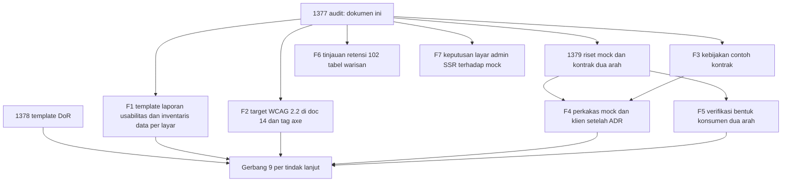

🇮🇩 Bahasa Indonesia · 🇬🇧 [English (source)](audit-alur-v2-adr-0156-2026-11-20.md)

<!-- i18n-source-hash: sha256:1af5294336e3ae6b4f2e5171c6ebd163801c35f2f1e4fc7c4b6bc37bd17d9960 -->

# Audit bukti alur UX-first dan contract-first (ADR-0156) — 20 November 2026

> **Untuk apa dokumen ini.** Audit pada satu titik waktu yang menentukan celah
> mana yang disebut
> [ADR-0156](../adr/0156-adopt-development-flow-v2-validated-ux-before-data-model-frontend-backend-integration-per-slice.id.md)
> pada 30 Oktober 2026 yang **masih nyata** di commit yang diaudit dan mana yang
> sudah tertutup, beserta buktinya. Ini keluaran riset issue #1377; ia bukan daftar
> tugas, dan tidak ada yang di sini mengubah runtime, skema, endpoint, otorisasi,
> atau tenancy.
>
> **Video yang memicunya bukan sumber kebijakan.** Sebuah video pendek tentang
> "jangan buat API dulu" memicu audit ini. Keputusannya tetap ADR-0156; audit ini
> hanya mengukur sejauh mana repo sudah menuju ke sana.

## 1. Baseline dan metode

| Butir                   | Nilai                                                                                                                                                        |
| ----------------------- | ------------------------------------------------------------------------------------------------------------------------------------------------------------ |
| Repo dan commit diaudit | `ahliweb/awcms` `main` di `765e52c7aca35e91a57ed24fc04a035176a32c95` (19 Nov 2026; HEAD diperiksa ulang 20 Nov 2026)                                         |
| Commit repo tetangga    | `ahliweb/awcms-astro` `origin/main` `02c71f7fadd2fbb887baed5cada73238f4de4fee`; `ahliweb/awcms-one` `origin/main` `66b9985ad753d815ad8f85f6392487087f4a8e8f` |
| CI pada SHA diaudit     | workflow `CI` run `44457608434` dan `CodeQL` run `44457608435`, keduanya `success` (dibaca dari GitHub, tidak dijalankan ulang)                              |
| Jalan lokal             | Bun 1.4.4, di worktree bersih pada SHA diaudit, hasil di §2                                                                                                  |
| Tidak dikerjakan        | tidak ada jalan berbasis DB, tidak ada `bun run security:readiness` ke basis data nyata, tidak ada akses produksi, tidak ada uji usabilitas                  |

Kosakata status, dipakai sama di setiap tabel:

| Status       | Arti                                                                                                        |
| ------------ | ----------------------------------------------------------------------------------------------------------- |
| **VERIFIED** | Kontrolnya ada dan buktinya dibaca atau direproduksi di audit ini (perintah dan hasilnya dikutip).          |
| **ASSUMED**  | Dokumen atau issue menyatakan ada, tetapi audit ini tidak mereproduksinya.                                  |
| **PLANNED**  | Celah yang diketahui dengan tindak lanjut teridentifikasi; **ketiadaannya** sudah diperiksa dan dinyatakan. |
| **DEFERRED** | Keputusan tercatat untuk menunda, atau bergantung pada sesuatu di luar repo ini.                            |

Kelas (apa yang dilakukan): **Reuse** (sudah menjawab pertanyaannya), **Extend**
(tambahan kecil pada yang sudah ada), **Defer** (jangan bertindak dulu, dengan
syaratnya).

## 2. Perintah yang dijalankan dan hasil sebenarnya

Semua dijalankan dari worktree bersih `765e52c7`, 20 November 2026, dengan Bun.

| Perintah                                                                                                                                                                                                                                              | Hasil                                                                                                           |
| ----------------------------------------------------------------------------------------------------------------------------------------------------------------------------------------------------------------------------------------------------- | --------------------------------------------------------------------------------------------------------------- |
| `bun run api:spec:check`                                                                                                                                                                                                                              | lulus                                                                                                           |
| `bun run asyncapi:provisional:check`                                                                                                                                                                                                                  | lulus                                                                                                           |
| `bun run api:docs:check`                                                                                                                                                                                                                              | OK, referensi cocok dengan hasil generate deterministik                                                         |
| `bun run api:consumer-contract:check`                                                                                                                                                                                                                 | OK, 15 jalur konsumen dan setiap komponen yang dijangkaunya masih terpenuhi secara aditif                       |
| `bun run access:permissions:enforcement:check`                                                                                                                                                                                                        | OK, 456/456 permission terdeklarasi berpenjaga, 0 pengecualian tercatat                                         |
| `bun run access:chokepoint:check`                                                                                                                                                                                                                     | OK, 742 handler rute, 95 layar admin semuanya lewat `loadAdminScreen`                                           |
| `bun run admin:screen-coverage:check`                                                                                                                                                                                                                 | OK, 95 layar mengklaim 311 dari 456 permission terdeklarasi; 11 disengaja, 134 menunggu layar                   |
| `bun run design:token-contrast:check`                                                                                                                                                                                                                 | OK, 68 pasangan token di 2 tema, semuanya di atas atau sama dengan **WCAG 2.1** AA                              |
| `bun run subject-data:coverage:check`                                                                                                                                                                                                                 | OK, 278 tabel: 235 berdeskriptor, 43 ditolak beralasan, 0 masih berutang                                        |
| `bun run data-lifecycle:table-coverage:check`                                                                                                                                                                                                         | OK, 278 tabel: 112 berdeskriptor, 9 tersegel, 55 dikecualikan beralasan, **102 utang warisan** (hanya menyusut) |
| `bun run i18n:screens:check`                                                                                                                                                                                                                          | OK, 95/95 layar admin diterjemahkan                                                                             |
| `bun test tests/api-consumer-contract.test.ts tests/openapi-route-parity-mutation.test.ts tests/openapi-bundle.test.ts tests/openapi-extra-fragment.test.ts tests/omes-control-contract-consumer-compat.test.ts tests/product-surface-policy.test.ts` | 142 lulus, 0 gagal (6 berkas)                                                                                   |

## 3. Matriks bukti

Pemilik adalah pemilik repo (`ahliweb`) kecuali repo lain disebut; audit tidak
menunjuk orang. "Issue" adalah issue yang **sudah ada**, atau "tidak ada" bila
tidak ada issue terbuka yang mencakupnya.

| ID  | Kontrol                                                      | Artefak                                                                                                                                                    | Tes atau gerbang                                                                                                                                                                                    | Bukti (repo@SHA)                                                                                                                                                                                                                                                                                                                                                                         | Status                                                                | Kelas        | Issue                                           |
| --- | ------------------------------------------------------------ | ---------------------------------------------------------------------------------------------------------------------------------------------------------- | --------------------------------------------------------------------------------------------------------------------------------------------------------------------------------------------------- | ---------------------------------------------------------------------------------------------------------------------------------------------------------------------------------------------------------------------------------------------------------------------------------------------------------------------------------------------------------------------------------------- | --------------------------------------------------------------------- | ------------ | ----------------------------------------------- |
| M1  | UX / prototipe tervalidasi (langkah 4)                       | `design/redesain-ui-ux-2026-10/` — "Proposal, not implemented" (`design/README.md`); `docs/awcms/14_ui_ux_design_system.md`                                | tidak ada yang memvalidasi prototipe dengan pengguna                                                                                                                                                | `git grep "UXT-"` di `765e52c7` hanya cocok di `alur-pengembangan.md` dan cerminnya: tidak ada laporan, skema ID, atau putaran uji                                                                                                                                                                                                                                                       | PLANNED (ketiadaan diperiksa)                                         | Extend       | tidak ada (#1378 hanya menambah pertanyaan DoR) |
| M2  | Inventaris data per layar (langkah 4)                        | tidak ada; template tidak ada                                                                                                                              | tidak ada. `admin:screen-coverage:check` memetakan **permission ke layar**, itu pertanyaan lain                                                                                                     | `git grep -i "data inventory\|inventaris data"` hanya menemukan ADR-0156, dokumen alur, dan nama tabel Master Data Inventory di `04_erd_data_dictionary.md`                                                                                                                                                                                                                              | PLANNED (ketiadaan diperiksa)                                         | Extend       | tidak ada                                       |
| M3  | WCAG 2.2 AA                                                  | `14_ui_ux_design_system.md` §Accessible menyebut **2.1 AA**; ADR-0166 (19 Nov 2026) menyebut halaman publik harus memenuhi **2.2 AA**                      | tag E2E axe `wcag2a, wcag2aa, wcag21a, wcag21aa` (`tests/e2e/a11y-axe.e2e.ts:66`); `design:token-contrast:check` adalah 2.1 AA                                                                      | `axe-core` 4.14.0 yang terpasang menandai **satu** aturan `wcag22aa` (`target-size`), dicek dengan `axe.getRules(["wcag22aa"])`; dua dokumen repo ini berbeda soal tingkat target                                                                                                                                                                                                        | VERIFIED (celah nyata)                                                | Extend       | tidak ada                                       |
| M4  | Kontrak OpenAPI dan gerbang sisi provider                    | `openapi/awcms-public-api.openapi.yaml` (bundle hasil generate) dari `openapi/modules/*.openapi.yaml` (41 fragmen) dan `openapi/awcms-public-api.src.yaml` | `api:spec:check`, `api:docs:check`, `tests/openapi-route-parity-mutation.test.ts`, `tests/openapi-bundle.test.ts`                                                                                   | OpenAPI 3.1.0, 570 path, 742 operasi, 511 skema; 742 handler rute (`access:chokepoint:check`); paritas **template path** antara berkas rute dan spec digerbangi dan dibuktikan merah lewat mutasi (ia membandingkan himpunan path, bukan method, kode status, atau bentuk: `collectRouteParityProblems`, `scripts/api-spec-check.ts` baris 775 sampai 801); `info.version` masih `0.1.0` | VERIFIED                                                              | Reuse        | tidak ada                                       |
| M5  | Kontrak AsyncAPI                                             | `asyncapi/awcms-domain-events.asyncapi.yaml` (AsyncAPI 3.0.0, 85 kanal, 86 operasi) ditambah dokumen provisional terpisah                                  | `api:spec:check` (live), `asyncapi:provisional:check` (mengunci bahwa event provisional tidak pernah memecah envelope)                                                                              | kedua cek lulus; berkas provisional sengaja di luar generator dan paritas                                                                                                                                                                                                                                                                                                                | VERIFIED                                                              | Reuse        | tidak ada                                       |
| M6  | Contoh kontrak (masukan yang dibutuhkan mock hasil generate) | contoh di dalam bundle OpenAPI                                                                                                                             | tidak ada yang mewajibkan contoh                                                                                                                                                                    | diukur dengan penelusuran di §6: **1 dari 742** operasi punya contoh respons; **13 dari 511** skema membawa contoh; **0** respons `204`                                                                                                                                                                                                                                                  | VERIFIED (celah nyata)                                                | Extend       | tidak ada                                       |
| M7  | Mock server / klien bertipe yang dihasilkan dari kontrak     | tidak ada                                                                                                                                                  | tidak ada                                                                                                                                                                                           | `package.json` tidak memuat msw, prism, openapi-typescript, orval, pact, schemathesis, maupun dredd; `scripts/` hanya punya `openapi-bundle.ts`; dokumen alur §8 menyatakan hal yang sama                                                                                                                                                                                                | PLANNED (ketiadaan diperiksa)                                         | Defer        | #1379 (riset)                                   |
| M8  | Kontrak konsumen, sisi provider (repo ini)                   | `tests/fixtures/awcms-astro-consumer-contract.openapi.yaml`, `scripts/api-consumer-contract.ts` (`CONSUMED_PATHS` ditambah `COMMITTED_PATHS`)              | `api:consumer-contract:check` (superset aditif, closure `$ref` transitif), `tests/api-consumer-contract.test.ts` (kasus negatif: rename, ubah tipe, hapus field, hapus path)                        | cek OK dengan 15 path; fixture berubah di 16 commit sejak 2026-08-04, terakhir 2026-11-14 (#1314, #1320). Tes membuktikan cek memerah pada rename, ubah tipe, dan entri `required` yang dihapus                                                                                                                                                                                          | VERIFIED                                                              | Reuse        | tidak ada                                       |
| M9  | Kontrak konsumen, sisi konsumen (`awcms-astro`)              | `awcms-astro` `tests/kontrak-awcms.test.mjs` dan blok penanda di skill-nya                                                                                 | menegaskan **himpunan permukaan** yang dipanggil, diturunkan dari `src/` tanpa komentar, terikat dua arah ke penanda skill                                                                          | dibaca di `awcms-astro@02c71f7f`: ia menetapkan **jalur mana** yang dipanggil, bukan bentuk respons; tesnya menjawab dari respons palsu tulisan tangan (mis. `/api/v1/blog/terms`, `/api/v1/media/objects`), yaitu spesifikasi kedua yang ditulis tangan (`pasangFetchTiruan` di berkas itu)                                                                                             | VERIFIED (parsial)                                                    | Extend       | tidak ada                                       |
| M10 | Konsumen kontrak worker berversi (OMES)                      | `contracts:omes:sync:check`, `omes:contract:preflight` di rantai `bun run check`; `tests/omes-control-contract-consumer-compat.test.ts`                    | lulus di §2                                                                                                                                                                                         | #1185 masih terbuka walau tes consumer-compat dan preflight sudah ada di HEAD; sisa lingkupnya tidak diverifikasi                                                                                                                                                                                                                                                                        | ASSUMED (lingkup #1185)                                               | Reuse (pola) | #1185                                           |
| M11 | Definition of Ready memuat pemeriksaan gerbang-9 v2          | `docs/awcms/templates/definition-of-ready.md` dan `.id.md`                                                                                                 | tidak ada yang otomatis                                                                                                                                                                             | di `765e52c7` template belum memuat V1–V5 (dokumen alur §9 menyatakannya); PR #1381 menambahkannya dan **belum di-merge**                                                                                                                                                                                                                                                                | PLANNED (di PR #1381)                                                 | Extend       | #1378                                           |
| M12 | Otorisasi dan isolasi tenant                                 | descriptor `permissions`; RLS di `sql/`; chokepoint                                                                                                        | `access:permissions:enforcement:check`, `access:chokepoint:check`; CI menjalankan `tests/security-readiness-*.test.ts` dan `tests/integration/` terhadap Postgres (`ci.yml`, baris 321 dan 356–363) | hasil §2; CI `success` di `765e52c7`. `bun run security:readiness` ke basis data nyata **tidak dijalankan** di sini (butuh `DATABASE_URL`); dokumen alur menaruhnya di langkah 15                                                                                                                                                                                                        | VERIFIED (gerbang), ASSUMED (jalan ke basis data nyata)               | Reuse        | tidak ada                                       |
| M13 | Cacat blocking: tabel tanpa klasifikasi                      | tabel sensitivitas di `04_erd_data_dictionary.md` §Sensitive data classification                                                                           | tidak ada gerbang yang memeriksa tingkat klasifikasinya sendiri (pencarian `scripts/` tidak menemukan)                                                                                              | jawaban RLS dan subjek data **sudah** digerbangi (`security:readiness`, `subject-data:coverage:check`: 0 berutang)                                                                                                                                                                                                                                                                       | PLANNED (ketiadaan diperiksa)                                         | Extend       | tidak ada                                       |
| M14 | Cacat blocking: kolom PII tanpa retensi                      | descriptor `dataLifecycle`                                                                                                                                 | `data-lifecycle:table-coverage:check`                                                                                                                                                               | tabel baru dipaksa menjawab; **102 tabel warisan** ada di ledger yang hanya menyusut tanpa jawaban retensi. Semuanya juga ada di antara 235 tabel berdeskriptor subjek data (dihitung; isi descriptor tidak diperiksa), sehingga ia **daftar kandidat**, bukan pelanggaran terbukti                                                                                                      | VERIFIED (mekanisme), ASSUMED (apakah salah satu dari 102 memuat PII) | Extend       | tidak ada                                       |
| M15 | Regresi, integrasi, E2E                                      | 651 `tests/*.test.ts`, 206 entri di `tests/integration/`, 33 entri di `tests/e2e/` (satu adalah direktori pendukung)                                       | job `quality`, `integration-tests`, `E2E smoke (Playwright)`, `minimum-supported`, `hygiene` di `ci.yml`                                                                                            | jumlah entri lewat `ls`; CI `success` di SHA diaudit. Apakah tes itu mencakup setiap pemetaan **layar ke operasi** tidak bisa diketahui sampai M2 ada                                                                                                                                                                                                                                    | VERIFIED                                                              | Reuse        | tidak ada                                       |
| M16 | Layar admin SSR terhadap mock kontrak                        | `admin/*.astro` memanggil fungsi aplikasi di sisi server; hanya tulis yang ke `/api/v1`                                                                    | tidak ada                                                                                                                                                                                           | dokumen alur §11.1 mencatat ini sebagai pertanyaan terbuka; audit ini tidak menjawabnya                                                                                                                                                                                                                                                                                                  | DEFERRED                                                              | Defer        | keputusan dibutuhkan                            |
| M17 | Kebentukan kontrak (apakah skema terkompilasi?)              | `openapi/modules/booking.openapi.yaml`; bundle                                                                                                             | `api:spec:check` lulus; ia tidak mengompilasi skema                                                                                                                                                 | `BookingPolicy.policy` punya `properties:` kosong dengan field menjorok sejajar (`booking.openapi.yaml` baris 4209–4210); 19 lokasi skema memakai `nullable: true` tanpa `type` di dokumen yang menyatakan OpenAPI 3.1.0. Keduanya ditemukan riset #1379 (uji coba kompilasi `ajv`), rincian di sana                                                                                     | VERIFIED (celah nyata)                                                | Extend       | tidak ada                                       |

## 4. Pembacaan matriks

1. **Sisi provider dari kontrak kuat, dan itu Reuse.** Paritas rute ke kontrak di tingkat path,
   penegakan permission, cakupan chokepoint, snapshot konsumen aditif, dan tes RLS
   berbasis DB semuanya berjalan di CI dan direproduksi di sini.
2. **Yang diminta ADR-0156 dan belum dimiliki repo ada di depan alur, bukan di
   belakang.** M1, M2, M3, dan M13 adalah artefak dan gerbang yang hilang atau
   saling bertentangan; M6 dan M7 adalah alasan "mock hasil generate dari kontrak
   yang menjalankan contohnya" belum bisa dipenuhi hari ini: kontrak memuat satu
   contoh respons, dan tidak ada generator.
3. **M6 lebih penting daripada M7.** Memilih perkakas (#1379) tidak membuat mock
   berguna selama 741 dari 742 operasi tidak punya contoh. Perkakas apa pun yang
   dipilih, cakupan contoh adalah prasyarat dan butuh keputusan sendiri tentang
   siapa yang menulis contoh dan bagaimana ia dijaga tetap benar (kontrak adalah
   sumber tunggal; spesifikasi kedua tulis tangan persis yang dilarang alur).
4. **Sisi konsumen satu sisi di kedua arah.** Provider membekukan bentuk yang
   dipanggil konsumen (M8). Konsumen membekukan jalur mana yang dipanggilnya (M9)
   tetapi menguji terhadap respons palsu yang ia tulis sendiri. Tidak ada perkakas
   yang memutar ulang ekspektasi konsumen terhadap provider, dan tidak ada yang
   memvalidasi respons palsu itu terhadap kontrak.
5. **ADR-0156 belum punya pemakaian yang teramati.** ADR itu mendarat 30 Oktober
   (commit `99bc57f0`). Dari 150 commit sesudahnya sampai commit yang diaudit
   (`git log --after=2026-10-30T12:00`, subjek dan badan), tidak satu pun menyebut
   "ADR-0156", "flow v2", "UXT-", "data inventory", atau "definition of ready", dan
   tidak satu pun ADR 0157 sampai 0166 menyebut uji usabilitas atau inventaris per
   layar. Satu-satunya yang menyebut WCAG 2.2 adalah ADR-0166. Ini pernyataan
   tentang **bukti tercatat**, bukan tentang apakah seseorang mencoba prototipe di
   luar catatan.
6. **102 tabel utang retensi warisan layak dilihat, bukan dipanikkan.** Ledgernya
   digerbangi dan hanya boleh menyusut, itu sebabnya aman menunggu. Pertanyaan
   terbukanya adalah apakah ada yang menyimpan data pribadi (M14).

## 5. Baseline metrik

Definisi dulu; nilai diberikan hanya bila ada instrumennya. **Tidak ada angka di
bawah yang diperkirakan.**

| Metrik                                   | Definisi                                                                                                  | Sumber                                                                 | Baseline                                                                                                                                                    |
| ---------------------------------------- | --------------------------------------------------------------------------------------------------------- | ---------------------------------------------------------------------- | ----------------------------------------------------------------------------------------------------------------------------------------------------------- |
| Cakupan kontrak atas rute                | operasi di bundle dibagi handler rute di `src/pages/api/v1`                                               | penelusuran bundle (§6); `access:chokepoint:check`                     | 742 / 742 di tingkat operasi, sebuah **hitungan teramati**. Yang digerbangi hanya paritas template path, jadi kesetaraan itu bukan invarian yang digerbangi |
| Cakupan kontrak atas contoh              | operasi dengan setidaknya satu contoh respons dibagi operasi                                              | penelusuran bundle (§6)                                                | 1 / 742; skema bercontoh 13 / 511                                                                                                                           |
| Cakupan layar ke operasi                 | layar yang sumber datanya terpetakan ke operasi kontrak dibagi layar                                      | inventaris data per layar (tidak ada)                                  | **N/A**: tidak ada inventaris (M2). `admin:screen-coverage:check` (95 layar, 311 dari 456 permission) mengukur hal lain                                     |
| Drift kontrak sisi provider              | ketidakcocokan spec/rute yang sampai ke `main`                                                            | `api:spec:check` merah di `main`                                       | 0 di SHA diaudit. Riwayat **N/A**: run merah tidak dicatat beserta penyebabnya                                                                              |
| Frekuensi perubahan kontrak konsumen     | commit yang meregenerasi fixture konsumen (tiap satu adalah "konsumen juga harus berubah" yang disengaja) | `git log -- tests/fixtures/awcms-astro-consumer-contract.openapi.yaml` | 16 commit dari 2026-08-04 sampai 2026-11-14. **Proksi** untuk tekanan perubahan, bukan jumlah cacat                                                         |
| Revisi pasca Definition of Ready         | perubahan kontrak atau layar setelah issue-nya lolos langkah 9                                            | butuh DoR tercatat per issue                                           | **N/A**: tidak ada bukti DoR tercatat per issue sebelum PR #1381                                                                                            |
| Kegagalan integrasi akibat celah kontrak | kegagalan integrasi atau E2E yang penyebabnya celah kontrak ditemukan di 11.3                             | butuh label penyebab pada kegagalan CI                                 | **N/A**: tidak ada instrumentasi                                                                                                                            |

## 6. Cara angka contoh dan cakupan dihasilkan

Dapat direproduksi dengan dependensi `yaml` milik repo sendiri, dari akar repo:

```js
import { parse } from "yaml";
import { readFileSync } from "node:fs";
const d = parse(readFileSync("openapi/awcms-public-api.openapi.yaml", "utf8"));
const hasEx = (o) =>
  o &&
  typeof o === "object" &&
  ("example" in o || "examples" in o || Object.values(o).some(hasEx));
let ops = 0,
  withExample = 0;
for (const item of Object.values(d.paths))
  for (const m of ["get", "post", "put", "patch", "delete"]) {
    const op = item[m];
    if (!op) continue;
    ops++;
    if (Object.values(op.responses ?? {}).some(hasEx)) withExample++;
  }
// di 765e52c7: ops = 742, withExample = 1
```

Kode status respons dihitung dengan cara sama (operasi yang mendeklarasikan
masing-masing): 200 ×688, 201 ×68, 400 ×621, 401 ×708, 403 ×687, 404 ×379, 409
×301, 422 ×95, 429 ×54, 503 ×97, 500 ×7, 502 ×5; **tidak ada `204`** yang
dideklarasikan di mana pun. Ini masukan untuk riset mock di #1379.

## 7. Peta dependensi dan kandidat tindak lanjut

Tindak lanjut adalah **kandidat**, bukan issue. Issue #1377 meminta memecahnya
hanya setelah gerbang 9 lolos, dan standar lintas-portofolio internal yang
mengatur pekerjaan ini tidak mengizinkan issue implementasi baru sebelum itu.
Tidak satu pun dibuat oleh audit ini, dan tidak satu pun menduplikasi issue
terbuka (diperiksa terhadap issue terbuka pada 20 November 2026, termasuk #1185,
#1186, #1378, #1379, #1380).



| Kandidat | Apa                                                                                                                                 | Kelas  | Ukuran | Prasyarat DoR-nya                                                                       | Repo pemilik              |
| -------- | ----------------------------------------------------------------------------------------------------------------------------------- | ------ | ------ | --------------------------------------------------------------------------------------- | ------------------------- |
| F1       | Template laporan usabilitas (`UXT-*`) dan inventaris data per layar                                                                 | Extend | S      | #1378 di-merge (supaya DoR menyebutnya); tanpa kode, hanya dokumen                      | `awcms`                   |
| F2       | Selaraskan doc 14 ke 2.2 AA; tambah `wcag22aa` ke himpunan tag axe (menambah satu aturan, `target-size`; review manual tetap perlu) | Extend | S      | putuskan apakah admin menargetkan 2.2 AA seperti halaman publik (ADR-0166)              | `awcms`                   |
| F3       | Kebijakan contoh kontrak: siapa menulis, bagaimana tetap benar, batas bawah per operasi baru                                        | Extend | M      | keputusan pemilik; masukan untuk F4                                                     | `awcms`                   |
| F4       | Perkakas mock dan klien                                                                                                             | Defer  | M      | rekomendasi #1379, sebuah ADR (Proposed lalu Accepted oleh pemilik), F3; lalu gerbang 9 | `awcms`, konsumen         |
| F5       | Verifikasi bentuk sisi konsumen dan pemutaran ulang ekspektasi konsumen oleh provider                                               | Defer  | M      | rekomendasi #1379; ketiga repo konsumen sepakat satu mekanisme                          | `awcms-astro` dan `awcms` |
| F6       | Tentukan apakah ada dari 102 tabel utang retensi warisan yang menyimpan data pribadi, lalu jawab retensinya                         | Extend | M      | keputusan pemilik soal prioritas; memakai ledger berpagar yang ada, tanpa gerbang baru  | `awcms`                   |
| F7       | Putuskan bagaimana langkah 11.1 berlaku untuk layar admin SSR                                                                       | Defer  | S      | keputusan pemilik (mungkin butuh ADR); dokumen alur §11.1 sudah menandainya terbuka     | `awcms`                   |

## 8. Keputusan yang menunggu pemilik

1. Apakah F2 menaikkan target **admin** ke 2.2 AA (sisi publik sudah diputuskan
   ADR-0166).
2. Apakah contoh kontrak (F3) menjadi kewajiban untuk operasi baru.
3. Bagaimana langkah 11.1 berlaku untuk layar admin SSR (F7).
4. Prioritas F6.

Pilihan perkakas adalah hak pemilik lewat ADR; #1379 menyediakan opsi dan
rekomendasi, bukan keputusan.

## 9. Batas audit ini

- Ia membaca kode dan menjalankan gerbang pada satu commit. Ia tidak menguji
  dengan pengguna, tidak menjalankan produksi, dan tidak menunjukkan bahwa suatu
  layar dapat dipakai.
- `bun run security:readiness` ke basis data nyata tidak dijalankan.
- 142 tes dan sebelas gerbang di §2 dijalankan sekali, secara lokal; hasil CI yang
  dikutip berasal dari GitHub, tidak dijalankan ulang.
- Ia tidak mengklaim sertifikasi atau kesesuaian dengan standar apa pun. ISO/IEC
  27001, ISO/IEC 27034, OWASP ASVS, OWASP API Security, dan NIST SSDF disebut di
  issue hanya sebagai sumber kontrol yang relevan.
- Matriks mencerminkan `765e52c7`; PR #1381 dan #1382 (terbuka saat ditulis) dapat
  mengubah M11 dan teks dokumen alur yang dikutipnya.

## 10. Pembaruan bertanggal (2026-11-20)

- **ADR-0167 berstatus Accepted (2026-11-20).** ADR perkakas yang disebut baris F4 (§7)
  sebagai prasyarat ("sebuah ADR (Proposed lalu Accepted oleh pemilik)") kini Accepted:
  [ADR-0167](../adr/0167-contract-derived-fixtures-and-two-sided-conformance-checks-with-an-in-repo-generator-and-ajv.id.md).
  Baris F4 dan temuan di atas tidak diubah; keduanya menggambarkan commit yang diaudit
  `765e52c7`. Catatan ini tidak memutuskan apakah F4 keluar dari Defer.
