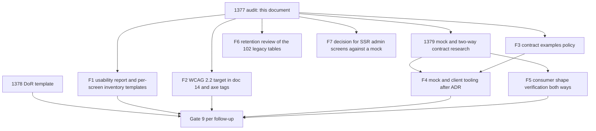

🇬🇧 English (source) · 🇮🇩 [Bahasa Indonesia](audit-alur-v2-adr-0156-2026-11-20.id.md)

# Evidence audit of the UX-first, contract-first flow (ADR-0156) — 20 November 2026

> **What this document is for.** A point-in-time audit that decides which of the
> gaps [ADR-0156](../adr/0156-adopt-development-flow-v2-validated-ux-before-data-model-frontend-backend-integration-per-slice.md)
> named on 30 October 2026 are **still real** at the audited commit and which
> are already closed, with the evidence for each. It is the research output of
> issue #1377; it is not a task list, and nothing here changes runtime, schema,
> endpoints, authorisation or tenancy.
>
> **The video that triggered it is not a source of policy.** A short video on
> "do not build the API first" prompted the audit. The decision stays ADR-0156;
> this audit only measures how far the repo has got toward it.

## 1. Baseline and method

| Item                    | Value                                                                                                                                                        |
| ----------------------- | ------------------------------------------------------------------------------------------------------------------------------------------------------------ |
| Audited repo and commit | `ahliweb/awcms` `main` at `765e52c7aca35e91a57ed24fc04a035176a32c95` (19 Nov 2026; HEAD re-checked on 20 Nov 2026)                                           |
| Neighbour commits read  | `ahliweb/awcms-astro` `origin/main` `02c71f7fadd2fbb887baed5cada73238f4de4fee`; `ahliweb/awcms-one` `origin/main` `66b9985ad753d815ad8f85f6392487087f4a8e8f` |
| CI on the audited SHA   | workflow `CI` run `44457608434` and `CodeQL` run `44457608435`, both `success` (read from GitHub, not re-run)                                                |
| Local runs              | Bun 1.4.4, in a clean worktree of the audited SHA, results in §2                                                                                             |
| Not done                | no DB-backed run, no `bun run security:readiness` against a real database, no production access, no usability test                                           |

Status vocabulary, used the same way in every table:

| Status       | Meaning                                                                                                  |
| ------------ | -------------------------------------------------------------------------------------------------------- |
| **VERIFIED** | The control exists and the evidence was read or reproduced in this audit (command and result are cited). |
| **ASSUMED**  | Documents or an issue say it exists, but this audit did not reproduce it.                                |
| **PLANNED**  | A known gap with a follow-up identified; the **absence** itself was checked and is stated.               |
| **DEFERRED** | A recorded decision to postpone or a dependency on something outside this repo.                          |

Class (what to do about it): **Reuse** (it already answers the question),
**Extend** (a small addition to something that exists), **Defer** (do not act
yet, with the condition).

## 2. Commands run and their actual results

All run from a clean worktree of `765e52c7`, 20 November 2026, with Bun.

| Command                                                                                                                                                                                                                                               | Result                                                                                                            |
| ----------------------------------------------------------------------------------------------------------------------------------------------------------------------------------------------------------------------------------------------------- | ----------------------------------------------------------------------------------------------------------------- |
| `bun run api:spec:check`                                                                                                                                                                                                                              | passed                                                                                                            |
| `bun run asyncapi:provisional:check`                                                                                                                                                                                                                  | passed                                                                                                            |
| `bun run api:docs:check`                                                                                                                                                                                                                              | OK, reference matches deterministic generation                                                                    |
| `bun run api:consumer-contract:check`                                                                                                                                                                                                                 | OK, 15 consumer paths and every component they reach still satisfied additively                                   |
| `bun run access:permissions:enforcement:check`                                                                                                                                                                                                        | OK, 456/456 declared permissions guarded, 0 recorded exceptions                                                   |
| `bun run access:chokepoint:check`                                                                                                                                                                                                                     | OK, 742 route handlers, 95 admin screens all through `loadAdminScreen`                                            |
| `bun run admin:screen-coverage:check`                                                                                                                                                                                                                 | OK, 95 screens claim 311 of 456 declared permissions; 11 deliberate, 134 awaiting a screen                        |
| `bun run design:token-contrast:check`                                                                                                                                                                                                                 | OK, 68 token pairs across 2 themes, all at or above **WCAG 2.1** AA                                               |
| `bun run subject-data:coverage:check`                                                                                                                                                                                                                 | OK, 278 tables: 235 with a descriptor, 43 refused with a reason, 0 still owed                                     |
| `bun run data-lifecycle:table-coverage:check`                                                                                                                                                                                                         | OK, 278 tables: 112 with a descriptor, 9 sealed, 55 excluded with a reason, **102 legacy debt** (may only shrink) |
| `bun run i18n:screens:check`                                                                                                                                                                                                                          | OK, 95/95 admin screens translated                                                                                |
| `bun test tests/api-consumer-contract.test.ts tests/openapi-route-parity-mutation.test.ts tests/openapi-bundle.test.ts tests/openapi-extra-fragment.test.ts tests/omes-control-contract-consumer-compat.test.ts tests/product-surface-policy.test.ts` | 142 pass, 0 fail (6 files)                                                                                        |

## 3. Evidence matrix

Owner is the repo owner (`ahliweb`) unless another repo is named; the audit does
not assign people. "Issue" is an **existing** issue, or "none" when no open
issue covers it.

| ID  | Control                                                | Artifact                                                                                                                                                | Test or gate                                                                                                                                                                                | Evidence (repo@SHA)                                                                                                                                                                                                                                                                                                                                                                       | Status                                                           | Class           | Issue                                   |
| --- | ------------------------------------------------------ | ------------------------------------------------------------------------------------------------------------------------------------------------------- | ------------------------------------------------------------------------------------------------------------------------------------------------------------------------------------------- | ----------------------------------------------------------------------------------------------------------------------------------------------------------------------------------------------------------------------------------------------------------------------------------------------------------------------------------------------------------------------------------------- | ---------------------------------------------------------------- | --------------- | --------------------------------------- |
| M1  | UX / validated prototype (step 4)                      | `design/redesain-ui-ux-2026-10/` — "Proposal, not implemented" (`design/README.md`); `docs/awcms/14_ui_ux_design_system.md`                             | none validates a prototype with a user                                                                                                                                                      | `git grep "UXT-"` at `765e52c7` matches only `alur-pengembangan.md` and its mirror: no report, no ID scheme, no test round exists                                                                                                                                                                                                                                                         | PLANNED (absence checked)                                        | Extend          | none (#1378 adds the DoR question only) |
| M2  | Per-screen data inventory (step 4)                     | none; template does not exist                                                                                                                           | none. `admin:screen-coverage:check` maps **permissions to screens**, which is a different question                                                                                          | `git grep -i "data inventory\|inventaris data"` finds only ADR-0156, the flow document and a Master Data Inventory table name in `04_erd_data_dictionary.md`                                                                                                                                                                                                                              | PLANNED (absence checked)                                        | Extend          | none                                    |
| M3  | WCAG 2.2 AA                                            | `14_ui_ux_design_system.md` §Accessible says **2.1 AA**; ADR-0166 (19 Nov 2026) says public pages must meet **2.2 AA**                                  | axe E2E tags `wcag2a, wcag2aa, wcag21a, wcag21aa` (`tests/e2e/a11y-axe.e2e.ts:66`); `design:token-contrast:check` is 2.1 AA                                                                 | installed `axe-core` 4.14.0 tags **one** rule `wcag22aa` (`target-size`), checked with `axe.getRules(["wcag22aa"])`; the repo's two documents disagree on the target level                                                                                                                                                                                                                | VERIFIED (gap is real)                                           | Extend          | none                                    |
| M4  | OpenAPI contract and its provider-side gates           | `openapi/awcms-public-api.openapi.yaml` (generated bundle) from `openapi/modules/*.openapi.yaml` (41 fragments) and `openapi/awcms-public-api.src.yaml` | `api:spec:check`, `api:docs:check`, `tests/openapi-route-parity-mutation.test.ts`, `tests/openapi-bundle.test.ts`                                                                           | OpenAPI 3.1.0, 570 paths, 742 operations, 511 schemas; 742 route handlers (`access:chokepoint:check`); parity of **path templates** between route files and the spec is gated and proven red by mutation (it compares the set of paths, not methods, status codes or shapes: `collectRouteParityProblems`, `scripts/api-spec-check.ts` lines 775 to 801); `info.version` is still `0.1.0` | VERIFIED                                                         | Reuse           | none                                    |
| M5  | AsyncAPI contract                                      | `asyncapi/awcms-domain-events.asyncapi.yaml` (AsyncAPI 3.0.0, 85 channels, 86 operations) plus a separate provisional document                          | `api:spec:check` (live), `asyncapi:provisional:check` (pins that provisional events never fork the envelope)                                                                                | both checks passed; the provisional file is deliberately outside generators and parity                                                                                                                                                                                                                                                                                                    | VERIFIED                                                         | Reuse           | none                                    |
| M6  | Contract examples (the input a generated mock needs)   | examples inside the OpenAPI bundle                                                                                                                      | none requires an example                                                                                                                                                                    | measured with the walk in §6: **1 of 742** operations has any response example; **13 of 511** schemas carry an example; **0** responses are `204`                                                                                                                                                                                                                                         | VERIFIED (gap is real)                                           | Extend          | none                                    |
| M7  | Mock server / typed client generated from the contract | none                                                                                                                                                    | none                                                                                                                                                                                        | `package.json` has no msw, prism, openapi-typescript, orval, pact, schemathesis or dredd; `scripts/` has `openapi-bundle.ts` only; the flow document §8 states the same                                                                                                                                                                                                                   | PLANNED (absence checked)                                        | Defer           | #1379 (research)                        |
| M8  | Consumer contract, provider side (this repo)           | `tests/fixtures/awcms-astro-consumer-contract.openapi.yaml`, `scripts/api-consumer-contract.ts` (`CONSUMED_PATHS` plus `COMMITTED_PATHS`)               | `api:consumer-contract:check` (additive-superset, transitive `$ref` closure), `tests/api-consumer-contract.test.ts` (negative cases: renamed, retyped, removed field, deleted path)         | check OK with 15 paths; the fixture changed in 16 commits since 2026-08-04, the latest on 2026-11-14 (#1314, #1320). The test proves the check goes red on a rename, a retype and a removed `required` entry                                                                                                                                                                              | VERIFIED                                                         | Reuse           | none                                    |
| M9  | Consumer contract, consumer side (`awcms-astro`)       | `awcms-astro` `tests/kontrak-awcms.test.mjs` and a marker block in its skill                                                                            | asserts the **set of surfaces** called, derived from `src/` with comments stripped, bound both ways to the skill marker                                                                     | read at `awcms-astro@02c71f7f`: it fixes **which paths** are called, not response shapes; its tests answer from hand-written fake responses (for example `/api/v1/blog/terms`, `/api/v1/media/objects`), which is a second, hand-written specification (`pasangFetchTiruan` in that file)                                                                                                 | VERIFIED (partial)                                               | Extend          | none                                    |
| M10 | Versioned worker contract consumer (OMES)              | `contracts:omes:sync:check`, `omes:contract:preflight` in the `bun run check` chain; `tests/omes-control-contract-consumer-compat.test.ts`              | passed in §2                                                                                                                                                                                | #1185 is still open although a consumer-compat test and a preflight exist at HEAD; what remains of its scope was not verified                                                                                                                                                                                                                                                             | ASSUMED (scope of #1185)                                         | Reuse (pattern) | #1185                                   |
| M11 | Definition of Ready carries the v2 gate-9 checks       | `docs/awcms/templates/definition-of-ready.md` and `.id.md`                                                                                              | none automated                                                                                                                                                                              | at `765e52c7` the template has no V1–V5 checks (the flow document §9 says so); PR #1381 adds them and is **not merged**                                                                                                                                                                                                                                                                   | PLANNED (in PR #1381)                                            | Extend          | #1378                                   |
| M12 | Authorisation and tenant isolation                     | `permissions` descriptors; RLS in `sql/`; chokepoint                                                                                                    | `access:permissions:enforcement:check`, `access:chokepoint:check`; CI runs `tests/security-readiness-*.test.ts` and `tests/integration/` against Postgres (`ci.yml`, lines 321 and 356–363) | §2 results; CI `success` on `765e52c7`. `bun run security:readiness` against a real database was **not run** here (needs `DATABASE_URL`); the flow document puts it at step 15                                                                                                                                                                                                            | VERIFIED (gates), ASSUMED (real-database run)                    | Reuse           | none                                    |
| M13 | Blocking defect: table without classification          | sensitivity table in `04_erd_data_dictionary.md` §Sensitive data classification                                                                         | no gate checks the classification level itself (search of `scripts/` found none)                                                                                                            | RLS and data-subject answers **are** gated (`security:readiness`, `subject-data:coverage:check`: 0 owed)                                                                                                                                                                                                                                                                                  | PLANNED (absence checked)                                        | Extend          | none                                    |
| M14 | Blocking defect: PII column without retention          | `dataLifecycle` descriptors                                                                                                                             | `data-lifecycle:table-coverage:check`                                                                                                                                                       | new tables are forced to answer; **102 legacy tables** are on a shrink-only ledger without a retention answer. All 102 also appear among the 235 tables with a subject-data descriptor (computed; descriptor content not inspected), so they are a **candidate list**, not a proven violation                                                                                             | VERIFIED (mechanism), ASSUMED (whether any of the 102 holds PII) | Extend          | none                                    |
| M15 | Regression, integration, E2E                           | 651 `tests/*.test.ts`, 206 entries in `tests/integration/`, 33 entries in `tests/e2e/` (one is a support directory)                                     | `quality`, `integration-tests`, `E2E smoke (Playwright)`, `minimum-supported`, `hygiene` jobs in `ci.yml`                                                                                   | entry counts by `ls`; CI `success` on the audited SHA. Whether those tests cover each **screen to operation** mapping is not knowable until M2 exists                                                                                                                                                                                                                                     | VERIFIED                                                         | Reuse           | none                                    |
| M16 | SSR admin screens against a contract mock              | `admin/*.astro` call application functions server-side; only writes go to `/api/v1`                                                                     | none                                                                                                                                                                                        | flow document §11.1 records this as an open question; this audit does not answer it                                                                                                                                                                                                                                                                                                       | DEFERRED                                                         | Defer           | decision needed                         |
| M17 | Contract well-formedness (do the schemas compile?)     | `openapi/modules/booking.openapi.yaml`; the bundle                                                                                                      | `api:spec:check` passes; it does not compile schemas                                                                                                                                        | `BookingPolicy.policy` has `properties:` empty with its fields indented as siblings (`booking.openapi.yaml` lines 4209–4210); 19 schema locations use `nullable: true` without a `type` in a document declaring OpenAPI 3.1.0. Both found by the research of #1379 (`ajv` compile trial), details there                                                                                   | VERIFIED (gap is real)                                           | Extend          | none                                    |

## 4. Reading of the matrix

1. **The provider side of the contract is strong, and that is Reuse.** Path-level
   route to contract parity, permission enforcement, chokepoint coverage, additive
   consumer snapshot and the DB-backed RLS tests all run in CI and were
   reproduced here.
2. **What ADR-0156 asks for and the repo does not have is on the front of the
   flow, not the back.** M1, M2, M3 and M13 are missing or contradictory
   artifacts and gates; M6 and M7 are the reason "a mock generated from the
   contract that runs its examples" cannot be met today: the contract holds one
   response example, and there is no generator.
3. **M6 matters more than M7.** Choosing a tool (#1379) does not make a mock
   useful while 741 of 742 operations have no example. Whatever tool is chosen,
   example coverage is a prerequisite and needs its own decision on who writes
   examples and how they are kept true (the contract is the single source; a
   hand-written second spec is exactly what the flow forbids).
4. **The consumer side is one-sided in both directions.** The provider freezes
   shapes the consumer calls (M8). The consumer freezes which paths it calls (M9)
   but tests against fake responses it wrote itself. No tool replays the
   consumer's expectations against the provider, and none validates the fake
   responses against the contract.
5. **ADR-0156 has had no observable use yet.** The ADR landed on 30 October
   (commit `99bc57f0`). Among the 150 commits after it up to the audited commit
   (`git log --after=2026-10-30T12:00`, subject and body), none mentions
   "ADR-0156", "flow v2", "UXT-", "data inventory" or "definition of ready", and
   none of the ADRs 0157 to 0166 mentions a usability test or a
   per-screen inventory. The only one that names WCAG 2.2 is ADR-0166. This is a
   statement about **recorded evidence**, not about whether anyone tried a
   prototype off the record.
6. **The 102 legacy retention-debt tables deserve a look, not an alarm.** The
   ledger is gated and may only shrink, which is why it is safe to wait. The
   open question is whether any of them holds personal data (M14).

## 5. Metric baselines

Definitions first; a value is given only when an instrument exists. **No number
below is estimated.**

| Metric                                  | Definition                                                                                         | Source                                                                 | Baseline                                                                                                                          |
| --------------------------------------- | -------------------------------------------------------------------------------------------------- | ---------------------------------------------------------------------- | --------------------------------------------------------------------------------------------------------------------------------- |
| Contract coverage of routes             | operations in the bundle divided by route handlers under `src/pages/api/v1`                        | bundle walk (§6); `access:chokepoint:check`                            | 742 / 742 at operation level, an **observed count**. Only path-template parity is gated, so the equality is not a gated invariant |
| Contract coverage of examples           | operations with at least one response example divided by operations                                | bundle walk (§6)                                                       | 1 / 742; schemas with an example 13 / 511                                                                                         |
| Screen to operation coverage            | screens whose data sources are mapped to contract operations divided by screens                    | per-screen data inventory (does not exist)                             | **N/A**: no inventory (M2). `admin:screen-coverage:check` (95 screens, 311 of 456 permissions) measures a different thing         |
| Provider contract drift                 | spec/route mismatches that reach `main`                                                            | `api:spec:check` red on `main`                                         | 0 at the audited SHA. History **N/A**: red runs are not recorded with a cause                                                     |
| Consumer contract change frequency      | commits that regenerate the consumer fixture (each is a deliberate "the consumer must change too") | `git log -- tests/fixtures/awcms-astro-consumer-contract.openapi.yaml` | 16 commits from 2026-08-04 to 2026-11-14. A **proxy** for change pressure, not a defect count                                     |
| Revisions after Definition of Ready     | changes to a contract or screen after its issue passed step 9                                      | needs a recorded DoR per issue                                         | **N/A**: no DoR evidence is recorded per issue before PR #1381                                                                    |
| Integration failures from contract gaps | integration or E2E failures whose cause is a contract gap found at 11.3                            | needs a failure-cause label on CI failures                             | **N/A**: no instrumentation                                                                                                       |

## 6. How the example and coverage numbers were produced

Reproducible with the repo's own `yaml` dependency, from the repo root:

```js
import { parse } from "yaml";
import { readFileSync } from "node:fs";
const d = parse(readFileSync("openapi/awcms-public-api.openapi.yaml", "utf8"));
const hasEx = (o) =>
  o &&
  typeof o === "object" &&
  ("example" in o || "examples" in o || Object.values(o).some(hasEx));
let ops = 0,
  withExample = 0;
for (const item of Object.values(d.paths))
  for (const m of ["get", "post", "put", "patch", "delete"]) {
    const op = item[m];
    if (!op) continue;
    ops++;
    if (Object.values(op.responses ?? {}).some(hasEx)) withExample++;
  }
// at 765e52c7: ops = 742, withExample = 1
```

Response status codes counted the same way (operations declaring each): 200 ×688,
201 ×68, 400 ×621, 401 ×708, 403 ×687, 404 ×379, 409 ×301, 422 ×95, 429 ×54,
503 ×97, 500 ×7, 502 ×5; **no `204`** is declared anywhere. This is input to the
mock research in #1379.

## 7. Dependency map and follow-up candidates

Follow-ups are **candidates**, not issues. Issue #1377 says to split them only
after gate 9 passes, and the internal cross-portfolio standard that governs this
work allows no new implementation issue before then. None of them is created by this audit, and
none duplicates an open issue (checked against open issues on 20 November 2026,
including #1185, #1186, #1378, #1379, #1380).



| Candidate | What                                                                                                                    | Class  | Size | Prerequisites for its DoR                                                             | Owner repo                |
| --------- | ----------------------------------------------------------------------------------------------------------------------- | ------ | ---- | ------------------------------------------------------------------------------------- | ------------------------- |
| F1        | Templates for a usability report (`UXT-*`) and a per-screen data inventory                                              | Extend | S    | #1378 merged (so the DoR names them); no code, docs only                              | `awcms`                   |
| F2        | Align doc 14 to 2.2 AA; add `wcag22aa` to the axe tag set (it adds one rule, `target-size`; manual review still needed) | Extend | S    | decide whether the admin targets 2.2 AA as the public pages do (ADR-0166)             | `awcms`                   |
| F3        | Policy for contract examples: who writes them, how they stay true, a floor per new operation                            | Extend | M    | owner decision; input to F4                                                           | `awcms`                   |
| F4        | Mock and client tooling                                                                                                 | Defer  | M    | #1379 recommendation, an ADR (Proposed then Accepted by the owner), F3; then gate 9   | `awcms`, consumers        |
| F5        | Consumer-side shape verification and provider replay of consumer expectations                                           | Defer  | M    | #1379 recommendation; the three consumer repos agree on one mechanism                 | `awcms-astro` and `awcms` |
| F6        | Determine whether any of the 102 legacy retention-debt tables holds personal data, then answer retention                | Extend | M    | owner decision on priority; uses the existing gated ledger, no new gate               | `awcms`                   |
| F7        | Decide how step 11.1 applies to SSR admin screens                                                                       | Defer  | S    | an owner decision (it may need an ADR); the flow document §11.1 already marks it open | `awcms`                   |

## 8. Decisions that wait for the owner

1. Whether F2 raises the **admin** target to 2.2 AA (the public side is already
   decided by ADR-0166).
2. Whether contract examples (F3) become a requirement for new operations.
3. How step 11.1 applies to SSR admin screens (F7).
4. Priority of F6.

The tooling choice is the owner's through an ADR; #1379 supplies options and a
recommendation, not a decision.

## 9. Limits of this audit

- It reads code and runs gates at one commit. It does not test with users, does
  not run production, and does not show that a given screen is usable.
- `bun run security:readiness` against a real database was not run.
- The 142 tests and eleven gates listed in §2 were run once, locally; CI results
  cited are from GitHub, not re-run.
- It claims no certification or conformance with any standard. ISO/IEC 27001,
  ISO/IEC 27034, OWASP ASVS, OWASP API Security and NIST SSDF are named in the
  issue only as sources of relevant controls.
- The matrix reflects `765e52c7`; PRs #1381 and #1382 (open when written) may
  change M11 and the flow-document text it cites.

## 10. Dated update (2026-11-20)

- **ADR-0167 is Accepted (2026-11-20).** The tooling ADR that row F4 (§7) names as a
  precondition ("an ADR (Proposed then Accepted by the owner)") is now Accepted:
  [ADR-0167](../adr/0167-contract-derived-fixtures-and-two-sided-conformance-checks-with-an-in-repo-generator-and-ajv.md).
  The F4 row and the findings above are unchanged; they describe the audited commit
  `765e52c7`. This note does not decide whether F4 leaves Defer.
