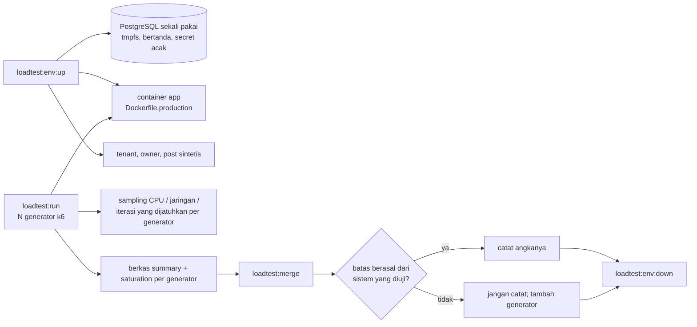

🇮🇩 Bahasa Indonesia · 🇬🇧 [English (source)](load-testing.md)

<!-- i18n-source-hash: sha256:f48f66f962ffd7fe98de59bbd044614bf1ab16ebc04ea3c9982e6d5aeaae99b5 -->

# Uji beban terdistribusi (Issue #1283, ADR-0161)

> Sebuah **prosedur**, bukan hasil. Repo ini menyertakan harness-nya. **Tidak
> ada angka baseline yang dicatat di sini**, karena belum ada uji beban yang
> dijalankan. Tabel baseline di bagian akhir tetap kosong sampai sebuah run
> nyata terjadi dan hasilnya diterima oleh pemeriksaan saturasi (§Membaca
> hasil).

## Untuk apa

ADR-0161 menjadikan target kapasitas sebagai NFR terukur: laju request edge
dengan hit ratio 99% atau lebih, **p95 di bawah 500 ms** di origin, baca admin
dan API p95 500 ms serta tulis 900 ms, dan **lonjakan 10x trafik dalam 60 detik
dengan 5xx paling banyak 1%**. Satu-satunya uji HTTP sebelumnya (Juli 2026)
terbatas sekitar 800 rps oleh klien uji, sehingga tidak mengatakan apa pun
tentang aplikasinya. Harness ini ada agar hasil dapat dipercaya: ia mengirim
beban dari beberapa generator dan menolak run yang batasnya berasal dari
generator.

## Di mana beban boleh berjalan

Hanya terhadap **environment sementara per run** (keputusan pemilik pada #1281,
opsi A): app terpisah ditambah PostgreSQL sekali pakai berisi data sintetis,
dibuat untuk satu run dan dihancurkan setelahnya. Tidak ada environment uji
beban permanen, dan beban tidak pernah dikirim ke deployment yang hidup
(ADR-0083, [`environments.md`](environments.md)).



## Pengaman

- Database dibuat oleh proyek compose yang sama yang menyalakan app. Tooling
  **tidak pernah membaca `DATABASE_URL`** atau credential lain dari pemanggil;
  proses anak migrasi mendapat environment yang dibangun dari nol.
- Sebelum menulis apa pun, tooling memeriksa bahwa database bernama
  `awcms_lt_<run id>` dan memiliki komentar `awcms-loadtest-ephemeral:<run id>`
  yang ia tulis sendiri. Selain itu, proses dibatalkan.
- Seed hanya berbicara HTTP dan menolak target non-loopback. Kedua port yang
  dipublikasikan mengikat ke `127.0.0.1`.
- Setiap credential acak per run. Berkas credential bermode `0600` di bawah
  `$XDG_RUNTIME_DIR` dan dihapus oleh `down`. Tidak ada rahasia yang dicetak
  atau di-commit.
- `loadtest:run` menolak mulai kecuali `LOADTEST_TARGET_APPROVED` sama dengan run
  id, dan `setup()` k6 dibatalkan kecuali tenant yang di-seed **untuk run ini**
  menjawab di target. URL yang salah ketik gagal di situ, sebelum ada beban.
- App berjalan sebagai `APP_ENV=production` dengan role least-privilege
  `awcms_app` dan `awcms_setup` diaktifkan, sehingga RLS benar-benar teruji
  seperti di produksi, bukan dilewati oleh superuser.

## Prosedur

Prasyarat: Docker dengan plugin compose, Bun, dan [k6](https://k6.io) di setiap
mesin generator (atau `--k6-docker`, yang menjalankan `grafana/k6` di jaringan
host). Jalankan dari root repo.

```bash
# 1. Buat environment (mencetak URL target; menulis berkas env 0600).
bun run loadtest:env:up -- --run-id lt-baseline1 --posts 50

# 2. Muat credential ke shell (berkasnya tidak dicetak).
set -a; . "$XDG_RUNTIME_DIR/awcms-loadtest-lt-baseline1/loadtest.env"; set +a

# 3. Tiga generator di mesin ini, halaman publik, ramp lalu tahan.
bun run loadtest:run -- --run-id lt-baseline1 --base-url "$LOADTEST_BASE_URL" \
  --tenant-code "$LOADTEST_TENANT_CODE" --scenario public-page \
  --profile baseline --target-rps 1500 --generators 3

# 4. Gabungkan, baca vonisnya.
bun run loadtest:merge -- --run-id lt-baseline1 --generators 3

# 5. Hancurkan semuanya (container, database, image, berkas env).
bun run loadtest:env:down -- --run-id lt-baseline1
```

**Skenario** (`--scenario`): `public-page` (indeks blog dan post, dapat
di-cache, tanpa login), `admin-read` (`GET /api/v1/offices`, terautentikasi,
per tenant, tidak dapat di-cache), `api-write` (`POST /api/v1/blog/posts`,
membuat draf sintetis). **Profil** (`--profile`): `smoke` (15 detik, untuk
memeriksa kabel; tidak pernah diterima sebagai baseline), `baseline` (ramp 60
detik, tahan, bawaan 5 menit, `--hold` untuk mengubah), `spike` (laju normal 2
menit, 10x dalam 60 detik, tahan, kembali). `--target-rps` adalah laju
**agregat**; tiap generator menjalankan bagiannya.

**Lebih dari satu mesin.** Generator di mesin terpisah menjalankan perintah yang
sama dengan `--run-id`, `--total-generators`, dan `--start-at <epoch ms>` yang
sama, masing-masing dengan `--generator-id` sendiri (`g1`, `g2`, ...) dan
credential di environment-nya sendiri, mengarah ke target yang dapat dijangkau
mesin itu. Lalu salin setiap `<gen>.summary.json` dan `<gen>.saturation.json` ke
satu direktori `loadtest/results/<run id>/` dan jalankan `loadtest:merge` dengan
`--generators N`. Environment sementara mengikat ke loopback, jadi run
multi-mesin memerlukan operator membukanya dengan sengaja (misalnya satu
terowongan SSH per generator); pembukaan itu keputusan operator, bukan alat.

Empat skenario pada issue dipetakan sebagai: (1) halaman publik lewat CDN dan
(2) halaman yang sama di origin adalah satu skenario, `public-page`, dengan
`--base-url` menunjuk hostname CDN atau origin; hit ratio CDN berasal dari
analitik CDN, bukan k6; (3) `admin-read`; (4) `api-write`. Run lewat CDN
memerlukan hostname CDN di depan environment yang disetujui pemilik untuk itu;
environment sementara yang hanya loopback tidak dapat menyediakannya.

## Membaca hasil

`loadtest:merge` mencetak satu laporan dan keluar `0` hanya bila hasil
**diterima**.

| Bidang                  | Arti                                                                                                                                                               |
| ----------------------- | ------------------------------------------------------------------------------------------------------------------------------------------------------------------ |
| mean rps                | Request dibagi durasi run, dijumlahkan lintas generator. Ringkasan k6 tidak memuat puncak sesaat.                                                                  |
| latensi p50/p90/p95/p99 | Ditampilkan sebagai rata-rata berbobot request dari generator dan sebagai **generator terburuk**. Persentil tidak dapat digabung persis; yang terburuk menentukan. |
| laju 5xx                | Diagregasi lintas generator. HTTP 429 dihitung terpisah dan membuat run tidak diterima: pembatas laju, bukan kapasitas, yang membentuknya.                         |
| threshold k6            | p95 di bawah 500 ms (tulis 900 ms) dan 5xx paling banyak 1%: bentuk ADR-0161.                                                                                      |
| saturasi klien          | Per generator: puncak CPU, puncak jaringan terhadap kecepatan NIC, dan iterasi yang dijatuhkan (k6 tidak dapat menjaga laju kedatangan).                           |

**Penerimaan.** Hasil diterima hanya bila setiap generator yang diharapkan
melapor, tidak ada generator yang melampaui batasnya (bawaan: CPU 70%, jaringan
70% dari kecepatan NIC, iterasi yang dijatuhkan 1%; `--max-cpu`, `--max-net`
pada `loadtest:merge`), dan tidak ada HTTP 429. Kecepatan NIC yang tidak
diketahui dihitung tidak diterima (berikan `--link-mbps` ke `loadtest:run` bila
kernel tidak dapat melaporkannya, misalnya di VM). **Run yang tidak diterima
bukan baseline**: tambah generator atau turunkan target sampai batasnya jelas
berada di sisi aplikasi.

CPU aplikasi dan koneksi database **tidak** dikumpulkan harness. Bacalah dari
host dan dari PostgreSQL selama run (misalnya `docker stats` dan
`pg_stat_activity`) dan tulis di samping laporan. Metrik latensi HTTP di dalam
app belum terpasang (ADR-0161, issue #1287), sehingga latensi hanya berasal
dari k6.

### Membandingkan dengan ADR-0161

| Nilai awal ADR-0161                                               | Cara membandingkan                                                                         |
| ----------------------------------------------------------------- | ------------------------------------------------------------------------------------------ |
| Origin dinamis 2.000 rps per node 2 vCPU pada p95 di bawah 500 ms | Laju `public-page` tertinggi di origin yang diterima dan lolos threshold, dibagi vCPU node |
| Baca admin p95 paling banyak 500 ms, tulis paling banyak 900 ms   | p95 `admin-read` dan `api-write` pada konkurensi yang dinyatakan                           |
| Lonjakan 10x dalam 60 detik, 5xx paling banyak 1%                 | Profil `spike`: threshold lolos dan laju 5xx tetap dalam batas                             |
| Hit ratio 99% atau lebih                                          | Analitik CDN saat run lewat CDN; tidak terukur di setup sementara                          |

Catat, untuk tiap nilai, apakah ia bertahan atau perlu direvisi, beserta
tanggal, perangkat keras host app dan generator, dan run id.

## Batas environment sementara

Satu host, satu PostgreSQL di tmpfs dengan `fsync=off`, tanpa CDN, tanpa Varnish,
dan tanpa Redis (`EDGE_CACHE_MODE=off` kecuali `--edge-cache` diberikan). Perilaku
database yang terikat disk dan hit ratio CDN karena itu **tidak** terwakili, dan
data sintetisnya satu tenant dengan post terbit sejumlah `--posts`. Sebutkan hal
itu di setiap laporan. Bila pemilik menyetujui environment kedua untuk run CDN,
itu keputusan tersendiri di bawah ADR-0083.

## Baseline terukur

**Belum dicatat.** Belum ada run yang dilakukan. Saat ada, tambahkan tabelnya di
sini (tanggal, environment, metode, run id, diterima ya/tidak, angka per
skenario, dan vonis bertahan/revisi per nilai ADR-0161) dalam pull request yang
sama dengan angkanya, dalam kedua bahasa.

## Terkait

- ADR-0161 (target kapasitas adalah NFR terukur; diterima 2026-11-12, dokumennya mendarat lewat pull request-nya sendiri), [ADR-0083](../adr/0083-this-template-deploys-to-one-environment.md)
- [`environments.md`](environments.md), [`edge-cache-architecture.md`](edge-cache-architecture.md), [`database-capacity-runbook.md`](database-capacity-runbook.md)
- Kode: `loadtest/` (`k6/awcms.js`, `run.ts`, `merge-results.ts`, `lib/`, `ephemeral/`)
