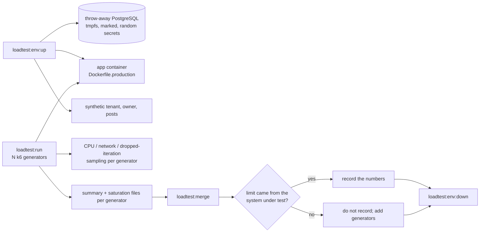

🇬🇧 English (source) · 🇮🇩 [Bahasa Indonesia](load-testing.id.md)

# Distributed load testing (Issue #1283, ADR-0161)

> A **procedure**, not a result. This repository ships the harness. **No
> baseline number is recorded here**, because no load test has been run yet. The
> baseline table at the end stays empty until a real run happens and its result
> is accepted by the saturation check (§Reading a result).

## What this is for

ADR-0161 makes capacity targets measured NFRs: an edge request rate with a hit
ratio of 99% or more, **p95 under 500 ms** at the origin, admin and API reads at
p95 500 ms and writes at 900 ms, and a **spike of 10x traffic within 60 seconds
with 5xx at or below 1%**. The only earlier HTTP test (July 2026) was capped at
roughly 800 rps by the test client, so it said nothing about the application.
This harness exists so that a result can be trusted: it drives load from several
generators and rejects a run whose limit came from the generators.

## Where the load may run

Only against an **ephemeral per-run environment** (owner decision on #1281,
option A): a separate app plus a throw-away PostgreSQL with synthetic data,
created for one run and destroyed after it. No permanent load-test environment
exists, and load is never sent to the live deployment (ADR-0083,
[`environments.md`](environments.md)).



## Safety interlocks

- The database is created by the same compose project that starts the app. The
  tooling **never reads `DATABASE_URL`** or any credential from the caller; the
  migration child process gets an environment built from scratch.
- Before any write, the tooling checks that the database is named
  `awcms_lt_<run id>` and carries the comment `awcms-loadtest-ephemeral:<run
id>`, which it wrote itself. Anything else aborts.
- The seed talks only HTTP and refuses a non-loopback target. Both published
  ports bind to `127.0.0.1`.
- Every credential is random per run. The credentials file is mode `0600` in a
  `0700` directory under `$XDG_RUNTIME_DIR` (or `~/.cache` when it is unset,
  never the shared OS temp directory) and is deleted by `down`. The env file is
  built only from generated values and this run's own database, never from an
  HTTP response. Nothing secret is printed, logged or committed.
- `loadtest:run` refuses to start unless `LOADTEST_TARGET_APPROVED` equals the
  run id, and the k6 `setup()` aborts unless the tenant seeded **for this run**
  answers on the target. A mistyped URL fails there, before any load.
- The app runs as `APP_ENV=production` with the least-privilege `awcms_app` and
  `awcms_setup` roles activated, so RLS is exercised as in production rather
  than bypassed by a superuser.

## Procedure

Prerequisites: Docker with the compose plugin, Bun, and [k6](https://k6.io) on
every generator machine (or `--k6-docker`, which runs `grafana/k6` on the host
network). Run from the repository root.

```bash
# 1. Create the environment (prints the target URL; writes a 0600 env file).
bun run loadtest:env:up -- --run-id lt-baseline1 --posts 50

# 2. Load the credentials into the shell (the file is not printed).
set -a; . "$XDG_RUNTIME_DIR/awcms-loadtest-lt-baseline1/loadtest.env"; set +a

# 3. Three generators on this machine, public pages, ramp then hold.
bun run loadtest:run -- --run-id lt-baseline1 --base-url "$LOADTEST_BASE_URL" \
  --tenant-code "$LOADTEST_TENANT_CODE" --scenario public-page \
  --profile baseline --target-rps 1500 --generators 3

# 4. Merge, read the verdict.
bun run loadtest:merge -- --run-id lt-baseline1 --generators 3

# 5. Destroy everything (containers, database, image, env file).
bun run loadtest:env:down -- --run-id lt-baseline1
```

**Scenarios** (`--scenario`): `public-page` (blog index and posts, cacheable,
no login), `admin-read` (`GET /api/v1/offices`, authenticated, tenant-scoped,
uncacheable), `api-write` (`POST /api/v1/blog/posts`, creates synthetic drafts).
**Profiles** (`--profile`): `smoke` (15 s, to check wiring; never accepted as a baseline), `baseline` (60 s
ramp, hold, default 5 min, `--hold` to change), `spike` (normal rate for 2 min,
10x within 60 s, hold, return). `--target-rps` is the **aggregate** rate; each
generator drives its share.

**More than one machine.** Generators on separate machines run the same command
with the same `--run-id`, `--total-generators` and `--start-at <epoch ms>`, each
with its own `--generator-id` (`g1`, `g2`, ...) and credentials in its own
environment, aimed at a target that machine can reach. Then copy every
`<gen>.summary.json` and `<gen>.saturation.json` into one
`loadtest/results/<run id>/` directory and run `loadtest:merge` with
`--generators N`. The ephemeral environment binds to loopback, so a multi-machine
run needs the operator to expose it deliberately (for example an SSH tunnel per
generator); that exposure is the operator's decision, not the tool's.

The four scenarios in the issue map as: (1) public page through the CDN and (2)
the same page at the origin are one scenario, `public-page`, with `--base-url`
pointing at the CDN hostname or at the origin; the CDN hit ratio comes from the
CDN's analytics, not from k6; (3) `admin-read`; (4) `api-write`. A run through a
CDN additionally needs a CDN hostname in front of an environment the owner has
approved for that; the loopback-only ephemeral environment cannot provide it.

## Reading a result

`loadtest:merge` prints one report and exits `0` only when the result is
**accepted**.

| Field                   | Meaning                                                                                                                                         |
| ----------------------- | ----------------------------------------------------------------------------------------------------------------------------------------------- |
| mean rps                | Requests over run duration, summed across generators. k6 summaries carry no instantaneous peak.                                                 |
| latency p50/p90/p95/p99 | Shown as a request-weighted mean of the generators and as the **worst generator**. Percentiles cannot be merged exactly; the worst one decides. |
| 5xx rate                | Aggregated across generators. HTTP 429 is counted separately and makes the run not accepted: a rate limiter, not capacity, shaped it.           |
| k6 thresholds           | p95 under 500 ms (writes 900 ms) and 5xx at or below 1%: the ADR-0161 shapes.                                                                   |
| client saturation       | Per generator: CPU peak, network peak against the NIC speed, and dropped iterations (k6 could not keep the arrival rate).                       |

**Acceptance.** A result is accepted only if every expected generator reported,
no generator exceeded its limits (defaults: CPU 70%, network 70% of the NIC
speed, dropped iterations 1%; `--max-cpu`, `--max-net` on `loadtest:merge`), and
there was no HTTP 429. An unknown NIC speed counts as not accepted (pass
`--link-mbps` to `loadtest:run` when the kernel cannot report it, for example in
a VM). **A run that is not accepted is not a baseline**: add generators or lower
the target until the limit visibly sits on the application side.

Application CPU and database connections are **not** collected by the harness.
Read them from the host and from PostgreSQL during the run (for example
`docker stats` and `pg_stat_activity`) and write them next to the report. The
HTTP latency metric inside the app is not wired yet (ADR-0161, issue #1287), so
latency comes from k6 only.

### Comparing with ADR-0161

| ADR-0161 initial value                                       | How to compare                                                                                                   |
| ------------------------------------------------------------ | ---------------------------------------------------------------------------------------------------------------- |
| Origin dynamic 2,000 rps per 2-vCPU node at p95 under 500 ms | Highest `public-page` rate at the origin that is accepted and passes the thresholds, divided by the node's vCPUs |
| Admin read p95 at most 500 ms, write at most 900 ms          | `admin-read` and `api-write` p95 at a stated concurrency                                                         |
| Spike 10x in 60 s, 5xx at most 1%                            | `spike` profile: thresholds pass and the 5xx rate stays within bound                                             |
| Hit ratio 99% or more                                        | CDN analytics during a CDN run; not measurable in the ephemeral setup                                            |

Record, for each value, whether it holds or needs revising, with the date, the
hardware of the app host and the generators, and the run id.

## Limits of the ephemeral environment

It is one host, one PostgreSQL on tmpfs with `fsync=off`, no CDN, no Varnish and
no Redis (`EDGE_CACHE_MODE=off` unless `--edge-cache` is given). Disk-bound
database behaviour and CDN hit ratio are therefore **not** represented, and
the synthetic data is one tenant with `--posts` published posts. Say so in any
report. If the owner approves a second environment for a CDN run, that is a
separate decision under ADR-0083.

## Measured baseline

**Not recorded.** No run has been performed. When one is, add the table here
(date, environment, method, run id, accepted yes/no, per-scenario numbers, and
the held/revise verdict per ADR-0161 value) in the same pull request as the
numbers, in both languages.

## Related

- ADR-0161 (capacity targets are measured NFRs; accepted 2026-11-12, its document lands with its own pull request), [ADR-0083](../adr/0083-this-template-deploys-to-one-environment.md)
- [`environments.md`](environments.md), [`edge-cache-architecture.md`](edge-cache-architecture.md), [`database-capacity-runbook.md`](database-capacity-runbook.md)
- Code: `loadtest/` (`k6/awcms.js`, `run.ts`, `merge-results.ts`, `lib/`, `ephemeral/`)
