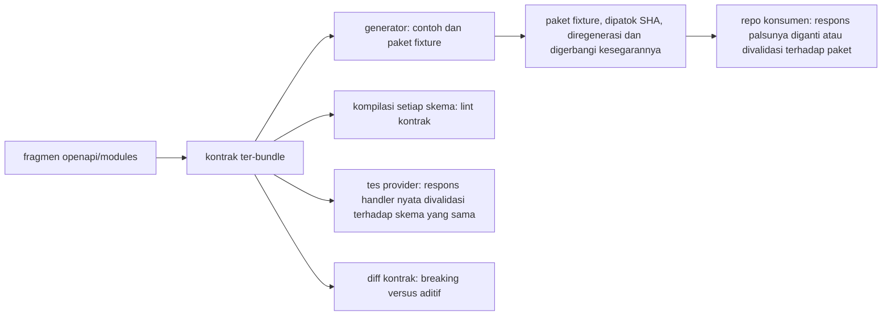
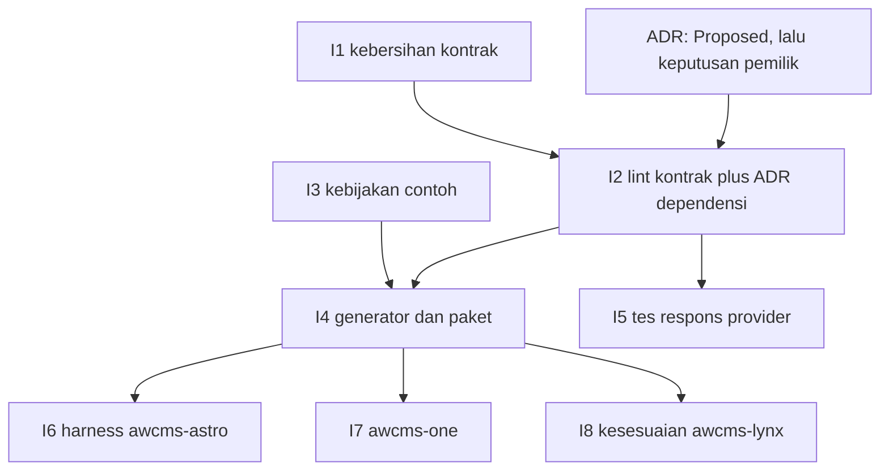

🇮🇩 Bahasa Indonesia · 🇬🇧 [English (source)](research-openapi-mock-and-two-way-contract-tests-2026-11-20.md)

<!-- i18n-source-hash: sha256:141c34d12a343be99619fdc52ca2203d0e2463f7a7111d5a967eefcf4271e1ce -->

# Riset: mock turunan OpenAPI dan uji kontrak dua arah — 20 November 2026

> **Pembaruan status (2026-11-20).** Pemilik memilih opsi **C′** dan kebijakan kontrak untuk operasi baru; keduanya tercatat sebagai [ADR-0167](../adr/0167-contract-derived-fixtures-and-two-sided-conformance-checks-with-an-in-repo-generator-and-ajv.id.md) (Accepted). Analisis di bawah dipertahankan seperti saat riset dikerjakan: di mana tertulis "usulan", "Rekomendasi", atau "belum ada ADR", bacalah sebagai sudah diputuskan oleh ADR-0167. Kandidat tindak lanjut menjadi issue backlog #1389 sampai #1395 di bawah epik #1396 dan menunggu gerbang 9 serta Definition of Ready; tidak ada yang diimplementasikan.

> **Apa dokumen ini.** Keluaran riset issue #1379. Ia mengevaluasi opsi perkakas
> untuk mock yang **dihasilkan dari kontrak OpenAPI** serta pemeriksaan kontrak
> sisi provider dan sisi konsumen, supaya langkah 8
> [alur pengembangan](alur-pengembangan.md) (mock hasil generate) dan langkah 11.1
> (frontend terhadapnya) bisa dijalankan. Semua yang bertanda **Rekomendasi**
> adalah **usulan**. Keputusannya milik pemilik, lewat ADR; dokumen
> ini sendiri **tidak** mengajukan ADR dan tidak ada yang di dalamnya berstatus `Accepted` (ADR-0167 adalah keputusannya; lihat pembaruan di atas).
>
> **Batas lingkup.** Riset ini tidak menambah dependensi, rute, objek basis data,
> atau perubahan spec. Perkakas dicoba **di luar repo**, di direktori sementara,
> dan hasilnya dikutip beserta batasnya. Mock tidak pernah menjadi bukti keamanan
> runtime (§6).

## 1. Baseline, metode, dan non-duplikasi

| Butir             | Nilai                                                                                                                                                                                                                                |
| ----------------- | ------------------------------------------------------------------------------------------------------------------------------------------------------------------------------------------------------------------------------------ |
| Repo dan commit   | `ahliweb/awcms` `main` `765e52c7aca35e91a57ed24fc04a035176a32c95` (19 Nov 2026), diperiksa ulang 20 Nov 2026                                                                                                                         |
| Konsumen dibaca   | `ahliweb/awcms-astro` `origin/main` `02c71f7fadd2fbb887baed5cada73238f4de4fee`; `ahliweb/awcms-one` `origin/main` `66b9985ad753d815ad8f85f6392487087f4a8e8f`; `ahliweb/awcms-lynx` `main` `2ffce1d072cd8c026017374d9163337fba973692` |
| Runtime pekerjaan | Bun 1.4.4 di Linux x64                                                                                                                                                                                                               |
| Uji coba perkakas | di direktori sementara di luar repo, `bun add --ignore-scripts`; versi dipatok di §3; **bukan** di CI                                                                                                                                |
| Tidak dikerjakan  | tidak ada run perkakas di CI, tidak ada run Prism, Pact, Schemathesis, atau Dredd (alasan di §3), tidak ada backend hidup, tidak ada browser, tidak ada benchmark kinerja mock                                                       |

Kosakata status (sama dengan audit pendamping): **VERIFIED** (dibaca atau
direproduksi di sini), **ASSUMED**, **PLANNED**, **DEFERRED**.

**Hubungan dengan pekerjaan lain, agar tidak ada yang dikerjakan dua kali.**

- Audit pendamping
  ([`audit-alur-v2-adr-0156-2026-11-20.md`](audit-alur-v2-adr-0156-2026-11-20.md), issue #1377, PR #1383) menetapkan celahnya (M6 contoh, M7 tanpa generator, M9
  respons palsu konsumen). Dokumen ini tidak mengulangnya; ia memilih cara
  menutup M6, M7, M8, dan M9.
- `ahliweb/awcms-lynx` menerbitkan validasi kontraknya sendiri pada 20 November 2026
  (`docs/contract-validation-2026-11.md`, dibaca di SHA di atas). Tindak lanjut R-1
  miliknya (cek kesesuaian spec untuk kliennya) **menunggu riset ini** dan berbunyi
  "jangan membangun generator mock kedua". Temuan F-05 miliknya diverifikasi ulang
  di sini sebagai drift nyata (§2, R5). R-6 miliknya (entri kontrak untuk
  `feed.json` dan indeks statis) hanya tercakup #1379 sejauh "entri kontrak
  dibutuhkan"; berkas-berkas itu di luar OpenAPI repo ini dan tetap menjadi issue
  #547 milik `awcms-one`.
- Issue #1378 (template Definition of Ready) menamai pemeriksaan yang diberi
  masukan oleh riset ini; #1380 (klarifikasi staging) berdiri sendiri; #1185
  (konsumen kontrak worker OMES) adalah **kontrak lain** (protokol worker, bukan
  OpenAPI publik) dan hanya dipakai di sini sebagai pola.

## 2. Temuan revalidasi

| ID  | Temuan                                                                                                                                                                                                                                                                                                                                                                                    | Status                             | Bukti                                                                                                                                                                                                                                                                       |
| --- | ----------------------------------------------------------------------------------------------------------------------------------------------------------------------------------------------------------------------------------------------------------------------------------------------------------------------------------------------------------------------------------------- | ---------------------------------- | --------------------------------------------------------------------------------------------------------------------------------------------------------------------------------------------------------------------------------------------------------------------------- |
| R1  | Celah masih ada di HEAD: tidak ada generator mock atau klien terpasang, dan hanya **1 dari 742** operasi membawa contoh respons; **tidak ada respons `204`** di mana pun dan **tidak ada ekstensi `x-` tingkat operasi** (permission sebuah operasi tidak tercatat di kontrak)                                                                                                            | VERIFIED                           | `package.json` tidak memuat msw, prism, openapi-typescript, orval, pact, schemathesis, dredd; penelusuran bundle `openapi/awcms-public-api.openapi.yaml` (metode di audit §6)                                                                                               |
| R2  | **Cacat kontrak yang diungkap klien bertipe:** di `BookingPolicy.policy` kunci `properties:` kosong dan definisi field menjorok sejajar, sehingga skema tidak mendeklarasikan properti apa pun. `api:spec:check` tetap lulus                                                                                                                                                              | VERIFIED                           | `openapi/modules/booking.openapi.yaml` baris 4209–4210 di `765e52c7`; `openapi-typescript` menghasilkan `policy: Record<string, never>`; `ajv` menolak mengompilasinya (`properties value must be ["object"]`); pemindaian menemukan satu kemunculan `properties: null` ini |
| R3  | **`nullable: true` dipakai 869 kali di components dokumen yang menyatakan `openapi: 3.1.0`**, yang di sana `nullable` bukan lagi keyword; **19 lokasi skema membawanya tanpa `type`**, dan ini membuat skema sukses **44 operasi** gagal dikompilasi di `ajv` 8.20.0 (mode 2020-12, non-strict)                                                                                           | VERIFIED (uji coba)                | pemindaian dan kompilasi `ajv`, direktori sementara, 20 Nov 2026: 688 dari 734 operasi berskema sukses JSON terkompilasi; 46 gagal (44 karena ini, 2 karena R2)                                                                                                             |
| R4  | **Skema hanya sekuat daftar `required`-nya.** 267 dari 460 skema objek component tidak mendeklarasikan `required`; 106 mengatur `additionalProperties: false`. Memvalidasi contoh hasil generate terhadap kontrak **tidak** menangkap properti `Office` yang di-rename (ia tanpa `required`), dan menangkap ubah tipe, properti required baru, dan `additionalProperties` yang diperketat | VERIFIED (uji coba)                | vektor uji §7, dijalankan dengan `ajv` 8.20.0                                                                                                                                                                                                                               |
| R5  | **Drift nyata antara spec dan handler ada, dan gerbang tidak melihatnya.** `awcms-one` mendokumentasikan `account/otp/request` sebagai `202`; handler menjawab `ok(...)`, yaitu `200`. `api:spec:check` hanya membandingkan **himpunan template path** dengan berkas rute, bukan method, kode status, atau bentuk                                                                         | VERIFIED                           | `awcms-one@66b9985a`: OpenAPI `"202"`, handler `request.ts` baris 146 dan 174 memanggil `ok(...)`; `awcms` `src/modules/_shared/api-response.ts:47-55` (`status: 200`); `scripts/api-spec-check.ts` `collectRouteParityProblems` (baris 775–801)                            |
| R6  | **Tes respons-terhadap-skema sisi provider ada untuk segelintir endpoint, masing-masing tulis tangan.** `validateAgainst` pada tes office memeriksa keberadaan properti dan tipe primitif, mengabaikan `required`, properti ekstra, dan nesting                                                                                                                                           | VERIFIED                           | `tests/openapi-office-response-schema-postgres.test.ts` (DB-gated); sembilan berkas membaca bundle; setidaknya dua menegaskan bentuk respons (tes office dan `tests/integration/menu-widget-response-shape.integration.test.ts`), sisanya tidak diperiksa untuk hal ini     |
| R7  | **Setiap konsumen membawa spesifikasi kedua tulis tangan.** `awcms-astro` menjawab dari `pasangFetchTiruan`; `awcms-one` memuat `apps/storefront/scripts/stub-awcms.mjs` 2263 baris yang membaca fixture ter-commit; `awcms-lynx` mengunci perilaku dengan `fetch` palsu yang disuntikkan (119 tes klien lulus di sana)                                                                   | VERIFIED                           | `awcms-astro@02c71f7f` `tests/kontrak-awcms.test.mjs`; `awcms-one@66b9985a` `apps/storefront/scripts/stub-awcms.mjs`; `awcms-lynx` `docs/contract-validation-2026-11.md` §What the tests prove                                                                              |
| R8  | Bentuk respons bersyarat mengalahkan generasi naif: `GET /api/v1/blog/posts` mengembalikan `BlogPostSummary` secara bawaan dan `BlogPost` bila `view=full`, dinyatakan sebagai `oneOf` di dalam respons                                                                                                                                                                                   | VERIFIED                           | `openapi/modules/blog-content.openapi.yaml`; di bundle skema sukses 20 operasi butuh pilihan `oneOf`                                                                                                                                                                        |
| R9  | **Generator minimal layak di atas dependensi `yaml` yang sudah ada**: dari 734 operasi berskema sukses JSON, 685 menghasilkan contoh tanpa penilaian, 20 butuh pilihan `oneOf`, 6 siklik atau terlalu dalam, 2 terkena cacat R2                                                                                                                                                           | VERIFIED (bukti konsep, sementara) | bukti konsep atas bundle, 20 Nov 2026; ia memeriksa bahwa generasi **selesai**, dan §7 memvalidasi sampel dengan `ajv`; ia bukan bukti validitas penuh                                                                                                                      |

## 3. Opsi

Data registry sebagaimana dibaca dari registry npm pada 20 November 2026 (dist-tag latest; "direct deps" menghitung daftar dependensi paket itu sendiri).

| Opsi                                                                        | Yang diberikan                                                                     | Bukti                                                                                                                                                                                                                                                                            |
| --------------------------------------------------------------------------- | ---------------------------------------------------------------------------------- | -------------------------------------------------------------------------------------------------------------------------------------------------------------------------------------------------------------------------------------------------------------------------------- |
| **A1** `openapi-typescript` 7.13.0 (+ `openapi-fetch` 0.17.0)               | path dan skema bertipe, opsional klien fetch bertipe; **tanpa mock, tanpa contoh** | MIT, 6 direct deps, rilis terakhir 2026-02-11. **Berjalan di Bun 1.4.4** terhadap bundle: 52.171 baris dalam 0,77 detik. Mengungkap R2 pada keluarannya                                                                                                                          |
| **A2** Prism (`@stoplight/prism-cli` 5.16.0)                                | **server** mock yang menjawab dari contoh di spec                                  | Apache-2.0, 21 direct deps, `engines: node >=24.18.0`. **Tidak dijalankan**: repo ini Bun-only dan melarang perkakas yang memaksa Node; ia juga kelaparan oleh R1 (1 contoh)                                                                                                     |
| **A3** verifikasi provider: Dredd 14.1.0, Schemathesis                      | memutar ulang atau mengacak server nyata terhadap kontrak                          | Dredd: MIT, **rilis terakhir 2021-11-16**. Schemathesis adalah Python dan di luar toolchain Bun; **tidak dievaluasi**. Keduanya butuh backend hidup, yang job CI `integration-tests` baru sediakan sebatas layanan Postgres                                                      |
| **B** Mock Service Worker 3.0.7 + fixture                                   | intersepsi request di tes dengan handler tulis tangan atau hasil generate          | MIT, 12 direct deps, 3,4 MB terurai, `engines: node >=22.12.0`. **Satu uji coba di Bun 1.4.4: intersepsi tidak bekerja**: `Failed to replace a global value at "_wrapHandle": not a global value`, dan request menuju DNS nyata. Satu uji coba, bukan vonis atas semua versi Bun |
| **C** generator dalam repo, **tanpa dependensi baru**                       | skrip Bun di atas `yaml` yang ada, membangun contoh dan fixture dari kontrak       | bukti konsep R9. Preseden validator dalam repo ada (R6) dan lemah. Biaya: subset validator yang harus ditulis dan dijaga benar                                                                                                                                                   |
| **C′** C ditambah **`ajv` 8.20.0** sebagai satu-satunya dependensi dev baru | C, dengan validasi skema oleh validator standar                                    | `ajv`: MIT, 4 direct deps, 1,0 MB terurai, rilis terakhir 2026-04-24. **Berjalan di Bun 1.4.4**: mengompilasi 688 dari 734 skema sukses dalam 0,9 detik; 46 kegagalan adalah cacat kontrak (R2, R3)                                                                              |
| **D** Pact (`@pact-foundation/pact` 17.1.4)                                 | kontrak digerakkan konsumen yang dibagikan lewat broker                            | MIT, 16 direct deps, `engines: node >=22`. **Tidak dievaluasi**: gaya kontrak berbeda (berkas pact, bukan OpenAPI) dan sumber kebenaran kedua yang oleh alur justru dihindari                                                                                                    |

### Kriteria (hanya yang berbeda antar opsi)

| Kriteria                                 | A1                 | A2                           | A3                              | B                             | C                                 | C′                                    |
| ---------------------------------------- | ------------------ | ---------------------------- | ------------------------------- | ----------------------------- | --------------------------------- | ------------------------------------- |
| Mock diturunkan dari kontrak             | tidak (hanya tipe) | ya, tetapi butuh contoh (R1) | n/a                             | hanya bila handler dihasilkan | ya                                | ya                                    |
| Menangkap drift provider (R5)            | sebagian (tipe)    | tidak                        | ya, dengan server hidup         | tidak                         | ya, bila dikaitkan ke respons     | ya, bila dikaitkan ke respons         |
| Menangkap drift konsumen                 | ya, saat kompilasi | tidak                        | tidak                           | tidak                         | ya                                | ya                                    |
| Keamanan dan rantai pasok                | hanya dev, 6 dep   | 21 dep, Node 24              | ditinggalkan atau di luar stack | 12 dep, 3,4 MB                | **tidak ada yang ditambah**       | satu dependensi dev yang dikenal luas |
| Runtime Bun dan CI                       | jalan (uji coba)   | memaksa Node                 | butuh server                    | **gagal di uji coba**         | native                            | jalan (uji coba)                      |
| Perawatan dan biaya                      | rendah, regenerasi | sedang                       | tinggi                          | tinggi (handler)              | sedang, memiliki subset validator | rendah-sedang                         |
| Kompatibilitas dengan kebijakan Bun-only | ya                 | **tidak**                    | tidak                           | belum pasti                   | ya                                | ya                                    |

## 4. Rekomendasi (diadopsi pemilik sebagai ADR-0167)

**C′ — perangkat kesesuaian kontrak dalam repo, native Bun, dengan `ajv` sebagai
satu-satunya dependensi dev baru — dan tanpa server mock.** Ini usulan. Pemilik
memutuskan lewat ADR, dan boleh memilih C (tanpa dependensi) dengan konsekuensi
menulis dan merawat validator sendiri.

Kenapa ini dan bukan yang lain:

1. **Kontrak harus tetap menjadi sumber tunggal.** Mock tulis tangan adalah
   spesifikasi kedua, yang dilarang alur dan yang R7 tunjukkan sudah dibayar tiga
   konsumen. C′ membaca bundle dan menghasilkan; ia tidak pernah menuliskannya
   ulang.
2. **Ia bekerja di apa yang sudah dijalankan repo ini.** Bun 1.4.4 menjalankan
   `ajv` dan generator; Prism butuh Node 24 dan MSW tidak mengintersepsi pada satu
   uji coba.
3. **Ia menemukan cacat pada hari ia mendarat.** R2 dan R3 persis yang dilaporkan
   saat mengompilasi setiap skema sukses dengan `ajv`: 46 operasi. Gerbang hanya
   layak ditambah bila bisa gagal, dan yang ini gagal pada kontrak hari ini,
   sehingga ia harus dipasangkan lebih dulu dengan perbaikannya (kandidat I1).
4. **Batas yang jujur:** validasi hanya sekuat `required` (R4). C′ karena itu
   butuh **diff kontrak-terhadap-kontrak** di samping validasi instans. Repo sudah
   punya yang pertama untuk irisan yang dikonsumsi (`api:consumer-contract`
   memeriksa snapshot beku tetap menjadi subset bundle dan kasus negatifnya
   memerah pada rename, ubah tipe, dan entri `required` yang dihapus), dan
   mekanisme itu tidak bergantung pada kelengkapan `required`.
5. **A1 adalah keputusan terpisah, belakangan.** Klien bertipe berharga bagi
   konsumen dan jalan di Bun, tetapi itu masalah lain (keamanan saat kompilasi
   konsumen) dan menambah dependensi dev per konsumen. Ia tidak boleh dibundel ke
   ADR ini.

**Yang diputuskan pemilik:** C atau C′ (atau tidak keduanya); apakah contoh
menjadi kewajiban untuk operasi baru (F3 audit pendamping); apakah fixture hasil
generate diterbitkan sebagai artefak terpatok untuk repo konsumen.

### Bentuk usulan

Paket fixture adalah **data, bukan layanan**: repo konsumen mematoknya dengan SHA
dan tidak pernah mengimpor kode repo ini, sehingga mereka tetap konsumen dan bukan
pemilik logika domain.

## 5. Pemeriksaan sisi provider dan sisi konsumen, dipisah

| Sisi         | Pertanyaan                                                                    | Hari ini                                                                                                           | Usulan                                                                                                                 |
| ------------ | ----------------------------------------------------------------------------- | ------------------------------------------------------------------------------------------------------------------ | ---------------------------------------------------------------------------------------------------------------------- |
| **Provider** | Apakah **handler nyata** menjawab sesuai kontrak (status, bentuk, header)?    | hanya himpunan path (`collectRouteParityProblems`); bentuk respons untuk satu atau dua endpoint, tulis tangan (R6) | validasi respons nyata endpoint terpilih terhadap bundle di dalam suite DB-gated; deklarasikan-dan-periksa kode status |
| **Provider** | Apakah kontrak itu sendiri **berbentuk benar**?                               | aturan struktural `api:spec:check`; tidak mengompilasi skema (R2, R3 lulus)                                        | lint kontrak: kompilasi setiap skema; gagal pada `properties: null`, `nullable` tanpa `type`                           |
| **Provider** | Apakah sebuah perubahan mematahkan konsumen?                                  | `api:consumer-contract:check` untuk 15 path                                                                        | pertahankan; perluas dengan diff ke path apa pun yang ditambah konsumen (daftarnya sudah per konsumen)                 |
| **Konsumen** | Apakah **respons palsu milik konsumen** cocok dengan kontrak yang diikutinya? | tidak (R7)                                                                                                         | respons palsu dihasilkan dari, atau divalidasi terhadap, paket fixture terpatok                                        |
| **Konsumen** | Apakah konsumen hanya memanggil yang ada di kontrak?                          | `awcms-astro` mematok **himpunan path** yang dipanggil                                                             | tetap; tambah validasi bentuk fixture-nya                                                                              |
| **Keduanya** | Apakah kode status dideklarasikan dan dipakai?                                | tidak (R5)                                                                                                         | tercakup pemeriksaan provider di atas                                                                                  |

### Matriks konsumen

| Konsumen                               | Cara memanggil                                                                                                                         | Kekhasan yang harus dihormati pemeriksaan                                                                                            | Repo pemilik  |
| -------------------------------------- | -------------------------------------------------------------------------------------------------------------------------------------- | ------------------------------------------------------------------------------------------------------------------------------------ | ------------- |
| `awcms-astro`                          | generasi statis saat build dengan bearer mesin (tenant diturunkan dari token), ditambah beberapa panggilan anonim dari browser pembaca | SSG: bentuk harus valid saat **build**, kegagalan muncul di build; panggilan pembaca butuh aturan CORS dan `content-type`            | `awcms-astro` |
| `awcms-one` `apps/storefront`          | generasi statis saat build ditambah server stub tulis tangan                                                                           | stub adalah spesifikasi kedua yang harus dipensiunkan; storefront juga memakai berkas indeks statis di luar kontrak (#547)           | `awcms-one`   |
| klien `awcms-lynx`                     | token Bearer atau pelanggan, profil native, desktop, dan Web                                                                           | Web terkena batas CORS (F-03, F-04 miliknya); envelope respons dan gema correlation ID adalah perilaku yang tidak dinyatakan kontrak | `awcms-lynx`  |
| admin SISTEM API (UI repo ini sendiri) | halaman Astro server-rendered memanggil fungsi aplikasi langsung; hanya tulis yang ke `/api/v1`                                        | model mock cocok untuk tulis dan island klien, bukan bacaan SSR (alur §11.1, masih terbuka)                                          | `awcms`       |

Dimensi lintas-bidang permintaan diperiksa terhadap kontrak dan dicatat agar tidak
ditemukan ulang: **envelope** `{success, data, meta}` dan `ApiError`; **auth**
`bearerAuth` dan `tenantHeader` (root `security`), dengan 39 operasi publik
eksplisit; **correlation ID** adalah komponen parameter header, tetapi gemanya
perilaku, bukan kontrak; **idempotency** `Idempotency-Key` dideklarasikan di 225
operasi, sedangkan semantik replay (misalnya `200` saat replay versus `201`) tidak
bisa dinyatakan sebagai contoh respons; **paginasi** adalah keyset lewat `cursor`
dan `nextCursor`; **204** tidak dideklarasikan di mana pun; **versioning** adalah
awalan path `/api/v1` dan `info.version` masih `0.1.0`, sehingga tidak ada
kebijakan tercatat tentang apa yang dihitung breaking.

## 6. Matriks keamanan dan privasi

**Mock bukan bukti keamanan runtime.** Ia bisa menunjukkan bahwa klien mampu
menangani `403`; ia tidak bisa menunjukkan bahwa server mengembalikannya.

| Perhatian                    | Yang bisa ditunjukkan mock atau fixture hasil generate                                                                                                | Yang hanya ditunjukkan sistem nyata                                                                                                          | Tempat diperiksa                                                                       |
| ---------------------------- | ----------------------------------------------------------------------------------------------------------------------------------------------------- | -------------------------------------------------------------------------------------------------------------------------------------------- | -------------------------------------------------------------------------------------- |
| RBAC dan ABAC                | bahwa klien menangani `401` dan `403`                                                                                                                 | bahwa permission ditegakkan; **permission tidak ada di kontrak** (R1, tanpa ekstensi `x-` tingkat operasi), ia ada di descriptor `module.ts` | `access:permissions:enforcement:check`, `access:chokepoint:check` (VERIFIED, audit §2) |
| FORCE RLS dan isolasi tenant | tidak ada                                                                                                                                             | pembacaan dan penulisan lintas-tenant ditolak                                                                                                | suite integrasi DB-gated dan tes `security-readiness-*` di CI                          |
| Minimisasi PII               | fixture dapat **hanya sintetis**: domain tercadang seperti `example.test`, tanpa data nyata                                                           | bahwa respons tidak membawa data pribadi lebih dari yang dinyatakan kontrak                                                                  | validasi respons provider dengan `additionalProperties: false` bila itu aturan         |
| Anti-enumerasi               | bahwa respons newsletter **netral** menurut kontrak (`NewsletterNeutralResult`), sehingga mock turunan tidak bisa membedakan alamat dikenal dan tidak | bahwa server netral dalam waktu dan badan                                                                                                    | tes endpoint yang ada; jaga mock tetap netral                                          |
| Penanganan error             | envelope `ApiError`, tanpa stack atau internal di contoh                                                                                              | apa yang bocor dari server saat gagal                                                                                                        | `api:spec:check` sudah menegakkan setiap 4xx dan 5xx resolve ke `ApiError`             |
| Rantai pasok                 | n/a                                                                                                                                                   | dependensi hanya-dev tetap masuk lockfile                                                                                                    | `deps:audit:check`, `deps:license:check`, `deps:freshness`, satu PR per dependensi     |

## 7. Rencana uji, termasuk contoh negatif

**Uji coba, direktori sementara, 20 November 2026, `ajv` 8.20.0 di Bun 1.4.4.**
Sebuah contoh untuk `GET /api/v1/offices` (`200`) dihasilkan dari kontrak itu
sendiri, lalu divalidasi terhadap kontrak dan terhadap lima salinan termutasi
(vektor keenam yang direncanakan, nilai enum opsional baru, tidak berefek pada uji
coba dan tidak dilaporkan; ia masih harus dijalankan):

| Vektor | Perubahan pada salinan kontrak                              | Jenis      | Hasil                                                                      |
| ------ | ----------------------------------------------------------- | ---------- | -------------------------------------------------------------------------- |
| TV-0   | tidak ada                                                   | baseline   | PASS                                                                       |
| TV-1   | properti opsional baru di `Office`                          | **aditif** | PASS (benar: tidak boleh gagal)                                            |
| TV-2   | sebuah properti `Office` di-rename                          | breaking   | **PASS, tidak tertangkap**: `Office` tidak mendeklarasikan `required` (R4) |
| TV-3   | properti string diubah tipe menjadi integer                 | breaking   | FAIL, tertangkap: `must be integer` di `/data/items/0/id`                  |
| TV-4   | properti **required** baru                                  | breaking   | FAIL, tertangkap: `must have required property 'zzReq'`                    |
| TV-5   | `additionalProperties: false` dengan properti lebih sedikit | breaking   | FAIL, tertangkap: `must NOT have additional properties`                    |

TV-2 yang terpenting: **validasi instans tidak bisa menangkap apa yang tidak
diwajibkan kontrak**, itu sebabnya §4 memasangkannya dengan diff kontrak dan
mengapa kebijakan kelengkapan `required` menjadi bagian usulan (kandidat I1).

Rencana uji untuk tiga endpoint representatif (§8), per lapisan:

| Lapisan | Tes                                                                                                                                        | Harus memerah bila                                                                                                        |
| ------- | ------------------------------------------------------------------------------------------------------------------------------------------ | ------------------------------------------------------------------------------------------------------------------------- |
| L0      | lint kontrak: setiap skema sukses dan error terkompilasi                                                                                   | `properties: null` (R2), `nullable` tanpa `type` (R3) — **merah hari ini**, jadi ia mendarat bersama perbaikannya         |
| L1      | perubahan aditif (field opsional baru, nilai enum baru, parameter opsional baru) **lulus** pemeriksaan konsumen dan provider               | perubahan aditif membuat pemeriksaan merah (false positive)                                                               |
| L2      | perubahan breaking (rename, ubah tipe, `required` dihapus, path dihapus, enum dipersempit) memerahkan **diff** dan pemeriksaan **instans** | salah satunya tetap hijau pada mutasi breaking, ditunjukkan tes mutasi dalam repo seperti `api-consumer-contract.test.ts` |
| L3      | handler menjawab status yang tidak dideklarasikan kontrak (kasus R5) memerahkan pemeriksaan provider                                       | `202` terdokumentasi sementara `200` dikembalikan tetap hijau                                                             |
| L4      | respons palsu konsumen divalidasi terhadap paket terpatok                                                                                  | respons palsu konsumen mempertahankan field yang sudah dihapus kontrak                                                    |
| L5      | paket itu **segar**: regenerasi tidak menghasilkan diff                                                                                    | kontrak berubah dan paket tidak diregenerasi                                                                              |

## 8. Endpoint representatif dan matriks fixture

Dipilih untuk mencakup tiga bentuk konsumen dan keluarga kode status yang diminta.
"Dideklarasikan" berarti kontrak menyatakannya hari ini, sehingga mock **turunan
kontrak** bisa menghasilkannya.

| Endpoint                                                    | Kenapa mewakili                                                                                                   | Respons dideklarasikan       | Tidak dideklarasikan, jadi belum turunan hari ini |
| ----------------------------------------------------------- | ----------------------------------------------------------------------------------------------------------------- | ---------------------------- | ------------------------------------------------- |
| `GET /api/v1/blog/posts` (`blogListPosts`)                  | SSG saat build; paginasi keyset; **bentuk bersyarat** menurut `view` (R8); bearer mesin                           | 200, 400, 401, 403           | 404, 409, 422, 429, 5xx                           |
| `POST /api/v1/newsletter/subscribe` (`newsletterSubscribe`) | tulis dari browser pembaca; anonim (`security: []`); CORS; anti-enumerasi                                         | 200 (netral), 400, 429       | 401, 403, 404, 409, 422, 5xx                      |
| `PUT /api/v1/booking/policy` (`bookingPolicyPut`)           | tulis admin SISTEM; `Idempotency-Key`; berpagar permission; himpunan dideklarasikan terluas; **membawa cacat R2** | 200, 400, 401, 403, 409, 422 | 404, 429, 5xx; semantik replay                    |

Di seluruh bundle kode status yang dideklarasikan adalah: 200 di 688 operasi, 401
di 708, 403 di 687, 400 di 621, 404 di 379, 409 di 301, 422 di 95, 429 di 54, 503
di 97, 500 di 7, 502 di 5, dan 204 di tidak satu pun. Fixture untuk 429 dan 5xx
karena itu butuh komponen bersama atau kebijakan eksplisit tentang operasi mana
yang mendeklarasikannya; itu keputusan kontrak, bukan perkakas.

## 9. Dependensi, Definition of Ready, dan kandidat tindak lanjut

Tindak lanjut adalah **kandidat**. Issue #1379 meminta memotongnya setelah gerbang
9, dan standar lintas-portofolio internal yang mengatur pekerjaan ini tidak
mengizinkan issue implementasi baru sebelum itu. Tidak satu pun dibuat di sini;
tidak satu pun menduplikasi issue terbuka (diperiksa pada 20 November 2026
terhadap daftar terbuka, termasuk #1185, #1186, #1377 sampai #1380).

> **Pembaruan 2026-11-20:** kandidat ini kini issue backlog di epik #1396: I1 sampai I5 menjadi #1389 sampai #1393; penerbitan paket terpatok #1394; cek kebijakan operasi baru #1395. I6 sampai I8 dikerjakan di repo konsumen masing-masing. Semuanya menunggu gerbang 9 dan Definition of Ready.

| Kandidat | Apa                                                                                                                              | Ukuran | Repo pemilik  | Bergantung pada                                                    |
| -------- | -------------------------------------------------------------------------------------------------------------------------------- | ------ | ------------- | ------------------------------------------------------------------ |
| I1       | Perbaiki kebersihan kontrak: `BookingPolicy.policy.properties`, 19 lokasi `nullable`-tanpa-`type`; putuskan kebijakan `required` | S      | `awcms`       | tidak ada; perubahan kontrak, jadi langkah 8 dan gerbang 9 berlaku |
| I2       | Gerbang lint kontrak (kompilasi setiap skema) dan, bila C′, dependensi dev `ajv`                                                 | M      | `awcms`       | ADR (Proposed ke Accepted), I1                                     |
| I3       | Kebijakan contoh dan contoh untuk tiga operasi representatif                                                                     | M      | `awcms`       | keputusan pemilik (F3 audit)                                       |
| I4       | Generator dan paket fixture, dengan gerbang kesegaran                                                                            | M      | `awcms`       | I2, I3                                                             |
| I5       | Tes kesesuaian respons provider untuk ketiga endpoint di suite DB-gated, termasuk pemeriksaan kode status                        | M      | `awcms`       | I2                                                                 |
| I6       | Harness konsumen: validasi atau ganti respons palsu dengan paket terpatok                                                        | S      | `awcms-astro` | I4                                                                 |
| I7       | Selaraskan `account/otp/request` (`202` versus `200`) dan pensiunkan stub tulis tangan demi paket                                | S      | `awcms-one`   | I4; catat di #547-nya                                              |
| I8       | Kesesuaian klien persona terhadap paket terpatok (R-1 miliknya)                                                                  | S      | `awcms-lynx`  | I4                                                                 |

**Definition of Ready untuk masing-masing**, di repo yang memilikinya: pekerjaan
ditempatkan di alur; path kontrak ada; repo pemilik disebut; otorisasi per-resource
dinyatakan; tes yang gagal saat drift dideskripsikan (§7); jawaban ancaman dan
privasi diperbarui (V5 Definition of Ready, issue #1378). ADR adalah prasyarat I2
dan semua yang sesudahnya.

## 10. Keputusan yang menunggu pemilik (sudah dijawab)

> **Terjawab 2026-11-20 oleh ADR-0167:** butir 1, C′. Butir 2, ya, contoh wajib untuk operasi baru. Butir 3, ya, paket diterbitkan sebagai artefak terpatok. Butir 4, `required` wajib dan null ditulis `type: [X, "null"]` untuk operasi baru, yang lama diperbaiki bertahap. Butir 5, `429` wajib bila endpoint ber-rate-limit; `5xx` **belum** diputuskan dan tetap terbuka.

1. C, C′, atau tidak keduanya (keputusan dependensi dev baru di bawah aturan tata
   kelola dependensi).
2. Apakah contoh menjadi wajib untuk operasi baru.
3. Apakah paket fixture diterbitkan sebagai artefak terpatok untuk konsumen.
4. Kebijakan `required` dan `nullable` untuk kontrak (I1).
5. Mana dari 429 dan 5xx yang wajib dideklarasikan setiap operasi.

## Lampiran A — kerangka draf ADR (diajukan sebagai ADR-0167, Accepted)

> **Sudah diajukan.** Kerangka ini menjadi [ADR-0167](../adr/0167-contract-derived-fixtures-and-two-sided-conformance-checks-with-an-in-repo-generator-and-ajv.id.md), Accepted pada 2026-11-20. Kerangka di bawah adalah draf seperti adanya; yang berwenang adalah ADR-nya, yang menambahkan kebijakan kontrak untuk operasi baru.

- **Judul:** Fixture turunan kontrak dan pemeriksaan kesesuaian dua sisi untuk OpenAPI publik.
- **Status:** Proposed (draf); diajukan sebagai Accepted di ADR-0167.
- **Konteks:** langkah 8 mewajibkan mock hasil generate dari kontrak; R1 sampai R9.
- **Keputusan (usulan):** skrip Bun dalam repo menghasilkan contoh dan paket fixture dari bundle; `ajv` (satu dependensi dev) memvalidasi skema, respons provider, dan fixture konsumen; diff kontrak mengklasifikasikan perubahan breaking dan aditif; tanpa server mock.
- **Konsekuensi:** cacat kontrak muncul seketika (R2, R3) dan harus diperbaiki bersama gerbang; kebijakan contoh dan `required` menjadi aturan mutu kontrak; konsumen mematok paket alih-alih menyimpan spesifikasi kedua; satu dependensi dev lagi untuk ditata kelola.
- **Alternatif:** A1 belakangan dan terpisah; A2 dan A3 ditolak (terikat Node, ditinggalkan); B ditolak untuk saat ini (satu uji coba Bun gagal) dan dapat ditinjau ulang; C sebagai cadangan tanpa dependensi; D ditolak (sumber kebenaran kedua).

## Lampiran B — cara angka dihasilkan

Semua dari worktree bersih `765e52c7` ditambah, untuk uji coba, direktori sementara
di luar repo. Reproduksi dengan: `bun add --ignore-scripts openapi-typescript@7.13.0 msw@3.0.7 ajv@8.20.0 ajv-formats yaml@2.9.1`;
`bun --bun node_modules/.bin/openapi-typescript <bundle> -o out.d.ts` (A1);
skrip yang mendaftarkan bundle ke `ajv/dist/2020.js` (`strict: false`, id
`urn:awcms:bundle`) dan mengompilasi `#/paths/<path>/<method>/responses/<code>/content/application~1json/schema`
untuk setiap operasi (R3, C′); dan pemanggilan `setupServer` dari `msw/node`
dengan satu handler `http.get`, lalu `fetch` ke sana (B). Bukti konsep generator
menelusuri `$ref`, `allOf`, dan `oneOf`, menghormati `example`, `enum`, dan `const`,
dan menghitung apa yang tidak bisa ditanganinya (R9).

## Batas riset ini

- Uji coba perkakas adalah satu kali jalan di satu mesin; hasil MSW khususnya satu
  uji coba dan tidak berkata apa pun tentang versi Bun atau MSW lain.
- Tidak ada perkakas yang dijalankan di CI dan tidak ada yang ditambahkan ke repo.
- Bukti konsep memeriksa bahwa generasi selesai dan `ajv` menerima sampel, bukan
  bahwa setiap contoh hasil generate adalah nilai domain yang setia.
- Prism, Pact, Schemathesis, dan Dredd tidak dijalankan; barisnya bertumpu pada
  metadata registry dan kebijakan repo, bukan uji coba.
- Tidak ada yang di sini adalah klaim kesesuaian dengan standar; OpenAPI
  Initiative, OWASP API Security Top 10, dan NIST SSDF disebut hanya sebagai
  sumber kontrol yang relevan.
- Angka menggambarkan `765e52c7`; PR #1381, #1382, dan #1383 terbuka saat ini
  ditulis.
