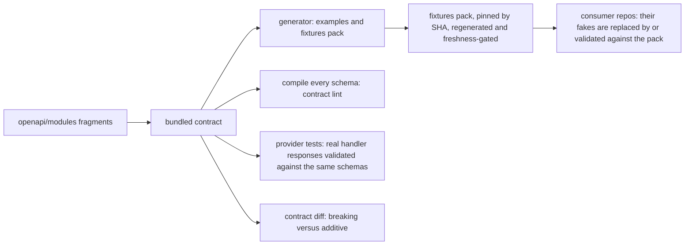
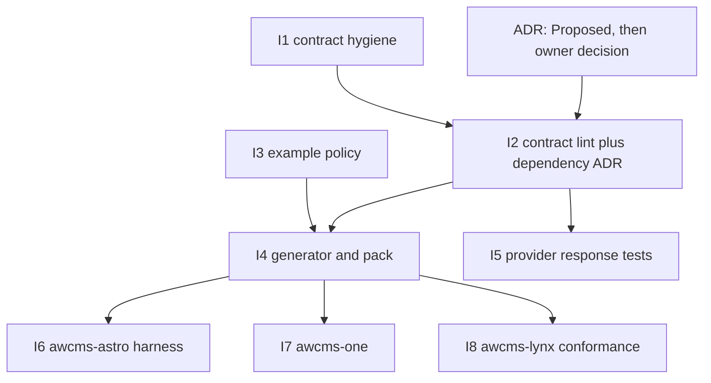

🇬🇧 English (source) · 🇮🇩 [Bahasa Indonesia](research-openapi-mock-and-two-way-contract-tests-2026-11-20.id.md)

# Research: OpenAPI-derived mocks and two-way contract tests — 20 November 2026

> **Status update (2026-11-20).** The owner chose option **C′** and the contract policy for new operations; both are recorded as [ADR-0167](../adr/0167-contract-derived-fixtures-and-two-sided-conformance-checks-with-an-in-repo-generator-and-ajv.md) (Accepted). The analysis below is kept as written when the research was done: wherever it says "proposal", "Recommendation" or "no ADR", read it as decided by ADR-0167. The follow-up candidates became backlog issues #1389 to #1395 under epic #1396 and wait for gate 9 and the Definition of Ready; none is implemented.

> **What this document is.** The research output of issue #1379. It evaluates
> tooling options for a mock **generated from the OpenAPI contract** and for
> provider-side and consumer-side contract checks, so that step 8 of the
> [development flow](alur-pengembangan.md) (a generated mock) and step 11.1
> (frontend against it) can be carried out. Everything marked **Recommendation**
> is a **proposal**. The decision is the owner's, through an ADR; this document itself files **no** ADR and nothing in it is
> `Accepted` (ADR-0167 is the decision; see the update above).
>
> **Scope guard.** No dependency, route, database object or spec change is made
> by this research. Tools were tried **outside the repo**, in a scratch
> directory, and the results are quoted with their limits. A mock is never
> evidence of runtime security (§6).

## 1. Baseline, method and non-duplication

| Item                | Value                                                                                                                                                                                                                                |
| ------------------- | ------------------------------------------------------------------------------------------------------------------------------------------------------------------------------------------------------------------------------------ |
| Repo and commit     | `ahliweb/awcms` `main` `765e52c7aca35e91a57ed24fc04a035176a32c95` (19 Nov 2026), re-checked on 20 Nov 2026                                                                                                                           |
| Consumers read      | `ahliweb/awcms-astro` `origin/main` `02c71f7fadd2fbb887baed5cada73238f4de4fee`; `ahliweb/awcms-one` `origin/main` `66b9985ad753d815ad8f85f6392487087f4a8e8f`; `ahliweb/awcms-lynx` `main` `2ffce1d072cd8c026017374d9163337fba973692` |
| Runtime of the work | Bun 1.4.4 on Linux x64                                                                                                                                                                                                               |
| Tool trials         | in a scratch directory outside the repo, `bun add --ignore-scripts`; versions pinned in §3; **not** in CI                                                                                                                            |
| Not done            | no CI run of any tool, no Prism, Pact, Schemathesis or Dredd run (reasons in §3), no live backend, no browser, no performance benchmark of a mock                                                                                    |

Status vocabulary (same as the companion audit): **VERIFIED** (read or
reproduced here), **ASSUMED**, **PLANNED**, **DEFERRED**.

**Relation to other work, so nothing is done twice.**

- The companion audit
  ([`audit-alur-v2-adr-0156-2026-11-20.md`](audit-alur-v2-adr-0156-2026-11-20.md), issue #1377, PR #1383) established the gap (M6 examples, M7 no generator, M9
  consumer fakes). This document does not repeat it; it chooses among ways to close
  M6, M7, M8 and M9.
- `ahliweb/awcms-lynx` published its own contract validation on 20 November 2026
  (`docs/contract-validation-2026-11.md`, read at the SHA above). Its follow-up R-1
  (a spec-conformance check of its client) **waits for this research** and says "do
  not build a second mock generator". Its finding F-05 is re-verified here as real
  drift (§2, R5). Its R-6 (contract entries for `feed.json` and the static
  indexes) is covered by #1379 only as far as "contract entries are needed"; the
  files are outside this repo's OpenAPI and stay `awcms-one`'s issue #547.
- Issue #1378 (Definition of Ready template) names the checks this research
  feeds; #1380 (staging clarification) is independent; #1185 (OMES worker
  contract consumer) is a **different contract** (worker protocol, not the public
  OpenAPI) and is reused here only as a pattern.

## 2. What the revalidation found

| ID  | Finding                                                                                                                                                                                                                                                                                                                                                                      | Status                               | Evidence                                                                                                                                                                                                                                                              |
| --- | ---------------------------------------------------------------------------------------------------------------------------------------------------------------------------------------------------------------------------------------------------------------------------------------------------------------------------------------------------------------------------- | ------------------------------------ | --------------------------------------------------------------------------------------------------------------------------------------------------------------------------------------------------------------------------------------------------------------------- |
| R1  | The gap still exists at HEAD: no mock or client generator is installed, and only **1 of 742** operations carries a response example; there is **no `204`** response anywhere and **no operation-level `x-` extension** (an operation's permission is not recorded in the contract)                                                                                           | VERIFIED                             | `package.json` has no msw, prism, openapi-typescript, orval, pact, schemathesis, dredd; bundle walk of `openapi/awcms-public-api.openapi.yaml` (method in the audit §6)                                                                                               |
| R2  | **A contract defect that a typed client exposes:** in `BookingPolicy.policy` the key `properties:` is empty and the field definitions are indented as siblings, so the schema declares no properties. `api:spec:check` passes anyway                                                                                                                                         | VERIFIED                             | `openapi/modules/booking.openapi.yaml` lines 4209–4210 at `765e52c7`; `openapi-typescript` emits `policy: Record<string, never>`; `ajv` refuses to compile it (`properties value must be ["object"]`); a scan finds this one occurrence of `properties: null`         |
| R3  | **`nullable: true` is used 869 times in components of a document that declares `openapi: 3.1.0`**, where `nullable` is no longer a keyword; **19 schema locations carry it without a `type`**, and these make **44 operations'** success schemas fail to compile in `ajv` 8.20.0 (2020-12 mode, non-strict)                                                                  | VERIFIED (trial)                     | scan and `ajv` compile, scratch directory, 20 Nov 2026: 688 of 734 operations with a JSON success schema compile; 46 fail (44 for this reason, 2 for R2)                                                                                                              |
| R4  | **A schema is only as strong as its `required` list.** 267 of 460 component object schemas declare no `required`; 106 set `additionalProperties: false`. Validating a generated example against the contract did **not** catch a renamed property on `Office` (it has no `required`), and did catch a retype, a new required property and a tightened `additionalProperties` | VERIFIED (trial)                     | §7 test vectors, run with `ajv` 8.20.0                                                                                                                                                                                                                                |
| R5  | **Real drift between spec and handler exists, and the gate does not see it.** `awcms-one` documents `account/otp/request` as `202`; the handler answers `ok(...)`, which is `200`. `api:spec:check` compares only the **set of path templates** to the route files, not methods, status codes or shapes                                                                      | VERIFIED                             | `awcms-one@66b9985a`: OpenAPI `"202"`, handler `request.ts` lines 146 and 174 call `ok(...)`; `awcms` `src/modules/_shared/api-response.ts:47-55` (`status: 200`); `scripts/api-spec-check.ts` `collectRouteParityProblems` (lines 775–801)                           |
| R6  | **Provider-side response-versus-schema tests exist for a handful of endpoints, each hand-rolled.** The office test's `validateAgainst` checks property presence and primitive types, ignores `required`, extra properties and nesting                                                                                                                                        | VERIFIED                             | `tests/openapi-office-response-schema-postgres.test.ts` (DB-gated); nine files read the bundle; at least two assert response shape (the office test and `tests/integration/menu-widget-response-shape.integration.test.ts`), and the rest were not inspected for this |
| R7  | **Consumers each carry a hand-written second specification.** `awcms-astro` answers from `pasangFetchTiruan`; `awcms-one` ships a 2263-line `apps/storefront/scripts/stub-awcms.mjs` reading committed fixtures; `awcms-lynx` pins behaviour with an injected fake `fetch` (119 client tests pass there)                                                                     | VERIFIED                             | `awcms-astro@02c71f7f` `tests/kontrak-awcms.test.mjs`; `awcms-one@66b9985a` `apps/storefront/scripts/stub-awcms.mjs`; `awcms-lynx` `docs/contract-validation-2026-11.md` §What the tests prove                                                                        |
| R8  | A conditional response shape defeats naive generation: `GET /api/v1/blog/posts` returns `BlogPostSummary` by default and `BlogPost` when `view=full`, expressed as `oneOf` inside the response                                                                                                                                                                               | VERIFIED                             | `openapi/modules/blog-content.openapi.yaml`; in the bundle 20 operations' success schemas need a `oneOf` choice                                                                                                                                                       |
| R9  | A **minimal generator is feasible on the existing `yaml` dependency**: of 734 operations with a JSON success schema, 685 produce an example with no judgement, 20 need a `oneOf` choice, 6 are cyclic or too deep, 2 hit the R2 defect                                                                                                                                       | VERIFIED (proof of concept, scratch) | proof of concept over the bundle, 20 Nov 2026; it checks that generation **completes**, and §7 validates samples with `ajv`; it is not a full validity proof                                                                                                          |

## 3. Options

Registry data is as read from the npm registry on 20 November 2026 (latest dist-tag; "direct deps" counts the package's own dependency list).

| Option                                                          | What it gives                                                                           | Evidence                                                                                                                                                                                                                                                                                 |
| --------------------------------------------------------------- | --------------------------------------------------------------------------------------- | ---------------------------------------------------------------------------------------------------------------------------------------------------------------------------------------------------------------------------------------------------------------------------------------- |
| **A1** `openapi-typescript` 7.13.0 (+ `openapi-fetch` 0.17.0)   | typed paths and schemas, optionally a typed fetch client; **no mock, no examples**      | MIT, 6 direct deps, last release 2026-02-11. **Ran under Bun 1.4.4** against the bundle: 52,171 lines in 0.77 s. Surfaces R2 in its output                                                                                                                                               |
| **A2** Prism (`@stoplight/prism-cli` 5.16.0)                    | a mock **server** that answers from the spec's examples                                 | Apache-2.0, 21 direct deps, `engines: node >=24.18.0`. **Not run**: this repo is Bun-only and forbids tooling that forces Node; it would also be starved by R1 (1 example)                                                                                                               |
| **A3** provider verification: Dredd 14.1.0, Schemathesis        | replay or fuzz the real server against the contract                                     | Dredd: MIT, **last release 2021-11-16**. Schemathesis is Python and outside the Bun toolchain; **not evaluated**. Both need a running backend, which the CI `integration-tests` job already provides only as a Postgres service                                                          |
| **B** Mock Service Worker 3.0.7 + fixtures                      | request interception in tests with hand or generated handlers                           | MIT, 12 direct deps, 3.4 MB unpacked, `engines: node >=22.12.0`. **One trial under Bun 1.4.4: interception did not work**: `Failed to replace a global value at "_wrapHandle": not a global value`, and the request went to real DNS. A single trial, not a verdict on every Bun version |
| **C** in-repo generator, **no new dependency**                  | a Bun script on the existing `yaml` that builds examples and fixtures from the contract | R9 proof of concept. Precedent for in-repo validators exists (R6) and is weak. Cost: a validator subset to write and keep correct                                                                                                                                                        |
| **C′** C plus **`ajv` 8.20.0** as the single new dev dependency | C, with schema validation done by a standard validator                                  | `ajv`: MIT, 4 direct deps, 1.0 MB unpacked, last release 2026-04-24. **Ran under Bun 1.4.4**: compiled 688 of 734 success schemas in 0.9 s; the 46 failures are contract defects (R2, R3)                                                                                                |
| **D** Pact (`@pact-foundation/pact` 17.1.4)                     | consumer-driven contracts shared with a broker                                          | MIT, 16 direct deps, `engines: node >=22`. **Not evaluated**: a different contract style (pact files, not the OpenAPI) and a second source of truth the flow says to avoid                                                                                                               |

### Criteria (only the ones that differ between options)

| Criterion                              | A1                   | A2                           | A3                      | B                              | C                               | C′                            |
| -------------------------------------- | -------------------- | ---------------------------- | ----------------------- | ------------------------------ | ------------------------------- | ----------------------------- |
| Mock derived from the contract         | no (types only)      | yes, but needs examples (R1) | n/a                     | only if handlers are generated | yes                             | yes                           |
| Catches provider drift (R5)            | partly (types)       | no                           | yes, with a live server | no                             | yes, if wired to responses      | yes, if wired to responses    |
| Catches consumer drift                 | yes, at compile time | no                           | no                      | no                             | yes                             | yes                           |
| Security and supply chain              | dev-only, 6 deps     | 21 deps, Node 24             | abandoned or off-stack  | 12 deps, 3.4 MB                | **none added**                  | one well-known dev dependency |
| Bun runtime and CI                     | works (trial)        | forced Node                  | needs a server          | **failed in trial**            | native                          | works (trial)                 |
| Maintenance and cost                   | low, regenerate      | medium                       | high                    | high (handlers)                | medium, owns a validator subset | low-medium                    |
| Compatibility with the Bun-only policy | yes                  | **no**                       | no                      | uncertain                      | yes                             | yes                           |

## 4. Recommendation (adopted by the owner as ADR-0167)

**C′ — an in-repo, Bun-native contract-conformance kit with `ajv` as its single
new dev dependency — and no mock server.** It is a proposal. The owner decides
through an ADR, and may prefer C (no dependency) at the cost of writing and
maintaining a validator.

Why this and not the others:

1. **The contract must stay the single source.** A hand-written mock is a second
   specification, which the flow forbids and which R7 shows three consumers
   already pay for. C′ reads the bundle and generates; it never restates it.
2. **It works on what this repo already runs.** Bun 1.4.4 ran `ajv` and the
   generator; Prism needs Node 24 and MSW did not intercept in the one trial.
3. **It finds defects the day it lands.** R2 and R3 are exactly what compiling
   every success schema with `ajv` reports: 46 operations. A gate is only worth
   adding if it can fail, and this one fails on today's contract, so it must first
   be paired with the fixes (candidate I1).
4. **Honest limit:** validation is only as strong as `required` (R4). C′ therefore
   needs a **contract-versus-contract diff** beside instance validation. The
   repo already has the former for the consumed slice (`api:consumer-contract`
   checks that the frozen snapshot stays a subset of the bundle and its negative
   cases go red on a rename, a retype and a removed `required` entry), and that
   mechanism does not depend on `required` being complete.
5. **A1 is a separate, later decision.** Typed clients are valuable to the
   consumers and it works under Bun, but it is a different problem (consumer
   compile-time safety) and adds a dev dependency per consumer. It should not be
   bundled into this ADR.

**What the owner decides:** C or C′ (or neither); whether examples become a
requirement for new operations (the companion audit's F3); whether the generated
fixtures are published as a pinned artifact for consumer repos.

### Shape of the proposal

The fixtures pack is **data, not a service**: consumer repos pin it by SHA and
never import this repo's code, which keeps them consumers and not owners of
domain logic.

## 5. Provider-side and consumer-side checks, kept apart

| Side         | Question                                                                          | Today                                                                                                   | Proposed                                                                                                                        |
| ------------ | --------------------------------------------------------------------------------- | ------------------------------------------------------------------------------------------------------- | ------------------------------------------------------------------------------------------------------------------------------- |
| **Provider** | Does the **real handler** answer what the contract says (status, shape, headers)? | path set only (`collectRouteParityProblems`); response shape for one or two endpoints, hand-rolled (R6) | validate real responses of the chosen endpoints against the bundle inside the DB-gated suite; declare-and-check the status code |
| **Provider** | Is the contract itself **well-formed**?                                           | `api:spec:check` structural rules; does not compile schemas (R2, R3 pass)                               | contract lint: compile every schema; fail on `properties: null`, `nullable` without `type`                                      |
| **Provider** | Did a change break a consumer?                                                    | `api:consumer-contract:check` for 15 paths                                                              | keep; extend by diff to any path a consumer adds (the list is already per consumer)                                             |
| **Consumer** | Does the consumer's **own fake** match the contract it claims to follow?          | no (R7)                                                                                                 | the fake is generated from, or validated against, the pinned fixtures pack                                                      |
| **Consumer** | Does the consumer call only what the contract has?                                | `awcms-astro` pins the **set of paths** called                                                          | unchanged; add shape validation of its fixtures                                                                                 |
| **Both**     | Is the status code declared and used?                                             | no (R5)                                                                                                 | covered by the provider check above                                                                                             |

### Consumer matrix

| Consumer                              | How it calls                                                                                                                  | Particulars the checks must respect                                                                                             | Owner repo    |
| ------------------------------------- | ----------------------------------------------------------------------------------------------------------------------------- | ------------------------------------------------------------------------------------------------------------------------------- | ------------- |
| `awcms-astro`                         | build-time static generation with a machine bearer (tenant derived from the token), plus a few anonymous reader-browser calls | SSG: the shape must be valid at **build** time, failures surface in a build; reader calls need CORS and `content-type` rules    | `awcms-astro` |
| `awcms-one` `apps/storefront`         | build-time static generation plus a hand-written stub server                                                                  | the stub is the second specification to retire; the storefront also uses static index files outside the contract (#547)         | `awcms-one`   |
| `awcms-lynx` clients                  | Bearer or customer token, native, desktop and Web profiles                                                                    | Web hits CORS limits (its F-03, F-04); the response envelope and correlation ID echo are behaviours the contract does not state | `awcms-lynx`  |
| API SYSTEM admin (this repo's own UI) | server-rendered Astro pages call application functions directly; only writes go to `/api/v1`                                  | the mock model fits writes and client islands, not SSR reads (flow §11.1, still open)                                           | `awcms`       |

The cross-cutting dimensions of the request were checked against the contract
and are recorded so they are not rediscovered: **envelope** `{success, data, meta}`
and `ApiError`; **auth** `bearerAuth` and `tenantHeader` (root `security`), with
39 explicitly public operations; **correlation ID** is a header parameter
component, but its echo is behaviour, not contract; **idempotency** `Idempotency-Key`
is declared on 225 operations, while replay semantics (for example `200` on replay
versus `201`) are not expressible as a response example; **pagination** is keyset
by `cursor` and `nextCursor`; **204** is declared nowhere; **versioning** is the
path prefix `/api/v1` and `info.version` is still `0.1.0`, so there is no recorded
policy for what counts as breaking.

## 6. Security and privacy matrix

**A mock is not evidence of runtime security.** It can show that a client copes
with a `403`; it cannot show that the server returns one.

| Concern                        | What a mock or generated fixture can show                                                                                                       | What only the real system shows                                                                                                                     | Where it is checked                                                                    |
| ------------------------------ | ----------------------------------------------------------------------------------------------------------------------------------------------- | --------------------------------------------------------------------------------------------------------------------------------------------------- | -------------------------------------------------------------------------------------- |
| RBAC and ABAC                  | that the client handles `401` and `403`                                                                                                         | that the permission is enforced; **permission is not in the contract** (R1, no operation-level `x-` extension), it lives in `module.ts` descriptors | `access:permissions:enforcement:check`, `access:chokepoint:check` (VERIFIED, audit §2) |
| FORCE RLS and tenant isolation | nothing                                                                                                                                         | cross-tenant reads and writes refused                                                                                                               | DB-gated integration suite and `security-readiness-*` tests in CI                      |
| PII minimisation               | fixtures can be **synthetic only**: reserved domains such as `example.test`, no real data                                                       | that responses carry no more personal data than the contract states                                                                                 | provider response validation with `additionalProperties: false` where it is a rule     |
| Anti-enumeration               | that the newsletter response is **neutral** by contract (`NewsletterNeutralResult`), so a derived mock cannot tell known from unknown addresses | that the server is neutral in timing and body                                                                                                       | existing endpoint tests; keep the mock neutral                                         |
| Error handling                 | `ApiError` envelope, no stack or internals in examples                                                                                          | what the server leaks under failure                                                                                                                 | `api:spec:check` already enforces that every 4xx and 5xx resolves to `ApiError`        |
| Supply chain                   | n/a                                                                                                                                             | a dev-only dependency still enters the lockfile                                                                                                     | `deps:audit:check`, `deps:license:check`, `deps:freshness`, one PR per dependency      |

## 7. Test plan, including negative examples

**Trial run, scratch directory, 20 November 2026, `ajv` 8.20.0 under Bun 1.4.4.**
An example for `GET /api/v1/offices` (`200`) was generated from the contract
itself, then validated against the contract and against five mutated copies (a
sixth planned vector, a new optional enum value, was a no-op in the trial and is
not reported; it remains to be run):

| Vector | Change to the contract copy                         | Kind         | Result                                                     |
| ------ | --------------------------------------------------- | ------------ | ---------------------------------------------------------- |
| TV-0   | none                                                | baseline     | PASS                                                       |
| TV-1   | a new optional property on `Office`                 | **additive** | PASS (correct: must not fail)                              |
| TV-2   | a property of `Office` renamed                      | breaking     | **PASS, not caught**: `Office` declares no `required` (R4) |
| TV-3   | a string property retyped to integer                | breaking     | FAIL, caught: `must be integer` at `/data/items/0/id`      |
| TV-4   | a new **required** property                         | breaking     | FAIL, caught: `must have required property 'zzReq'`        |
| TV-5   | `additionalProperties: false` with fewer properties | breaking     | FAIL, caught: `must NOT have additional properties`        |

TV-2 is the important one: **instance validation cannot catch what the contract
does not require**, which is why §4 pairs it with a contract diff and why a
`required`-completeness policy is part of the proposal (candidate I1).

Test plan for the three representative endpoints (§8), by layer:

| Layer | Test                                                                                                                                | Must go red when                                                                                                    |
| ----- | ----------------------------------------------------------------------------------------------------------------------------------- | ------------------------------------------------------------------------------------------------------------------- |
| L0    | contract lint: every success and error schema compiles                                                                              | `properties: null` (R2), `nullable` without `type` (R3) — **red today**, so it lands with its fixes                 |
| L1    | additive change (new optional field, new enum value, new optional parameter) **passes** both consumer and provider checks           | an additive change turns a check red (a false positive)                                                             |
| L2    | breaking change (rename, retype, removed `required`, removed path, narrowed enum) turns the **diff** and the **instance** check red | either goes green on a breaking mutation, shown by an in-repo mutation test as `api-consumer-contract.test.ts` does |
| L3    | a handler answers a status the contract does not declare (the R5 case) turns the provider check red                                 | `202` documented while `200` is returned stays green                                                                |
| L4    | consumer fakes validated against the pinned pack                                                                                    | a consumer fake keeps a field the contract removed                                                                  |
| L5    | the pack is **fresh**: regenerating produces no diff                                                                                | the contract changes and the pack is not regenerated                                                                |

## 8. Representative endpoints and fixture matrix

Chosen to cover the three consumer shapes and the status-code families asked
for. "Declared" means the contract states it today, so a **contract-derived**
mock can produce it.

| Endpoint                                                    | Why it represents                                                                                   | Declared responses           | Not declared, so not derivable today |
| ----------------------------------------------------------- | --------------------------------------------------------------------------------------------------- | ---------------------------- | ------------------------------------ |
| `GET /api/v1/blog/posts` (`blogListPosts`)                  | build-time SSG; keyset pagination; **conditional shape** by `view` (R8); machine bearer             | 200, 400, 401, 403           | 404, 409, 422, 429, 5xx              |
| `POST /api/v1/newsletter/subscribe` (`newsletterSubscribe`) | reader-browser write; anonymous (`security: []`); CORS; anti-enumeration                            | 200 (neutral), 400, 429      | 401, 403, 404, 409, 422, 5xx         |
| `PUT /api/v1/booking/policy` (`bookingPolicyPut`)           | SYSTEM admin write; `Idempotency-Key`; permission-gated; widest declared set; **carries defect R2** | 200, 400, 401, 403, 409, 422 | 404, 429, 5xx; replay semantics      |

Across the whole bundle the declared status codes are: 200 on 688 operations, 401
on 708, 403 on 687, 400 on 621, 404 on 379, 409 on 301, 422 on 95, 429 on 54, 503
on 97, 500 on 7, 502 on 5, and 204 on none. Fixtures for 429 and 5xx would
therefore need either a shared component or an explicit policy on which
operations declare them; that is a contract decision, not a tooling one.

## 9. Dependencies, Definition of Ready and follow-up candidates

Follow-ups are **candidates**. Issue #1379 says to cut them after gate 9, and the
internal cross-portfolio standard that governs this work allows no new
implementation issue before it. None is created here; none duplicates an open
issue (checked on 20 November 2026 against the open list, including #1185,
#1186, #1377 to #1380).

> **Update 2026-11-20:** these candidates are now backlog issues under epic #1396: I1 to I5 are #1389 to #1393; publishing the pinned pack is #1394; the new-operation policy check is #1395. I6 to I8 are done in the consumer repositories themselves. All wait for gate 9 and the Definition of Ready.

| Candidate | What                                                                                                                            | Size | Owner repo    | Depends on                                          |
| --------- | ------------------------------------------------------------------------------------------------------------------------------- | ---- | ------------- | --------------------------------------------------- |
| I1        | Fix contract hygiene: `BookingPolicy.policy.properties`, the 19 `nullable`-without-`type` locations; decide a `required` policy | S    | `awcms`       | none; a contract change, so step 8 and gate 9 apply |
| I2        | Contract lint gate (compile every schema) and, if C′, the `ajv` dev dependency                                                  | M    | `awcms`       | ADR (Proposed to Accepted), I1                      |
| I3        | Example policy and examples for the three representative operations                                                             | M    | `awcms`       | owner decision (audit F3)                           |
| I4        | Generator and the fixtures pack, with a freshness gate                                                                          | M    | `awcms`       | I2, I3                                              |
| I5        | Provider response-conformance tests for the three endpoints in the DB-gated suite, including the status-code check              | M    | `awcms`       | I2                                                  |
| I6        | Consumer harness: validate or replace the fakes with the pinned pack                                                            | S    | `awcms-astro` | I4                                                  |
| I7        | Align `account/otp/request` (`202` versus `200`) and retire the hand-written stub in favour of the pack                         | S    | `awcms-one`   | I4; record on its #547                              |
| I8        | Conformance of the persona client against the pinned pack (its R-1)                                                             | S    | `awcms-lynx`  | I4                                                  |

**Definition of Ready for each**, in the repo that owns it: the work is placed in
the flow; the contract path exists; the owner repo is named; per-resource
authorisation is stated; a test that fails on drift is described (§7); the
threat and privacy answers are updated (V5 of the Definition of Ready, issue
#1378). The ADR is a prerequisite of I2 and everything after it.

## 10. Decisions that waited for the owner

> **Resolved 2026-11-20 by ADR-0167:** item 1, C′. Item 2, yes, examples are required for new operations. Item 3, yes, the pack is published as a pinned artifact. Item 4, `required` is required and null is written `type: [X, "null"]` for new operations, old ones fixed gradually. Item 5, `429` is required when an endpoint is rate-limited; `5xx` is **not** decided and stays open.

1. C, C′ or neither (a new dev dependency decision under the dependency
   governance rules).
2. Whether examples become mandatory for new operations.
3. Whether the fixtures pack is published as a pinned artifact for consumers.
4. A `required` and `nullable` policy for the contract (I1).
5. Which of 429 and 5xx every operation must declare.

## Appendix A — draft ADR outline (filed as ADR-0167, Accepted)

> **Filed.** This outline became [ADR-0167](../adr/0167-contract-derived-fixtures-and-two-sided-conformance-checks-with-an-in-repo-generator-and-ajv.md), Accepted on 2026-11-20. The outline below is the draft as it stood; the ADR is authoritative and adds the contract policy for new operations.

- **Title:** Contract-derived fixtures and two-sided conformance checks for the public OpenAPI.
- **Status:** Proposed (draft); filed as Accepted in ADR-0167.
- **Context:** step 8 requires a mock generated from the contract; R1 to R9.
- **Decision (proposed):** an in-repo Bun script generates examples and a fixtures pack from the bundle; `ajv` (single dev dependency) validates schemas, provider responses and consumer fixtures; a contract diff classifies breaking and additive changes; no mock server.
- **Consequences:** contract defects surface at once (R2, R3) and must be fixed with the gate; example and `required` policies become contract-quality rules; consumers pin a pack instead of keeping a second specification; one more dev dependency to govern.
- **Alternatives:** A1 later and separately; A2 and A3 rejected (Node-bound, abandoned); B rejected for now (one failed Bun trial) and revisitable; C as the no-dependency fallback; D rejected (second source of truth).

## Appendix B — how the numbers were produced

All from a clean worktree of `765e52c7` plus, for trials, a scratch directory
outside the repo. Reproduce with: `bun add --ignore-scripts openapi-typescript@7.13.0 msw@3.0.7 ajv@8.20.0 ajv-formats yaml@2.9.1`;
`bun --bun node_modules/.bin/openapi-typescript <bundle> -o out.d.ts` (A1);
a script that registers the bundle with `ajv/dist/2020.js` (`strict: false`, id
`urn:awcms:bundle`) and compiles `#/paths/<path>/<method>/responses/<code>/content/application~1json/schema`
for every operation (R3, C′); and the `msw/node` `setupServer` call with one
`http.get` handler, then a `fetch` to it (B). The generator proof of concept
walks `$ref`, `allOf` and `oneOf`, honours `example`, `enum` and `const`, and
counts what it cannot handle (R9).

## Limits of this research

- Tool trials are single runs on one machine; the MSW result in particular is
  one trial and says nothing about other Bun or MSW versions.
- No tool was run in CI and none was added to the repo.
- The proof of concept checks that generation completes and that `ajv` accepts
  samples, not that every generated example is a faithful domain value.
- Prism, Pact, Schemathesis and Dredd were not run; their rows rest on registry
  metadata and repo policy, not on a trial.
- Nothing here is a claim of conformance to a standard; OpenAPI Initiative,
  OWASP API Security Top 10 and NIST SSDF are named only as sources of relevant
  controls.
- The numbers describe `765e52c7`; PRs #1381, #1382 and #1383 were open when this
  was written.
