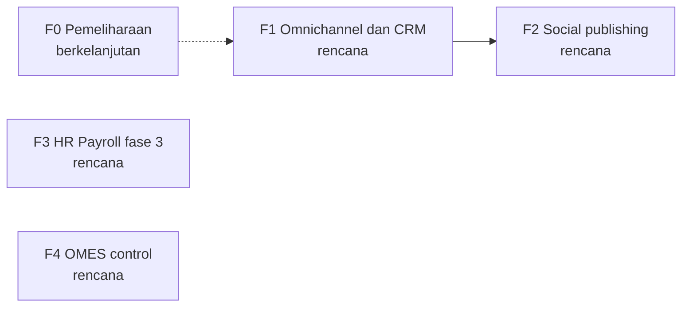

🇮🇩 Bahasa Indonesia · 🇬🇧 [English (source)](roadmap.md)

<!-- i18n-source-hash: sha256:4fd448ec857239a9bbaa26dc8de50ddbad0a2d25a3e0e48de87c18d357c3eded -->

# AWCMS — Roadmap

## Metadata

- Version: `v0.1.0`
- Last updated: `2026-11-08`
- Changeset: `Draf pertama roadmap di bawah standar roadmap dan issue lintas-portofolio internal (DL-041). Fase dikelompokkan dari issue terbuka dan ADR yang sudah diterima per 2026-11-08; urutan, status, dan kriteria keluar perlu konfirmasi pemilik.`

> **Draf menunggu konfirmasi pemilik.** Pengelompokan fase, penomoran, urutan, dan status di bawah ini diturunkan dari pembacaan issue terbuka, `docs/PROJECT_STATE.md`, dan ADR di `docs/adr/` pada 2026-11-08. Belum ada yang disepakati dengan pemilik. Setiap status ditandai **perlu konfirmasi pemilik**. Tidak ada tanggal, dan tidak boleh disimpulkan.

## Visi

AWCMS adalah system of record keluarga AWCMS: modular monolith yang memegang seluruh permukaan otorisasi, API, model data, dan layar admin SISTEM, dengan `ahliweb/awcms-astro` sebagai lapisan pengalaman publik dan admin USER ([ADR-0055](adr/0055-development-confined-to-awcms-and-awcms-astro.md), [ADR-0070](adr/0070-peran-keluarga-awcms-astro-memikul-publik-dan-admin-user.md)). Roadmap ini mengurutkan pekerjaan yang masih terbuka: pesan omnichannel dan CRM, publikasi sosial, penggajian, dan pengerasan operasional.

## Prinsip

- **Roadmap bukan janji tanggal.** Ia menyatakan urutan, tujuan, dan kriteria keluar. Tanggal, bila kelak ditambahkan, adalah sasaran indikatif yang boleh bergeser, dan pergeserannya dicatat.
- **Kriteria keluar menentukan "selesai"**, bukan daftar issue yang kosong.
- **Status hidup tinggal di GitHub**, bukan di berkas ini. Baca kemajuan dari milestone dan issue:

  ```bash
  gh api repos/ahliweb/awcms/milestones --jq '.[] | "\(.title): \(.closed_issues) selesai, \(.open_issues) terbuka"'
  ```

- **Roadmap tidak menggantikan gerbang 9.** Fase yang spesifikasinya belum lolos gerbang 9 pada [alur pengembangan](awcms/alur-pengembangan.md) tetap `rencana`; issue implementasi dibuat setelah gerbang lolos. Yang boleh lebih awal hanya `jenis:riset` dan spike yang ditandai.
- **Status** (hanya lima nilai): `rencana`, `berjalan`, `selesai`, `ditunda`, `dibatalkan`.
- Judul issue mengikuti `[Fase/SEQ] jenis: ringkasan`; pekerjaan di luar fase memakai `F0`. Label dan form dijelaskan di `CONTRIBUTING.md`. Issue lama mempertahankan judul conventional-commit; tidak ada penggantian nama massal.

## Fase

| Fase | Milestone                      | Tujuan                                                                                                        | Kriteria keluar                                                                                                                            | Status                                                                               | Issue                                                                                                                                                                                                                                                                                                                           |
| ---- | ------------------------------ | ------------------------------------------------------------------------------------------------------------- | ------------------------------------------------------------------------------------------------------------------------------------------ | ------------------------------------------------------------------------------------ | ------------------------------------------------------------------------------------------------------------------------------------------------------------------------------------------------------------------------------------------------------------------------------------------------------------------------------- |
| F1   | `F1 Omnichannel dan CRM`       | Kanal pesan pelanggan per tenant (WhatsApp, Telegram, email) mengalir ke satu percakapan dan pipeline prospek | Diusulkan pemilik; draf: setiap adapter yang diterima lolos audit keamanan, fail-closed per akun, dan dapat dioperasikan dari admin Astro  | `rencana` (perlu konfirmasi pemilik; sebagian mungkin sudah dibangun, lihat catatan) | WhatsApp #1142, #1143, #1231; Telegram #1156; email #1159 sampai #1162; inbox dan CRM #1164, #1165, #1166; intake situs #1153; realtime #1171; admin #1154. Diterima oleh [ADR-0148](adr/0148-omnichannel-foundation-is-five-gated-capabilities-with-fail-closed-per-account-capability.md), ADR-0150 sampai ADR-0155, ADR-0158 |
| F2   | `F2 Social publishing`         | Intent publikasi per akun, antrean, dan konektor per platform                                                 | Diusulkan pemilik; draf: setiap konektor platform dibatasi fase dan dikirim di balik kapabilitas akunnya sendiri                           | `rencana` (perlu konfirmasi pemilik)                                                 | #1145 sampai #1152, #1157. Diterima oleh [ADR-0157](adr/0157-social-publishing-is-an-account-scoped-publication-intent-and-per-account-job-module.md)                                                                                                                                                                           |
| F3   | `F3 HR Payroll fase 3`         | Kompensasi, run, slip gaji, dan rekening pembayaran penggajian, setelah DPIA terdokumentasi                   | Diusulkan pemilik; draf: DPIA selesai (#976), celah batas payroll yang tersisa tertutup (#1095), latihan backup dan restore selesai (#968) | `rencana` (perlu konfirmasi pemilik; #976 memblokir #957 menurut judulnya)           | #957 sampai #962, #976, #968, #1095. Diterima oleh [ADR-0132](adr/0132-hr-payroll-module-family-admission.md), [ADR-0136](adr/0136-configurable-payroll-segregation-of-duties-mode.md), [ADR-0137](adr/0137-payout-account-encryption-at-rest-and-keyed-hashing.md)                                                             |
| F4   | `F4 OMES control`              | Kontrak berversi dan ruang kerja admin baca-saja untuk pusat kendali OMES                                     | Diusulkan pemilik                                                                                                                          | `rencana` (perlu konfirmasi pemilik)                                                 | #1185, #1186. [ADR-0122](adr/0122-omes-control-center-domain-module-admission.md)                                                                                                                                                                                                                                               |
| F0   | tanpa milestone (pemeliharaan) | Kesegaran dependensi, tindak lanjut keamanan, dan perbaikan di luar fase                                      | Tidak berlaku; F0 tidak punya akhir                                                                                                        | berkelanjutan                                                                        | #1173, #1215; perbaikan baru                                                                                                                                                                                                                                                                                                    |

**Catatan F1 dan F2.** Pelacak masih memuat issue yang ADR dan sebagian kodenya sudah mendarat (misalnya ADR-0155, ADR-0157, dan ADR-0158 ada, dan changeset tertunda bernama #1142, #1145, dan #1153 ada di `.changeset/`). Keadaan tiap issue itu harus dicek ke kode sebelum triase; roadmap ini tidak mengklaim semuanya belum dibangun.

**Tidak dicakup di sini.** "Sprint Plan 1 sampai 12" di `docs/awcms/07_sprint_testing_production_readiness.md` dan milestone M0 sampai M8 di `docs/awcms/06_github_issues_detail.md` adalah target perencanaan tahap fondasi. Keduanya tidak dipelihara sebagai status dan roadmap ini tidak memakainya kembali.

## Ketergantungan antarfase



Panah hanya menunjukkan ketergantungan yang terlihat di ADR (modul social publishing memakai kembali model akun omnichannel ADR-0148). F3 dan F4 tidak bergantung pada F1 dan F2 sejauh sumber menunjukkan; pemilik mengonfirmasi.

## Ditunda dan dibatalkan

Belum ada fase yang ditunda atau dibatalkan. Entri ditambahkan di sini beserta alasan dan tanggalnya; tidak dihapus dari tabel.

## Tinjauan

Tinjau roadmap ini setiap kali sebuah milestone selesai, prioritas berubah, atau gerbang 9 menolak spesifikasi sebuah fase. Tinjauan memeriksa apakah kriteria keluar terpenuhi, apa yang bergeser dan mengapa, ke mana issue sisa dipindah, dan apakah fase berikutnya masih benar. Hasilnya satu entri Changelog dan kenaikan versi.

## Changelog

### 2026-11-08 - v0.1.0

- Draf pertama di bawah standar roadmap dan issue (DL-041). Empat fase dan F0 dikelompokkan dari issue terbuka dan ADR yang diterima; semua status perlu konfirmasi pemilik; tanpa tanggal.
