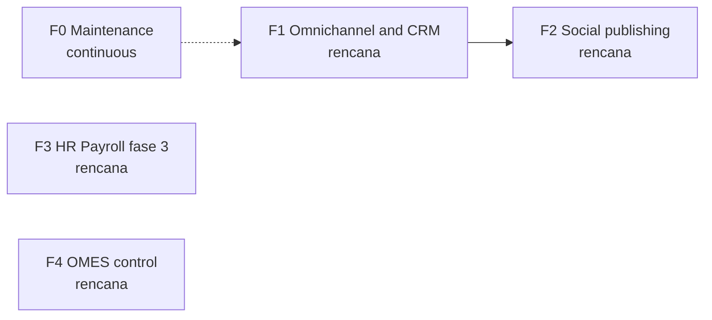

🇬🇧 English (source) · 🇮🇩 [Bahasa Indonesia](roadmap.id.md)

# AWCMS — Roadmap

## Metadata

- Version: `v0.1.0`
- Last updated: `2026-11-08`
- Changeset: `First roadmap draft under the internal cross-portfolio roadmap and issue standard (DL-041). Phases are grouped from the open issues and admitted ADRs on 2026-11-08; order, status and exit criteria need the owner's confirmation.`

> **Draft awaiting owner confirmation.** The phase grouping, numbering, order and status below were derived by reading the open issues, `docs/PROJECT_STATE.md` and the ADRs under `docs/adr/` on 2026-11-08. Nothing here was agreed with the owner yet. Every status is marked **needs owner confirmation**. No dates are given and none should be inferred.

## Vision

AWCMS is the system of record of the AWCMS family: the modular monolith that owns the whole authorization surface, the API, the data model and the SYSTEM admin screens, with `ahliweb/awcms-astro` as the public and USER-admin experience layer ([ADR-0055](adr/0055-development-confined-to-awcms-and-awcms-astro.md), [ADR-0070](adr/0070-peran-keluarga-awcms-astro-memikul-publik-dan-admin-user.md)). The roadmap orders the work that is still open: omnichannel messaging and CRM, social publishing, payroll, and operational hardening.

## Principles

- **A roadmap is not a promise of dates.** It states order, goal and exit criteria. A date, if one is ever added, is an indicative target that may move, and the move is recorded.
- **Exit criteria decide "done"**, not an empty issue list.
- **Live status lives on GitHub**, not in this file. Read progress from the milestones and issues:

  ```bash
  gh api repos/ahliweb/awcms/milestones --jq '.[] | "\(.title): \(.closed_issues) closed, \(.open_issues) open"'
  ```

- **The roadmap does not replace gate 9.** A phase whose specification has not passed gate 9 of the [development flow](awcms/alur-pengembangan.md) stays `rencana`; implementation issues are created after the gate. Only `jenis:riset` and marked spikes may come earlier.
- **Statuses** (only these five): `rencana`, `berjalan`, `selesai`, `ditunda`, `dibatalkan`.
- Issue titles follow `[Fase/SEQ] jenis: ringkasan`; work outside any phase uses `F0`. Labels and forms are described in `CONTRIBUTING.md`. Existing issues keep their conventional-commit titles; there is no mass rename.

## Phases

| Phase | Milestone                        | Goal                                                                                                          | Exit criteria                                                                                                                                         | Status                                                                            | Issues                                                                                                                                                                                                                                                                                                                  |
| ----- | -------------------------------- | ------------------------------------------------------------------------------------------------------------- | ----------------------------------------------------------------------------------------------------------------------------------------------------- | --------------------------------------------------------------------------------- | ----------------------------------------------------------------------------------------------------------------------------------------------------------------------------------------------------------------------------------------------------------------------------------------------------------------------- |
| F1    | `F1 Omnichannel dan CRM`         | Tenant-scoped customer messaging channels (WhatsApp, Telegram, email) feed one conversation and lead pipeline | To be proposed by the owner; draft: each admitted adapter passes its security audit, is fail-closed per account, and is operable from the Astro admin | `rencana` (needs owner confirmation; part of this may already be built, see note) | WhatsApp #1142, #1143, #1231; Telegram #1156; email #1159 to #1162; inbox and CRM #1164, #1165, #1166; website intake #1153; realtime #1171; admin #1154. Admitted by [ADR-0148](adr/0148-omnichannel-foundation-is-five-gated-capabilities-with-fail-closed-per-account-capability.md), ADR-0150 to ADR-0155, ADR-0158 |
| F2    | `F2 Social publishing`           | Account-scoped publishing intent, queue and per-platform connectors                                           | To be proposed by the owner; draft: each platform connector is phase-gated and ships behind its own account capability                                | `rencana` (needs owner confirmation)                                              | #1145 to #1152, #1157. Admitted by [ADR-0157](adr/0157-social-publishing-is-an-account-scoped-publication-intent-and-per-account-job-module.md)                                                                                                                                                                         |
| F3    | `F3 HR Payroll fase 3`           | Payroll compensation, runs, payslips and payout accounts, after a documented DPIA                             | To be proposed by the owner; draft: DPIA done (#976), residual payroll-boundary gaps closed (#1095), backup and restore drill done (#968)             | `rencana` (needs owner confirmation; #976 blocks #957 per its title)              | #957 to #962, #976, #968, #1095. Admitted by [ADR-0132](adr/0132-hr-payroll-module-family-admission.md), [ADR-0136](adr/0136-configurable-payroll-segregation-of-duties-mode.md), [ADR-0137](adr/0137-payout-account-encryption-at-rest-and-keyed-hashing.md)                                                           |
| F4    | `F4 OMES control`                | Versioned contract and read-only admin workspace for the OMES control center                                  | To be proposed by the owner                                                                                                                           | `rencana` (needs owner confirmation)                                              | #1185, #1186. [ADR-0122](adr/0122-omes-control-center-domain-module-admission.md)                                                                                                                                                                                                                                       |
| F0    | none (maintenance, no milestone) | Dependency freshness, security follow-ups and fixes outside a phase                                           | Not applicable; F0 has no exit                                                                                                                        | continuous                                                                        | #1173, #1215; new fixes                                                                                                                                                                                                                                                                                                 |

**Note on F1 and F2.** The tracker still lists issues whose ADRs and some code have landed (for example ADR-0155, ADR-0157 and ADR-0158 exist, and pending changesets named after #1142, #1145 and #1153 are in `.changeset/`). The state of each of those issues must be checked against the code before triage; this roadmap does not claim they are unbuilt.

**Not covered here.** The "Sprint Plan 1 to 12" in `docs/awcms/07_sprint_testing_production_readiness.md` and the milestones M0 to M8 in `docs/awcms/06_github_issues_detail.md` are earlier planning targets from the foundation stage. They are not maintained as status and this roadmap does not reuse them.

## Phase dependencies



The arrows show only the dependency that is visible in the ADRs (the social publishing module reuses the omnichannel account model of ADR-0148). F3 and F4 are independent of F1 and F2 as far as the sources show; the owner confirms.

## Postponed and cancelled

No phase is postponed or cancelled yet. Entries are added here with the reason and the date; they are not deleted from the table.

## Review

Review this roadmap whenever a milestone completes, priorities change, or gate 9 rejects the specification of a phase. The review checks whether the exit criteria are met, what moved and why, where the remaining issues go, and whether the next phase is still correct. The result is one Changelog entry and a version bump.

## Changelog

### 2026-11-08 - v0.1.0

- First draft under the roadmap and issue standard (DL-041). Four phases and F0 grouped from open issues and admitted ADRs; all statuses need owner confirmation; no dates.
